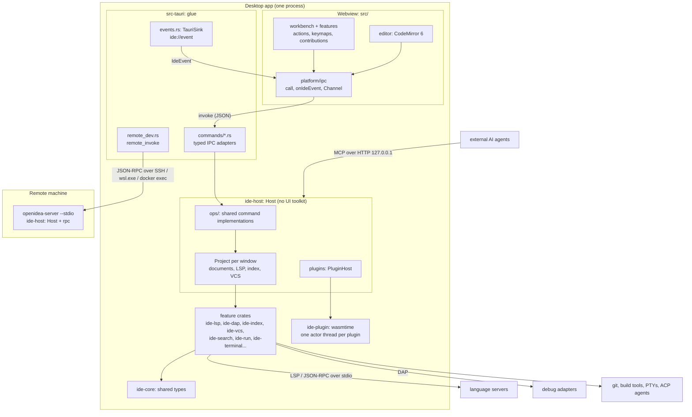

OpenIDEA is a Tauri 2 desktop app. The UI is a React + CodeMirror 6 frontend in the system webview; everything that touches the disk, processes or the network runs in Rust. The Rust side is built so that the same backend runs inside the desktop app and, for remote development, on another machine as `openidea-server`.

## The big picture

## Layers

| Layer              | Where             | Role                                                                                                                                                                                                                      |
| ------------------ | ----------------- | ------------------------------------------------------------------------------------------------------------------------------------------------------------------------------------------------------------------------- |
| Frontend           | `src/`            | Rendering, interaction and editor state. Features register actions, tool windows and editor extensions; they reach the backend only through the generated bindings. See [Frontend](/en/contribute/architecture/frontend). |
| Generated bindings | `src/bindings.ts` | Typed TypeScript for every command and IPC type, generated by tauri-specta. Never edited by hand. See [IPC](/en/contribute/architecture/ipc).                                                                             |
| Desktop shell      | `src-tauri/`      | Glue only: `AppState`, one `commands/<domain>.rs` per domain, the event sink, windows, menus, the remote-development client. No domain logic.                                                                             |
| Host               | `crates/ide-host` | The IDE backend without a UI toolkit: projects per window, settings, terminals, processes, trust, plugins, MCP, and `ops/` — the implementations that both the desktop commands and `openidea-server` call.               |
| Feature crates     | `crates/ide-*`    | One domain each (LSP, DAP, index, git, search, run, database…). They depend on `ide-core` and never on each other's internals. See [Crates](/en/contribute/architecture/crates).                                          |
| Shared vocabulary  | `crates/ide-core` | Ids, text coordinates, `IdeError`, `IdeEvent`, settings types — anything that crosses a crate or the IPC boundary.                                                                                                        |

## Processes

- **The app process** hosts the webview and the whole Rust backend (Tokio runtime plus blocking pools). There is one backend for all windows; each project window owns one `Project` in the host.
- **Language servers and debug adapters** are child processes, started lazily per language and workspace root from `languages/<id>.toml`. The backend speaks LSP / DAP to them (`ide-lsp`, `ide-dap` over `ide-jsonrpc`). See [Code intelligence](/en/contribute/architecture/code-intelligence).
- **Tools** are run through their CLIs where that keeps behaviour identical to the command line: `git` for writes (reads use gitoxide in-process), `docker`, `adb`, `gh`, Maven/Gradle, coding agents over ACP.
- **Plugins** run in-process as WebAssembly components, each on its own thread with its own sandboxed store. See [Plugin host](/en/contribute/architecture/plugin-host).
- **`openidea-server`** is the same `Host` with a JSON-RPC front instead of Tauri. The desktop starts it over SSH, WSL or `docker exec` and routes a remote window's commands to it. See [Remote development](/en/contribute/architecture/remote).
- **Local servers** for outside clients: the MCP server for AI agents (`ide-mcp`) and the built-in static web server (`ide-web`), both on `127.0.0.1`.

## How a request flows

Taking Find in Files as an example:

1. The search feature allocates a `RequestId`, creates a `Channel`, and calls `commands.searchStart(request, query, channel)` from `src/bindings.ts`.
2. Tauri dispatches to `search_start` in `src-tauri/src/commands/search.rs`, after the invoke handler has checked project trust.
3. The command forwards to `ide_host::ops::search::start`, which registers a `CancellationToken` for the request and runs the `ide-search` engine on a blocking thread.
4. Each file's matches are sent through the channel as they are found; the command resolves after sending `Done`.
5. If the user cancels, the UI calls `cancel_request(request)` and the token stops the walk.

The same `ops::search::start` serves a remote window: the frontend's `invoke` is routed to `remote_invoke`, the server runs the identical function, and channel values come back tagged with their channel id.

## Where to go next

<CardGroup cols={2}>
  <Card title="Rust or UI?" href="/en/contribute/architecture/boundaries">
    Which side a feature belongs on, with examples.
  </Card>
  <Card title="IPC" href="/en/contribute/architecture/ipc">
    Commands, errors, streaming, cancellation and events.
  </Card>
  <Card title="Crates" href="/en/contribute/architecture/crates">
    Every backend crate and what it owns.
  </Card>
  <Card title="Frontend" href="/en/contribute/architecture/frontend">
    Actions, keymaps, context keys and contributions.
  </Card>
</CardGroup>
