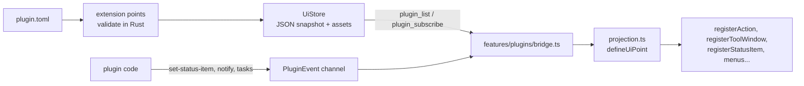

This page is about the host side, for contributors changing it. Plugin authors should start with the [plugin docs](/en/plugins/index); the authoritative reference for the API is [`plugins/README.md`](https://github.com/l0ng-ai/openidea/blob/main/plugins/README.md).

## Three crates

| Crate               | Role                                                                                                                                                                                                                                                                 |
| ------------------- | -------------------------------------------------------------------------------------------------------------------------------------------------------------------------------------------------------------------------------------------------------------------- |
| `ide-extension`     | The kernel, independent of the Wasm runtime: the `plugin.toml` manifest, `Capability` and its `Risk`, the `ExtensionPoint` trait and `ExtensionRegistry`, UI contributions (`UiStore`, `UiPoint`), the grant ledger, packages, signatures and the marketplace index. |
| `ide-plugin`        | The WebAssembly runtime: wasmtime with the component model and WASI preview 2, one `Store` per plugin, the `Actor` thread that owns it, limits, and the host side of the WIT interfaces.                                                                             |
| `ide-host::plugins` | The `PluginHost` that assembles them: sources, lifecycle, consent, the extension points owned by the host, editor providers, views, remote plugins.                                                                                                                  |

Dependency direction: `ide-core` ← `ide-extension` ← feature crates (their extension points) and `ide-plugin` ← `ide-host` (assembly). `src-tauri` only adapts `PluginHost` to the `plugin_*` Tauri commands.

The plugin host runs **where the project is**: in the desktop app for local projects, in `openidea-server` for remote ones.

## The interface

The API is defined in WIT, in `wit/` (package `openidea:plugin@1.7.0`). A plugin is a component targeting the `plugin` world (or `plugin-syntax`). The guest SDK `sdk/rust/openidea-plugin` wraps it in a typed Rust API and carries a copy of `wit/`; `crates/ide-plugin/tests/api_compat.rs` checks the copies are identical.

Released API versions are frozen. wasmtime resolves interface names by semver, but function types must match exactly, so a released 1.x only grows: new interfaces and new optional exports, never changed records or variants. See _Evolving the plugin API_ in `plugins/README.md` before touching `wit/`.

## Package lifecycle

Sources of packages: installed plugins (`<plugins_dir>/<id>/`), project plugins (`<project>/.openidea/plugins/*/`, loaded only for trusted projects), and folders linked with `openidea-plugin link` (`links.json`).

<Steps>
  <Step title="Prepare">
    The manifest is parsed and every declaration is validated by the extension point that owns it
    (`ExtensionRegistry::prepare`). No side effects.
  </Step>
  <Step title="Consent">
    The grant ledger decides whether the package may load. New plugins and project plugins wait for the user's consent;
    an update that asks for a new capability must be confirmed again.
  </Step>
  <Step title="Commit">
    Contributions take effect all or nothing (`ExtensionRegistry::commit`) and can be withdrawn per plugin.
  </Step>
  <Step title="Activate">
    Code is instantiated only when one of its activation events fires: `on-command`, `on-language`, `on-file`,
    `on-view`, `on-schedule`, `on-event`, or `on-startup-finished`.
  </Step>
</Steps>

Declarative contributions (menus, key bindings, status items, settings, themes, languages…) are live after commit, before any plugin code runs.

### Extension points

An extension point is implemented by the crate that owns the feature, so the kernel doesn't grow with every contribution type. For example `ide-language` implements the languages point (`plugin_point.rs`), and `ide-host::plugins` implements providers, run detectors, themes and navigation indexers. UI points (`ui.rs` in `ide-extension`, `ui_points.rs` in the host) validate menus, keymaps, status bar items, settings, views and custom editors completely in Rust.

## The runtime

### One actor per plugin

Each active plugin's runtime lives on its own `Actor` thread (`crates/ide-plugin/src/actor.rs`). Callers queue jobs and wait on a reply channel instead of holding a lock across the call, which gives three properties:

- an instance is entered by one job at a time, never concurrently;
- an edit-path caller (completion, line markers) can stop waiting at its soft deadline while the call runs on, and is interrupted at the hard deadline;
- any thread can cancel a call.

A parked thread per active plugin costs little, and idle plugins are reclaimed (after 300 s by default), ending the thread.

### Sandbox

Each plugin gets its own wasmtime `Store`: no preopened directories, no environment, no network, no inherited stdio — only clocks and randomness from WASI, plus the host functions. Every host function that reaches files, processes, the network or VCS writes checks a capability the user granted; a missing grant returns `denied` and the plugin keeps running. Path grants are resolved to real paths before comparison, and `process:` grants pin the program's absolute path and hash.

### Limits

Defaults from `Limits` in `crates/ide-plugin/src/types.rs`:

| Limit                                      | Default                                                           |
| ------------------------------------------ | ----------------------------------------------------------------- |
| Fuel per call                              | 5·10⁹ (≈ wasm instructions)                                       |
| Commands, events, activation, deactivation | 5 s wall clock                                                    |
| A call that began a task (`tasks.begin`)   | 60 s                                                              |
| Editor providers                           | 50 ms soft (a later result is dropped), 500 ms hard (interrupted) |
| Linear memory                              | 256 MiB                                                           |
| Restart backoff                            | 1 s, doubling per crash in a row                                  |
| Crashes before _Failed_                    | 3 in a row                                                        |
| Idle reclaim                               | 300 s                                                             |

Deadlines and cancellation are enforced by wasmtime epoch interruption: the store's epoch callback checks the per-call deadline and the cancel flag. A trap (panic, fuel or memory exhausted, timeout, permission violation, cancellation) poisons the instance; the actor drops it and the host's supervisor starts a fresh one the next time it is needed. A call that returns normally resets the crash count. Settings › Plugins shows activations, p95 call latency, crashes, late editor results and reclaims.

## How contributions reach the UI



- **Declarative UI** is validated completely in Rust and committed as JSON into the `UiStore`. The client receives the store's snapshot and projects each item onto an existing workbench `register*` function (`src/features/plugins/projection.ts`). A projection must not fail; if it throws, that item is logged and skipped, nothing is half-registered. Large payloads such as icon SVGs go into the store's assets and are fetched on demand.
- **Runtime UI** from running code (status item text, notifications, tasks, event subscriptions) arrives as `PluginEvent`s on the `plugin_subscribe` channel and is handled by `runtimeUi.tsx` and `bridge.ts`.
- **Views and custom editors** whose content plugin code renders are served by the `plugin_view_render` / `plugin_view_event` commands.
- **Web views** are pages shipped in the package. The client loads them in a sandboxed frame (an opaque origin with no network and no IDE API) from the `openidea-plugin` URL scheme (`src-tauri/src/plugin_web.rs`), with a CSP of their own; the page talks to the IDE only through the frame bridge.

Adding a UI contribution type means one Rust extension point plus one `defineUiPoint` in the client; the kernel (projection, store, bridge) isn't touched.

## Remote projects

When a window opens a remote project, the desktop sends its enabled code plugins and their grants to `openidea-server`, which runs them next to the files: file reads, process starts, fetches and diagnostics act on the remote machine, and `process:` programs are resolved and pinned there. Changes on the desktop (install, disable, grants) follow within a second. Secrets stay in the desktop's keychain; the server asks for one with the `plugin_secret` request. Project plugins don't run in remote projects yet.

## Testing the host

```sh
plugins/build.sh                         # rebuild the checked-in components
plugins/build.sh --check                 # what CI runs: nothing stale, everything builds
cargo test -p ide-host --test plugins
```

The host's integration tests (`crates/ide-host/tests/plugins.rs` and the other `plugin_*.rs` files) load the checked-in components of the official plugins and the fixtures in `crates/ide-plugin/tests/fixtures/`. Rebuild them after changing a plugin, the SDK or `wit/`. `pnpm perf:rust` includes plugin runtime benchmarks (`plugins/load_50`, `plugins/cold_activation`, `plugins/syntax_highlights_2k_lines`).
