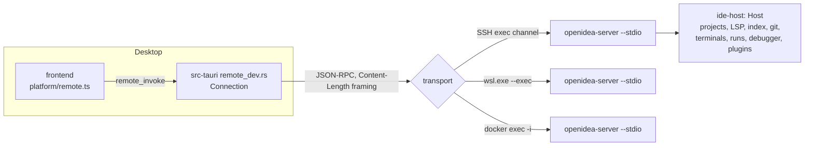

In remote development a window's project lives on another machine (an SSH host, a WSL distribution or a dev container). The UI stays on the desktop; the backend for that project — the same `ide-host` `Host` the desktop uses — runs on the remote machine as `openidea-server`. For using it, see [Remote development over SSH](/en/guide/remote/ssh).

<Note>
  Two crates have "remote" in their name but are different things. **Remote development** is `ide-host` (`rpc.rs`, the
  `openidea-server` binary) plus the client in `src-tauri/src/remote_dev.rs`. **`ide-remote`** is SFTP deployment and
  run targets (running a configuration over SSH or in Docker from a local project).
</Note>

## Pieces



| Piece                             | Where                                                                         |
| --------------------------------- | ----------------------------------------------------------------------------- |
| Server binary                     | `crates/ide-host/src/bin/server.rs` (`openidea-server`)                       |
| Protocol and dispatcher           | `crates/ide-host/src/rpc.rs`                                                  |
| Client: connect, install, forward | `src-tauri/src/remote_dev.rs`                                                 |
| WSL and dev container transports  | `src-tauri/src/remote_wsl.rs`, `src-tauri/src/remote_container.rs`            |
| Port relay inside a container     | `crates/ide-host/src/relay.rs` (`openidea-server --connect`)                  |
| Frontend routing                  | `src/platform/remote.ts`, hooked into `invoke` by `src/platform/tauriCore.ts` |
| UI (File › Remote Development…)   | `src/features/remote-dev/`                                                    |

## The server

```text
openidea-server --stdio | --connect <host> <port> | --version
```

- `--stdio` serves one desktop client over stdin/stdout. stdout carries the protocol, so logs go to stderr (filter with `OPENIDEA_LOG`).
- Its state lives under `OPENIDEA_SERVER_HOME` (default `~/.openidea`), in `config/` and `data/`. Language definitions can be added in `config/languages/`.
- An SSH exec channel gets a minimal environment, so on every start the server takes the login shell's environment and adds the IDE-managed tools directory to `PATH`.
- `--version` prints the app version and the protocol version.

### Installing it on the remote machine

The desktop picks the server binary for the remote OS and architecture (from `uname -sm`): `OPENIDEA_SERVER_BINARY` if set, then `<data dir>/server/<os>-<arch>/openidea-server`, then the one next to the app when the platforms match; otherwise it downloads the release build for that platform once into its data dir. It uploads the binary into `~/.openidea/server/` on the remote host, one folder per version, keyed by a content hash, and removes other builds of that version. CI keeps a static Linux (musl) build working.

## The protocol

JSON-RPC 2.0 with `Content-Length` framing (`ide-jsonrpc`), over the server's stdio:

| Message                 | Direction       | Payload                                                                                                                                              |
| ----------------------- | --------------- | ---------------------------------------------------------------------------------------------------------------------------------------------------- |
| request `initialize`    | client → server | `{ version }` → `ServerInfo { version, protocol, os, arch, home }`                                                                                   |
| request `commands`      | client → server | the names of the commands the server answers                                                                                                         |
| request `invoke`        | client → server | `{ window, cmd, args }` → the command's result. `args` as the desktop command takes them (camelCase); a streaming argument is `{ "$channel": <id> }` |
| notification `event`    | server → client | `{ window, event }`: an `IdeEvent` for that window, or for every window when `window` is null                                                        |
| notification `channel`  | server → client | `{ id, data }`: one value of a streaming argument                                                                                                    |
| notification `plugin`   | server → client | `{ window, event }` from code plugins of the remote project                                                                                          |
| request `plugin_secret` | server → client | `{ plugin, name }` → `string` or `null`: a secret from the desktop's keychain                                                                        |

The protocol version is `PROTOCOL_VERSION` in `rpc.rs`. Errors are `IdeError`s carried as JSON in the JSON-RPC error message, so the frontend sees the same `kind` / `message` as for a local command.

## Routing commands

The frontend doesn't know whether a window is remote. Features call `commands.*` as usual; the routing happens below the generated bindings:

1. `src/platform/tauriCore.ts` is what `@tauri-apps/api/core` resolves to (a Vite alias). Its `invoke` asks the installed route first.
2. In a remote window, `src/platform/remote.ts` installs a route that sends the commands listed in the session's `commands` to `remote_invoke`, and runs everything else locally.
3. `remote_invoke` replaces each `Channel` argument with `{ "$channel": id }`, forwards the call as an `invoke` request, and delivers `channel` notifications back to the right `Channel`. `event` notifications are re-emitted to the window through the normal event sink.

A few commands are always local even if the server knows them: `open_project` and `close_project` (opening a local folder leaves the remote one; closing drops the connection), system font listing, and client UI settings. Client settings (keymap, appearance, editor fonts and colours…) are listed in `src/platform/clientSettings.ts`; a global tooling setting is applied on both sides.

### What runs where

| On the remote machine                                    | On the desktop                       |
| -------------------------------------------------------- | ------------------------------------ |
| The project: files, documents, settings                  | Windows, menus, the webview          |
| Language servers, index, search                          | Client UI settings, keymaps, themes  |
| Git, terminals, runs, debug adapters                     | The SSH connection and port forwards |
| Code plugins of the project, their processes and fetches | Plugin secrets (keychain)            |

## Port forwarding

Forwarded ports go through the SSH connection. In a dev container, each connection to a forwarded port runs `openidea-server --connect localhost <port>` inside the container (via `docker exec`) and pipes the connection through its stdin/stdout, so the container's network is reachable the same way on every Docker setup.

## Trust

Restricted mode works the same in remote windows: before forwarding a command that isn't on the restricted-mode allowlist, the desktop asks the server whether the remote project is trusted, and the server authorizes every `invoke` again with `Host::authorize_command`. For a dev container of a folder the user already trusts, the desktop starts the server with that project folder marked trusted (`OPENIDEA_TRUSTED_ROOT`, never persisted).

The WSL and container transports run programs with arguments directly (`wsl.exe --exec`, `docker exec`); only fixed scripts reach `sh -c`, and every variable value is passed as a positional argument.

## Making a command work remotely

1. Implement it in `ide-host::ops::<domain>`, taking `&Host` and the window label, not Tauri types.
2. Register it with the server's `Dispatcher` (`d.add("name", |c| async move { ... })` in `rpc.rs` or the `ops` module), reading arguments with `c.arg("…")`.
3. Keep the desktop command a thin adapter over the same function.

If a command is not registered with the dispatcher, a remote window runs it locally — which is wrong for anything that touches the project.

## Testing

- `crates/ide-host/tests/rpc.rs`, `remote_env.rs`, `remote_plugins.rs`: the protocol and server behaviour.
- `smoke/server.ts` starts a real `openidea-server --stdio` and speaks the protocol to it; `smoke/desktop.ts` gives the frontend's modules a Tauri runtime whose commands go to that server through the remote-development route. The run and debug smoke tests use it (see [Smoke tests](/en/contribute/testing/smoke)).
