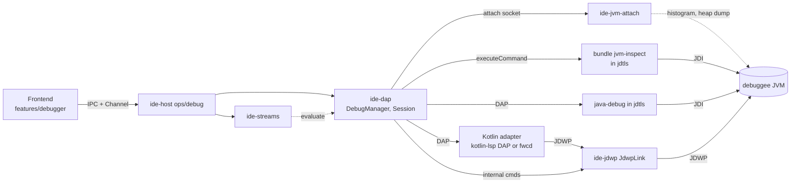

# Debugger JVM: Memory view, Coroutine view và Stream Debugger (bản 2)

Ngày: 2026-11-07 · Cơ sở code: `verify/swipe-integration` (trên `main` sau v0.1.38) · Trạng thái: **chờ duyệt, chưa viết code sản phẩm**

Bản 2 thay bản 1 sau bảy bài nghiên cứu độc lập (A–F, mục 2). Quy ước: **[XM]** = đã xác minh bằng chạy thật hoặc đọc nguồn gốc. **[SL]** = suy luận, chưa kiểm chứng. Mã thử nghiệm nằm ngoài repo.

## 0. Tóm tắt và cái gì đổi so với bản 1

Mục tiêu không đổi: đưa ba tính năng debug JVM của IntelliJ vào OpenIDEA, và làm tốt hơn chỗ IntelliJ làm chưa tốt. Kiến trúc đổi nhiều:

| Chủ đề                           | Bản 1                                                    | Bản 2                                                                                                                                                                                                                  | Lý do                                                                              |
| -------------------------------- | -------------------------------------------------------- | ---------------------------------------------------------------------------------------------------------------------------------------------------------------------------------------------------------------------- | ---------------------------------------------------------------------------------- |
| Bảng class của Memory view       | JDWP `InstanceCounts` chia lô                            | **Attach socket `GC.class_histogram -all`**                                                                                                                                                                            | 40–60 ms so với 4–8 s trên 10M object, có thêm shallow bytes (A, E)                |
| Truy cập instance/field cho Java | Relay, app tự chạy JVM, java-debug attach qua relay      | **Bundle jdtls `jvm-inspect` dùng JDI của java-debug**, không đổi launch                                                                                                                                               | Bundle chạm được VM thật ở cả launch và attach (D)                                 |
| Relay JDWP                       | Mọi phiên                                                | **Chỉ Kotlin** (JVM do app chạy)                                                                                                                                                                                       | Java không cần                                                                     |
| Coroutine                        | Gọi `dumpCoroutinesInfoAsJson…` qua invoke               | **Chỉ đọc field, không invoke; không cần agent làm điều kiện**                                                                                                                                                         | Invoke treo phiên trên 1.5/1.6, JSON thiếu field (B)                               |
| Stream trace                     | `peek` ghi `String.valueOf` vào `System.getProperties()` | **Ghi tham chiếu thật vào một `ArrayList`, resolver theo thời gian + danh tính**, tắt breakpoint khi trace                                                                                                             | Chuỗi mất danh tính, sai tới 19%; breakpoint ở thread khác làm treo phiên (C1, C2) |
| Retained size, GC root           | Ngoài phạm vi                                            | **Có trong lộ trình (M4)**: heap dump + parser Rust                                                                                                                                                                    | ~5 s trên 20M object (E). Agent JetBrains là Apache-2.0, nhưng chậm                |
| Adapter Kotlin                   | fwcd                                                     | kotlin-lsp DAP đạt K0 về kỹ thuật (launch, relay + gói chèn, async stack, step qua `delay`); chủ repo đã chấp nhận rủi ro giấy phép (2026-11-07; chi tiết ở K0 §4): kotlin-lsp DAP là debugger chính, fwcd là dự phòng | fwcd gần như bỏ hoang, evaluate là stub (F)                                        |
| Hồi quy launch Java (R1)         | Rủi ro cao nhất                                          | **Không còn**                                                                                                                                                                                                          | Không đổi launch                                                                   |

## 1. Mục tiêu, không phải mục tiêu, anti-goals

**Mục tiêu**

- **Memory view:** bảng class (số instance, shallow bytes, chênh lệch so với lần dừng trước, lọc), danh sách instance, referrer một bước. Sau đó: retained size, đường tới GC root, so sánh snapshot, và allocation bằng profiler.
- **Coroutine view:** cây coroutine theo trạng thái và job cha, stack tạm dừng, stack lúc tạo khi có agent, nhảy tới source, sao chép dump.
- **Stream Debugger:** chế độ Flat và Split, ánh xạ phần tử giữa các bước, kết quả cuối, cảnh báo rõ khi chuỗi không trace được hoặc trace không đầy đủ.
- Chạy cả khi IDE ở chế độ remote development (`ide-host` / `openidea-server`), có test tự động ở mọi tầng.

**Không phải mục tiêu (v1)**

- Android (ART), JVM không có `canGetInstanceInfo`.
- OpenJ9 cho phần heap dump (định dạng PHD không có GC root).
- Stream Debugger cho Kotlin `Sequence`, Python, JS; chỉ Java `Stream`/`IntStream`/`LongStream`/`DoubleStream`.

**Anti-goals**

- Làm hỏng phiên debug thường dùng: adapter chết, breakpoint chạy khác, hoặc **JVM của người dùng abort** (mục 6).
- Sao chép mã của JetBrains. IntelliJ chỉ để hiểu kiến trúc. Mã của ta viết lại từ đặc tả JDWP/JVMTI, mã nguồn OpenJDK và `kotlinx-coroutines` (Apache-2.0). Agent `debugger-memory-agent` của JetBrains là Apache-2.0 nhưng ta không phụ thuộc vào nó.

## 2. Bằng chứng

Sáu thí nghiệm của tôi và bảy bài nghiên cứu (agent Opus). Thư mục thí nghiệm: `scratchpad/research-{A..F}`.

| #    | Câu hỏi                                                                         | Kết quả                                                                                                |
| ---- | ------------------------------------------------------------------------------- | ------------------------------------------------------------------------------------------------------ |
| S1   | `evaluate` của fwcd gọi được hàm?                                               | **Không [XM]**: chỉ tra tên biến, mọi biểu thức khác trả `unknown`                                     |
| S2   | Relay chèn gói JDWP riêng khi fwcd là client?                                   | **Được [XM]**: `InstanceCounts`, `Instances`, `InvokeMethod`; fwcd vẫn bình thường                     |
| S3–4 | `evaluate` java-debug chạy stream + lambda; `peek` ghi log trong một biểu thức? | **Được, có giới hạn [XM]**                                                                             |
| S5   | `evaluate` có dừng ở breakpoint người dùng?                                     | **Không dừng ở cùng thread [XM]** (nhưng xem C2 về thread khác)                                        |
| S6   | Static không qualify trong lambda?                                              | **Lỗi JDT ở frame static [XM]**                                                                        |
| A    | Cách tốt nhất lấy dữ liệu heap                                                  | Attach histogram nhanh hơn JDWP ~100 lần; JDWP có bẫy refcount (mục 6). 7 thí nghiệm trên JDK 11/21/25 |
| B    | Coroutine                                                                       | Không invoke; đọc field; 1.5.2–1.11.0                                                                  |
| C1   | Ngữ nghĩa stream và IntelliJ                                                    | IntelliJ đã chuyển sang trace lần chạy thật; property test 20.000 chuỗi                                |
| C2   | Ma trận khả năng `evaluate` JDT                                                 | Nhiều lỗ; treo cả phiên khi chờ thread bị breakpoint                                                   |
| D    | Mở rộng java-debug                                                              | Bundle chạm JDI qua `JdtVirtualMachineManagerProvider`                                                 |
| E    | Phân tích heap                                                                  | hprof + dominator Rust ~4–5 s; agent JetBrains mở nhưng chậm                                           |
| F    | Adapter Kotlin                                                                  | fwcd bỏ hoang; kotlin-lsp có DAP                                                                       |

| S7 | Attach lúc dừng ở breakpoint, listener bật bằng `-XX:+StartAttachListener`, không `SIGQUIT` | **[XM]** socket có ngay khi khởi động trên 8/11/17/21/25. Histogram `-all` khi dừng: 17 → 32 ms, 21 → 34 ms, 25 → 32 ms; **8 và 11 treo** (timeout 15 s, kể cả `VM.version`). Khi VM dừng lúc khởi động (`suspend=y`, chưa ai nối) `VM.version` trả lời trên mọi bản (5–16 ms). JDK 8 nhận `-all`. Mã: `scratchpad/m1-spike` |
| S8 | JVM do Gradle/Maven sinh ra (debug qua JDWP attach): có socket không, và tìm pid bằng cách nào | **[XM]** Đặt `-XX:+StartAttachListener` cạnh agent JDWP trong init script Gradle: JVM của task có `.java_pid` ngay khi chờ debugger. JVM đó là con của **Gradle daemon**, không nằm dưới tiến trình `gradle` mà app chạy, nên không tìm được theo cây tiến trình. Lệnh attach `agentProperties` (không phải `VM.system_properties`) trả `sun.jdwp.listenerAddress=dt_socket\:<port>`, đúng cổng JDWP in ra, trên 8/11/17/21/25 (16–98 ms, VM đang `suspend=y` lúc khởi động). Quét mọi socket `.java_pid*` của user: 51 ms. Mã: `scratchpad/m1-spike/gradle_spike.py`, `agentprops_versions.py` |
| G1 (M2) | Reflection tới VM của java-debug với bản app cài hôm nay; ánh xạ phiên → VM | **[XM]** vscode-java-debug 0.60.0 (plugin 0.53.2) + JDT LS 1.63.0 chạy được. Launch khớp theo pid; attach khớp theo cổng đầu xa của socket JDWP. Danh sách thread **không** dùng được: hai JVM cùng chương trình trùng id và tên thread |
| G2 (M2) | JVM đếm ObjectID theo từng lần xuất hiện trong reply? Dispose ReferenceTypeID? | **[XM 8/11/17/21/25]** Đếm từng lần, kể cả hai lần trong một reply; link dispose đúng phần mình thì object của adapter vẫn sống. Dispose ReferenceTypeID không làm nó hết hiệu lực → không dispose |
| H1 (M4) | `GC.heap_dump` qua attach khi VM dừng ở breakpoint | **[XM]** Chạy trên 17/21/23/25 (270k object 14–21 ms; 20M 0,41 s; 4,3 GB 2,4 s), phiên debug sống. JDK 11 timeout, dump chỉ được ghi sau resume. Đang chạy: 8 và 11 đều được |
| H2 (M4) | Lỗi khi VM đang dừng có treo listener? | **[XM]** Chỉ lỗi tham số (`-parallel` trên 17/21, `-bogus` trên 25) làm treo, lệnh xếp sau chỉ chạy sau resume. Lỗi file trả về bình thường; đường dẫn có dấu cách trong ngoặc kép chạy được |
| H3 (M4) | Bộ nhớ và thời gian của biểu diễn gọn | **[XM]** 58 B/object; 20M object 1,98 s, đỉnh 1,5 GB RAM hoặc 0,27 GB ẩn danh khi mảng mmap; 100M object 19,3 s |
| H4 (M4) | Shallow size đúng được không | **[XM]** Histogram cùng lần dừng đúng cho mọi class không phải mảng; mảng theo `VM.flags`; `.hprof` ngoài: khoảng cách địa chỉ nhỏ nhất khớp 100% class trên G1/Parallel, 86% trên ZGC |
| G3 (M2) | `InstanceCounts` một lần khi dừng; timeout ~3 s của Eclipse JDI | **[XM]** 10M object: JDK 8 1,3 s, 11 0,8 s, 21 5–8 s (ở timeout mặc định cả lệnh đếm lẫn `evaluate` của java-debug hỏng; `setRequestTimeout` 60 s sửa được). `executeCommand` dài không chặn jdtls (hover 5 ms) |
| K0 | kotlin-lsp DAP qua relay + gói chèn; launch; giấy phép | **Kỹ thuật đạt [XM]**: 22 phiên chèn, 161 lần chèn, 0 lỗi do relay; giấy phép mơ hồ (xem K0 §4), chủ repo đã chấp nhận rủi ro (2026-11-07) |
| P (M5) | async-profiler `event=alloc[,live]`: định dạng, độ chính xác, khi nào ghi file, phiên debug | **[XM]** lá `<kiểu>_[i]`; `total` ±11 % ở site lớn; không nhiều sự kiện ngoài JFR; `live` cần 11+ và GC trước dump; có file khi SIGINT/SIGTERM, không khi SIGKILL/`VirtualMachine.Exit`; dump khi đang dừng treo. Mã: `scratchpad/m5-spike` |
| K1 | kotlin-lsp DAP điều khiển như ide-dap (adapterID, invalidated, step, thread id, vòng đời, tín hiệu import) | **[XM]** trúng breakpoint và step qua relay không giữ gói sau khi đổi adapterID sang `intellij_jvm`; tín hiệu import `intellij/workspaceImportState`; xem plan K1 Grounding. Mã: `scratchpad/k1-spike` |

**Chưa kiểm chứng [SL]** (mỗi mục có thí nghiệm ở mục 15): Windows; JDK 12–16 khi attach lúc dừng (coi như 11); heap thật 4–8 GB; ECJ trên JRE-only.

## 3. Kiến trúc

### 3.1 Crate và thành phần mới

| Thành phần         | Trách nhiệm                                                                                                                                                                                               | Phụ thuộc                                               |
| ------------------ | --------------------------------------------------------------------------------------------------------------------------------------------------------------------------------------------------------- | ------------------------------------------------------- |
| `ide-jvm-attach`   | Client attach HotSpot bằng Rust thuần: tìm pid/socket, gửi lệnh `GC.class_histogram`, `GC.heap_dump`, `VM.version`. Unix trước, Windows qua `jcmd` rồi stub sau                                           | `ide-core`                                              |
| `ide-jvm-inspect`  | Trait `JvmInspector` (classes, instances, referrers, fields, arrays, strings) và các bộ giải mã dùng chung: diff histogram, dựng cây coroutine, parser `@DebugMetadata` từ `.class`. Không IO tới adapter | `ide-core`                                              |
| `ide-jdwp`         | Codec JDWP và `JdwpLink` (relay) cho Kotlin, cài `JvmInspector` bằng JDWP                                                                                                                                 | `ide-core`, `ide-jvm-inspect`                           |
| `java/jvm-inspect` | Bundle jdtls (mẫu `java/java-usages`), cài `JvmInspector` bằng JDI. Phía Rust gọi qua `workspace/executeCommand` (cạnh `crates/ide-lsp/src/jdtls/hierarchy.rs`)                                           | embed bằng `include_bytes!` như bundle hiện có          |
| `ide-streams`      | Tìm chuỗi (tree-sitter-java qua `ide-syntax`), chuẩn hoá, sinh biểu thức, giải mã log, resolver                                                                                                           | `ide-core`, `ide-syntax` (`with_tree`), `tree-sitter`   |
| `ide-heap` (M4)    | Parser hprof streaming, dominator tree, retained size, đường tới GC root, chỉ mục trên đĩa, registry snapshot, so sánh theo class                                                                         | `ide-core`, `memmap2`                                   |
| `ide-dap`          | Sở hữu backend theo phiên, chọn nguồn dữ liệu, capabilities, API cho `ide-host`                                                                                                                           | các crate trên (gồm `ide-heap` để ước lượng dung lượng) |

Theo `CLAUDE.md`, mỗi crate một domain; `src-tauri` chỉ có wrapper mỏng.

## 4. Mỗi câu hỏi lấy dữ liệu từ đâu

| Cần                          | Nguồn chính                                                                                                                                                   | Đo được                                                                                                                                                  | Điều kiện / dự phòng                                                                                                                                                                                                                                                                                                                |
| ---------------------------- | ------------------------------------------------------------------------------------------------------------------------------------------------------------- | -------------------------------------------------------------------------------------------------------------------------------------------------------- | ----------------------------------------------------------------------------------------------------------------------------------------------------------------------------------------------------------------------------------------------------------------------------------------------------------------------------------- |
| Bảng class (số lượng, bytes) | Attach `GC.class_histogram -all`                                                                                                                              | 40–60 ms (10M object, G1/ZGC); 316 ms Shenandoah                                                                                                         | Cùng máy, HotSpot, listener sẵn sàng. JDK 11 treo khi dừng, JVM từ xa, Windows → dự phòng: JDWP `InstanceCounts` **một lần, không chia lô**, chỉ khi phiên đang dừng, kèm cảnh báo thời gian; đo 10M object: JDK 8 1,3 s, JDK 11 0,8 s, JDK 21 5–8 s **[XM, M2 G3]**; không có shallow size; chênh lệch chỉ với baseline cùng nguồn |
| Danh sách instance           | `Instances(max ≤ 1000)` qua JDI (Java) hoặc JdwpLink (Kotlin)                                                                                                 | 3–35 ms                                                                                                                                                  | Cần `canGetInstanceInfo`                                                                                                                                                                                                                                                                                                            |
| Referrer một bước            | `ReferringObjects`                                                                                                                                            | ~0,9–1 s mỗi lần (20M object, duyệt cả heap)                                                                                                             | Không gọi lặp để lần ngược                                                                                                                                                                                                                                                                                                          |
| Coroutine                    | Đọc field qua `JvmInspector`                                                                                                                                  | 15–22 ms (registry agent); 90–550 ms (quét heap, heap nhỏ)                                                                                               | Không invoke                                                                                                                                                                                                                                                                                                                        |
| Retained size, GC root       | Heap dump + `ide-heap`                                                                                                                                        | 20M object (880 MB): dump 0,41 s (JDK 21) / 0,85 s (JDK 25), phân tích 2,0–2,3 s; 100M object (4,3 GB): dump 2,4 s, phân tích 19–35 s **[XM, M4 H1/H3]** | Đang dừng: JDK ≥ 17 + listener (17/21/23/25 **[XM, M4 H1]**); đang chạy: JDK 8+; HotSpot                                                                                                                                                                                                                                            |
| Allocation                   | async-profiler ≥ 3.0 qua executor "Profile Allocations" (`event=alloc,total`, byte) / "Profile Live Objects" (`event=alloc,live`, số mẫu), output `collapsed` | 512 MiB cấp phát thật → ước 491–595 MB trên JDK 8/11/17/21/25; 64 MiB giữ lại → 53–80 MB **[XM, M5 P1/P2]**                                              | Chỉ khi chạy (không trong phiên debug); không Windows; mỗi lần chạy một sự kiện. `live` cần JDK ≥ 11 và `GC.run` qua attach trước khi dừng, nếu không rác chiếm tới 57 % mẫu **[XM, M5 P4]**                                                                                                                                        |
| Stream trace                 | `evaluate` + `ide-streams`                                                                                                                                    | 15–30 ms mỗi evaluate                                                                                                                                    | Tắt breakpoint khi trace                                                                                                                                                                                                                                                                                                            |

## 5. ide-jvm-attach

**Giao thức POSIX [XM, nguồn OpenJDK + client Python chạy được trên 11/21/25]:** tạo `.attach_pid<pid>` trong thư mục làm việc của JVM, gửi `SIGQUIT`, chờ socket UNIX `<tmp>/.java_pid<pid>`, gửi `"1\0" cmd\0 a1\0 a2\0 a3\0`, đọc dòng mã kết quả và output. Thư mục tạm: Linux `/tmp` (container: `/proc/<pid>/root`); macOS **`confstr(_CS_DARWIN_USER_TEMP_DIR)`, không phải `$TMPDIR`**. v2 của giao thức bị từ chối trên 11 và 21.

**Điểm sống còn: Attach Listener phải chạy trước khi VM dừng.** Khi JDWP đã suspend, thread `Signal Dispatcher` cũng bị suspend nên khởi tạo listener thất bại trên 11, 21, 25 **[XM]**. Cách xử lý:

- JVM do app chạy, trực tiếp (Kotlin `start_kotlin_debuggee`, Java qua `vmArgs` của java-debug) hay qua build tool (Gradle, Maven, Tomcat, script qua `jdwpLaunch`): thêm `-XX:+StartAttachListener`.
- JVM không do app chạy (người dùng tự attach): chỉ có dữ liệu nếu JVM đã chạy với cờ đó; nếu không, tab nêu cách bật.
- Không bao giờ gửi `SIGQUIT` khi VM đang dừng.

**Theo JDK khi VM đang dừng (listener đã sẵn):** 17, 21 và 25 chạy được **[XM, S7]**; 8 và 11 treo (listener tự chờ khi bị suspend) → chỉ lấy khi VM đang chạy, hoặc dự phòng JDWP (M2); 12–16 chưa kiểm **[SL]** → coi như 11. Lệnh mà DCmd từ chối tham số (ném `IllegalArgumentException`, ví dụ `-parallel` trên 17/21 hay `-bogus` trên 25) khi VM đang dừng làm treo listener; các lệnh xếp sau chỉ chạy khi VM resume (JDK 11 cũng vậy: dump đã treo vẫn được ghi sau khi resume). Lỗi IO (`Unable to create …`) trả về bình thường. Vì vậy chỉ gửi tham số đã biết hợp lệ cho bản JDK đó **[XM, M4 H2]**. Phiên bản JDK đọc từ file `release` cạnh file thực thi của tiến trình (`/proc/<pid>/exe`, macOS `proc_pidpath`), không cần gửi lệnh attach.

**Phạm vi M1 (quyết định khi lập plan, mở rộng sau khi xác minh trong app):** M1 **không bao giờ gửi `SIGQUIT`**: chỉ dùng socket đã có, và chỉ khi socket thuộc user hiện tại với quyền `0600` (như `VirtualMachineImpl` của JDK). Hai loại phiên có dữ liệu:

- Phiên _launch_ do app khởi động (java-debug launch, Kotlin `start_kotlin_debuggee`): app biết pid và tự thêm `-XX:+StartAttachListener`, đặt trước tham số của người dùng để `-XX:-StartAttachListener` hay `-XX:+DisableAttachMechanism` của họ thắng.
- Phiên _attach_ JDWP vào JVM trên máy này. Đây là đường debug của mọi cấu hình Gradle, Maven, Tomcat và script (`jdwpLaunch`), tức phần lớn dự án thật; người dùng tự attach cũng đi đường này. Ở mọi chỗ app chèn agent JDWP, nó chèn `-XX:+StartAttachListener` cùng kênh, trừ khi người dùng đã tự đặt hai cờ trên. Pid tìm theo S8: trước khi gửi `attach`, nếu host là loopback, `ide-dap` quét các socket `.java_pid*` của user và hỏi `agentProperties`, chọn JVM có `sun.jdwp.listenerAddress` trùng cổng (timeout mỗi socket 1 s, tổng ≤ 2 s, không làm hỏng phiên nếu thất bại). Lúc đó JVM còn chờ debugger hoặc đang chạy, nên mọi JDK đều trả lời.

Tab Memory hiện ở mọi phiên của adapter JVM. Khi không có dữ liệu (Windows, JVM ở máy khác, JVM chạy ngoài app không có cờ), tab nêu lý do. Windows và dự phòng JDWP chuyển sang M2, cùng lúc có bundle và `JdwpLink`.

**Chế độ live** (`GC.class_histogram` không `-all`) luôn chạy Full GC và xoá `WeakReference` của chương trình **[XM]**; chỉ bật khi người dùng yêu cầu, kèm cảnh báo. `-all` có lẫn `jdk.internal.vm.FillerElement` của G1, phải lọc. Đối chiếu tên với `AllClasses` để xử lý nhiều classloader (đánh dấu mơ hồ).

**Windows:** attach dùng named pipe và `CreateRemoteThread` chạy stub gọi `JVM_EnqueueOperation`. M2: chỉ dự phòng JDWP (khi đang dừng), vì đường này đã đo còn `jcmd` trên VM đang dừng chưa kiểm được trên Windows; `jcmd` và stub native để sau **[SL]**.

**Không dùng được khi** `-XX:+DisableAttachMechanism`, hoặc OpenJ9 (giao thức khác) **[SL]**.

## 6. JdwpLink (cho Kotlin)

Relay đặt giữa adapter Kotlin và JVM, thay `kotlin_jdwp.rs`. Mã hiện tại relay **mọi** phiên Kotlin, cả launch và attach (`StartupRelay` dựng theo adapter, không theo request), nên phiên attach Kotlin cũng có link. Phục vụ danh sách instance, referrer và phần đọc field của Coroutine view.

### 6.1 Bất biến

1. **Trong suốt.** Không sửa hay xoá gói của adapter. Ngoại lệ duy nhất: giữ `Resume` trước `release()` khi `hold_resumes = true` (fwcd cần; kotlin-lsp 263.7084 **không** cần **[XM K0]**: nó chỉ nối JDWP sau `configurationDone` và đặt `ClassPrepare` trước `Resume` đầu tiên).
2. **Dải id tách biệt**: gói nội bộ dùng `[0x7000_0000, 0x7FFF_FFFF)`. Adapter phát id trong dải → link sang `Degraded` (chỉ chuyển tiếp) và báo UI.
3. **Chặn reply của ta**: reply thuộc dải id của ta không bao giờ tới adapter **[XM, đo 38/38 gói]**.
4. **Chỉ gửi khi VM đang dừng**, xác minh bằng `ThreadReference.SuspendCount (11/12)` trước mỗi lệnh, không chỉ suy từ gói. kotlin-lsp tự `InvokeMethod` ở mỗi lần dừng (`CoroutinesDebugHelper`, `BatchEvaluatorServer.evaluate2`, `toString`, `Class.forName`) và breakpoint của nó dùng policy `EVENT_THREAD` rồi `VM.Suspend` **[XM K0]**. Vì vậy trạng thái dừng không suy được từ event, và `SuspendCount` có thể bằng 0 khi adapter đang invoke: bỏ lần chèn đó, thử lại sau.
5. **Mỗi lệnh nội bộ là một lệnh một lúc**; bản thân JDWP agent cũng xử lý tuần tự nên lệnh dài của ta chặn lệnh của adapter. Vì vậy không chia lô `InstanceCounts` (bản 1 sai chỗ này **[XM]**).
6. **Lỗi không lan**: lỗi của đường chèn chỉ làm hỏng lệnh đó. Hai chế độ lỗi: `Degraded` và `Closed`.

### 6.2 Quy tắc về ObjectID (từ A, xác minh bằng chạy thật)

- Hai "client" trên cùng kết nối nhận **cùng một ID** và dùng chung refcount. **`DisposeObjects` thừa dù một lần làm JVM abort** (`RefNode count < 0`, SIGABRT trên 11/21/25). Link phải đếm chính xác số lần nó nhận mỗi ID và chỉ dispose đúng số đó.
- **`EnableCollection` không đếm**: gọi nó có thể bỏ pin của adapter, làm object bị GC. Link không dùng `DisableCollection`/`EnableCollection`. Từ JDK 17, `suspendAll` đã pin mọi ID trong lúc VM dừng.
- Ghi nhận: ID ta đang giữ cũng làm object sống, tính vào số đếm.
- Tham chiếu nhận được chỉ dùng trong cùng `generation` của lần dừng; `Resume` của adapter huỷ mọi truy vấn nội bộ đang chờ.
- JVM đếm mỗi lần một ID xuất hiện trong reply, kể cả hai lần trong cùng một reply **[XM 8/11/17/21/25, M2 G2]**.
- Không dispose ReferenceTypeID: `DisposeObjects` lên nó không làm nó hết hiệu lực, nên nó không theo cùng quy tắc đếm **[XM]**.
- **[XM K0]** kotlin-lsp gọi `DisableCollection`/`EnableCollection` theo cặp quanh invoke (12–80 cặp mỗi phiên) và không gửi `DisposeObjects` (0/37 phiên). Link vẫn đếm và dispose phần của mình; lỗi `INVALID_OBJECT (20)` trên ID của link là "object đã mất", không chuyển `Degraded`.

### 6.3 Invoke (chỉ khi thật cần)

Bản 2 **không dùng invoke** cho coroutine và Memory. Khi một tính năng sau này cần (ví dụ xem trước `toString`): chỉ trên thread bị dừng **bởi event** (lỗi 10 nếu không), `INVOKE_SINGLE_THREADED`; event phát sinh bên trong làm invoke treo tới khi `Resume` đúng loại (`SUSPEND_ALL` → `VM.Resume`, `EVENT_THREAD` → `ThreadReference.Resume`); invoke của ta va chạm với `evaluate` của adapter trên cùng thread; có thể huỷ bằng `ThreadReference.Interrupt` rồi `Stop`. Đây là việc của "Invoke Shield" ở bản sau, không phải v1.

### 6.4 Trạng thái

`Connecting → Handshaking → (Held nếu hold_resumes) → Ready ⇄ Suspended(generation, thread) → Closed`; mọi lỗi đường chèn dẫn tới `Degraded`.

## 7. Bundle jdtls `jvm-inspect` (cho Java)

**Cơ chế [XM, đã chạy thật trên jdtls + java-debug 0.53.2, JDK 21]:** java-debug không có extension point cho lệnh DAP (enum `Command` đóng, provider gắn cứng). Nhưng `JdtVirtualMachineManagerProvider.getVirtualMachineManager()` là public và trả về `AdvancedVirtualMachineManager` giữ `connectedVMs` (package-private; `connectedVirtualMachines()` của Eclipse luôn rỗng). Bundle khai báo `delegateCommandHandler` (API ổn định của jdtls mà java-debug cũng dùng), lấy `connectedVMs` bằng reflection rồi dùng `com.sun.jdi` chuẩn. Hai class này không đổi từ 2020.

**Lệnh dự kiến:** `openidea.jvm.vms`, `.classes`, `.instances`, `.fields`, `.values`, `.referrers`. Chạy 3–4 ms mỗi class; `instanceCounts` toàn bộ ~600 class 6–9 ms (lần chậm nhất 108 ms) trên heap nhỏ.

**Ánh xạ phiên → VM:** launch: `vm.process().pid()` trùng pid java-debug báo. Attach (cả "Listen to remote JVM" qua relay): cổng đầu xa của socket JDWP (`VirtualMachineImpl.packetReceiveManager()` → `fConnection` → `fSocket`) trùng `port` của request `attach`, lọc thêm theo host khi trùng cổng. Danh sách thread không dùng được: hai JVM cùng chương trình có cùng id và tên thread **[XM, M2 G1]**.

**Giới hạn đã đo:**

- Không dùng invoke thô: một breakpoint của người dùng trong `toString` làm java-debug phát `stopped` bất ngờ và invoke timeout ~3 s. DAP `evaluate` thì được che chắn (`isInEvaluation`).
- Timeout gói JDWP của Eclipse JDI là toàn cục (~3 s). Bundle nâng bằng `org.eclipse.jdi.VirtualMachine.setRequestTimeout` (API công khai) trong lệnh dài rồi trả lại. Đo trên JDK 21, 10M object: không nâng thì cả lệnh đếm lẫn `evaluate` của java-debug đang chờ hỏng ở 3 s; nâng thì `evaluate` chờ 4,5 s vẫn thành công **[XM, M2 G3]**. `Instances` (max 1000) nhanh.
- Ba điểm reflection (`connectedVMs`, `packetReceiveManager()`, `fConnection`/`fSocket`) đều có guard: thiếu → `unsupported`.
- Không ghim phiên bản java-debug (app cài bản mới nhất). Guard: thiếu class/field → trả `unsupported`, `caps.jvmInspect = false`; gửi PR upstream để `connectedVirtualMachines()` trả đúng danh sách; test trong CI "Language smoke" với bản cài thật.
- Launch Java của java-debug không chuyển tiếp stdin và luôn báo mã thoát 0 **[XM]**: không phải tính năng ta cần "giữ nguyên".

**Phương án đã loại:** relay + app tự chạy JVM cho Java (rủi ro hồi quy launch); adapter JDWP tự viết (ước 8–12 người-tháng, evaluate cần compiler Java).

## 8. Memory view

1. Mở tab (hoặc bấm Refresh) khi VM dừng: gọi histogram `-all` qua attach. Hiển thị theo lô khi có thể, danh sách ảo hoá.
2. Chênh lệch so với **lần lấy trước** (không tự lấy ở mỗi lần dừng) tính ở backend, chỉ giữa các lần cùng chế độ (`-all` hoặc live). Class trùng tên (nhiều classloader) giữ thành dòng riêng, đánh dấu mơ hồ, không tính chênh lệch.
3. Cửa sổ instance: `Instances(max ≤ 1000)`. Xem trước giá trị chỉ bằng `StringReference.Value` và đọc field kiểu bọc (`Integer.value`…); còn lại `Type@id`. Không gọi `toString`. Referrer một bước theo yêu cầu.
4. Mặc định **làm mới theo yêu cầu**, không tự cập nhật ở mỗi lần dừng; tuỳ chọn tự cập nhật tắt mặc định.
5. Ghi rõ nguồn số liệu trong UI ("đếm object reachable" cho JDWP; "bao gồm cả chưa được thu gom" cho histogram `-all`).
6. Nhảy tới source bằng điều hướng symbol hiện có (M2: debugger chưa có hàm mở class theo tên đầy đủ).

## 9. Coroutine view

**Không bao giờ invoke.** Mô hình: `CoroutineSnapshot { source, complete, coroutines[] }` mỗi coroutine có `key (ObjectId của job), name, debugId, job: New|Active|Completing|Cancelling|Cancelled|Completed, exec: Running{thread}|Suspended|Created|Unknown, dispatcher, parent, children, frames[origin Thread|Async|Creation], missing[]`.

**Hai nguồn, chung bộ giải mã (B, [XM] trên 1.5.2–1.11.0):**

- **A, registry của agent** (khi `DebugProbesImpl` đã nạp): đường đi `DebugProbesImpl.capturedCoroutinesMap → core → keys (AtomicReferenceArray) → HashedWeakRef.referent → CoroutineOwner{delegate, info} → DebugCoroutineInfoImpl`; cấu trúc giống hệt qua các bản; 12–20 coroutine đọc trong 15–22 ms, kể cả sau Pause. Có thêm creation stack.
- **B, đồ thị heap (không agent):** đi từ stack các thread (coroutine đang chạy) → `Job` → cây con qua `ChildHandleNode`; leaf suspended qua chuỗi `completion`; nối `withContext`/`coroutineScope` qua `ScopeCoroutine.uCont`. Tên, dispatcher từ `CombinedContext`. Dòng lệnh và biến spill từ `@DebugMetadata` (`l[label-1]`, `s`, `n`) đọc từ **bytes `.class` trên classpath** (JDWP không có lệnh đọc annotation). Trạng thái Job còn chính xác hơn agent (thấy `Cancelling`). Mất duy nhất creation stack. Quét `Instances` theo class chỉ khi người dùng bấm "Deep scan" (heap 30M object: ~450 ms mỗi class).
- Phải lọc: "lambda template" (`completion == null`, `label == 0`), `SafeCollector`, builder `sequence{}`/`iterator{}`; gộp `ScopeCoroutine`, `DispatchedCoroutine`, `UndispatchedCoroutine` vào coroutine sở hữu.

**Agent là tuỳ chọn.** Chi phí đo trên 1.9.0: `yield` ×2, resume chuỗi suspend sâu 20 tầng ×45, creation trace bật làm `launch` 200k mất 1470 ms so với 276 ms. Nếu bật, phải dùng **đúng file jar đang trên classpath** (agent và app khác ABI qua ranh giới 1.6/1.7 làm JVM chết lúc khởi động **[XM]**), và truyền qua `vmArguments` của phiên app khởi động, không dùng `JAVA_TOOL_OPTIONS` (áp cho cả Gradle/Kotlin daemon). **Mặc định tắt** (quyết định của mình, dựa trên chi phí và rủi ro ABI; sẽ đo lại trước khi chốt), tuỳ chọn "Capture coroutine creation stacks" trong run config. Launch của kotlin-lsp (cả Gradle) **tự thêm** `-javaagent:<kotlinx-coroutines-core trên classpath>` và `debugger-agent.jar` của nó **[XM K0]**. Nếu app dùng đường đó thì agent luôn bật, trái mặc định "tắt" ở đây. Phiên attach do app chạy JVM thì không có agent.

**Phạm vi theo loại phiên Kotlin:**

| Phiên                               | Memory (bảng class) | Memory (instance) | Coroutine                                   |
| ----------------------------------- | ------------------- | ----------------- | ------------------------------------------- |
| Run/Debug do app khởi động          | Có (attach)         | Có (JdwpLink)     | Có                                          |
| Gradle/Maven debug do frontend chạy | Có                  | Có nếu qua link   | Có, agentless; agent qua `jvmArgs` của task |
| Attach vào JVM có sẵn               | Có nếu cùng máy     | Có (JdwpLink)     | Có, agentless                               |

**Async stack trong panel Frames và smart step-over (M3b):** frame thật của thread tới `invokeSuspend` đầu tiên, rồi nối chuỗi `completion`. Step qua điểm treo: Kotlin ≥ 2.2 có trường `nl` trong `DebugMetadata` v2 → breakpoint ở dòng đó lọc theo continuation; bản cũ dùng method-entry `invokeSuspend` + `InstanceOnly($continuation)`. Cần kiểm với adapter thật. Với kotlin-lsp, `stackTrace` đã có frame async (người gọi đang treo; stack lúc tạo khi chạy bằng agent của nó) và step qua điểm treo đúng dòng **[XM K0]**, nên M3b chỉ còn cần cho fwcd. Panel Frames không phân biệt được frame async (không có `presentationHint`).

**Dự phòng:** thiếu metadata → hiện class/method; không có agent → "Creation stack: bật agent"; không có dependency coroutines → tab ẩn hoặc "không dùng kotlinx-coroutines".

## 10. Stream Debugger

### 10.1 Quy trình (engine A: `evaluate` + chuẩn hoá)

1. Action `debug.traceStreamChain` (khi `debugSessionPaused`, frame Java). `ide-streams` tìm chuỗi bằng tree-sitter-java quanh dòng đang dừng.
2. **Điều kiện được trace** (xem 10.2); không đạt thì từ chối kèm lý do.
3. **Chuẩn hoá** theo quy tắc ở 10.3, ghi lại mọi điều chỉnh và hiện trong hộp thoại.
4. **Sinh biểu thức:** chèn `peek` sau nguồn và sau mỗi bước trung gian. Bộ ghi là một `ArrayList` đặt vào `System.getProperties()` dưới khoá `oi.<nonce>` (E0). Mỗi `peek` của bước `k` thêm hai phần tử liên tiếp: `Integer.valueOf(k)` rồi chính đối tượng `x`. Chỉ số trong list là thời gian (đơn điệu, duy nhất). Không gọi `toString` trong lúc stream chạy. Bộ ghi ném `IllegalStateException("oi-budget:<nonce>")` khi vượt ngân sách (mặc định 100.000 mục) và `IllegalStateException("oi-thread:<nonce>")` khi luồng ghi khác luồng chạy E1 (ForkJoin bọc lại ngoại lệ, nên so bằng `contains`; nonce tránh trùng thông điệp của người dùng). Sau phép kết thúc, E1 ghi `Integer.valueOf(-1)` rồi kết quả (phép kết thúc `void` ghi `null`) **[XM, S1 Q3]**.
5. **Bốn bước:** E0 tạo bộ ghi; E1 chạy chuỗi (lấy kết quả cuối); E2 đọc list bằng `JvmInspector` (giữ danh tính đối tượng; trong phiên Java bằng bundle; DAP `variables` không thay được: `String` mất danh tính, `Integer` không có giá trị **[XM, S1 Q3]**); E3 dọn `oi.<nonce>` (luôn chạy).
6. **Giải mã** thành các cột theo bước, resolver theo phép toán (10.4), hiển thị giá trị theo kiểu lười và có giới hạn.

### 10.2 Chuỗi nào được trace

| Trường hợp                                                                                                                                                           | Xử lý                                                                                                                                  |
| -------------------------------------------------------------------------------------------------------------------------------------------------------------------- | -------------------------------------------------------------------------------------------------------------------------------------- |
| Gốc là biến/field/biểu thức không phải lời gọi tạo stream                                                                                                            | Từ chối: chạy lại sẽ tiêu thụ stream của chương trình                                                                                  |
| Gốc là lời gọi tạo stream mới (`x.stream()`, `parallelStream()`, `Stream.of/iterate/generate/concat`, `IntStream.range…`, `Arrays.stream`, `String.chars()/lines()`) | Cho phép                                                                                                                               |
| `Stream.generate`/`iterate` với hàm có trạng thái, `reader.lines()`, `Scanner.tokens()`, `Files.*`                                                                   | Cảnh báo "thay đổi trạng thái chương trình / đọc lại tài nguyên" (chạy lại `Random` làm đổi giá trị kế tiếp của chương trình **[XM]**) |
| Phép kết thúc là `iterator()`/`spliterator()`                                                                                                                        | Từ chối (không chạy pipeline)                                                                                                          |
| Có `parallel()` trong chuỗi                                                                                                                                          | Xoá mọi `.parallel()`/`.sequential()` rồi thêm `.sequential()` **ngay trước phép kết thúc** (cờ cuối thắng **[XM]**), kèm banner       |
| Nhiều câu lệnh / thiếu phép kết thúc                                                                                                                                 | Từ chối ở v1                                                                                                                           |
| Frame là frame lambda giữa chuỗi                                                                                                                                     | Chỉ cho chuỗi nằm trong thân lambda đó                                                                                                 |
| `count()` trên nguồn có kích thước biết trước (JDK ≥ 9, mở rộng ở 21+)                                                                                               | Pipeline không chạy, `peek` không ghi gì: banner "JDK tính count từ kích thước nguồn"                                                  |

### 10.3 Chuẩn hoá cho bộ evaluate của JDT (đo trên java-debug 0.53.2)

1. Bọc thành `Object __r = <expr>; return __r;` (khối lambda có `return` lỗi, ternary cấp ngoài lỗi).
2. Bỏ kiểu tham số lambda `(Integer x) ->` → `(x) ->`.
3. Biến bắt có kiểu generic (`List<Integer> nums`): `<Erasure> __c_x = x;` trước chuỗi, `((<Kiểu khai báo>) __c_x)` trong lambda. Kiểu khai báo lấy từ cú pháp; với `var`/diamond lấy từ jdtls hover (18–22 ms lần đầu, 1–2 ms sau **[XM, S1 Q2]**); không có thì dùng alias thô.
4. Qualify hàm/field static không qualify trong lambda bằng tên class khai báo (luôn với field private static).
5. Method private, `this::priv`, `super::m` trong lambda: từ chối hoặc chuyển engine khác.
6. `instanceof` pattern → `instanceof` + cast; switch expression: từ chối.
7. Primitive trong `Object[]{…}` → `valueOf`; varargs rỗng → mảng rỗng tường minh. Chỉ áp dụng ngoài thân lambda (trong lambda là bytecode thật, chạy được); cast `(Object)` không thay được `valueOf` **[XM, S1 Q2]**.
8. Frame record (ở file riêng): tên đầy đủ cho mọi kiểu ngoài `java.lang`; frame generic: cast về erasure; frame class ẩn danh/local/top-level phụ (kể cả record top-level phụ): từ chối cả trace, vì `peek` của bộ ghi cũng là lambda **[XM, S1 Q2]**.
9. Ngoại lệ do code người dùng ném ra được `evaluate` trả như giá trị thành công. Bản ghi không có dấu kết thúc nghĩa là chuỗi đã ném ngoại lệ, và giá trị E1 là ngoại lệ đó (DAP `type` chỉ có tên ngắn, không biết được có phải `Throwable`).

**An toàn phiên (C2, [XM]):** `evaluate` có thể chờ một thread khác đang dừng ở breakpoint, và vì java-debug xử lý request tuần tự, không có DAP `cancel`, cả phiên chết. Vì vậy: **tắt mọi breakpoint và exception breakpoint trước khi trace, khôi phục sau** (kiểm id/verified/điều kiện còn nguyên), timeout phía app, và nếu hết giờ thì báo phiên có thể treo và đề nghị khởi động lại. Mỗi lần evaluate có lambda để lại ~3 class không bao giờ unload.

### 10.4 Resolver (từ C1, property test 20.000 chuỗi ngẫu nhiên)

- **Phép toán đồng bộ** (`map*/boxed/asXStream/peek/filter/skip/limit/takeWhile/dropWhile/flatMap/mapMulti`, `distinct` phần tử được giữ): bản ghi cha của bước k+1 tại thời điểm t là bản ghi bước k gần nhất trước t. **0 lỗi**, kể cả Integer cache.
- **`sorted`:** khớp theo giá trị với kiểu bọc (`Integer`, `Long`… và mọi phần tử của `IntStream`/`LongStream`/`DoubleStream`, vì mỗi `peek` bọc lại), theo danh tính với object khác, cộng thứ tự xuất hiện; "mơ hồ" khi khoá lặp. Chỉ khớp danh tính sai 11.299/431.004 liên kết (29% ở `sorted` primitive), cách này 0 **[XM, S1 Q4]**. Nhận ra trường hợp `sorted` không làm gì (nguồn đã SORTED) qua log xen kẽ.
- **`distinct`, phần tử bị loại:** gán cho phần tử giữ lại có `equals` bằng nó, tính ở E2 (gọi `equals` của người dùng, có cảnh báo).
- **`gather`/`mapConcurrent`/phép toán phát trễ:** chỉ hiện giá trị từng bước, không vẽ đường nối (thứ tự thay đổi theo bản JDK).
- Khớp tham lam theo giá trị (kiểu IntelliJ cũ) sai: `skip` 3,9%, filter có trạng thái 18%, `sorted` theo khoá ẩn 19%. Không dùng.

### 10.5 Các engine sau (khi số đo chứng minh cần)

- **S3, trace lần chạy thật** (cách IntelliJ mặc định hiện nay: `MethodExit` + `ForceEarlyReturn`, không chạy lambda hai lần). Dùng JDI trong bundle. Chỉ áp dụng khi đang dừng trước phép toán đầu tiên.
- **S4, compile-and-define cho JDK ≥ 23:** sinh class trace là class lồng static trong bản sao file nguồn, dịch bằng ECJ có trong jdtls, gửi bytes qua `evaluate` và `defineHiddenClass(NESTMATE)` (truy cập private, một lần evaluate, không cần chuẩn hoá). **JDK 21 hỏng với lambda trong hidden class** (JDK-8330467, sửa ở 23) nên chỉ cho JDK ≥ 23.
- **Tiêu chí chọn:** bộ ~30 chuỗi đại diện (helper private, biến generic, lambda khối, method ref, record) đo trên JDK 17, 21, 25; engine A cần ≥ 70% đúng, B ≥ 95%; độ trễ mỗi trace < 300 ms. Nếu A dưới 70% thì v1 chỉ hỗ trợ JDK ≥ 23 hoặc đầu tư S3.

## 11. Phân tích heap và allocation

- **M4, `ide-heap`:** lấy dump bằng `GC.heap_dump -all "<path>"` qua attach, không bao giờ `-parallel` (21 không nhận; 22+ đã song song mặc định và không nhanh hơn); khi đang dừng cần JDK ≥ 17 + listener; parser hprof streaming qua mmap; đồ thị CSR; dominator (Lengauer-Tarjan lặp hoặc semi-NCA); retained theo class và object; đường ngắn nhất tới GC root; so sánh hai snapshot; chỉ mục lưu trên đĩa kiểu MAT. Đo bản gọn (bitmap địa chỉ + rank, CSR `u32`, semi-NCA không stack): 58 B/object mảng, bộ nhớ ẩn danh 0,27 GB khi mảng nằm trong file mmap (20M object); ước 8 GB heap ≈ 200M object: CPU ≈ 24 s, ≈ 10–12 GB file-backed, ≈ 1 GB ẩn danh **[XM, M4 H3]**. Shallow size: capture của IDE lấy từ histogram cùng lần dừng (`bytes / instances`, đúng cả class có field do VM chèn), mảng theo layout từ `VM.flags`; `.hprof` ngoài: khoảng cách địa chỉ nhỏ nhất (khớp 100% class trên G1/Parallel, 86% trên ZGC) rồi layout **[XM, M4 H4]**. Cạnh `Reference.referent` không tính vào retained và đường tới GC root. Chạy `spawn_blocking`, tôn trọng `CancellationToken`, kiểm dung lượng đĩa trước khi dump, dọn file tạm. Dùng lại được để mở `.hprof` từ ngoài. Không hỗ trợ OpenJ9.
- **M5, allocation:** `async-profiler event=alloc[,live]` qua cơ chế `JAVA_TOOL_OPTIONS` của `ide-profiler` (hiện chỉ `event=cpu`, `plan.rs:144-146`), đổ vào cây gọi đã có. Không trong phiên debug ở M5. Đã đo: async-profiler nạp bằng `-agentpath` lúc launch sống qua breakpoint `SUSPEND_ALL` và ghi profile khi JVM nhận SIGINT/SIGTERM (Stop của java-debug launch là `Process.destroy` + detach: có file), nhưng không khi kết thúc bằng JDWP `VirtualMachine.Exit` (launch `runInTerminal`) hay SIGKILL; dump khi VM đang dừng treo trên 11/21/25, nên không xem được ở breakpoint **[XM, M5 P5–P7]**. Xem allocation tại breakpoint cần agent JVMTI `SampledObjectAlloc` (agent JetBrains Apache-2.0 kèm NOTICE, hoặc tự viết); để sau.
- Agent nạp động (`JVMTI.agent_load`) vào VM đang suspend treo **[XM]**; chỉ nạp lúc launch (`-agentpath`). Kể cả với async-profiler đã nạp (`asprof dump`, 11/21/25: timeout 15 s, file chỉ ghi sau resume); khi VM đang chạy, lệnh attach `load <lib> true dump,…` trả lời trong 5–9 ms **[XM, M5 P7]**.

## 12. Adapter Kotlin

fwcd 0.4.4: release cuối 2023-10, 43 issue mở không phản hồi; evaluate là stub; `configurationDone` không trả lời; báo breakpoint "verified" không kiểm tra, nên class khai báo trong `Main.kt` và thân hàm inline không bao giờ trúng; tên class suy từ đường dẫn file (lý do cần `SourceMirror`); resume `VMStart` quá sớm (lý do cần hold-Resume) **[XM]**. Lần "verified nhưng không trúng" trong hàm `suspend` ở spike 1 không phải giới hạn coroutine (3/3 lần trúng khi chạy lại) mà là lỗi fwcd/harness.

kotlin-lsp (JetBrains, đã dùng làm LSP): có DAP tích hợp, khởi động bằng `workspace/executeCommand start_debug_server`, `adapterID` `intellij_jvm`. Bản 263.7084 **[XM]** cho: evaluate Kotlin đầy đủ (`name.uppercase()`, `Later(name).run(3)`), breakpoint trong hàm inline và class khác tên file, step qua `delay` đúng dòng, ẩn biến tổng hợp, async stack coroutine. Phải chờ import xong mới attach (trước đó breakpoint "verified" nhưng 0 lần trúng). Import bắt đầu ngay sau `initialized`, không cần `didOpen`; tín hiệu xong là notification `intellij/workspaceImportState { phase: "FINISHED", folders[].status }`; `$/progress` "Indexing" lặp mỗi ~10 s nên "hết progress" không dùng được; `start_debug_server` không tự chờ import **[XM K1 G2]**. Client cần xử lý `invalidated`, thread id không ổn định, `source.path` dạng `file://`, `reason: "breakpoint"` khi step. `invalidated` được gửi cả khi client báo `supportsInvalidatedEvent: false`, giá trị đầu là `Collecting data…` **[XM K1 G3]**; request mang thread id của lần dừng trước không bao giờ được trả lời (request khác vẫn chạy) **[XM K1 G4]**; `terminate` trên phiên attach thoát JVM, gửi `terminated` rồi đóng socket DAP; `disconnect { terminateDebuggee: false }` khi đang dừng để JVM chạy tiếp **[XM K1 G5]**. **Rủi ro:** Alpha, một phần mã đóng, có lệnh `license`/EULA (bản thử báo "does not require a license"); giấy phép mơ hồ, chủ repo đã chấp nhận rủi ro (2026-11-07; K0 §4). Kết quả K0 **[XM]**: launch cần gọi `intellij.java.resolveLaunch` trước (launch trần chỉ có `mainClass` treo); DAP đi qua TCP từ `start_debug_server`; relay chỉ chen được ở attach hoặc launch `integratedTerminal` (`runInTerminal`); lỗi evaluate sau step (evaluate gọi hàm có breakpoint làm mất các lần dừng sau đó); breakpoint của coroutine khác bị bỏ qua khi step; adapter nạp class `com.intellij.rt.debugger.*` vào VM người dùng.

**Hướng:** kotlin-lsp DAP là debugger chính khi kotlin-lsp là LSP Kotlin đang chạy. App vẫn tự chạy JVM (`start_kotlin_debuggee`) và kotlin-lsp attach qua `JdwpLink` với `hold_resumes = false`. fwcd là dự phòng (khi kotlin-lsp không phải LSP đang chạy hoặc debug server của nó không dùng được), với `hold_resumes = true`. Không làm proxy sửa evaluate cho fwcd, không fork java-debug cho Kotlin, không viết adapter Kotlin riêng.

## 13. Tích hợp

- **IPC** (`IdeResult<T>`, `Channel<T>` cho streaming, `RequestId` để huỷ), mỗi lệnh gọi `host.require_trust(window)` và được đăng ký ở `ops/debug.rs::register` để smoke gọi được:
  `debug_jvm_memory_classes(session, request, on_chunk)`, `debug_jvm_memory_instances(session, class_ref, limit)`, `debug_jvm_memory_referrers(session, object_ref, limit)`, `debug_jvm_coroutines(session)`, `debug_stream_chains(session, frame_id)`, `debug_stream_trace(session, frame_id, chain, request)`, và ở M4 `debug_heap_*`.
- **Capabilities và sự kiện:** thêm `jvm_memory`, `jvm_instances`, `jvm_coroutines`, `stream_trace` vào `DebugCapabilities` (`ide-dap/src/lib.rs:117`). `loadCapabilities` chỉ chạy lúc phiên bắt đầu (`state.ts:213`, `:609`), không tải lại, nên từ M2 thêm `DebugEvent::Capabilities` và `DebugEvent::JvmBackend { state }` vào `crates/ide-core/src/event.rs:205`, xử lý trong `handleDebugEvent` (`state.ts:1034`, switch không có `default`). `jvm_memory` của M1 tĩnh (adapter + `launch`) nên chưa cần sự kiện mới.
- **Transport DAP qua TCP:** Transport DAP qua TCP đã có (`debugServer` → `ProcessLauncher` với `reuse_port`, như java-debug); K1 thêm adapter `kotlin-lsp` dùng đường đó, cổng từ `workspace/executeCommand start_debug_server` (`[URI thư mục gốc của server]`; lệnh nhận mọi đối số và mỗi lần trả một cổng mới **[XM K1 G5]**). `adapterID` của DAP `initialize` phải là `intellij_jvm` **[XM K1 G1]**. K1 không dùng `launch` của kotlin-lsp nên không gọi `intellij.java.resolveLaunch` (chỉ cần nếu sau này dùng launch) **[XM K0]**.
- **Relay hiện có:** `crates/ide-dap/src/jdwp.rs` đã relay JDWP Java cho "Listen to remote JVM" (`debug_listen_for_jvm`); M2 không gộp: phiên đó là phiên java-debug, lấy instance qua bundle (khớp theo cổng relay); `jdwp.rs` giữ là bản copy byte. `kotlin_jdwp.rs` được thay bằng `JdwpLink`.
- **Frontend:** `src/features/debugger/{memory,coroutines,streams}/`; tab trong `DebugToolWindow.tsx` (`type Tab` ~dòng 106, mảng tab ~174–179) mở rộng và gắn `sessionSupports`. Không import tính năng khác. Action: `debug.memory.refresh`, `debug.coroutines.copyDump`, `debug.traceStreamChain`; action không có phím mặc định thì không cần dòng trong preset (như `debug.reloadChangedClasses`); nếu thêm phím thì thêm cho cả cặp macOS/Windows của IntelliJ và VS Code vì `windows.test.ts` so khớp bộ khoá (preset Eclipse kế thừa IntelliJ). Chuỗi hiển thị vào `en.json` và `zh.json`; title action phải có bản zh khác en. CSS Modules + tokens, icon trong `src/ui/icons.tsx`, `aria-label` cho nút icon.

## 14. Kiểm thử

| Tầng                             | Cách làm                                                                                                                                                                                                                                                                                                                                                                                                                                  |
| -------------------------------- | ----------------------------------------------------------------------------------------------------------------------------------------------------------------------------------------------------------------------------------------------------------------------------------------------------------------------------------------------------------------------------------------------------------------------------------------- |
| `ide-jvm-attach`                 | Test giao thức với JVM thật trên JDK 11/21/25 (đã có client Python để đối chiếu); test lọc FillerElement, nhiều classloader; test từ chối khi listener chưa chạy                                                                                                                                                                                                                                                                          |
| `ide-jdwp`                       | JVM giả bằng script qua loopback: bit-exact passthrough, hold Resume, va chạm id, chèn xen kẽ, đếm/dispose ID (không bao giờ dispose thừa), `Degraded`. JVM thật `#[ignore]` trong CI                                                                                                                                                                                                                                                     |
| Bundle                           | Test Java của bundle + test tích hợp qua jdtls thật (mẫu `java/java-usages`); test `NoSuchFieldException` → `unsupported`                                                                                                                                                                                                                                                                                                                 |
| `ide-streams`                    | Test chuỗi/chuẩn hoá/snapshot biểu thức; **property test resolver** với fixture log thật + đáp án theo con trỏ cha (từ `ResolverProp.java`), ma trận JDK 11/17/21/25 (S1 đo oracle trên 17/21/25; 11 chạy được với fixture cú pháp Java 11 nhưng chưa đo [SL]); test vàng: `count` không chạy pipeline, `sorted` không làm gì, `sorted+limit`, `[1,1,1].skip(2)`, `distinct` khi `equals ≠ toString`, ngoại lệ giữa chừng, vượt ngân sách |
| Coroutine                        | Fixture đủ trường hợp (`NonCancellable`, `GlobalScope`, `suspendCoroutine` thô, Mutex/select, shaded jar); so quét heap với registry; ma trận 1.5.2–mới nhất                                                                                                                                                                                                                                                                              |
| `ide-heap`                       | Dump nhỏ với đáp án tính tay; property test dominator; proptest trên byte ngẫu nhiên và dump mẫu bị đột biến (chạy trong test thường, không cần nightly)                                                                                                                                                                                                                                                                                  |
| `ide-dap`, frontend, smoke, perf | Mở rộng `FakeLauncher`, vitest, e2e Playwright, `smoke/debug.test.ts` cho java (Stream + Memory) và kotlin (Memory + Coroutines), ngân sách `perf/budgets.json`                                                                                                                                                                                                                                                                           |

Trước mỗi PR chạy đúng bộ lệnh trong `CLAUDE.md`. Xác minh runtime bằng skill `verify` kèm ảnh chụp.

## 15. Lộ trình, PR và thí nghiệm còn lại

| Mốc        | Nội dung                                                                                                                                                                                                                          | Phụ thuộc             |
| ---------- | --------------------------------------------------------------------------------------------------------------------------------------------------------------------------------------------------------------------------------- | --------------------- |
| **M1**     | `ide-jvm-attach` + bảng class + tab Memory (phiên launch và attach JDWP vào JVM trên máy này, gồm Gradle/Maven/Tomcat; HotSpot, macOS/Linux; JDK 8–16 chỉ khi đang chạy)                                                          | độc lập               |
| **M2**     | Instance list và referrer: bundle `jvm-inspect` (Java) + `JdwpLink` (Kotlin), trait `JvmInspector`                                                                                                                                | M1 cho UI             |
| **K0**     | Spike kotlin-lsp DAP (relay, launch, EULA)                                                                                                                                                                                        | độc lập               |
| **K1**     | Chuyển debug Kotlin sang kotlin-lsp DAP: adapter `kotlin-lsp` qua đường `debugServer` có sẵn, cổng từ `start_debug_server` sau khi import xong, attach vào JVM do app chạy qua `JdwpLink` (`hold_resumes = false`), fwcd dự phòng | M2 (JdwpLink), K0     |
| **M3**     | Coroutine view (đọc field, agentless; agent tuỳ chọn)                                                                                                                                                                             | M2, K1                |
| **M3b**    | Async stack, smart step-over: chỉ cho fwcd (kotlin-lsp đã có async stack và step qua điểm treo)                                                                                                                                   | M3                    |
| **S1**     | `ide-streams` + fixture + property test                                                                                                                                                                                           | độc lập               |
| **S2**     | UI + engine A + an toàn phiên                                                                                                                                                                                                     | S1, M2 (đọc list)     |
| **S3, S4** | Trace lần chạy thật; engine JDK ≥ 23                                                                                                                                                                                              | S2, số đo             |
| **M4**     | `ide-heap`                                                                                                                                                                                                                        | M1                    |
| **M5**     | Allocation (Profile Allocations / Live Objects)                                                                                                                                                                                   | M1 (`ide-jvm-attach`) |

Hai nhánh làm song song trong worktree riêng. Theo quy tắc repo: một vấn đề mỗi PR, `Closes #n`, mở issue trước.

**Thí nghiệm còn thiếu (mỗi cái chốt một rủi ro):**

1. ~~kotlin-lsp DAP qua relay + gói chèn; launch; EULA~~ (đã làm, K0; chủ repo đã chấp nhận rủi ro giấy phép, 2026-11-07).
2. ~~Attach lúc dừng trên JDK 17~~ (đã làm, S7); JDK 12–16; Windows x64/ARM64 (stub, antivirus).
3. Bundle: heap 4–6 GB với timeout JDI nâng; ~~`executeCommand` dài có chặn jdtls~~ (không: hover 5 ms trong lúc đếm 5,2 s, M2 G3); ~~ánh xạ hai phiên attach cùng chương trình~~ (khớp theo cổng, M2 G1).
4. `evaluate` khi bật exception breakpoint "mọi exception" (có `stopped`/treo?).
5. Tắt và khôi phục breakpoint không đổi id/verified/điều kiện.
6. Bộ 30 chuỗi đại diện trên JDK 17/21/25 cho engine A/B.
7. Gradle/Kotlin daemon với `JAVA_TOOL_OPTIONS` chứa agent (đã quyết không dùng; chỉ để xác nhận).
8. Heap thật 8 GB cho `ide-heap` (RAM, thời gian): đã đo 4,3 GB / 100M object (M4 H3); 8 GB còn ngoại suy.
9. ECJ trên JRE-only; JDK 11–16 cho engine B.
10. Chen relay vào launch Gradle của kotlin-lsp (K0 chưa thử chen).

## 16. Rủi ro

| #   | Rủi ro                                                                                                                             | Mức         | Giảm thiểu                                                                        |
| --- | ---------------------------------------------------------------------------------------------------------------------------------- | ----------- | --------------------------------------------------------------------------------- |
| R1  | JVM abort do `DisposeObjects` thừa; gỡ pin của adapter                                                                             | Cao nếu sai | Đếm refcount chính xác, không dùng Enable/DisableCollection, test xen kẽ          |
| R2  | Adapter Kotlin: kotlin-lsp giấy phép mơ hồ (chủ repo đã chấp nhận); bản không ghim, ra bản mới mỗi 2–3 tuần; lỗi evaluate sau step | Cao         | fwcd dự phòng; smoke `debug.test.ts` cho kotlin với bản cài thật                  |
| R3  | Treo cả phiên khi `evaluate` chờ thread bị breakpoint                                                                              | Cao         | Tắt breakpoint khi trace, timeout, banner                                         |
| R4  | Attach lúc dừng không chạy (listener chưa có, JDK 11/17, Windows)                                                                  | Trung bình  | `-XX:+StartAttachListener`, attach sớm, dự phòng JDWP                             |
| R5  | Reflection vào java-debug gãy khi cập nhật                                                                                         | Trung bình  | Guard `unsupported`, CI với bản mới nhất, PR upstream                             |
| R6  | Bộ evaluate của JDT không chạy được chuỗi của người dùng                                                                           | Trung bình  | Chuẩn hoá có ghi lại, từ chối rõ, đo tỉ lệ đúng, engine S3/S4                     |
| R7  | Khác biệt phiên bản `kotlinx-coroutines`; tên field nội bộ đổi                                                                     | Trung bình  | Ma trận phiên bản trong CI, probe `Methods`                                       |
| R8  | Trace sai mà không báo (mapping sai, `count` short-circuit)                                                                        | Trung bình  | Resolver có property test, banner cho các ca đã biết, không vẽ nối khi không chắc |
| R9  | Histogram live xoá WeakReference/chạy GC                                                                                           | Thấp        | Mặc định `-all`, cảnh báo ở chế độ live                                           |
| R10 | Bản quyền                                                                                                                          | Thấp        | Clean-room từ đặc tả và nguồn mở                                                  |

## 17. Quyết định cần chốt (kèm mặc định)

1. **Thứ tự giao:** M1 (bảng class qua attach, không cần relay hay bundle) và S1/S2 (Stream) trước, song song.
2. **Java:** bundle jdtls thay relay; không đổi cách launch.
3. **Kotlin:** Kỹ thuật đạt (K0); chủ repo chấp nhận giấy phép (2026-11-07): kotlin-lsp DAP là debugger chính, fwcd dự phòng.
4. **Coroutine:** agentless mặc định, agent tuỳ chọn trong run config.
5. **Retained size, GC root, allocation:** đưa vào lộ trình (M4, M5) bằng hprof + Rust và async-profiler.
6. **Stream:** engine A (evaluate + chuẩn hoá) cho v1; chọn S3/S4 dựa trên số đo bộ 30 chuỗi.
7. **Issue theo dõi:** tạo issue (Memory, Coroutines, Stream, Kotlin adapter, Heap) trước PR đầu tiên. Việc này đẩy nội dung ra GitHub nên cần bạn đồng ý.

**Trạng thái (2026-11-07):** chủ repo duyệt bản 2 và các mặc định 1–6. Mặc định 7 (tạo issue) vẫn cần đồng ý riêng trước PR đầu tiên.

**Câu hỏi của builder check, đã chốt khi lập plan:** JDK 8 là debuggee được hỗ trợ với cùng quy tắc như 11 (S7); không đưa mã thử nghiệm hay bản sao nguồn OpenJDK (GPL) vào repo: fixture viết lại nhỏ gọn, test JVM thật để `#[ignore]` với biến `OPENIDEA_TEST_JAVA`; S1 lấy thông tin kiểu từ cú pháp trước, phần còn lại (`var`/diamond) qua `TypeHints` do S2 điền từ jdtls hover; gốc chuỗi là method ngoài danh mục (`repo.findAll()`) bị từ chối ở v1 (`RootNotNewStream`); Kotlin chạy qua java-debug (dự án trộn) được xét ở M3.

## 18. Để lại cho người xây

Bố cục, hoạt ảnh và tên cụ thể của tab/hộp thoại (theo `src/styles/tokens.css`); kích thước lô, ngân sách bộ ghi, timeout; cách đóng gói test JVM giả; thứ tự resolver cho phép toán hiếm (`takeWhile`, `dropWhile`, `mapMulti`); định dạng chỉ mục của `ide-heap`.

## Phụ lục: những gì lấy từ IntelliJ (chỉ để hiểu)

- Memory view cơ bản dùng JDI (`vm.instanceCounts`, `ReferenceType.instances`); phần nặng dùng agent native, nay là mã nguồn mở Apache-2.0 (`JetBrains/debugger-memory-agent`).
- Coroutine: `-javaagent` của `kotlinx-coroutines-core` + gọi `DebugProbesImpl` qua JDI. Ta chọn đọc field vì invoke treo trên bản cũ.
- Stream Debugger: mã mở trong `intellij-community/plugins/stream-debugger`; mặc định hiện nay trace lần chạy thật (registry `debugger.streams.use.breakpoint.based.tracing`), engine `peek` là dự phòng. Ta bắt đầu bằng `peek` vì không cần JDI trong mọi phiên, nhưng ghi tham chiếu thay vì chuỗi.
