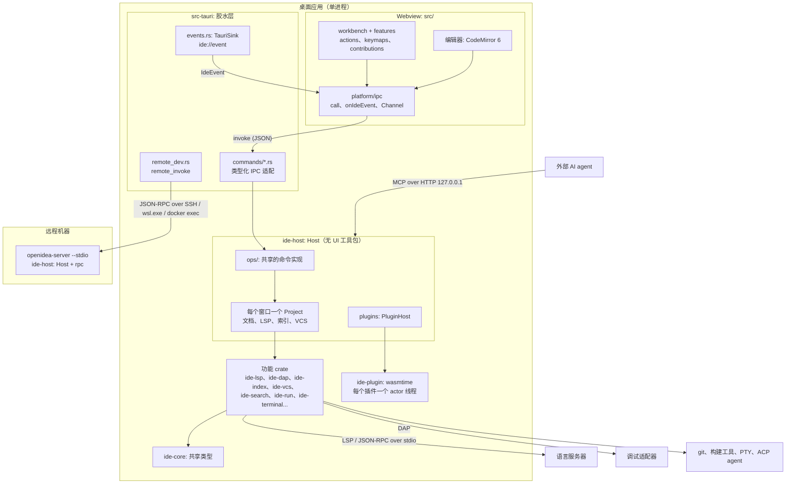

OpenIDEA 是一个 Tauri 2 桌面应用。UI 是运行在系统 webview 里的 React + CodeMirror 6 前端；凡是涉及磁盘、进程或网络的工作都在 Rust 里完成。Rust 端的设计让同一套后端既能跑在桌面应用里，也能在远程开发时以 `openidea-server` 的形式跑在另一台机器上。

## 全景图

## 分层

| 层         | 位置              | 职责                                                                                                                                                        |
| ---------- | ----------------- | ----------------------------------------------------------------------------------------------------------------------------------------------------------- |
| 前端       | `src/`            | 渲染、交互和编辑器状态。各功能注册 action、工具窗口和编辑器扩展，只通过生成的绑定访问后端。见[前端](/zh/contribute/architecture/frontend)。                 |
| 生成的绑定 | `src/bindings.ts` | 每个命令和 IPC 类型的 TypeScript 定义，由 tauri-specta 生成，禁止手改。见 [IPC](/zh/contribute/architecture/ipc)。                                          |
| 桌面外壳   | `src-tauri/`      | 只做胶水：`AppState`、每个领域一个 `commands/<domain>.rs`、事件 sink、窗口、菜单、远程开发客户端。不放领域逻辑。                                            |
| Host       | `crates/ide-host` | 不依赖 UI 工具包的 IDE 后端：按窗口管理项目、设置、终端、进程、信任、插件、MCP，以及 `ops/`——桌面命令和 `openidea-server` 共同调用的实现。                  |
| 功能 crate | `crates/ide-*`    | 每个负责一个领域（LSP、DAP、索引、git、搜索、运行、数据库等），依赖 `ide-core`，不触碰彼此的内部实现。见 [Crate 一览](/zh/contribute/architecture/crates)。 |
| 共享词汇   | `crates/ide-core` | id、文本坐标、`IdeError`、`IdeEvent`、设置类型——任何跨 crate 或跨 IPC 的类型。                                                                              |

## 进程

- **应用进程**承载 webview 和整个 Rust 后端（Tokio 运行时加阻塞线程池）。所有窗口共用一个后端，每个项目窗口在 Host 里对应一个 `Project`。
- **语言服务器和调试适配器**是子进程，按 `languages/<id>.toml` 针对语言和工作区根目录懒启动。后端通过 `ide-lsp`、`ide-dap`（底层是 `ide-jsonrpc`）与它们通信。见[代码智能](/zh/contribute/architecture/code-intelligence)。
- **外部工具**在能保证与命令行行为一致时直接调用其 CLI：写操作用 `git`（读操作用进程内的 gitoxide）、`docker`、`adb`、`gh`、Maven/Gradle、通过 ACP 驱动的编码 agent。
- **插件**以 WebAssembly 组件的形式在进程内运行，每个插件一个线程、一个独立的沙箱 store。见[插件宿主](/zh/contribute/architecture/plugin-host)。
- **`openidea-server`** 是同一个 `Host`，只是前面换成 JSON-RPC 而不是 Tauri。桌面端通过 SSH、WSL 或 `docker exec` 启动它，并把远程窗口的命令转给它。见[远程开发](/zh/contribute/architecture/remote)。
- **本地服务**供外部客户端使用：给 AI agent 的 MCP 服务（`ide-mcp`）和内置静态 Web 服务（`ide-web`），都只监听 `127.0.0.1`。

## 一次请求的路径

以 Find in Files 为例：

1. 搜索功能分配一个 `RequestId`，创建一个 `Channel`，调用 `src/bindings.ts` 里的 `commands.searchStart(request, query, channel)`。
2. invoke handler 检查完项目信任后，Tauri 分派到 `src-tauri/src/commands/search.rs` 的 `search_start`。
3. 命令转发给 `ide_host::ops::search::start`，后者为该请求注册一个 `CancellationToken`，并在阻塞线程上运行 `ide-search` 引擎。
4. 每找到一个文件的匹配就通过 channel 发出去；发送 `Done` 之后命令返回。
5. 用户取消时，UI 调用 `cancel_request(request)`，token 中止遍历。

远程窗口用的也是同一个 `ops::search::start`：前端的 `invoke` 被路由到 `remote_invoke`，服务端运行完全相同的函数，channel 的值带着 channel id 传回来。

## 继续阅读

<CardGroup cols={2}>
  <Card title="Rust 还是 UI？" href="/zh/contribute/architecture/boundaries">
    功能该放在哪一侧，附实例。
  </Card>
  <Card title="IPC" href="/zh/contribute/architecture/ipc">
    命令、错误、流式传输、取消和事件。
  </Card>
  <Card title="Crate 一览" href="/zh/contribute/architecture/crates">
    每个后端 crate 及其职责。
  </Card>
  <Card title="前端" href="/zh/contribute/architecture/frontend">
    action、keymap、上下文键和扩展点。
  </Card>
</CardGroup>
