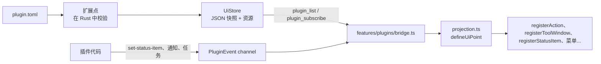

本页讲宿主一侧，面向要修改它的贡献者。插件作者请从[插件文档](/zh/plugins/index)开始；API 的权威参考是 [`plugins/README.md`](https://github.com/l0ng-ai/openidea/blob/main/plugins/README.md)。

## 三个 crate

| Crate               | 职责                                                                                                                                                                                       |
| ------------------- | ------------------------------------------------------------------------------------------------------------------------------------------------------------------------------------------ |
| `ide-extension`     | 与 Wasm 运行时无关的内核：`plugin.toml` 清单、`Capability` 及其 `Risk`、`ExtensionPoint` trait 和 `ExtensionRegistry`、UI 贡献（`UiStore`、`UiPoint`）、授权账本、插件包、签名和市场索引。 |
| `ide-plugin`        | WebAssembly 运行时：带组件模型和 WASI preview 2 的 wasmtime、每个插件一个 `Store`、持有它的 `Actor` 线程、各项限制，以及 WIT 接口的宿主端实现。                                            |
| `ide-host::plugins` | 把它们组装起来的 `PluginHost`：插件来源、生命周期、授权确认、宿主自己负责的扩展点、编辑器 provider、视图、远程插件。                                                                       |

依赖方向：`ide-core` ← `ide-extension` ← 各功能 crate（各自的扩展点）和 `ide-plugin` ← `ide-host`（组装）。`src-tauri` 只把 `PluginHost` 适配成 `plugin_*` 系列 Tauri 命令。

插件宿主**运行在项目所在的地方**：本地项目在桌面应用里，远程项目在 `openidea-server` 里。

## 接口

API 用 WIT 定义，位于 `wit/`（包名 `openidea:plugin@1.7.0`）。插件是面向 `plugin` world（或 `plugin-syntax`）的组件。插件端 SDK `sdk/rust/openidea-plugin` 把它封装成类型化的 Rust API，并带有一份 `wit/` 副本；`crates/ide-plugin/tests/api_compat.rs` 检查两份是否一致。

已发布的 API 版本是冻结的。wasmtime 按 semver 解析接口名，但函数类型必须完全一致，所以已发布的 1.x 只能增加：新的接口和新的可选导出，不能修改已有的 record 或 variant。改 `wit/` 之前请先读 `plugins/README.md` 里的 _Evolving the plugin API_。

## 插件包的生命周期

插件包的来源：已安装插件（`<plugins_dir>/<id>/`）、项目插件（`<project>/.openidea/plugins/*/`，只对受信任项目加载）、用 `openidea-plugin link` 链接的目录（`links.json`）。

<Steps>
  <Step title="准备">解析清单，每条声明由负责它的扩展点校验（`ExtensionRegistry::prepare`），没有副作用。</Step>
  <Step title="授权">
    授权账本决定插件包能否加载。新插件和项目插件要等用户确认；更新若要求新的 capability，需要重新确认。
  </Step>
  <Step title="提交">贡献要么全部生效、要么全部不生效（`ExtensionRegistry::commit`），并且可以按插件撤回。</Step>
  <Step title="激活">
    只有当某个激活事件触发时才实例化代码：`on-command`、`on-language`、`on-file`、`on-view`、`on-schedule`、`on-event`
    或 `on-startup-finished`。
  </Step>
</Steps>

声明式贡献（菜单、快捷键、状态栏项、设置、主题、语言等）在提交后立即生效，不需要运行任何插件代码。

### 扩展点

扩展点由负责该功能的 crate 实现，内核不会随贡献类型的增多而膨胀。例如 `ide-language` 实现语言扩展点（`plugin_point.rs`），`ide-host::plugins` 实现 provider、运行检测器、主题和导航索引器。UI 扩展点（`ide-extension` 的 `ui.rs`、宿主的 `ui_points.rs`）在 Rust 里完整校验菜单、keymap、状态栏项、设置、视图和自定义编辑器。

## 运行时

### 每个插件一个 actor

每个活跃插件的运行时都在自己的 `Actor` 线程上（`crates/ide-plugin/src/actor.rs`）。调用方把任务排进队列，在回复 channel 上等待，而不是在调用期间一直持有锁。由此得到三个性质：

- 一个实例同一时间只执行一个任务，从不并发；
- 编辑路径上的调用方（补全、行标记）可以在软时限到达时停止等待，调用本身继续执行，到硬时限时被中断；
- 任何线程都能取消一次调用。

每个活跃插件占用一个休眠线程，开销很小；空闲插件会被回收（默认 300 秒），线程随之结束。

### 沙箱

每个插件有自己的 wasmtime `Store`：没有预打开的目录、没有环境变量、没有网络、不继承标准输入输出，只有 WASI 的时钟和随机数，加上宿主函数。每个涉及文件、进程、网络或 VCS 写入的宿主函数都会检查用户是否授予了相应 capability；未授予时返回 `denied`，插件继续运行。路径类授权在比较前解析为真实路径，`process:` 授权会固定程序的绝对路径和哈希。

### 限制

默认值来自 `crates/ide-plugin/src/types.rs` 中的 `Limits`：

| 限制                              | 默认值                                                |
| --------------------------------- | ----------------------------------------------------- |
| 每次调用的 fuel                   | 5·10⁹（约等于 wasm 指令数）                           |
| 命令、事件、激活、停用            | 墙钟 5 秒                                             |
| 发起了任务（`tasks.begin`）的调用 | 60 秒                                                 |
| 编辑器 provider                   | 软时限 50 ms（之后的结果丢弃），硬时限 500 ms（中断） |
| 线性内存                          | 256 MiB                                               |
| 重启退避                          | 1 秒，连续崩溃每次翻倍                                |
| 标记为 _Failed_ 前的崩溃次数      | 连续 3 次                                             |
| 空闲回收                          | 300 秒                                                |

时限和取消通过 wasmtime 的 epoch interruption 实现：store 的 epoch 回调检查本次调用的截止时间和取消标记。trap（panic、fuel 或内存耗尽、超时、权限违规、取消）会使实例失效；actor 丢弃它，宿主的 supervisor 在下次需要时启动一个新实例。一次正常返回的调用会把崩溃计数清零。设置 › 插件 页面会显示激活次数、调用延迟 p95、崩溃、迟到的编辑器结果和回收次数。

## 贡献如何到达 UI



- **声明式 UI** 完全在 Rust 里校验，以 JSON 形式提交进 `UiStore`。客户端拿到 store 的快照，把每一项投射到工作台已有的 `register*` 函数上（`src/features/plugins/projection.ts`）。投射不允许失败；如果抛错，该项会被记录日志并跳过，不会出现注册了一半的情况。图标 SVG 这类大数据放在 store 的资源里，按需获取。
- **运行时 UI**（状态栏文字、通知、任务、事件订阅）来自正在运行的代码，以 `PluginEvent` 的形式经 `plugin_subscribe` channel 到达，由 `runtimeUi.tsx` 和 `bridge.ts` 处理。
- 由插件代码渲染内容的**视图和自定义编辑器**，通过 `plugin_view_render` / `plugin_view_event` 命令提供。
- **Web 视图**是插件包里自带的页面。客户端在沙箱 frame（不透明源、无网络、无 IDE API）中通过 `openidea-plugin` URL scheme（`src-tauri/src/plugin_web.rs`）加载它们，并附带独立的 CSP；页面只能通过 frame bridge 与 IDE 通信。

新增一种 UI 贡献类型，只需要一个 Rust 扩展点加上客户端的一个 `defineUiPoint`；内核（projection、store、bridge）无需改动。

## 远程项目

窗口打开远程项目时，桌面端把启用的代码插件及其授权发给 `openidea-server`，由它在文件旁边运行：读文件、启动进程、网络请求和诊断都作用于远程机器，`process:` 程序在那里解析并固定。桌面端的变更（安装、停用、授权）一秒内同步过去。密钥留在桌面端的钥匙串里，服务端通过 `plugin_secret` 请求索取。项目插件目前还不能在远程项目中运行。

## 测试宿主

```sh
plugins/build.sh                         # 重新构建提交在仓库里的组件
plugins/build.sh --check                 # CI 跑的检查：没有过期产物，全部能构建
cargo test -p ide-host --test plugins
```

宿主的集成测试（`crates/ide-host/tests/plugins.rs` 以及其他 `plugin_*.rs`）会加载官方插件和 `crates/ide-plugin/tests/fixtures/` 中夹具的已提交组件。修改插件、SDK 或 `wit/` 之后要重新构建它们。`pnpm perf:rust` 包含插件运行时的基准（`plugins/load_50`、`plugins/cold_activation`、`plugins/syntax_highlights_2k_lines`）。
