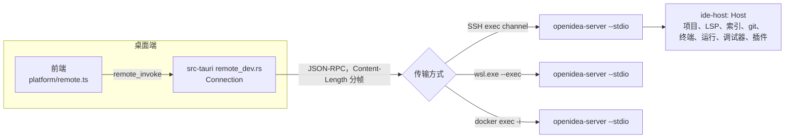

远程开发时，窗口的项目位于另一台机器（SSH 主机、WSL 发行版或 dev container）。UI 留在桌面端；该项目的后端——与桌面端相同的 `ide-host` `Host`——以 `openidea-server` 的形式运行在远程机器上。使用方法见[通过 SSH 远程开发](/zh/guide/remote/ssh)。

<Note>
  有两个名字里带 “remote” 的东西，它们不是一回事。**远程开发**是 `ide-host`（`rpc.rs`、`openidea-server` 二进制）加上
  `src-tauri/src/remote_dev.rs` 里的客户端。**`ide-remote`** 是 SFTP 部署和运行目标（从本地项目出发，在 SSH 或 Docker
  中运行某个配置）。
</Note>

## 组成



| 部分                      | 位置                                                                      |
| ------------------------- | ------------------------------------------------------------------------- |
| 服务端二进制              | `crates/ide-host/src/bin/server.rs`（`openidea-server`）                  |
| 协议与 dispatcher         | `crates/ide-host/src/rpc.rs`                                              |
| 客户端：连接、安装、转发  | `src-tauri/src/remote_dev.rs`                                             |
| WSL 与 dev container 传输 | `src-tauri/src/remote_wsl.rs`、`src-tauri/src/remote_container.rs`        |
| 容器内的端口中继          | `crates/ide-host/src/relay.rs`（`openidea-server --connect`）             |
| 前端路由                  | `src/platform/remote.ts`，由 `src/platform/tauriCore.ts` 挂到 `invoke` 上 |
| UI（文件 › 远程开发…）    | `src/features/remote-dev/`                                                |

## 服务端

```text
openidea-server --stdio | --connect <host> <port> | --version
```

- `--stdio` 通过 stdin/stdout 为一个桌面客户端提供服务。stdout 承载协议，所以日志写到 stderr（用 `OPENIDEA_LOG` 过滤）。
- 状态保存在 `OPENIDEA_SERVER_HOME`（默认 `~/.openidea`）下的 `config/` 和 `data/` 中。可以在 `config/languages/` 里追加语言定义。
- SSH exec channel 只给最小的环境变量，所以服务端每次启动都会读取登录 shell 的环境，并把 IDE 托管的工具目录加入 `PATH`。
- `--version` 打印应用版本和协议版本。

### 安装到远程机器

桌面端根据远程的操作系统和架构（来自 `uname -sm`）选择服务端二进制：先看是否设置了 `OPENIDEA_SERVER_BINARY`，再看 `<data dir>/server/<os>-<arch>/openidea-server`，平台相同时再用应用旁边自带的那个；都没有就把该平台的 release 构建下载到数据目录（只下载一次）。之后把二进制上传到远程主机的 `~/.openidea/server/`，每个版本一个目录，按内容哈希区分，并删除同版本的其他构建。CI 会持续验证静态 Linux（musl）构建。

## 协议

基于服务端 stdio 的 JSON-RPC 2.0，使用 `Content-Length` 分帧（`ide-jsonrpc`）：

| 消息                 | 方向            | 内容                                                                                                              |
| -------------------- | --------------- | ----------------------------------------------------------------------------------------------------------------- |
| 请求 `initialize`    | 客户端 → 服务端 | `{ version }` → `ServerInfo { version, protocol, os, arch, home }`                                                |
| 请求 `commands`      | 客户端 → 服务端 | 服务端能处理的命令名列表                                                                                          |
| 请求 `invoke`        | 客户端 → 服务端 | `{ window, cmd, args }` → 命令结果。`args` 与桌面命令的参数相同（camelCase）；流式参数写作 `{ "$channel": <id> }` |
| 通知 `event`         | 服务端 → 客户端 | `{ window, event }`：发给该窗口的 `IdeEvent`，`window` 为 null 时发给所有窗口                                     |
| 通知 `channel`       | 服务端 → 客户端 | `{ id, data }`：某个流式参数的一个值                                                                              |
| 通知 `plugin`        | 服务端 → 客户端 | `{ window, event }`：远程项目中代码插件发出的事件                                                                 |
| 请求 `plugin_secret` | 服务端 → 客户端 | `{ plugin, name }` → `string` 或 `null`：从桌面端钥匙串取密钥                                                     |

协议版本是 `rpc.rs` 中的 `PROTOCOL_VERSION`。错误是以 JSON 形式放在 JSON-RPC 错误消息里的 `IdeError`，所以前端看到的 `kind` / `message` 与本地命令完全一样。

## 命令路由

前端并不知道窗口是不是远程的。各功能照常调用 `commands.*`，路由发生在生成的绑定之下：

1. `@tauri-apps/api/core` 通过 Vite 别名解析到 `src/platform/tauriCore.ts`，它的 `invoke` 会先询问已安装的路由。
2. 在远程窗口中，`src/platform/remote.ts` 安装一个路由：会话 `commands` 列表中的命令发给 `remote_invoke`，其余的在本地运行。
3. `remote_invoke` 把每个 `Channel` 参数替换成 `{ "$channel": id }`，以 `invoke` 请求转发，再把 `channel` 通知送回对应的 `Channel`。`event` 通知则通过普通的事件 sink 重新发给窗口。

少数命令即使服务端认识，也始终在本地运行：`open_project` 和 `close_project`（打开本地文件夹即离开远程项目；关闭会断开连接）、系统字体列表，以及客户端 UI 设置。客户端设置（keymap、外观、编辑器字体和配色等）列在 `src/platform/clientSettings.ts` 中；全局的工具类设置会同时作用于两端。

### 什么在哪里运行

| 远程机器上                       | 桌面端                       |
| -------------------------------- | ---------------------------- |
| 项目：文件、文档、设置           | 窗口、菜单、webview          |
| 语言服务器、索引、搜索           | 客户端 UI 设置、keymap、主题 |
| Git、终端、运行、调试适配器      | SSH 连接和端口转发           |
| 项目的代码插件及其进程和网络请求 | 插件密钥（钥匙串）           |

## 端口转发

转发的端口走 SSH 连接。在 dev container 中，每个到转发端口的连接都会在容器内（通过 `docker exec`）运行 `openidea-server --connect localhost <port>`，并经由它的 stdin/stdout 转发数据，这样在任何 Docker 配置下都能以同样的方式访问容器网络。

## 信任

受限模式在远程窗口中同样生效：转发一个不在受限模式白名单里的命令之前，桌面端会先问服务端远程项目是否受信任，服务端还会对每个 `invoke` 用 `Host::authorize_command` 再校验一次。对于用户已经信任的文件夹所对应的 dev container，桌面端启动服务端时会把该项目目录标记为受信任（`OPENIDEA_TRUSTED_ROOT`，从不持久化）。

WSL 和容器两种传输方式都直接带参数运行程序（`wsl.exe --exec`、`docker exec`）；只有固定脚本才会交给 `sh -c`，所有变量值都作为位置参数传递。

## 让命令支持远程

1. 在 `ide-host::ops::<domain>` 中实现，参数是 `&Host` 和窗口标签，不要用 Tauri 类型。
2. 注册到服务端的 `Dispatcher`（在 `rpc.rs` 或 `ops` 模块中写 `d.add("name", |c| async move { ... })`），用 `c.arg("…")` 读取参数。
3. 桌面命令只是对同一函数的薄适配。

没有注册到 dispatcher 的命令，在远程窗口中会在本地执行——对任何涉及项目的命令来说这都是错的。

## 测试

- `crates/ide-host/tests/rpc.rs`、`remote_env.rs`、`remote_plugins.rs`：协议和服务端行为。
- `smoke/server.ts` 启动真实的 `openidea-server --stdio` 并与之通信；`smoke/desktop.ts` 为前端模块提供一个 Tauri 运行时，其命令经远程开发的路由发给该服务端。运行和调试冒烟测试都基于它（见[冒烟测试](/zh/contribute/testing/smoke)）。
