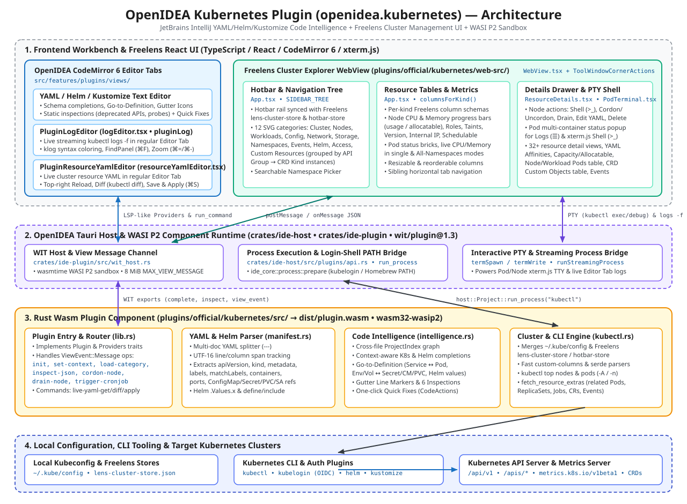

# OpenIDEA Kubernetes Plugin (`openidea.kubernetes`) — Design Document

## 1. Overview & Goals

The official **OpenIDEA Kubernetes Plugin** (`openidea.kubernetes`) brings two complementary capabilities into OpenIDEA:

1. **JetBrains IntelliJ Kubernetes Editor Intelligence**:
   - Context-aware completions, cross-resource **Go to Definition**, **Gutter Line Markers**, static **Inspections**, and one-click **Quick Fixes** across multi-document Kubernetes YAML manifests, **Helm** charts (`Chart.yaml`, `values.yaml`, `templates/*.yaml`, `_helpers.tpl`), and **Kustomize** overlays (`kustomization.yaml`).
2. **Freelens-Style Cluster Explorer & Live Operations**:
   - A full-featured React + Vite cluster management tool window modeled after **Freelens / OpenLens**, supporting hotbar cluster switching, 32+ Kubernetes resource kinds, Custom Resource Definitions (CRDs) grouped by API Group, live CPU/Memory metrics (`kubectl top`), interactive Pod & Node shells (`xterm.js` + host PTY), streaming Pod logs in regular CodeMirror 6 Editor Tabs, and live resource YAML editing (`Reload`, `Diff`, `Save & Apply`) in regular CodeMirror 6 Editor Tabs.

---

## 2. System Architecture

The architecture spans four layers across the OpenIDEA workbench, Tauri host, WASI Preview 2 (`wasm32-wasip2`) plugin sandbox, and external Kubernetes CLI tooling:

| Layer                                       | Location                                                                                                         | Responsibility                                                                                                                                                                                                                                                 |
| ------------------------------------------- | ---------------------------------------------------------------------------------------------------------------- | -------------------------------------------------------------------------------------------------------------------------------------------------------------------------------------------------------------------------------------------------------------- |
| **1. Workbench Editor Tabs & WebView Host** | `src/features/plugins/views/` (`WebView.tsx`, `logEditor.tsx`, `resourceYamlEditor.tsx`)                         | Hosts the Kubernetes tool window iframe, bridges PTY terminal streams (`termSpawn`), and provides first-class CodeMirror 6 Editor Tabs for live Pod log following (`pluginLog`) and cluster resource YAML editing (`pluginResourceYaml`).                      |
| **2. Freelens React UI**                    | `plugins/official/kubernetes/web-src/src/` (`App.tsx`, `ResourceDetails.tsx`, `PodTerminal.tsx`, `freelens.css`) | Renders the Freelens-style hotbar, collapsible 12-category SVG sidebar tree, customizable resource tables, 32+ resource detail drawers, YAML affinity/schema viewers, and embedded `xterm.js` PTY terminal.                                                    |
| **3. Tauri Host & WIT Runtime**             | `crates/ide-host/src/plugins/api.rs`, `crates/ide-plugin/src/wit_host.rs`                                        | Executes the `wasm32-wasip2` component in `wasmtime`, enforces capability grants (`project.read`, `process.exec`, `terminal`), prepares login-shell `PATH` (`ide_core::process::prepare`) for OIDC auth plugins (`kubelogin`), and routes 8 MiB view messages. |
| **4. Rust Wasm Plugin Core**                | `plugins/official/kubernetes/src/` (`lib.rs`, `manifest.rs`, `intelligence.rs`, `kubectl.rs`)                    | Implements WIT `Plugin` and `Providers` traits, maintains the cross-file `ProjectIndex` for YAML/Helm/Kustomize intelligence, and orchestrates `kubectl` / `helm` / `kustomize` queries and mutations.                                                         |

---

## 3. Component Design

### 3.1 Rust Wasm Plugin (`plugins/official/kubernetes/src/`)

#### 3.1.1 Multi-Document YAML & Helm Parser (`manifest.rs`)

- Splits multi-document YAML files (`---`) while preserving exact 0-based line numbers and **UTF-16 column offsets** required by the OpenIDEA editor protocol.
- Extracts `apiVersion`, `kind`, `metadata.name`, `metadata.namespace`, `metadata.labels`, `spec.selector.matchLabels`, container specs, exposed ports, volume mounts, `env` / `envFrom` references (`ConfigMap`, `Secret`), `PersistentVolumeClaim` claims, `ServiceAccount` references, Ingress backends, Kustomize `resources`/`patches`, and Helm template tokens (`.Values.<path>`, `{{ define "name" }}`, `{{ include "name" . }}`).
- Supports `# nonk8s` / `# openidea:nonk8s` opt-out comments on non-Kubernetes YAML files.

#### 3.1.2 Cross-Resource Code Intelligence (`intelligence.rs`)

- **`ProjectIndex`**: Indexes all workspace YAML, Helm, and Kustomize files in memory and updates incrementally on `Event::DocumentOpened`, `Event::DocumentChanged`, and `Event::FileSaved`.
- **Completions (`complete`)**:
  - Top-level and nested Kubernetes manifest keys, `apiVersion` / `kind` pairs, live workspace resource names (for `configMapKeyRef`, `secretKeyRef`, `claimName`, `serviceAccountName`, `backend.service.name`), and data keys inside target `ConfigMap` / `Secret` manifests.
  - Helm `.Values.*` path completions sourced from `values.yaml` and named template completions from `_helpers.tpl`.
- **Go to Definition (`goto_definition`) & Gutter Line Markers (`line_markers`)**:
  - `Service.spec.selector` ↔ matching `Pod` / workload `metadata.labels`
  - `Pod` volume / env references → `ConfigMap`, `Secret`, `PersistentVolumeClaim`, `ServiceAccount` declarations (and vice versa)
  - `Ingress` backend service & port → `Service` definition
  - `kustomization.yaml` file entries → target manifest files
  - Helm `.Values.foo.bar` → `values.yaml` key definition; `include`/`template` → `{{ define "..." }}` in `_helpers.tpl`
- **Static Inspections & Quick Fixes (`inspect_document` / `code_actions`)**:
  1. `k8s.deprecated-api`: Flags removed/deprecated `apiVersion`s (`extensions/v1beta1`, `networking.k8s.io/v1beta1`, `batch/v1beta1`, `policy/v1beta1`, `autoscaling/v2beta1`) with a Quick Fix to upgrade to the stable API version.
  2. `k8s.latest-tag`: Flags mutable `:latest` or untagged container images with a Quick Fix to pin a version tag.
  3. `k8s.missing-resources`: Flags workload containers missing `resources.requests`/`limits` with a Quick Fix to insert standard CPU/memory requests and limits.
  4. `k8s.missing-probes`: Flags application containers missing `livenessProbe`/`readinessProbe` with a Quick Fix to scaffold an HTTP health probe.
  5. `k8s.unresolved-selector`: Warns when a `Service` selector matches no workload labels in the workspace.
  6. `k8s.unresolved-key`: Warns when a `configMapKeyRef` or `secretKeyRef` references a key missing from the workspace `ConfigMap` or `Secret`.

#### 3.1.3 Cluster Explorer & CLI Engine (`kubectl.rs`)

- **Freelens Store Synchronization (`fetch_kubeconfig_overview`)**:
  - Merges contexts from `~/.kube/config` with Freelens's `lens-cluster-store.json` and `lens-hotbar-store.json` (`~/Library/Application Support/Freelens/` on macOS, `~/.config/Freelens/` on Linux, `%APPDATA%/Freelens/` on Windows), preserving cluster version, distribution, node count, default namespace, and hotbar pin order.
- **High-Throughput Resource Queries**:
  - Maps all 32+ Kubernetes resource kinds via `kubectl_resource_info(kind) -> (kubectl_plural, is_cluster_scoped, prefer_json_in_all_ns)`.
  - Uses compact Server-Side `custom-columns` queries (`CUSTOM_COLUMNS_SPEC`, `NODE_COLUMNS_SPEC`, `CRD_COLUMNS_SPEC`, `CR_INSTANCE_COLUMNS_SPEC`) for cluster-wide (`--all-namespaces`) and high-cardinality queries so responses stay well under process output limits even on clusters with 900+ namespaces.
  - Uses zero-allocation `serde::de::IgnoredAny` typed JSON deserialization (`parse_resource_list_json`) for single-namespace queries to skip megabytes of `managedFields` and `last-applied-configuration` annotations.
- **Live CPU & Memory Metrics (`enrich_pod_metrics` & `fetch_nodes_into_snapshot`)**:
  - Enriches `Node` rows with `kubectl top nodes --no-headers` and `.status.allocatable` so the `Nodes` table displays live CPU and Memory progress bars (`usage / allocatable`).
  - Enriches `Pod` rows with `kubectl top pods` in both single-namespace (`-n <ns>`) and `All Namespaces` (`-A`) modes.
- **On-Demand Drawer Extras (`fetch_resource_extras`)**:
  - When a user opens any resource in the Details Drawer (`inspect-json`), immediately streams the resource's full JSON (`resource-json`) and then fetches related objects (`resource-extras`):
    - **Node**: All Pods scheduled on that node across all namespaces (`--field-selector spec.nodeName=<node>`) + live `kubectl top pods -A --field-selector spec.nodeName=<node>`.
    - **Workloads (`Deployment`, `DaemonSet`, `StatefulSet`, `ReplicaSet`, `Job`)**: Child Pods matching `spec.selector.matchLabels` + live `kubectl top pods`, plus owned `ReplicaSet` revisions for `Deployment`s.
    - **CronJob**: Owned `Job`s.
    - **StorageClass**: Bound/available `PersistentVolume`s.
    - **Namespace**: `ResourceQuota`s and `LimitRange`s.
    - **CustomResourceDefinition**: All Custom Resource instances (`CR:<crd_name>`) across the cluster.
    - **Events**: All Kubernetes `Event`s filtered by `involvedObject.name` and `involvedObject.kind`.

---

### 3.2 Freelens React WebView UI (`plugins/official/kubernetes/web-src/`)

- **Navigation & Custom Resources Grouping (`App.tsx`)**:
  - Left hotbar rail for one-click switching between pinned clusters and the Cluster Catalog.
  - Collapsible sidebar with Freelens SVG icons for `Favorites`, `Cluster`, `Nodes`, `Workloads`, `Config`, `Network`, `Storage`, `Namespaces`, `Events`, `Helm`, `Access Control`, and `Custom Resources`.
  - Under **`Custom Resources`**, discovered CRDs are dynamically grouped by their **API Group** (e.g. `argoproj.io` → `Application`, `ApplicationSet`, `AppProject`; `cert-manager.io` → `Certificate`, `CertificateRequest`, etc.), with sibling kinds shown in the top horizontal tab bar.
- **Resource Details Drawer (`ResourceDetails.tsx`)**:
  - Renders `KubeObjectMeta` (`Created` in local `America/Los_Angeles` timezone, `Name`, `Namespace`, `Labels`, `Annotations`, `Finalizers`, `Controlled By`, collapsible YAML `Managed Fields`).
  - Renders dedicated Freelens sections for all 32+ resource types, including:
    - **`Node`**: `Addresses`, `OS`, `OS Image`, `Kernel version`, `Container runtime`, `Kubelet version`, `Taints`, `Conditions`, `Capacity` & `Allocatable` (with `GiB` unit conversion), and the sortable `Pods` table with CPU/Memory `<LineProgress>` bars.
    - **`Pod`**: `Status`, `Node`, `Host IPs`, `Pod IPs`, `Service Account`, `Priority Class`, `QoS Class`, collapsible `Tolerations` table, collapsible YAML `Affinities` (`<YamlCodeViewer>` with line numbers and indent guides), `Init Containers`, `Containers` (status brick, image, ports with one-click port-forward, environment variables with clickable `Secret`/`ConfigMap` links, mounts, probes, requests/limits), and `Volumes`.
    - **`CustomResourceDefinition` & Custom Objects**: `Group`, `Versions`, `Scope`, clickable `Resource` link, `Names` table, `Additional Printer Columns`, and an inline `Custom Objects (<count>)` table listing all instances of that CRD.
    - **`Events` (`KubeEventDetails`)**: Bottom events feed for every resource.
- **Interactive Pod & Node Shell (`PodTerminal.tsx`)**:
  - Uses `xterm.js` (`@xterm/xterm` + `@xterm/addon-fit`) connected to OpenIDEA's native PTY bridge (`window.openidea.termSpawn`).
  - For `Pod`: spawns `kubectl exec -it <pod> [-c <container>] -- /bin/sh -c "exec /bin/bash || exec /bin/ash || exec /bin/sh"`, with a multi-container status-square selector popup when a Pod has multiple containers.
  - For `Node`: spawns `kubectl debug node/<name> -it --image=busybox -- chroot /host`.

---

### 3.3 Regular CodeMirror 6 Editor Tabs for Logs & Live YAML (`src/features/plugins/views/`)

- **Streaming Pod Logs Editor Tab (`logEditor.tsx` — `PLUGIN_LOG_EDITOR_KIND = "pluginLog"`)**:
  - Clicking the Pod Logs (`☰`) button in the Pod drawer (or selecting a container from the multi-container popup) opens a regular Workbench Editor Tab backed by CodeMirror 6 (`openideaTheme`, `openideaHighlightStyle`, `logLanguage` with Kubernetes `klog` `I/W/E/F` severity & `key=value` highlighting, `FindPanel` search bar with Case/Word/Regex toggles, and `⌘=` / `⌘-` / `⌘0` font zoom).
  - Toolbar controls: `Timestamps` (`--timestamps=true`), `Previous` (`--previous`), `Soft-wrap`, `Clear`, `Scroll to Bottom`, and `Restart` / `Stop`.
- **Live Resource YAML Editor Tab (`resourceYamlEditor.tsx` — `PLUGIN_YAML_EDITOR_KIND = "pluginResourceYaml"`)**:
  - Clicking the Edit (`✎`) button on any resource opens its live cluster YAML (`kubectl get <kind> <name> -o yaml`) in a regular CodeMirror 6 Editor Tab with YAML syntax highlighting, code folding, undo/redo, `FindPanel` (`⌘F` / `⌘R`), and font zoom.
  - Top-right action bar:
    - **`Reload`**: Re-fetches the latest live YAML from the cluster.
    - **`Diff`**: Runs `kubectl diff -f -` against the live cluster and displays the unified diff in a collapsible bottom split pane.
    - **`Save & Apply` (`⌘S`)**: Runs `kubectl apply -f -` with the edited YAML and refreshes the cluster view.

---

## 4. Verification & Testing

- **Rust Unit & Integration Tests**:
  - `cargo test --manifest-path plugins/official/kubernetes/Cargo.toml` verifies multi-document YAML parsing, cross-resource Go-to-Definition, Helm values/template completion and navigation, static inspections & Quick Fixes, Freelens cluster/hotbar store merging, and `kubectl` command/output handling.
- **Plugin WebView & Wasm Build**:
  - `plugins/build.sh official/kubernetes` runs `tsc --noEmit && vite build` in `web-src/` and compiles the `wasm32-wasip2` release component into `plugins/official/kubernetes/dist/plugin.wasm`.
- **Workbench Typecheck & Tests**:
  - `pnpm typecheck`, `pnpm lint`, and `pnpm vitest run` verify the Workbench integration (`logEditor.tsx`, `resourceYamlEditor.tsx`, `WebView.tsx`, `uiPoints.tsx`).
