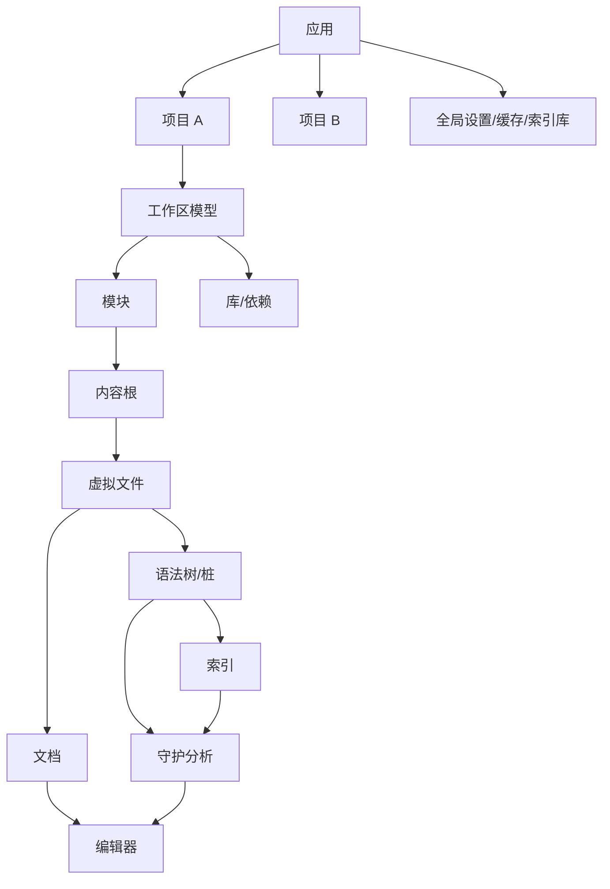

# 01 — 系统总览与能力地图

> 范围：产品定位、能力边界、部署形态、总体质量属性、术语表。｜ 依赖：无。｜ 排除：内部结构（见 02）、各子系统设计（见 03–20）。

## 1. 目的与范围

### 1.1 本系统解决什么问题

本规格描述的系统是一套**通用软件集成开发环境（IDE）**：把"读代码、改代码、跑代码、查历史"四类活动收敛到单一进程内的统一工作台。它的设计目标不是"支持某一种语言"，而是提供一层**与具体语言无关的核心机制**，再以可插拔的方式为每种语言补充语义能力。

核心机制必须解决的六个问题：

1. **统一的文件世界** —— 磁盘、归档、远程主机、内存虚拟目录在编辑器中呈现为同一棵树（见 04）。
2. **可编辑的文本缓冲区** —— 编辑、撤销、批量变换、多视图共享（见 05）。
3. **代码的结构化理解** —— 把文本解析成可查询的树与引用图（见 06），并为其建立可持久化的派生索引（见 07）。
4. **持续的后台分析** —— 在用户敲键的间隙不断重跑检查、补全、导航数据（见 08、09）。
5. **可执行的工程模型** —— 项目/模块/依赖/编译器/运行配置（见 11、12）。
6. **可扩展与可分部署** —— 第三方功能以声明式接缝接入（见 15），且同一套逻辑能拆成客户端/服务端（见 17）。

### 1.2 边界

本规格**不包括**：

- 具体语言的语法与类型系统设计（只规定接入方式）。
- 具体构建工具的语义（只规定集成契约）。
- 具体云厂商服务的业务逻辑（Docker/Kubernetes 等仅作为集成面出现）。
- 用户界面视觉规范（只规定交互模型与信息架构）。

### 1.3 与其他文档的关系

- 结构、分层、服务容器、扩展机制 → 02
- 运行时与并发语义 → 03
- 五条主数据流（文件、文档、语法树、索引、分析）→ 04–08
- 用户操作面（补全、导航、重构、生成）→ 09、10
- 工程与执行 → 11、12
- 界面与配置 → 13、14
- 可扩展性、分发、远端化 → 15、16、17
- 生态能力 → 18、19、20
- 验证方式与证据 → 21、22

## 2. 概念模型

### 2.1 三种时间尺度

系统的一切行为都可以归到三条时间尺度的交叠上，这是理解整体设计的第一把钥匙：

| 尺度 | 典型周期 | 载体 | 约束 |
|---|---|---|---|
| 即时 | 毫秒 | 键入、光标、滚动、高亮重绘 | 必须不阻塞输入，必须在单一线程内串行处理 |
| 增量 | 百毫秒～秒 | 守护分析、补全、索引更新、语法树重建 | 必须可取消、可重启、结果可丢弃 |
| 持久 | 分钟～会话 | 编译、索引落盘、构建同步、提交、调试会话 | 必须有明确状态机与恢复点 |

### 2.2 四个作用域

| 作用域 | 生命周期 | 内容 |
|---|---|---|
| 应用 | 进程 | 全局服务、设置、缓存、许可证、索引存储、插件注册表 |
| 项目 | 用户打开→关闭 | 项目模型、索引视图、守护分析、运行配置、变更列表 |
| 文件 | 文件存在期 | 虚拟文件、语法树、桩、文档 |
| 编辑器 | 标签页存在期 | 光标、选区、折叠、装饰、渲染状态 |

**作用域规则**：任何状态必须显式归属到其中一个作用域；跨作用域引用必须持有弱引用或可失效句柄。这是整个系统避免生命周期泄漏的基础（见 02 §5）。

### 2.3 关键实体关系

### 2.4 术语

规范术语表见 22 §2；本规格**只使用**该表中的写法。

## 3. 能力地图

以下按"用户可感知能力"分类。数量为安装包实测的扩展注册数（同一能力可能同时由多个模块提供）。

### 3.1 平台内核能力（所有发行版共有）

| 能力簇 | 说明 | 实测锚点 |
|---|---|---|
| 编辑 | 多光标、列编辑、折叠、软换行、装饰、代码视觉提示、分屏 | 编辑器动作处理器 260、键入处理器 102、选区扩展 128、行内标记 125 |
| 语法与语义 | 词法/语法/结构树、引用解析、符号、语言注入 | 解析定义 146、引用贡献者 201、多宿主注入 75 |
| 检查与修复 | 本地检查、全局检查、快速修复、意图动作 | 本地检查 2,265、意图动作 858、注解器 104 |
| 补全 | 基础补全、类型感知补全、排序与置信度、内联补全 | 补全贡献者 290、置信度策略 13 |
| 导航 | 转到文件/符号/声明/实现、用法查找、结构视图、最近文件、书签 | 符号贡献者 36、用法处理器 33、行内标记 125 |
| 重构 | 重命名、提取、内联、移动、签名变更、安全删除 | 重命名处理器 69、模板上下文 120、模板宏 160 |
| 版本控制 | 变更列表、差异、合并、注解、提交 | 见 18 |
| 运行与调试 | 运行配置、进程控制台、断点、求值、热重载 | 见 12 |
| 工程模型 | 项目/模块/库/依赖、构建系统同步、增量编译 | 见 11 |
| 界面 | 动作系统、工具窗口、设置界面、通知、进度 | 动作 1,559、动作组 487、工具窗口 37 |
| 扩展 | 插件装载、扩展点、服务、动态装卸 | 扩展点 3,235、注册 29,282；详见 15 |

### 3.2 语言与生态能力（本发行版捆绑，163 个插件）

| 能力域 | 覆盖内容（捆绑插件举例） |
|---|---|
| JVM | Java、Kotlin、Groovy、Scala 类工具链、字节码查看/反编译、JavaFX、Lombok、JPS 构建 |
| Web 前端 | JavaScript/TypeScript、CSS/Sass/Less/PostCSS、Angular、React、Vue、Next.js、Vite、Webpack、Tailwind、ESLint/Prettier/Stylelint/JSHint/TSLint、Emmet |
| 企业框架 | Jakarta EE（Servlet/JSP/JPA/CDI/Bean Validation/EL/JMS/JAX-RS）、Spring 全家桶、Quarkus、Micronaut、Hibernate、Thymeleaf、Velocity、FreeMarker、AOP 切点 |
| 数据 | 数据库工具与 SQL、数据编辑器网格、JDBC 驱动、Flyway/Liquibase、数据源内省 |
| 构建与依赖 | Gradle（含声明式 Gradle、DSL API）、Maven、Aether 依赖解析、Eclipse 互操作、Bazel 运行环境 |
| 运行时与运维 | Docker、Dev Containers、Kubernetes、SSH 远程运行、WSL、远程开发网关/服务端 |
| 协议与格式 | JSON/JSONPath、YAML、TOML、Properties、XML/XPath/XSLT、Markdown、Mermaid、Protobuf、HTTP Client、正则、RelaxNG |
| 质量 | Qodana 代码溯源、包检查器、结构搜索、重复代码检测、DFA 分析、性能测试插件 |
| 智能辅助 | 整行代码补全、搜索排序机器学习、AI 助手接入面（通过 Agent Client Protocol / MCP 服务端接入外部代理） |
| 可用性 | 中文/日文/韩文语言包、Eclipse/NetBeans/Visual Studio 键位映射、IDE 功能训练器、导航栏、书签、TODO、结构视图、最近文件 |

### 3.3 发行与授权面

安装包自身包含"终极版"定制层（套件功能开关、试用推广、许可校验构件），以及独立的许可与更新通道。该层属于**分发形态**而非平台设计，见 16。

## 4. 部署形态

系统必须支持三种部署拓扑，且**三种拓扑共享同一套核心机制**：

| 拓扑 | 进程布局 | 网络 | 用户侧 |
|---|---|---|---|
| 本地桌面 | 单一进程（可有辅助子进程：文件监视、终端、构建、调试代理） | 无 | 完整界面 |
| 远程开发 | 服务端进程（工作区、索引、构建、调试）+ 客户端进程（渲染、输入、动作触发） | 双向流式连接，支持断线重连 | 瘦客户端（桌面或浏览器） |
| Web 访问 | 服务端进程 + 浏览器前端 | HTTP(S) + 长连接 | 浏览器 |

设计要求：

- **职责可切分**：凡是"需要访问工作区"的行为（索引、语法树、编译、调试）必须能在服务端独立完成；凡是"需要呈现"的行为（渲染、输入法、剪贴板、对话框）必须能在客户端独立完成。二者之间只允许通过**显式的远程过程调用与状态通道**通信（见 17）。
- **可退化**：连接中断时客户端必须保持可交互（缓存渲染、输入暂存），重连后必须能重建一致视图。
- **可同构**：本地部署必须复用同一套接口，不得出现"本地特例分支"。

## 5. 总体质量属性

按优先级排序，且每一条都对应后文的强制约束：

| 属性 | 目标 | 对应约束 |
|---|---|---|
| 输入响应 | 键入到可见字符的延迟必须不受后台分析影响 | 03 §4 单线程输入/串行写 |
| 增量正确性 | 任何后台结果都必须可追溯到具体输入版本，版本不符即丢弃 | 03 §6、06 §4 |
| 数据安全 | 用户文件在崩溃、断电、并发写时不得出现半截状态 | 04 §7、05 §6 |
| 可恢复性 | 崩溃后可恢复到"已持久化"状态；未保存编辑必须可抢救 | 05 §7、14 §7 |
| 可扩展性 | 第三方模块不得因实现缺陷拖垮主流程 | 15 §7 |
| 可诊断性 | 卡顿、异常、内存压力必须能被归因到具体子系统与版本 | 03 §10、21 |
| 可移植性 | 核心机制不得依赖特定操作系统语义 | 04 §3、12 §4 |
| 可分部署 | 核心机制必须能在"有界面/无界面"两种角色下运行 | 17 §3 |

## 6. 设计原则（从既有设计反推，作为全文的判据）

1. **文本是入口，结构是真相**：一切语义能力建立在解析后的结构之上，文本只是其投影；因此必须有"从文本到结构"的增量重建与"从结构到文本"的可逆变换（06、10）。
2. **派生数据必须可再生**：索引、缓存、高亮、桩全部属于派生数据，删除后必须能完整重建；这决定了它们的存储格式与版本策略（07）。
3. **单写多读**：结构修改必须串行化并显式声明，读取必须可并发；为此引入读写锁与写意图（03）。
4. **一切接缝皆声明**：功能扩展通过声明式注册点接入，而不是通过代码打补丁；注册失败必须局部隔离（15）。
5. **每个动作都可用、可发现、可解释**：动作同时需要可被菜单、快捷键、搜索命中，并声明所需输入（13）。
6. **状态必须显式归属作用域**：见 §2.2。
7. **本地优先**：默认无网络依赖；网络能力（插件市场、许可、遥测、同步、远端执行）必须可关闭且失败不影响编辑。
8. **默认安全**：执行用户代码（编译、运行、测试、调试、构建脚本）必须假定其为不可信输入；路径、可执行文件、环境变量必须经统一校验（12、15）。

## 7. 故障模式与降级

系统级降级梯度（从轻到重），后文各子系统必须映射到其中一档：

| 档位 | 触发 | 系统行为 | 用户可见 |
|---|---|---|---|
| D0 正常 | — | 全功能 | — |
| D1 部分功能受限 | 索引未就绪 | 关闭依赖索引的能力，保留语法级功能 | 顶部提示"索引中" |
| D2 子系统失效 | 某插件异常/某分析器崩溃 | 隔离该扩展，继续其余功能 | 通知，可重启该子系统 |
| D3 项目只读 | 工程模型不可用（构建同步失败） | 编辑/导航保留，编译/运行禁用 | 明确的不可用原因 |
| D4 无界面服务 | 远端/无头角色 | 关闭全部渲染路径 | 仅 API/协议 |
| D5 抢救模式 | 持久化损坏 | 以只读/最小配置启动，导出诊断包 | 引导修复向导 |

## 8. 资源与性能预算

以下为设计预算（量级），用于约束各子系统（`[推断]` 项来自同类系统经验，非本安装包可测）：

| 指标 | 预算 | 说明 |
|---|---|---|
| 冷启动到可输入 | < 5 s（中等项目） | 启动阶段不得解析项目源码 |
| 大项目打开到索引完成 | 与文件数线性相关；必须并行 + 可后台化 | 共享索引可显著缩短（07 §9） |
| 编辑键入延迟 | 单次按键处理必须在输入线程上完成，且不含解析 | 解析必须异步 |
| 常驻内存 | 默认堆上限 2 GB（实测启动参数），必须依赖缓存淘汰而非无限增长 | 04 §8、07 §8 |
| 索引体积 | 必须可配置上限与排除规则；库索引可共享复用 | 07 §8 |
| 单文件编辑上限 | 大文件必须降级为纯文本模式 | 04 §6（默认 2.5 MB 全功能、20 MB 可打开，实测配置） |

## 9. 可观测性

系统必须能以"最小可复现状态"描述问题：

- **动作级**：每个用户可见命令有稳定标识，可被日志、快捷键表、遥测引用。
- **时序级**：长任务必须能输出阶段耗时（启动、索引、构建同步、守护分析）。
- **线程级**：卡顿时必须能抓取"谁持有锁、谁在等待、等待多久"。
- **版本级**：所有派生数据的格式版本、插件版本、工程模型版本必须可查询。

## 10. 扩展面

本系统对外提供两类扩展：

1. **语言与框架扩展**：新增语言/框架 → 见 06、07、08 的接入契约。
2. **功能与集成扩展**：新增动作、工具窗口、运行方式、VCS、构建系统 → 见 13、12、18、11 的接入契约。

两者共用同一套注册与生命周期机制（15）。

## 11. 对照实现（证据锚点）

| 上文结论 | 证据 |
|---|---|
| 产品标识与构建号：IntelliJ IDEA Ultimate 2026.2.0.1 / IU-262.8665.337 | 安装根 `product-info.json`：`name`、`version`、`buildNumber`、`productCode=IU` |
| 运行时要求 Java 25、JBR 25.0.3 | `product-info.json`: `minRequiredJavaVersion=25`；运行时发行信息 `JAVA_VERSION=25.0.3` |
| 2090 个内部模块；`intellij.platform.core` 被 1379 个模块依赖 | `_rev/modules.json`（由 2126 个模块描述符解析） |
| 163 个捆绑插件 + 73 个公开模块标识 | `product-info.json`: `bundledPlugins`, `modules` |
| 客户端/服务端拆分已存在于模块层 | 模块名族：`platform.frontend`、`platform.backend`、`*.frontend`、`*.backend`、`*.shared`、`platform.remote.*`、`platform.kernel.*`、`platform.rpc.*`、`platform.ijent.*` |
| 动作 1,559 个、动作组 487 个 | `_rev/agg.json`: `actions`, `groups` |
| 本地检查 2,265、意图动作 858、补全贡献者 290、注册条目 29,282 | `_rev/ep_counts.json`（`total` 口径：模块描述符 18,615 + 插件描述符 10,667） |
| 大文件阈值 2.5 MB / 20 MB | 启动属性文件实测：`idea.max.intellisense.filesize=2500`、`idea.max.content.load.filesize=20000` |
| 默认堆上限 2 GB | 启动参数文件实测：`-Xmx2048m` |

## 12. 未决问题

- 远程拓扑中"索引位于服务端、渲染位于客户端"的边界在语言服务（如 LSP 代理）参与时如何再切分，证据仅显示存在 `platform.lsp.impl` 与 `platform.split.protocol` 模块，具体职责划分 `[推断]`。
- Web 访问形态与远程桌面形态是否共用同一协议栈，证据显示 `webide` 与 `remoteDevServer` 为不同模块，`[推断]` 为共用内核、不同传输。
