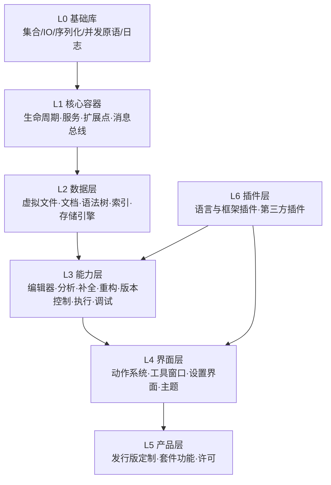
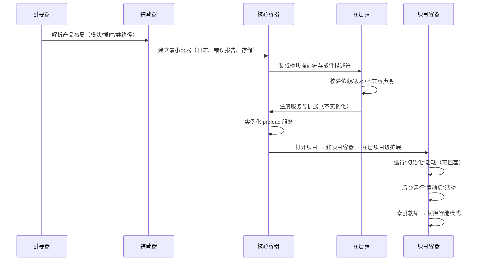

# 02 — 总体架构：模块、服务、组件与扩展点

> 范围：系统的静态结构与动态组装机制（分层、模块图、服务容器、扩展点、启动序列、动态装卸）。｜ 依赖：01。｜ 排除：并发语义（03）、具体子系统（04–20）。

## 1. 目的与范围

### 1.1 本机制解决什么问题

一个要同时支撑"平台内核 + 十余种语言 + 百余个功能插件 + 两种部署角色"的系统，必须解决四个结构性问题：

1. **依赖方向**：底层不能知道上层；平台不能知道产品；产品不能知道第三方插件。
2. **装配顺序**：组件之间互相引用，但必须能确定性地初始化。
3. **功能开放**：第三方必须能替换、包装、追加行为，而无需修改平台代码。
4. **故障隔离**：任一第三方实现的缺陷不得使进程不可用。

本子系统给出的答案是：**有向无环的模块图** + **按作用域缓存的服务容器** + **声明式扩展点** + **带版本号的动态装载**。

### 1.2 边界

不负责：业务逻辑（各子系统自述）、网络协议（17）、界面布局（13）。只规定"构件如何被定义、发现、实例化、销毁"。

## 2. 概念模型

### 2.1 四类构件

| 构件 | 定义 | 数量（实测） | 约束 |
|---|---|---|---|
| 模块（Module） | 编译期与运行期的依赖单元，声明依赖、可见性、资源根 | 2090 | 图必须无环；依赖必须单向 |
| 服务（Service） | 由容器托管、按作用域单例的能力对象 | 3,352（应用级 2,187、项目级 1,165） | 必须可无参构造或由容器注入；不得依赖自身 |
| 组件（Component） | 参与生命周期回调的旧式构件（初始/销毁） | 已基本被服务取代 | 仅为兼容保留 |
| 扩展点（EP）与扩展（Extension） | 声明式接缝与其实现条目 | 3,235 个 EP / 29,282 条注册 | 扩展必须实现 EP 声明的契约类型 |

### 2.2 分层



规则：

- **依赖只能向下**。实测 2090 个模块的依赖图**回边数为 0**，最长依赖链 **57 层**。
- **接口与实现分离**：同名模块常成对出现（抽象接口 / 实现），上层只依赖抽象。
- **扩展 API 与稳定 API 分离**：`.ex` 后缀表示"面向扩展作者但更易变的接口"，不走兼容承诺。
- **角色分离已下沉到模块层**：存在 `*.frontend`、`*.backend`、`*.shared` 三类模块与独立的远程/内核层，说明"可拆分部署"不是外挂能力，而是结构约束（见 17）。

### 2.3 作用域树

容器是树而非平面注册表：

```
应用容器 (Application)
├── 全局服务（设置、缓存、索引存储、许可、插件注册表）
└── 项目容器 (Project)
    ├── 项目服务（模型、分析、索引视图、运行配置、变更列表）
    └── 模块容器 (Module, 可选)
```

- 子容器**委托**父容器解析未知服务。
- 服务解析必须携带**作用域**；跨作用域只能通过显式取得父/子容器的能力，不得隐式向上查找项目服务。
- 项目容器销毁时，其项目服务、项目级扩展实例必须级联释放。

## 3. 数据模型

```
Module {
  name: string                       // 全局唯一
  visibility: public | internal      // internal 不得被外部模块引用
  dependencies: ModuleRef[]          // 有向、无环
  resourceRoots: Path[]              // 类与资源所在的物理位置
  namespace: string?                 // 归属（平台 / 产品 / 插件）
}

Service {
  interface: TypeRef                 // 查找键
  scope: application | project | module
  implementation: TypeRef
  testImplementation: TypeRef?       // 测试模式替换
  headlessImplementation: TypeRef?   // 无界面角色替换
  overrides: bool                    // 是否替换同接口的既有注册
  open: bool                         // 是否允许第三方提供实现
  preload: bool                      // 是否在启动期立即实例化
  clientSide: frontend | backend | both   // 远程部署时的有效侧
  os: os?                            // 仅特定操作系统生效
  configSchema: string?              // 该服务持久化状态的 schema 标识
}

ExtensionPoint {
  name: string                       // 稳定标识，带命名空间前缀
  area: application | project        // 注册可见域
  contract: TypeRef                  // 实现必须满足的类型
  bean: TypeRef?                     // 以声明式数据（而非代码）注册时的载体类型
  dynamic: bool                      // 是否允许在运行时装卸
  attributeConstraints: {attr: TypeRef}[]   // 属性级类型约束
  bundleOnly: bool                   // 是否仅允许随产品捆绑的模块注册
}

ExtensionEntry {
  point: string
  implementation: TypeRef | Data
  order: before | after | first | last
  condition: Expr?                   // 声明式启用条件
  origin: ModuleRef                  // 用于卸载与故障隔离
}
```

## 4. 行为契约

### 4.1 启动序列（必须遵守的相位）



硬性要求：

- **注册与实例化分离**：描述符装载阶段只登记，不执行用户代码。
- **相位命名固定**：初始化活动（必须快、必须不触发索引）、启动后活动（可慢、可取消）、智能模式就绪活动（依赖索引）。
- **失败不阻断**：单个插件描述符非法 → 跳过该插件并记录；不得中断启动。
- **可观测**：每个相位必须产出耗时计数（见 §9）。

### 4.2 服务解析算法

```
resolve(scopeContainer, interface):
  1. 若本容器已缓存该接口实例 → 返回
  2. 若本容器注册表有该接口的有效注册 → 实例化、缓存、返回
  3. 若存在父容器 → 委托父容器（结果不复制到子容器）
  4. 否则 → 报错（必须携带"接口 + 作用域 + 已装载模块"三元组）

resolveOptional(scopeContainer, interface) -> instance?:
  同 resolve，但"未注册"返回空值而非报错
  注意：空值不得被缓存为"不存在"，因为动态装载可能稍后提供
```

约束：

- **必须提供两种查找模式**：`required`（缺失即错，用于契约依赖）与 `optional`（缺失返回空，用于可选能力）。调用方不得用"捕获异常"模拟 optional。
- **解析必须允许异步完成**：容器接口按挂起语义设计，调用方不得假设"立即返回"；同步调用只允许用于已在启动相位预热的服务。
- 实例化必须在**首次解析时**完成（惰性），`preload=false` 的服务不得在启动期构造。
- 实例化期间再次解析同一接口 → **必须**判定为循环依赖并报错，不得递归。
- 注册冲突（同一接口、同作用域、多个实现）必须按"显式覆盖 > 产品 > 平台 > 插件"的优先级消解，且冲突本身必须可查询（诊断入口）。
- 服务必须支持"测试实现"与"无界面实现"的替换，替换在解析期按运行模式选择，不得由调用方分支判断。

### 4.3 扩展解析

```
contributions(point, context):
  entries := 注册表中该 point 的全部条目
  entries := filter(entries, enabled(condition) && areaMatches(context))
  entries := stableSort(entries, (order，注册序))
  return entries.map(resolveImplementation)   // 惰性：逐个实例化，失败隔离
```

- **area 语义**：应用级扩展在整个进程可见；项目级扩展每个项目拥有独立实例集合。
- **dynamic 语义**：`dynamic=true` 的扩展点必须支持运行期增减（插件装卸），且增减必须触发"变更通知"，订阅方负责重算；`dynamic=false` 表示只能在启动期确定，运行期变更必须被拒绝。
- **排序稳定性**：同 order 必须保持注册顺序；跨模块的注册顺序必须由依赖拓扑（而非装载偶然性）决定。
- **顺序约束是一个图**：条目可以声明"最先 / 最后 / 在 X 之前 / 在 X 之后"，这些约束与注册序一起构成有向图，解析时做拓扑排序；无约束条目保持注册序。约束成环必须被检测并降级（记录诊断，按注册序输出），不得死循环。
- **结果缓存**：一个扩展点的实例列表必须被缓存（双重检查加锁），且在注册集合变化或区域替换时整体作废并重新计算。
- **返回副本**：向调用方返回的集合/数组必须是副本，调用方修改不得影响内部缓存。
- **实例化失败隔离**：单个扩展实例化抛错 → 记录并跳过，不得使整个 `contributions()` 失败。

### 4.4 动态装卸

必须满足：

1. 卸载一个模块 → 其服务实例、扩展实例、监听器必须全部失效。
2. 已缓存的解析结果必须按"代际"作废：容器维护代际号，缓存键包含代际。
3. 卸载后不得残留强引用（类加载器必须可回收）；这是内存泄漏的主要来源，必须提供泄漏诊断入口。
4. 正在执行该模块代码的线程必须先被排空（见 03 §7），否则必须拒绝卸载。

### 4.5 产品定制

- 产品层可以**覆盖**平台服务与平台扩展（如替换编辑器实现、替换欢迎界面）；覆盖必须显式声明，不得依赖加载顺序。
- 产品层可以**裁剪**平台能力（套件功能开关），但裁剪必须是"存在性"层面，不得让上层代码在编译期依赖被裁掉的能力。

## 5. 不变量与约束

| 编号 | 不变量 |
|---|---|
| INV-1 | 模块依赖图必须无环。 |
| INV-2 | `internal` 可见性模块不得被其依赖闭包之外的模块引用。 |
| INV-3 | 任何状态必须归属且仅归属一个作用域（应用/项目/模块/文件/编辑器）。 |
| INV-4 | 服务实例在单一作用域内至多一个；跨作用域不得共享实例。 |
| INV-5 | 扩展点声明必须先于任何对它的注册；注册必须先于任何解析。 |
| INV-6 | 扩展实现的类型必须满足 EP 声明的契约（接口实现或属性约束）。 |
| INV-7 | `dynamic=false` 的扩展点在运行期集合不可变。 |
| INV-8 | 卸载模块后，其任何实例不得被任何存活对象强引用。 |
| INV-9 | 初始化活动不得触发索引、不得执行构建、不得访问网络。 |
| INV-10 | 任意构件失败必须被隔离在其作用域内，不得传播为进程级失败。 |
| INV-11 | 扩展解析结果对同一（扩展点、区域、代际、注册集合）必须逐位一致。 |
| INV-12 | 扩展查询返回的集合必须是副本；调用方修改不得改变后续查询结果。 |

## 6. 对外能力契约（概念级）

```
registerService(scope, interface, impl, opts) -> void
lookupService(scopeContainer, interface) -> Service
registerExtension(point, impl, order, condition) -> Handle
getExtensions(point, context) -> Extension[]        // 只读、稳定序
getOrCreateChildContainer(parent, kind) -> Container
disposeContainer(container) -> void                // 级联
subscribe(event, listener) -> Unsubscriber         // 见 03 消息总线
```

要求：

- 所有注册 API 必须幂等或明确拒绝重复注册，不得"最后一次生效"。
- 所有查询 API 必须可在无界面角色下调用（不得依赖界面已初始化）。
- 句柄必须支持显式注销，且注销后查询不得再返回该条目。

## 7. 故障模式与降级

| 故障 | 检测 | 用户可见 | 降级 |
|---|---|---|---|
| 插件描述符非法 | 装载期校验 | 通知"插件无法加载" | 跳过该插件，启动继续 |
| 依赖缺失/版本不兼容 | 装载期拓扑校验 | 列出缺失依赖 | 禁用该插件；依赖它的插件级联禁用 |
| 服务循环依赖 | 实例化栈检测 | 内部错误报告 | 抛出可捕获错误，调用方可降级 |
| 服务注册冲突 | 注册期比对 | 诊断项 | 按优先级消解并记录 |
| 扩展实例化异常 | 解析期捕获 | 该功能不可用 | 跳过条目 |
| 模块卸载后残留引用 | 代际标记 + 弱引用验证 | 内存增长 | 标记泄漏，提供诊断快照 |
| 平台与产品覆盖冲突 | 装载期声明比对 | 内部错误报告 | 显式覆盖优先 |

## 8. 资源与性能预算

| 项 | 预算/实测 |
|---|---|
| 模块数 | 2090（实测） |
| 依赖图回边 | 0（实测） |
| 最长依赖链 | 57 层（实测） |
| 扩展点 / 注册条目 | 3,235 / 29,282（实测：模块描述符 18,615 + 插件描述符 10,667） |
| 动作 / 动作组 | 1559 / 487（实测） |
| 服务（应用/项目） | 2,187 / 1,165（实测，合计口径） |
| 描述符装载 | 必须在用户可见界面出现前完成；不得解析任何用户源码 |
| 服务实例化 | 惰性；启动期只允许 `preload=true` 的服务 |
| 扩展解析 | 结果必须缓存，缓存键包含（点、上下文、代际） |

## 9. 可观测性

必须提供四个诊断视图（无界面角色也必须可导出）：

1. **模块图**：依赖边、可见性、所属插件。
2. **注册快照**：每个扩展点的贡献者与顺序。
3. **服务图**：谁被实例化、何时、被谁首次解析、实例化耗时。
4. **启动剖析**：相位耗时、活动项耗时、被跳过的项及原因。

## 10. 扩展点

第三方接入必须遵守：

- 只允许通过 EP 声明注册，不得运行时反射打补丁到平台内部类型。
- 声明必须携带：所属模块、依赖、兼容版本区间、目标 EP、实现类型。
- 声明必须可被**静态校验**（类型、必填属性、可见性、禁止的 API 包）。
- 扩展失败不得导致宿主不可用；宿主必须能列出"被禁用的第三方条目"。

## 11. 对照实现（证据锚点）

| 结论 | 证据 |
|---|---|
| 服务描述符包含测试/无界面/覆盖/开放/预加载/客户端侧/操作系统等字段 | `intellij.platform.core` → `openapi/components/ServiceDescriptor.java`（字段 `testServiceImplementation`、`headlessImplementation`、`overrides`、`open`、`preload`、`client`、`os`） |
| 服务本身通过扩展点登记 | `META-INF/Core.xml`：`extensionPoint name="applicationService" beanClass="…ServiceDescriptor"`、`projectService`、`moduleService` |
| 扩展点声明含作用域、动态性、类型约束、仅捆绑模块可用 | `META-INF/Core.xml`：`area="IDEA_PROJECT"`、`dynamic="true"`、`<with attribute=… implements=…>`、注释 `only bundled plugin can define …` |
| 启动相位：初始化 / 启动后 / 后台启动后 / 智能模式就绪 | `META-INF/Core.xml`：`initProjectActivity`、`postStartupActivity`、`backgroundPostStartupActivity`、`requiredForSmartModeStartupActivity` |
| 模块图无环、57 层、2090 模块 | `_rev/modules.json` + 拓扑分析（`_rev/layers.json`） |
| `core` 被 1379 个模块依赖 | 反向依赖统计 |
| 前/后端拆分已存在于模块层 | 模块族 `*.frontend`/`*.backend`/`*.shared`、`platform.kernel`、`platform.rpc`、`platform.remote.*` |
| 产品布局按 `moduleV2`/`productModuleV2`/`plugin`/`pluginAlias` 组织 | `product-info.json` → `layout[].kind`（实测计数 1177 / 402 / 163 / 73） |
| 新一代容器按"必需/可缺省"两种查询且支持挂起式解析 | `intellij.platform.ide.jar` → `platform/instanceContainer/InstanceContainer.java`（`instance` 与 `requestedInstance` 两个挂起方法） |
| 扩展列表双重检查加锁缓存、数组返回副本 | `util.jar` → `openapi/extensions/impl/ExtensionPointImpl.java`（`cachedExtensions`、`cachedExtensionsAsArray`、`toArray(...).clone()`） |
| 顺序约束 `first/last/before X/after X` 以图排序解决 | `util.jar` → `openapi/extensions/LoadingOrder.java`（`FIRST/LAST/BEFORE/AFTER`、`InboundSemiGraph` + 拓扑排序、`sortByLoadingOrder`） |
| 区域可整体替换并通知监听者 | `util.jar` → `openapi/extensions/impl/ExtensionsAreaImpl.java`、`ExtensionPointImpl` 中的 `areaReplaced` 通知 |

## 12. 未决问题

- `open=true` 的服务是否允许第三方为同一接口注册多个实现并由调用方择一，证据仅显示该标志存在，语义 `[推断]`。
- 动态装卸是否支持"降级为重启"的半动态路径，证据显示 `dynamic` 为布尔而非三态，`[推断]` 为不支持。
- 模块级容器（`moduleService`）在本发行版中的实际使用范围 `[推断]` 较小。
