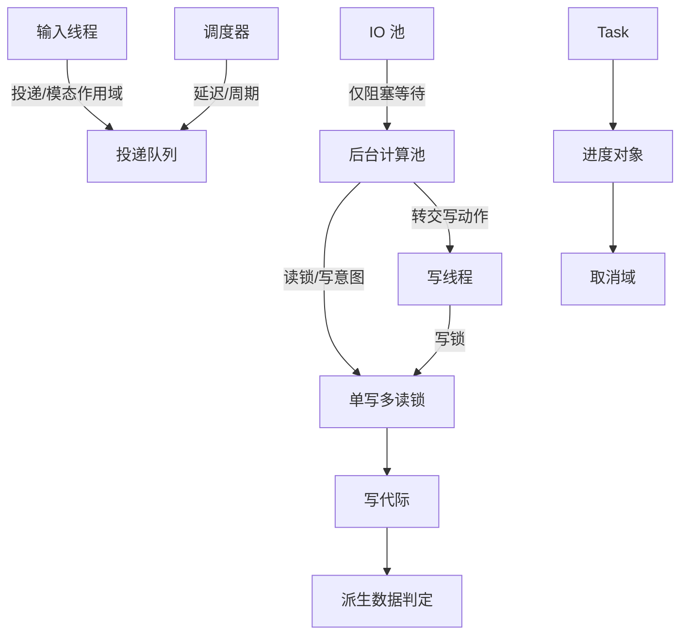

# 03 — 运行时与并发模型

> 范围：执行主体与线程角色、单写多读锁协议、写意图、任务与取消、调度与投递语义、协程与结构化并发、哑模式交互、消息总线、泄漏防护、卡顿与死锁诊断。｜ 依赖：01（质量属性 §5、降级梯度 §7）、02（作用域 §2.3、动态装卸 §4.4）。｜ 排除：文件与文档的具体并发细节（04、05）、索引在哑模式下的能力清单（07）、远程通道的传输并发（17）。

## 1. 目的与范围

### 1.1 本子系统解决什么问题

所有状态分属五个作用域（01 §2.2），被三类时间尺度以完全不同的频率读写（01 §2.1）。不加约束只剩三种病：输入被后台拖慢、结构被并发改坏、卡死无法归因。本子系统给出的是一条极窄的主干：

1. **呈现与输入串行化到单一线程**，该线程上不允许出现"等待别的线程"的行为。
2. **结构修改必须显式声明并独占**，读取可并发；读写关系由**单写多读锁（Single-Writer / Multi-Reader Lock）**定义。
3. **"只是看看但可能会改"必须提前声明**（写意图，Write Intent），把死锁从运行期偶发提前为获取期可判定。
4. **后台工作必须可取消、可超时、可丢弃**；取消是**必须向外传播的异常**，不是返回值。
5. **跨线程投递必须声明目标线程、模态作用域与失效条件**；目标消失即丢弃，禁止补执行。
6. **诊断必须能回答**"谁持有锁、谁在等、等了多久、被谁取消"。

### 1.2 边界

**不负责**：各子系统在锁内做什么（04–12）；派生数据的版本判定细则（07）；进程外并发协议（12）；远程拓扑下"哪一侧执行"的分派（17）——本文只规定两侧共享同一套并发契约。**不覆盖**界面交互细节（13）与插件装载的拓扑校验（02、15）。

### 1.3 与其他子系统的关系

| 关系 | 内容 | 引用 |
|---|---|---|
| 被容器约束 | 服务/扩展必须在解析线程实例化，且不得在持写锁时触发用户代码的惰性初始化 | 02 §4.2 |
| 约束文件、文档与索引 | 结构修改必须持写锁、读取必须在读锁内；读锁内索引查询的可见性与哑模式降级必须可区分 | 04 §5、05 §4、07 §4 |
| 约束分析 | 守护分析结果以"输入版本 + 写代际"为键 | 08 §4 |
| 约束界面 | 动作执行、面板刷新、弹窗模态性都经投递进入输入线程 | 13 §4 |
| 约束插件 | 扩展不得在输入线程执行阻塞操作，异常必须隔离 | 15 §7 |

## 2. 概念模型

### 2.1 三条不可让渡的时序约束

| 编号 | 约束 | 违反后果 |
|---|---|---|
| T-1 | 输入事件必须单线程**串行**处理，不得嵌套进入第二次事件循环 | 状态撕裂、重入崩溃 |
| T-2 | 后台计算**必须不**占用阻塞输入线程的资源；输入线程**必须不**等待后台才返回 | 卡顿、假死 |
| T-3 | 结构修改**必须**在写锁内，且写锁**必须不**跨越"等待另一个需要写锁的操作" | 死锁 |

T-2 与 T-3 的张力决定了正确形态：需要"后台算完再写"时必须**先算后写**（分段），而不是"持读写完"。

### 2.2 线程角色与允许操作清单

| 角色 | 并发度 | 允许 | 禁止 | 典型用途 |
|---|---|---|---|---|
| **输入/呈现线程**（下称输入线程） | 1，串行 | 派发输入事件；更新界面；**可以**直接获取写锁与写意图；执行投递给它的任务 | 任何阻塞等待（后台/锁/IO）；嵌套事件循环；长时间计算 | 键鼠处理、重绘、弹窗、动作触发 |
| **写线程**（逻辑角色） | 1，可与输入线程重合 | 获取写锁；执行写动作 | 与输入线程并存时二者**必须不**同时执行写动作 | 后台发起的模型修改 |
| **后台计算池** | 有界多线程 | 获取读锁；获取写意图；提交任务；检查取消 | 直接获取写锁（除非经写线程转交）；访问界面状态 | 解析、索引、检查、补全计算 |
| **IO/阻塞池** | 有界多线程，并行度小于计算池 | 阻塞等待（文件、网络、进程）；读锁**仅用于读取结果** | 在其上做长计算（饿死 IO） | 文件监视、远程调用、进程输出 |
| **定时/调度器** | 单逻辑队列 | 按延迟/周期触发；唤醒等待者 | 直接修改模型（必须转入写线程或投递） | 超时看门狗、周期取消检查、防抖 |
| **临时线程** | 不定 | 与后台池相同，但**必须**在所属子系统销毁时终止 | 长期驻留；跨作用域引用 | 版本控制命令、构建同步、调试适配器桥接 |

服务端（无界面）角色没有输入线程但**串行化语义不变**：由固定调度线程承担等价角色，呈现类投递**必须**被丢弃而非排队（§7，D4）`[推断]`。角色是**逻辑的**：输入线程与写线程可重合，但调用方不得依赖重合。线程本地状态（当前进度、锁深度、取消域）**必须**随投递显式传递；角色决定"能做什么"，能力（许可、进度、取消域）决定"此刻被允许做什么"，二者都必须判定。

### 2.3 锁模式谱

| 模式 | 并发度 | 可重入 | 可升级为写 | 可被写请求取消 |
|---|---|---|---|---|
| 读（Read） | 多 | 是（按线程计数） | **否** | 是 |
| 写意图（Write Intent） | 多 | 是 | **是**（受条件约束） | 否 |
| 写（Write） | 独占 | 是（同线程） | — | — |
| 并行读（Parallel Read） | 多，**跨线程共享同一许可** | — | 否 | 是（整组） |

- **写意图不是"半个写锁"**，而是"我接下来可能要写"：允许读者继续读、允许多个写意图共存，唯一作用是让升级在没有竞争写者时快速成功、有竞争时按队列排队而不必先放弃读。**并行读**把一份读许可分摊到多个协程/工作单元，共享同一"读代"视图直到最后一个组员释放，用于把单线程读计算扩到多核而不改变可见性语义。
- **只允许 写意图 → 写 的升级**，须满足同一持有者、无其他写者、写意图代际未作废；**读 → 写 的升级被禁止**（§4.5 F-1）。

### 2.4 任务、进度与取消域

| 概念 | 定义 |
|---|---|
| 任务（Task） | 可命名的后台工作：取消开关、进度对象、回调集合、可选截止时间 |
| 无进度任务 | 无进度反馈但**必须**响应取消；用于高频短工作 |
| 必须阻塞上下文（Blocking Context） | 允许阻塞等待的上下文标记；只有它才能调用"等待"形式的 API |
| 进度对象（Progress Indicator） | 取消的**唯一**感知入口；兼载文本、比例、模态性、不可取消段深度 |
| 取消域（Cancellation Scope） | 任务的父子关系；父取消**必须**级联全部子 |
| 写代际（Write Epoch） | 每次写锁成功获取后自增的全局计数，判定"读到的视图是否已被写打断" |

### 2.5 实体关系



## 3. 数据模型

```
ThreadRole = INPUT | WRITE | BACKGROUND | IO | SCHEDULER | TRANSIENT | SERVER_DISPATCH

Permit {
  mode: READ | WRITE_INTENT | WRITE | PARALLEL_READ
  owner: ThreadId | CoroutineId
  depth: int              // 重入计数 >=1；释放必须递减同源许可
  epochAtIssue: int       // 发放时的写代际快照
  cancellable: bool       // 读/并行读为 true
  groupId: Id?            // 并行读组标识
  released: bool
}
WriteIntent {
  holder: ThreadId | CoroutineId
  declaredAt: Epoch
  upgradeState: NONE | REQUESTED | GRANTED | REVOKED
  upgradeDeadlineMillis: int?
}
Task {
  id: TaskId
  cancellable: bool                // 无进度任务：true 且 progress == null
  progress: ProgressHandle?
  scope: Scope                     // 应用/项目/组件；销毁即取消
  parentScope: CancellationScope? ; deadlineMillis: int?
  onSuccess / onCancel / onFailure: Callback   // 均在目标线程投递执行
}
ProgressHandle {
  id: ProgressId
  fraction: float?                 // null = 不确定进度
  text / detail: string
  canceled / modal: bool
  modality: ModalityScope?
  nonCancelableDepth: int          // >0 时跳过取消检查
  ownerThreads: ThreadId[]         // 可跨线程共享（并行读）
  parent: ProgressHandle?          // 嵌套成链，取消自顶向下
}
ScheduledItem {
  kind: IMMEDIATE | DELAYED | MODAL_SCOPED | COALESCED
  payload: Ref
  modality: ModalityScope?         // MODAL_SCOPED 必填
  expiresWhen: Condition?          // 为真即丢弃，不执行
  coalesceKey: Object?             // COALESCED 必填：同键只留最后一个
  delayMillis: int?                // DELAYED 必填
  submittedAtEpoch: int
}
BusConnection { scope: Scope; topics: (TopicId, Handler)[]; deliveryMode: SYNC|ASYNC; closed: bool }
WeakHandle<T> { target: weak T; generation: int; valid: bool }
```

- `Permit.depth` 由持有者维护；跨线程递减即违约（INV-4）。`ProgressHandle.ownerThreads` 允许多个：并行读组共享一个进度对象。
- `ScheduledItem.expiresWhen` 缺省指向"提交方所属作用域的存活谓词"，提交方销毁即丢弃；`WeakHandle.generation` 与容器代际一致（02 §4.4），用于一次性作废全部旧引用。

## 4. 行为契约

### 4.1 输入线程的串行化

```
onInputEvent(e):
  1. 非加锁派发类别 → 无锁上下文派发，结束；否则若启用写意图包装 → 先取写意图
  2. 派发事件；排空"当前模态可接受"的投递项（期间不得再入事件循环）；释放许可
```

- **不变量**：输入线程至多持有一个写意图与一个写锁，嵌套获取必须成对释放；事件处理期间**必须不**等待任何线程，需要结果时把"等待"改写为"发起 + 投递回来"（续体）。
- 写意图包装由运行标志控制（本发行版默认**不**包装）；包装后事件内的模型修改无需二次加锁，避免"输入即写"路径反复加解锁。当前模态不接受的投递项**必须不**执行且**必须不**丢弃（除 `expiresWhen` 为真），它们属于未来模态作用域（§4.7）。

### 4.2 单写多读：读锁、写锁、写线程

```
acquireRead(blocking):
  1. 已持读锁 → depth += 1，返回（不排队）
  2. 有写者或升级请求在等 → 排队（可取消）；通过后登记 (owner, depth=1, epochAtIssue=currentEpoch)
acquireWrite():
  1. 已持写锁 → depth += 1，返回；持写意图 → 升级流程（§4.3）
  2. 持读锁但无写意图 → 必须报错（禁止升级，§4.5）；否则请求活跃读者退出（§4.4），等待后独占
```

- **写锁独占**：任一时刻至多一个写者；写者持有期间新读者**必须**排队，且一旦有写者排队新读者**必须**排其后（避免写饥饿，也是读者补偿的前提）。
- **读锁可重入计数**：同线程重复获取只增计数不排队，递减到 0 才真正退出。
- **写线程与事件队列**：后台发起的写动作**必须**经写线程转交——提交"在写线程上执行"的项并**阻塞等待**结果；该等待**必须**处于阻塞上下文且**必须不**发生在持有读锁时。后台事件**必须**经投递队列进入写线程，不得直接调用。
- **写代际**：每次写锁成功获取后全局自增，派生数据据此判定读视图是否过期（07 §4、08 §4）。

### 4.3 写意图协议

```
declareWriteIntent():
  1. 获取写意图许可（可与读锁并存，可与其他写意图共存）
  2. 记录 (holder, declaredAt=epoch, upgradeState=NONE)
upgradeToWrite():
  1. 前置：持有写意图且 upgradeState == NONE → upgradeState = REQUESTED，入升级队列（§4.4）
  2. 无其他写者且无更高优先级升级者 → GRANTED；epoch += 1
  3. 否则挂起等待（必须可取消）；等待期写意图被作废（作用域销毁/代际变更）→ REVOKED，调用方必须放弃并重试或降级
```

- **写意图必须先于"可能写"的读**：需要"读后可能写"的入口**必须**要求调用方进入前已持写意图；运行时在升级时校验，未声明者**必须**被拒绝而非冒进。
- **写意图不阻止其他读者**，因此升级**永远可能失败**；失败不是错误而是常规路径，调用方**必须**有重试分支。写意图**不得跨线程转移**（同协程内的续体延续视为同一持有者）；输入事件被包装时（§4.1）该写意图**必须**在事件结束时释放，不得残余到下一事件。

### 4.4 等待队列、公平性与读者补偿

| 队列 | 服务对象 | 取消语义 |
|---|---|---|
| 读队列 | 新读者 | 可取消（协程取消即出队） |
| 写队列 | 新写者（无写意图） | 可取消 |
| 写意图队列 | 新写意图持有者 | 可取消 |
| 升级队列 | 写意图 → 写 的升级 | 可取消；**优先级最高** |

1. **先进先出且支持就地取消**：等待者被取消时节点被标记而非移除，避免指针改写竞争。
2. **读者补偿（Reader Compensation）**：写者到达不直接抢占，而是向活跃读者发出**专用读取消信号**并给出补偿窗口，窗口默认 **250 ms**（实测默认运行参数）。窗口内退出的读者正常结束，超时未退出者被强制取消并记为违约；目的是让"短读"优雅完成、"长读"尽快失败重试，使写者等待上界可估。
3. **升级优先于新写者**，否则写意图机制失去意义；**等待必须可观测**——节点记录入队时间、模式、发起者，超阈值未获许可时写诊断（§9）。

### 4.5 禁止事项与死锁预防

| 编号 | 禁令 | 理由 | 违反时行为 |
|---|---|---|---|
| F-1 | 从读锁升级到写锁 | 两读者互等，必死锁 | 源码级禁止；运行期检测则报错并附调用栈 |
| F-2 | 持锁跨越阻塞等待 | 持锁者被外部阻塞时读写全停摆 | 等待型 API 在持锁时**必须**拒绝或记违约 |
| F-3 | 在写锁内等待另一线程的写动作 | 写者互等，必死锁 | 运行期直接判错并给出违例说明 |
| F-4 | 在输入线程上做阻塞等待 | 输入停摆 | 契约级禁止；诊断见 §9 |
| F-5 | 跨线程释放许可 | 计数错乱，锁永久泄漏 | 释放时校验持有者，不匹配则报错并强制回收 |
| F-6 | 在"锁禁止上下文"内获取任何锁 | 该上下文的意义就是证明此处不加锁 | 加锁 API **必须**抛出可捕获错误并给出上下文名 |
| F-7 | 在协程中隐式持锁 | 挂起跨越锁边界，锁被带到别的线程 | 见 §4.8 |

**锁顺序与死锁预防**：系统只有一把全局读写锁，其余为排他式单锁或不可重入的短临界区，因此**不存在多锁嵌套的环**；死锁只可能来自"锁 + 等待"的组合，即 F-2、F-3。规则：全局锁**可以**包含短临界区单锁而**必须不**相反；任何"锁内再取锁"不得使总深度超过 2 `[推断]`；需要多个锁时正确形态是**复制 → 放锁 → 写回**。

**锁转移（Lock Transfer）** 是 F-3 的唯一合法例外：持写锁者把写权限**转交**给指定线程并**阻塞自己**，待其完成后收回。约束：显式声明（给出转入线程与转出后动作）；转移期间原线程**必须不**触达模型状态；只能在写锁深度为 1 时转移，深度 > 1 **必须**拒绝；双方必须在同一取消域内，域取消则转移作废。

### 4.6 任务模型与取消语义

| 类型 | 进度 | 可取消 | 目标线程 | 备注 |
|---|---|---|---|---|
| 可取消后台任务 | 有 | 是 | 后台池 | 必须周期性检查取消 |
| 无进度任务 | 无 | 是 | 后台池/写线程 | 高频短任务；不得产生界面活动 |
| 必须阻塞上下文的调用 | 可选 | 是 | 由调用方决定 | 只有它能"等待"；等待型 API 必须标注此前提 |
| 模态任务 | 有 | 是 | 输入线程可见 | 携带模态作用域，期间其他投递被推迟 |

1. **取消是异常而非返回值**：必须表现为专用取消异常向上传播，调用方**必须不**用捕获把它转成空值/空集合/默认值。
2. **必须传播、不得吞掉**：中间层捕获后除清理外**必须**原样重抛；"继续循环"或"返回部分结果"属违约；唯一允许的是清理 + 重抛，或在明确的上层边界转为"任务被放弃"状态。
3. **检查点**：进度对象是唯一检查入口；长循环**必须**每轮（或每 N 轮，N 使单轮 < 10 ms）检查一次，密度须让端到端取消延迟落在百毫秒量级 `[推断]`。
4. **不可取消段**：允许短暂进入"不可取消"（如必须完整落地的写入），期间跳过检查，深度 > 0 时的取消被**延迟**而非丢弃且深度必须可查询；另有"即使处于不可取消段也必须检查"的模式，用于已知会返回脏结果的场景。
5. **跨线程取消** **必须**即时且不得阻塞；**取消与写锁**——取消异常离开写锁临界区时**必须**保证资源一致（要么全改、要么不改），这是"写动作要么完成要么不留痕"的来源。
6. **超时**：任务可带截止时间，超时按**取消**处理（同一异常路径）并额外标记"因超时被取消"。判定规则：只有显式标记为阻塞的入口才允许调用等待型 API，在非阻塞上下文（尤其输入线程、协程）调用等待型 API**必须**被判错。

### 4.7 调度与投递

| 形态 | 参数 | 执行时机 | 丢弃条件 |
|---|---|---|---|
| **立即投递** | 目标线程 | 目标线程空闲后尽快 | 目标作用域已销毁 |
| **延迟投递** | 目标线程 + 延迟 | 延迟到期后 | 目标已销毁；或延迟期内被同键合并 |
| **模态作用域投递** | 目标线程 + 模态作用域 | 当前模态"接受"该作用域时 | 作用域已关闭 |
| **合并投递** | 目标线程 + 归并键 | 首次可用时 | 同键有更新项（旧项被替换） |

1. **模态作用域是一个偏序**：每个弹窗/模态进度产生一个作用域，投递项声明所属作用域，当前模态"接受"它才执行；弹窗关闭后属于它的投递项**必须不**再执行（目标上下文已不存在）。
2. **合并按归并键去重**：同键只保留**最后一次提交**；执行时读取提交时刻的快照参数而非执行时刻的实时状态（否则会读到"未来的"输入）。同一目标线程、同一模态作用域内**必须**按提交顺序执行，跨模态作用域不保证顺序。
3. **目标销毁时的行为**（三态分明）：目标为输入线程且进程存活则保留并尽力执行、进程退出则不执行；目标为某作用域（项目/组件）且已销毁则**必须丢弃**（不是执行、不是报错）并计入"因目标失效丢弃"；目标为可失效执行器则句柄进入**已取消**状态且任务**必须不**执行。
4. **禁止补执行**：因失效被丢弃的项**必须不**在重建后重放，正确形态是"重建时重新提交"；**投递不得携带锁**——项在目标线程**必须**以无锁状态开始，需要锁时在项内部显式获取。

### 4.8 协程与结构化并发

```
coroutineRead { body }:  1. 读许可作为协程上下文元素 → 2. 挂起点不释放许可 → 3. 结束/取消时释放
coroutineWrite { body }: 1. 写锁（必要时先写意图再升级）→ 2. 挂起期间锁保持、线程归还调度器 → 3. 释放
```

- **结构化并发**：每个作用域持有一个协程作用域，子任务**必须**在其内启动，**必须不**存在"无人负责的协程"；父取消**必须**级联全部后代，父**必须**等待子结束或取消后才算完成。协程被取消时其许可**必须**在同一作用域内释放，不得依赖"线程结束"来释放。
- **调度器绑定**：输入线程调度域有三档严格度——**严格**（只在输入线程）、**放宽**（输入线程或写线程）、**兼容**（两者皆可，仅旧路径）；新代码**必须**用严格或放宽。
- **并行读作为上下文元素**：读许可可被上下文继承，组内所有子协程共享同一读代；运行时可判定"某上下文是否为并行读"，用于断言与诊断。
- **禁止隐式持锁**：锁只能以**许可对象**形式存在，许可必须是上下文显式元素或主体局部变量；挂起点**必须不**跨越"未声明许可"的加锁；写动作内**禁止**等待需要写锁的操作——写锁在挂起期间保持，等待同类操作等价于自死锁。
- **真挂起与假挂起**：写动作协程化默认**真挂起**（释放线程、保持锁），存在开关可退回假挂起（阻塞线程、保持锁）；切换只影响线程利用率，不改变可见性语义。

### 4.9 哑模式（Dumb Mode）与锁/任务的交互

```
SMART --(索引/同步开始)--> DUMB_ENTERING --> DUMB --(索引就绪)--> DUMB_EXITING --> SMART
```

进入条件（必须全部满足）：存在索引重建或工程模型同步任务被提交；提交者持有"允许启动哑模式"的权限（不得由任意后台代码随意进入）；当前不处于不可取消段。进入时**必须**记录**进入原因**（可追溯的操作/栈标识），使"为什么变哑"可回答。

| 期间禁止的能力 | 允许的替代 |
|---|---|
| 依赖索引的符号解析、全局引用查找、类型推断 | 语法级解析、词法高亮、结构视图 |
| 依赖索引的补全与导航 | 基于当前文件的局部补全 |
| 全局检查、跨文件重构 | 局部检查、文本级重构 |
| 依赖索引的动作（除非声明"哑模式可用"） | 声明为"哑模式可用"的动作保持可用 |

- 读锁**仍然有效且必须获取**；哑模式不改变锁协议，只改变**可回答的范围**。降级梯度：**精确结果** → **部分结果 + 明确标记不完整** → **空结果 + 可区分的"索引未就绪"信号**；**必须不**把"索引未就绪"伪装成"确实不存在"。
- 允许在读锁内重复尝试查询直到就绪，但每次尝试之间**必须**释放读锁并让出，否则阻塞索引写入。
- 任务队列：按**等价键**合并，同键只留一个（合并由任务自身声明"我能代表同类工作"）；按提交顺序执行，但每次执行前**必须**复核"仍是哑模式"否则跳过；**取消全部并等待**必须可用（索引写入前清空待办）且返回时必须确保所有任务已结束或取消；"进入智能模式后执行"的动作**必须**排队而非轮询，退出哑模式时按提交顺序排空。

### 4.10 消息总线（Message Bus）

| 模式 | 行为 | 适用 |
|---|---|---|
| 同步 | 在**发布者线程**上立即依次调用订阅者 | 需要"发布即生效"的状态变更 |
| 异步 | 投递到**目标线程**队列，稍后执行 | 跨线程通知、界面刷新 |

1. **顺序**：同一主题、同一连接内**必须**按发布顺序到达；不同主题间不保证相对顺序。
2. **重入规则**：发布期间再次发布同一主题**必须不**递归调用订阅者，而是**入队**并在本轮通知完成后依次执行——避免"监听器内再发布"导致栈溢出与半更新可见。
3. **监听器异常隔离**：单个监听器抛错**必须不**中断其余通知。默认记录并继续；可选"传播"模式把异常累积为"主异常 + 抑制异常"，在**全部**订阅者处理完后统一抛出；取消类异常走同一路径，**必须不**被当作正常结束吞掉。
4. **订阅生命周期绑定作用域**：连接创建时绑定作用域，作用域销毁时**必须**自动断开；其后再发布**必须**跳过该连接而非报错（严格模式下访问已销毁总线会报错，用于暴露泄漏）。通知期间的新增/移除**必须不**影响本轮已开始的遍历，新订阅从下一轮生效。
5. **方向性**：主题可声明"向子作用域广播"或"向父作用域广播"，方向在主题声明处固定，调用方不得改变；总线**必须**能报告某主题是否还有未投递通知，用于调试与有序关闭。

### 4.11 内存与泄漏

| 机制 | 语义 | 使用约束 |
|---|---|---|
| 弱引用句柄 | 只弱持有目标；被回收后返回空 | 反向引用（子→父、被监听者→监听者） |
| 可失效句柄 | 弱持有 + 代际号；代际不匹配即无效 | 跨作用域缓存与注册表快照 |
| 代际失效 | 容器销毁/模块卸载时递增，一次性作废全部旧句柄 | **必须**与写代际区分：写代际管数据新鲜度，容器代际管引用有效性 |
| 可失效执行器 + 合并键 | 提交时绑定作用域，销毁则任务取消、句柄进入已取消；同键只保留最后一次提交 | 任何"可能晚于发起者存活"的异步工作都必须用它；合并用于防止事件风暴堆积 |
| 线程局部缓存 | 按线程缓存的派生数据 | **必须**提供清理入口；挂起/切换线程的路径不得依赖它 |

长生命周期对象持有短生命周期对象的引用**必须**是弱引用或可失效句柄（与 02 INV-8 一致）；线程局部缓存的键**必须**可枚举可清理，在**任务结束、协程切换、模块卸载**三处**必须**清理；可失效执行器的"已取消但未执行"**必须**与"执行失败"区分，否则调用方无法判断是否重试。

## 5. 不变量与约束

| 编号 | 不变量 |
|---|---|
| INV-1 | 任一时刻至多一个写许可处于发放状态。 |
| INV-2 | 读许可释放次数必须等于获取次数；计数归零前该线程仍被视为读者。 |
| INV-3 | 写代际在每次写锁成功获取后严格自增，且对所有线程单调可见。 |
| INV-4 | 许可只能由其持有者释放；跨线程释放必须被检测并拒绝。 |
| INV-5 | 从读许可到写许可的升级路径不存在。 |
| INV-6 | 任何阻塞等待都不得发生在持有读许可或写许可期间。 |
| INV-7 | 取消异常必须传播到任务边界，不得在中间层被转换为正常返回值。 |
| INV-8 | 投递项在目标作用域销毁后必须不执行，且不得在重建后重放。 |
| INV-9 | 消息总线在单个监听器失败时，其余监听器仍必须收到通知。 |
| INV-10 | 哑模式期间的索引查询必须区分"无结果"与"索引未就绪"。 |
| INV-11 | 每个协程必须归属某个作用域；父取消必须级联全部后代。 |
| INV-12 | 输入线程在事件处理期间不得等待其他线程完成。 |
| INV-13 | 锁禁止上下文内不得成功获取任何许可。 |
| INV-14 | 持写锁期间不得发起对另一线程写动作的等待（除显式锁转移）。 |
| INV-15 | 任何因目标失效而丢弃的投递项必须计入诊断计数。 |

## 6. 对外能力契约

```
acquireRead(wait: bool) -> Permit | null ; acquireWriteIntent(wait: bool) -> WriteIntentPermit | null
upgradeToWrite(intent, timeoutMillis: int?) -> WritePermit | null    // 仅写意图可升级
release(permit) -> void ; isReadHeld(thread) -> bool ; isWriteHeld() -> bool
writeEpoch() -> int ; lockOwner() -> ThreadId?                       // 供诊断

submitTask(task, target: ExecutorRef) -> CancellableHandle ; runBlocking(task) -> Result
checkCanceled(progress?) -> void ; withNonCancelable(progress?, body) -> Result

post(cmd, target, modality?, expiresWhen?) -> Handle ; postDelayed(cmd, target, delayMillis, expiresWhen) -> Handle
postCoalesced(cmd, target, key, expiresWhen) -> Handle ; postModal(cmd, target, modality) -> Handle

readScope(constraints: ReadConstraint[]) -> Scope ; writeScope() -> Scope ; parallelReadGroup(n: int) -> Scope
pauseCoroutine() / resumeCoroutine()                                 // 协作式挂起

subscribe(topic, handler, scope, mode: SYNC|ASYNC) -> Subscription ; publish(topic, event) -> void
hasPending(topic) -> bool ; requestThreadDump(reason: string) -> DumpId
```

所有 `acquire*` 必须同时提供"可等待"与"立即失败"两种形态（后者用于不能阻塞的上下文）；所有返回句柄的 API 必须支持显式取消/注销，取消后查询必须反映"已取消"而非"成功"；所有查询 API 必须可在无界面角色下调用。

## 7. 故障模式与降级

| 故障 | 检测 | 用户可见 | 降级 | 档位 |
|---|---|---|---|---|
| 输入线程被阻塞 | 周期线程转储 + 响应性监视 | 界面卡顿（超阈值弹诊断入口） | 采集转储并归因；不自动恢复 | D2 |
| 写者长期等待（写饥饿）/ 读者未在补偿窗口内退出 | 队列等待时长、补偿计时 | 保存/修改无响应；补偿超时无界面变化 | 提升日志并输出持锁者；强制取消该读者并标记违约 | D2 / D0（内部） |
| 从读锁升级到写锁 / 持锁跨越等待 | 获取期校验、等待型 API 前置校验 | 内部错误 | 抛可捕获错误：释放后重取，或拒绝并给出上下文 | D2 |
| 任务不响应取消 / 取消异常被吞 | 检查点缺失检测、契约测试与断言 | 后台操作一直转圈；结果不完整却无提示 | 强制中断该工作单元；记违约并标记"可能不完整" | D2 |
| 哑模式期间查询索引 / 哑模式长时间不退出 | 索引就绪标志、进入原因与时长计时 | 部分功能不可用；顶部进度指示 | 语法级降级并提示"索引中"；提示可暂停索引 | D1 |
| 监听器反复抛错 | 按监听器的错误计数 | 某功能不刷新 | 隔离该监听器，其余继续 | D2 |
| 投递项因目标销毁被丢弃 / 无界面角色收到呈现类投递 | 丢弃计数、角色判定 | 无 | 记录并由发起方重建时重提；呈现类直接丢弃并计数 | D0 / D4 |
| 线程局部缓存未清理 / 协程泄漏（无作用域归属） | 泄漏探测、作用域关闭后的活跃子任务 | 内存缓慢增长；关闭项目后 CPU 仍占用 | 标记泄漏并提供快照；强制取消并记录 | D2 |
| 死锁（互等） | 转储中的循环等待检测 | 完全无响应 | 输出持有/等待关系与最小复现状态 | D5 |

## 8. 资源与性能预算

| 项 | 预算/实测 | 说明 |
|---|---|---|
| 读锁补偿窗口 | **250 ms**（实测默认运行参数） | 读者须在此窗口退出，否则被取消 |
| 输入线程单次事件处理 | 毫秒级完成，不含解析与 IO | 超出的处理必须改写为"投递续体" |
| 后台池 / IO 池并行度 | 计算池与可用核数同阶；IO 池小于计算池 | 计算密集任务不得占用 IO 池，阻塞等待不计入计算配额 |
| 取消检查间隔 | 单轮 < 10 ms；端到端取消延迟约 100 ms 量级 `[推断]` | 由检查点密度决定 |
| 进度取消轮询 | 固定延迟周期，毫秒级 `[推断]` | 使"不主动检查"的代码也能被取消 |
| 同一等待连续被拒绝上限 | **16 次**（实测常量） | 达到上限转为取消，避免活锁 |
| 锁嵌套深度 | ≤ 2（全局锁 + 一个短临界区单锁）`[推断]` | 超过即视为设计缺陷 |
| 哑模式任务合并 | 同等价键至多 1 个待执行项 | 防止同步风暴 |
| 线程转储保留 | 最近 N 份（可配置） | 见 §9 |
| 投递队列 | 无界但必须可观测；高频投递必须用合并形态 | 未合并的高频投递属于缺陷 |
| 启动期后台活动 | 合计注册 **124** 条"启动后后台活动"（模块描述符 60 + 插件描述符 64） | 必须全部可取消 |

## 9. 可观测性

| 入口 | 内容 | 最小状态 |
|---|---|---|
| 线程转储 | 全线程栈 + 每线程锁状态（持有什么、等什么、等多久） | 时间戳、进程角色、线程角色标签 |
| 锁持有者报告 | 当前写者、活跃读者集合、排队者（含模式与时长） | 写代际、补偿窗口内未退出的读者 |
| 超时看门狗 | 按"初始延迟 + 固定间隔 + 最大份数"周期转储，可指定单线程 | 用于捕获瞬时死锁 |
| 卡顿归因 | 从转储提取"公共栈"并归因到具体模块/插件与栈帧 | 卡顿持续时间、归档目录 |
| 取消审计 | 谁取消了哪个任务、因超时还是显式请求 | 取消链（父→子） |
| 投递审计 | 各队列长度、丢弃计数（按原因）、合并命中率 | 目标线程/作用域 |
| 违约计数与断言分级 | 升级禁止、持锁等待、锁禁止上下文加锁、跨线程释放；硬断言（必失败）/软断言（仅记录） | 每次违约附上下文名与栈；分级由运行标志切换 |

"卡顿/死锁包"（最小可复现状态）**必须**包含：全线程转储或周期转储序列；锁持有者报告与写代际；违约计数与最近 N 条违约记录；当前哑模式状态与进入原因（若处于哑模式）；投递队列长度与最近丢弃原因；各作用域内活跃协程数量。

## 10. 扩展点

| 接缝 | 契约 | 失败隔离 |
|---|---|---|
| 启动期活动（初始化 / 启动后 / 启动后后台 / 智能模式就绪）与应用级启动活动 | 初始化相位**必须**快、**必须不**触发索引与网络；后台相位**可以**慢但**必须**可取消；应用级活动**必须不**依赖项目存在并声明为运行期不可变 | 单个活动抛错被隔离，不阻断启动，并记入"被跳过的活动" |
| 非加锁事件派发 | **必须**在无锁上下文运行，**必须不**获取任何许可 | 派发器异常被捕获跳过，事件继续走常规路径 |
| 哑模式任务 | **必须**声明等价键、**必须**在取消时立即退出、**必须不**假设自己一定执行 | 任务异常被隔离，队列继续 |
| 取消检查提供者 + 阻塞方法标注（诊断用） | 检查点调用时**必须不**阻塞、**必须不**加锁；标注仅用于诊断，运行时据此判定"该调用不应出现在非阻塞上下文" | 异常被记录、取消语义不变；误标注只产生诊断噪声 |
| 线程转储项 | 输出自包含的文本/结构化片段 | 单项失败不影响整份转储 |
| 后台化的异步变更监听 | **必须**声明"可在后台运行"，**不得**假设在输入线程被调用 | 单个监听器失败被隔离 |

并发相关的额外约束：**任何扩展实现都不得在注册/解析阶段获取写锁**，也不得在启动期活动内启动无人负责的协程。注册、版本与可用性规则见 15 §4。

## 11. 对照实现（证据锚点）

| 上文结论 | 证据锚点 |
|---|---|
| 线程角色与"允许操作"判定 | `intellij.platform.core`: `openapi/application/Application`（`invokeLater`/`invokeAndWait`/`executeOnPooledThread` 标注"必须阻塞上下文"或"必须输入线程"）；`util/concurrency/annotations/*`（6 个标注：输入线程、后台线程、阻塞上下文、读锁、写锁、无读锁） |
| 写线程为逻辑角色、可转交 | `openapi/application/WriteThread`（`invokeAndWait` 经"在写线程上投递"实现） |
| 写/读动作外壳与违例报错 | `openapi/application/WriteAction`（从读锁内启动写动作直接判错："deadlock is coming"）；`ReadAction` |
| 四种许可模式与升级边界 | `intellij.platform.locking.impl`：`Permit`/`ReadPermit`/`WriteIntentPermit`/`WritePermit`/`ParallelizablePermit`（29 个源文件）；`ReadWriteMutexWithWriteIntent.upgradeWriteIntentToWrite` 存在而 `ReadPermit` 仅有 `release`；`WritePermitUpgradedFromWriteIntent` |
| 四个分离等待队列 + 就地取消 | `ReadWriteMutexWithWriteIntentImpl`：`cqsRead`/`cqsWrite`/`cqsWriteIntent`/`cqsUpgradingWriteIntentToWrite`；`cqs/CancellableQueueSynchronizer`（`ResumeMode`、`CancellationMode`、`tryMarkCancelling`/`markCancelled`） |
| 读者补偿与强制取消 | `RWMutexIdea.acquireReadActionPermit(cancelOnAcquireWritePermit)` + `ReadCancellationException` + `cancelActiveReaders`；`ide.read.lock.compensation.timeout.ms` 默认 250 |
| 写代际 / 许可按栈重入 | `RWMutexIdea.getWriteEpoch()`；`ExposedWritePermitData`（`writeIntentStack[]`、`writePermitStack[]`） |
| 写意图包装与真挂起等运行开关 | `IdeEventQueue.actuallyWrapInputEventsIntoWriteIntentLock` + `idea.wrap.high.level.input.events.in.write.intent`（默认关）；`ThreadingRuntimeFlags.useTrueSuspensionForWriteAction`、`background.write.action.enabled`（均默认开） |
| 非加锁事件派发 | `IdeEventQueue.nonLockingDispatchers`；EP `com.intellij/nonLockedIdeEventQueueDispatcher`（合计 **6**：模块 2 + 插件 4） |
| 锁禁止上下文 | `ThreadingSupport.withLocksProhibited`/`prohibitWriteActionsInside`/`getLockingProhibitedAdvice`；`ThreadingAssertions` 三条"locks are forbidden"文案 |
| 写锁转移与跨锁状态转交 | `ThreadingSupport.transferWriteActionAndBlock`；`TransferredWriteActionService`（输入线程↔后台双向）；`listeners/LockAcquisitionListener`（`beforeWriteLockAcquired`/`afterWriteLockAcquired`） |
| 协程化读写与"读内写"重试协议 | `openapi/application/CoroutinesKt`（`readAction`/`smartReadAction`/`constrainedReadAction`/`*Undispatched`/`readAndWriteAction`/`writeAction`/`backgroundWriteAction`/`writeIntentReadAction`/`edtWriteAction`）；`ReadAndWriteScope`（`value`/`writeAction` → `ReadResult`）；作用域绑定命名族 `*CoroutineScopeHolder`、`CoroutineSuspender` |
| 输入线程调度域三档与并行读 | `CoroutineSupport.UiDispatcherKind`：`STRICT`/`RELAX`/`LEGACY`（已废弃）；`ThreadingSupport.parallelizeLock`/`getLockContextElement`/`isParallelizedReadAction`/`isInTopmostReadAction` |
| 协程挂起等待许可 | `RunSuspend`（Job + `PermitWaitingInterceptor`） |
| 任务模型与回调 | `openapi/progress/Task`（`onCancel`/`onSuccess`/`onThrowable`；`Backgroundable`/`Modal`/`ConditionalModal`/`WithResult`）；`ProgressManager.runProcessWithProgress{Asynchronously,Synchronously}` |
| 进度对象即取消入口（可多线程共享） | `openapi/progress/ProgressIndicator`（`cancel`/`isCanceled`/`checkCanceled`/`pushState`/`popState`/`isModal`/`getModalityState`/`isIndeterminate`）；`CoreProgressManager` 的 `threadsUnderIndicator`（进度→线程集合）、`threadTopLevelIndicators`（线程→顶层进度）、固定延迟 `checkCanceled()` |
| 不可取消段、强制检查与等待上限 | `ProgressManager.executeNonCancelableSection`；`ProgressIndicatorUtils.checkCancelledEvenWithPCEDisabled`；`ProgressIndicatorUtilsCore.MAX_REJECTED_EXECUTIONS_BEFORE_CANCELLATION = 16` |
| 模态作用域投递与写入安全上下文 | `Application.invokeLater(action, ModalityState, Condition)`；`ModalityState`（`current`/`any`/`stateForComponent`/`accepts`/`dominates`）；`TransactionGuard`（`assertWriteSafeContext`/`isWriteSafeModality`/`isWritingAllowed`） |
| 可失效执行器与合并 | `ExpirableExecutor.expireWith`/`BaseExpirableExecutor`；`AppUIExecutor.onUiThread`/`onWriteThread`；`AsyncExecutionService.createUIExecutor`/`createWriteThreadExecutor` |
| 非阻塞读动作与读约束对象化 | `NonBlockingReadAction`：`inSmartMode`/`withDocumentsCommitted`/`expireWhen`/`expireWith`/`wrapProgress`/`finishOnUiThread`/`coalesceBy`/`submit`/`executeSynchronously`；`ReadConstraint.inSmartMode`/`withDocumentsCommitted`（`isSatisfied`/`awaitConstraint`） |
| 哑模式契约与任务合并 | `openapi/project/DumbService`：`isDumb`、`state`（状态流）、`dumbModeStartTrace`、`runWhenSmart`、`smartInvokeLater`、`waitForSmartMode(timeout)`、`queueTask`/`cancelTask`/`cancelAllTasksAndWait`/`completeJustSubmittedTasks`、`runInDumbMode`、`getDumbAwareExtensions`、`filterByDumbAwareness`、`allowStartingDumbModeInside(DumbModePermission)`、`suspendIndexingAndRun`；`DumbModeTask`（`MergeableQueueTask`、`equivalenceObject`、`tryMergeWith`、`performInDumbMode`）、`DumbServiceMergingTaskQueue` |
| 哑模式受阻功能与通知 | `DumbModeBlockedFunctionality`：**45** 个类目；`DumbService.DUMB_MODE`（项目级主题，`enteredDumbMode` 标注"必须输入线程"） |
| 总线同步/异步与重入排队 | `util/messages/impl/MessageBusImpl` + `MessageQueue`（`queue`/`current`）+ `MessageBusImplKt.pumpWaiting`/`executeOrAddToQueue`/`deliverImmediately` |
| 监听器异常隔离与可选传播 | `MessageBusImplKt.invokeListener`：默认记录并继续；`mergeErrors`（抑制异常累加）；`ijpl.message.bus.rethrows.errors.from.subscribers`（默认假）；`RuntimeFlags.isMessageBusThrowsWhenDisposed`（默认真） |
| 主题方向性与订阅生命周期 | `ToDirectChildrenMessagePublisher`/`ToParentMessagePublisher`；`MessageBusImpl.hasUndeliveredEvents(topic)`；`BaseBusConnection`（`subscriptions` 原子数组、`subscribe`、`disconnectIfNeeded`、`disconnect`） |
| 周期线程转储与卡顿归因 | `diagnostic/ThreadDumpService.start(initialDelayMillis, dumpIntervalMillis, maxTraces, specificThread) -> Cookie`；`FreezeAnalysis.analyzeFreeze(dump) -> {plugin, stackFrame}`；`FreezeNotifier.notifyFreeze(event, dumps, reportDir, durationMs)`；EP `com.intellij/threadDumpProvider`（3）、`threadDumpItemFactory`（2） |
| 违约诊断（输入事件无写意图） | `ThreadingAssertions.inputEventWithoutWriteIntentLock`（线程局部违规记录） |
| 启动相位与后台活动 | EP `com.intellij/initProjectActivity`（`dynamic=false`，合计 11）、`postStartupActivity`（合计 262）、`backgroundPostStartupActivity`（合计 124）、`requiredForSmartModeStartupActivity`（合计 11）、`applicationActivity`（`dynamic=false`，合计 53）；`ProjectActivity.execute` 为挂起函数；`StartupManager`（`postStartupActivityPassed`/`getAllActivitiesPassedFuture`） |
| 并发相关扩展点与模块规模 | `_rev/evidence/02-runtime-concurrency.md` 列出本子系统相关 EP **24** 个（`vfs.asyncListenerBackgroundable` 合计 6、`codeInsight.blockingMethodChecker` 合计 8、`codeInsight.nonBlockingContextChecker` 合计 1、`syntax.cancellationProviderExtension` 合计 1、`polySymbols.threadLocalCacheKeyProvider` 合计 1）；`intellij.platform.concurrency` 被 **317** 模块依赖、`util.coroutines` 202、`ide.progress` 131、`ide.concurrency` 47、`locking.impl` 4 |

## 12. 未决问题

- 写意图尚未成为所有路径的**强制**前提：证据显示存在多个开关（输入事件包装、命令包装、高层函数包装）且默认多为关闭；本规格按"可选声明的升级通道"描述，若转为强制则 §4.3 的"必须声明"需提升为全局不变量。升级队列相对新写者的优先级只能从"队列独立存在"推断，本规格的"升级优先"属设计意图归纳 `[推断]`。
- 读锁补偿窗口 250 ms 是本版本的调优默认值还是最终策略，证据不足以区分；哑模式"等价键"的代数性质（合并是否可交换/可结合）也仅有 `tryMergeWith` 的形态证据 `[推断]`。
- 无界面/服务端角色下"输入线程"的等价物由哪一线程承担，证据未见明确映射 `[推断]`。
- 并行读组的成员上限与调度策略（固定并行度还是自适应）证据不足；同步通知沿作用域方向广播时是否仍保证全局顺序，证据只能确认单连接内顺序 `[推断]`。
- "锁禁止上下文"是否覆盖全部启动期活动（而非部分路径）未在证据中确证 `[推断]`。
