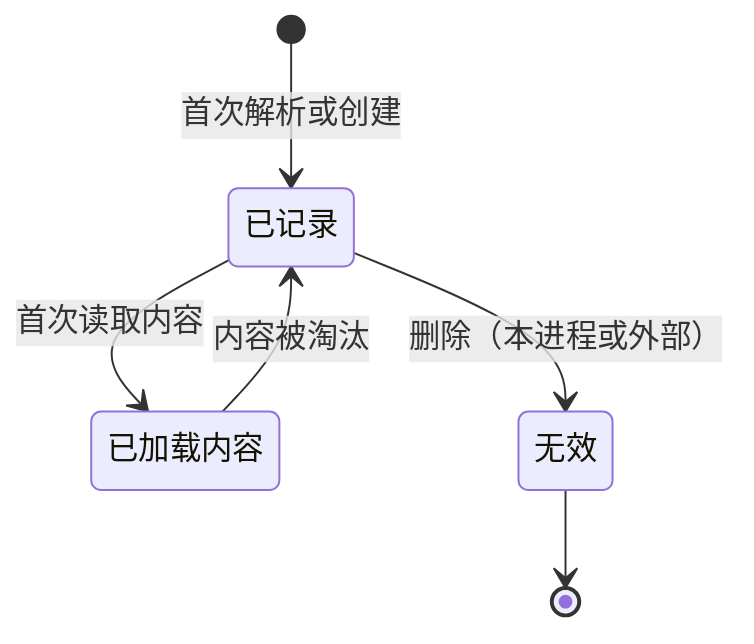

# 04 — 虚拟文件系统

> 范围：虚拟文件的标识与内容模型、文件系统族、事件与刷新语义、文件类型、写入与安全。｜ 依赖：02（模块/服务/扩展点）、03（并发与读写锁）。｜ 排除：文本缓冲区（见 05）、语法树与桩（见 06）、索引（见 07）、版本控制状态（见 18）。

## 1. 目的与范围

### 1.1 本子系统解决什么问题

编译器和编辑器面向的"文件"在物理上可能位于本地磁盘、归档包内部、远端主机、容器、内存或网络端点。若每个上层功能都自行判断"这是哪种文件、能不能写、内容怎么取"，系统将出现无法收敛的分叉。

虚拟文件系统（Virtual File System，下称 VFS）的作用是**把"文件"抽象成一种带稳定标识与内容句柄的对象**，使上层只面对一套契约：

1. **同一性**：同一个物理文件在一次进程生命周期内**必须**映射到同一个虚拟文件（Virtual File，下称 VF）实例；不得出现两个表达同一路径的不同对象。
2. **可寻址**：VF 以"协议 + 路径"构成的统一地址被引用，地址可持久化到配置、书签、断点、运行配置中，并在重启后重新解析。
3. **内容按需**：VF 只承诺"能取到内容"，不承诺"内容已在内存"。加载时机、体积阈值、编码判定、缓存驻留均由本子系统决定。
4. **变更可观测**：任何来源的变更（本进程写入、其他进程写入、刷新发现、归档重新挂载）**必须**归约为有限种类的变更事件，并按确定顺序投递。
5. **写入可控**：写入前必须能回答"该文件是否允许被本进程修改"，并能在被拒绝时给出可解释理由。

VFS 是"文本 → 结构 → 索引 → 分析"四级数据流的入口（见 01 §2.1）。它只保证"读到正确字节、知道何时变了"，不解释字节含义。

### 1.2 边界

本子系统**不负责**：

- 文本缓冲区的编辑、撤销、增量重算（见 05）；VFS 提供字节，文档层负责字节与字符的持久化映射与编辑事务。
- 语法解析、符号解析、桩生成（见 06），以及索引的构建、存储与查询（见 07）；VFS 只提供"文件标识 + 内容版本"作为索引的键。
- 版本控制状态、差异、合并（见 18）；VCS 以"派生只读文件系统"的形式接入，不修改物理文件。
- 项目结构（内容根、源根、排除根）的判定（见 11）；VFS 只回答"这个路径是否在某个根之下"。
- 用户界面的文件树呈现（见 13）。

### 1.3 与其他子系统的关系

| 关系 | 方向 | 契约要点 |
|---|---|---|
| 03 并发 | 依赖 | 结构性变更（创建/删除/移动/重命名/复制）**必须**在写锁内；事件投递在写锁内；读取可并发 |
| 05 文档 | 被依赖 | 文档以 VF 为宿主，按内容版本判定"磁盘是否被外部改动" |
| 06 语法树 | 被依赖 | 以 VF 标识为文件键；以内容版本为失效依据 |
| 07 索引 | 被依赖 | 以 VF 标识 + 内容版本作为索引条目的键与失效条件 |
| 11 工程模型 | 双向 | 内容根由工程模型声明，VFS 提供子树遍历与可见性 |
| 15 扩展机制 | 依赖 | 文件系统族、文件类型、监听器、写访问提供者均为扩展点 |
| 17 远端部署 | 双向 | 远端文件系统族把路径解析与内容读取转发到服务端 |

## 2. 概念模型

### 2.1 术语

| 术语 | 定义要点 |
|---|---|
| 虚拟文件（VF） | 文件系统之上的统一文件标识与内容句柄；有稳定标识，不参与资源释放 |
| 文件系统（FS） | 一类路径空间；以协议名标识；负责路径解析、属性读取、内容读写、监听注册 |
| 文件标识 | 在文件系统生命周期内唯一且稳定的整数标识；随文件记录持久化 |
| 内容标识 | 内容块在内容存储中的标识；多个 VF 可共享同一内容标识 |
| 属性集 | 目录/只读/隐藏/符号链接/特殊文件/子级大小写敏感等位标志 |
| 修改计数 | 单调递增计数器，用于判定"内容是否变过" |
| 时间戳 | 文件系统报告的最后修改时刻；可被外部工具改写，不可作为唯一失效依据 |
| 刷新会话 | 一次"把某批子树与物理状态对齐"的批处理单元，产出事件列表 |
| 变更事件 | 描述一次结构或内容变化的不可变记录 |
| 监听器 | 对变更事件做出反应的对象；分同步（before/after）与异步（可拦截）两类 |
| 文件类型 | 对文件内容的分类；决定是否二进制、默认编码、图标、是否有专用视图 |
| 写访问提供者 | 判定"某文件在给定项目下是否允许写入"的扩展 |

### 2.2 实体关系

```
文件系统（协议） 1 ── n 虚拟文件
虚拟文件 ── 文件标识（稳定）、属性集、内容标识 → 内容块、文件类型、子虚拟文件
刷新会话 n ── n 虚拟文件；刷新会话 1 ── n 变更事件列表
外部变更监视器 ── 刷新会话
变更事件列表 ── 同步监听器（before/after）、异步监听器（prepareChange → 应用器）
写访问提供者 ── 虚拟文件
```

### 2.3 三种"路径"视图

一个 VF 同时具有三种可表达的路径，**必须**明确区分，不得混用：**内部路径**（文件系统内规范路径，`/` 分隔，不含协议，作为标识键）、**统一地址**（`协议://内部路径`，跨子系统引用与持久化使用此形式）、**呈现路径**（面向用户，按平台习惯替换分隔符：Windows 反斜杠，其他平台正斜杠）。

## 3. 数据模型

### 3.1 虚拟文件

```
VirtualFile {
  id: FileId                // 文件系统生命周期内唯一且稳定
  name: string              // 单段名，不含分隔符
  path: string              // 内部路径（规范形态）
  parent: VirtualFile?      // 根为 null
  children: VirtualFile[]?  // 目录：可枚举；普通文件：必须为 null
  fileSystem: FileSystemRef
  valid: bool               // 记录未被回收
  attributes: {             // 位集
    directory, readOnly, hidden, symlink, special: bool
    childrenCaseSensitive: bool?   // 三态：未知 / 敏感 / 不敏感
    offlineByDefault: bool
  }
  content: { contentId: ContentId?, length: int64, timestamp: int64, modificationCount: int64 }
  // contentId 惰性：未加载为 null
  charset: Charset?         // null = 未覆盖，使用默认
  bom: bytes?               // 与 charset 联动
  detectedLineSeparator: string?
  fileTypeOverride: FileType?
  userData: map<key, value> // 每实例附加数据
}
```

字段约束：

- `id` **必须**在创建时分配并在文件存续期内不变；重命名与移动**不改变** `id`。
- `valid=false` 后除 `id`、`fileSystem` 外的一切读取**必须**返回"无效"信号而非抛出未定义行为；`children` **必须**为 null。
- 修改标记（`modificationStamp`，用于判定内容是否变过的单调值）在 `valid=false` 时**必须**返回 `-1` 作为哨兵；有效时**必须**不小于 0 且随内容变化单调不减。
- `timestamp` 由文件系统报告，**不得**作为唯一失效判据。
- `childrenCaseSensitive` 为三态：未知时**必须**按"与文件系统默认一致"处理，直到首次枚举完成探测。

### 3.2 文件系统

```
FileSystem {
  protocol: string            // 地址前缀，全局唯一
  physical: bool              // 是否对应真实外部存储（参与版本控制与本地历史）
  caseSensitive: bool         // 同一目录下 "A" 与 "a" 是否为不同名
  readOnly: bool              // 整个文件系统是否只读
  pathSeparator: string       // 内部路径分隔符，固定为 "/"
  nameValidator(name) -> bool // 非空且不含 "/" 与 "\"
  capabilities: { writable, symlinkAware, contentPreloadable, integrityCheckable, versioningKind }
}
```

`versioningKind` 取值：`DISABLED`（不参与本地历史与差异）、`LOCAL`（默认）、`ENFORCED_NON_LOCAL`（强制视为非本地，不写入本地历史）。

已知文件系统族及其语义差异（新增族**必须**在此四维上显式声明）：

| 族 | 路径语法 | 大小写 | 符号链接 | 写支持 |
|---|---|---|---|---|
| 本地 | `file://` + 绝对路径；分隔符按平台 | 按卷：Windows 不敏感、类 Unix 敏感 | 跟随；解析出规范目标，用于去重与环检测 | 可写，受文件属性与权限约束 |
| 临时 | `temp://` + 内部路径；进程内有效 | 敏感 | 无 | 可写，随会话销毁 |
| 归档内嵌 | `<归档地址>!/<条目路径>`；条目内以 `/` 分隔 | 敏感（条目名按字节比较） | 不跟随 | 条目只读；整包可重新挂载 |
| 内存 | `mem://` + 任意层级路径 | 敏感 | 无 | 可写，不落盘 |
| 远端（SSH / WSL / 容器） | `ssh://host/path`、`wsl://distro/path`、`container://id/path` | 以目标主机文件系统为准，由服务端上报 | 由服务端解析后回传规范目标 | 按远端权限；不可达时拒绝 |
| 协议式（URL） | `http(s)://` + 不透明路径 | 敏感（按服务端语义） | 无 | 只读；内容可缓存到本地存储 |
| 只读派生 | 自定义协议 + 虚拟路径（如仓库版本、数据库视图） | 敏感 | 无 | 只读；变更由上游驱动 |

### 3.3 文件类型

```
FileType {
  name: string               // 稳定标识
  displayName, description, defaultExtension: string
  binary, readOnly: bool     // readOnly = 类型层面禁止编辑
  charsetHint(file, prefixBytes) -> Charset?
  charsetHardcoded: bool     // true 时忽略用户编码覆盖
}
```

### 3.4 变更事件

```
VFileEvent {
  kind: Create|Delete|Move|Copy|ContentChange|PropertyChange
  requestor: Origin          // 发起者；用于区分"刷新导致"与"用户保存导致"
  path: string
  file: VirtualFile?
  fileSystem: FileSystemRef
  valid: bool                // 事件仍然描述当前状态
}
ContentChange 是 VFileEvent 的特化 {
  oldModificationStamp, newModificationStamp, oldTimestamp, newTimestamp, oldLength, newLength
}
PropertyChange 是 VFileEvent 的特化 {
  property: name|encoding|writable|hidden|symlinkTarget|childrenCaseSensitivity, oldValue, newValue
}
Move 是 VFileEvent 的特化 { oldParent, newParent }
Copy 是 VFileEvent 的特化 { originalFile, copyName }
```

`requestor` 语义：`REFRESH` 表示由刷新发现产生（非本进程主动修改）；"保存请求者"表示由文档保存引发。监听器可据此抑制回声（见 §4.4）。

### 3.5 持久化形态

文件记录**必须**跨会话持久化，否则重启后标识与缓存全部失效、索引无法复用：

| 存储 | 内容 | 失效策略 |
|---|---|---|
| 文件记录表 | id → (父 id, 名 id, 属性位, 内容 id, 长度, 时间戳, 修改计数) | 随文件系统生命周期；损坏时整体重建（见 §7） |
| 名称表 | 名 id → 名称字符串（去重、可压缩） | 只增；由压缩/整理回收 |
| 内容存储 | 内容 id → 字节块 | 按长度阈值与引用计数淘汰 |
| 路径索引 | 路径前缀树 → 文件 id | 与记录表同源，重建时重算 |

**不变量**：记录表与内容存储**必须**可独立校验；内容缺失只导致"需要重读"，不得导致标识重建。

## 4. 行为契约

### 4.1 生命周期状态机



状态转移说明：`无效` 为终态，**不得**回到 `已记录`；同一路径重新出现时产生**新**标识的新实例（见 INV-3）。

规则：

1. VF **必须不**参与资源释放。它**必须不**实现任何"可释放/可关闭"接口；构造期即拒绝此类实现，因为 VF 可能在应用级缓存、书签、断点、历史中被长期持有，过早释放会造成悬空引用。
2. 因此 VF 持有的资源（内容块、监听、句柄）**必须**由文件系统或刷新会话的责任域管理，而非由 VF 自身释放。
3. `invalid` 是**单向且终态**的：一个 VF 一旦无效**不得**复活。同一路径重新出现时**必须**产生新的 VF（新 id），旧 id 不复用。
4. 内容淘汰**不改变**有效性，只把 `contentId` 置空。

### 4.2 标识稳定性与路径规范化

- 标识**必须**由"父 id + 名称"派生并记录，不得由路径字符串哈希派生。
- 重命名、移动（同文件系统内）**必须**保持 id 不变，只改父 id 与名 id；这会触发属性变更与移动事件，而非"删除 + 创建"。
- 跨文件系统移动**必须**被拒绝：不同文件系统之间没有可比较的标识空间。
- 路径规范化规则：
  1. 折叠重复分隔符，去除尾部冗余分隔符（根除外）。
  2. 逐段解析；`.` 段忽略；`..` 段回退到父级。
  3. 若当前段是符号链接，`..` **必须**先取"规范目标"再取父级，不得在链接自身的父级上回退。
  4. 大小写处理：文件系统大小写不敏感时，查找**必须**按不敏感比较，但**必须**保留磁盘上实际的大小写形态作为 `name`。
- 逃逸防护：相对路径解析**必须**在越过文件系统根时返回"不存在"，不得返回根之上的任意对象。

### 4.3 事件投递时序

一次变更有严格的四阶段时序，**任何**监听器都不得看到"事件已发出但状态尚未生效"的中间态：

| 阶段 | 执行条件 | 内容 |
|---|---|---|
| A 准备 | 只读，可在写锁外/后台 | 异步监听器 `prepareChange(events)` 返回应用器（或空表示不关心） |
| B 变更前 | 已取得写锁，状态未变 | 应用器 `beforeVfsChange()`；此时可读到旧值 |
| C 变更 | 写锁内 | 状态改变；同步监听器 `before(events)` 先、`after(events)` 后 |
| D 变更后 | 写锁内，默认在全部同步监听器之后 | 应用器 `afterVfsChange()` |

关键契约：

- `prepareChange` 在**事件可见之前**执行，因此它可以"拦截并延迟"：返回的应用器可在 `beforeVfsChange` 中阻塞至外部条件满足（例如等待版本控制元数据就绪），从而让状态变更与事件投递同时后移。
- **例外排序**：若应用器被标记为"其 after 必须先于其他监听器触发"，则它在阶段 C 之前运行 `afterVfsChange`，用于那些必须在常规监听器之前重算文件的场景。
- 应用器分两类执行域：界面域与后台域。**必须**先执行界面域全部应用器，再执行后台域全部应用器。
- 单个 `prepareChange` 耗时超过 10 秒**应当**记录告警（含事件数量与耗时），但**不得**中断；异常**必须**被隔离，不影响其他监听器。
- 应用器与事件列表一一配对；退出前**必须**校验"所有应用器都已被处理"，未处理视为编程错误（见 §9）。

### 4.4 事件顺序、合并与去抖

- **顺序保证**：同一批事件内**必须**保持"产生顺序"；跨批事件**必须**严格串行（后一批的 before 不得早于前一批的 after）。
- **因果保证**：删除目录时，其子树的删除事件**必须**在同一批中，且父先于子；创建目录时父先于子。
- **合并与去抖**：同一次刷新内，对同一文件的多次内容变更**必须**合并为一次（保留首尾的修改计数与长度）；同一路径的"删除 + 创建"**不得**合并为"内容变更"；外部监视器上报的连续脏路径**必须**在刷新会话内聚合成一棵最小覆盖子树（见 §4.5），而不是逐条路径重扫。
- **版本一致**：事件的 `newModificationCount` **必须**等于事件投递完成时该 VF 的 `modificationCount`。若期间发生新变更，旧事件**必须**被标记为无效（`valid=false`），监听器**必须**以"重新读取"而非"增量应用"回应。
- **回声抑制**：本进程写入产生的事件携带非刷新的发起者；由刷新发现同一变更时不重复投递。

### 4.5 刷新

刷新是"把一组 VF 与其物理状态对齐"的批处理。

刷新会话的输入是"根集合 + 三个开关"：`asynchronous`（是否异步）、`recursive`（是否递归）、`background`（是否后台），外加完成回调与工作队列；输出是一批变更事件。

算法：

1. **入队**：显式加入的文件，或由监视器脏路径解析出的根集合。
2. **筛选**：只有"脏"的文件才进入重扫集合。非递归且同步的刷新**必须**强制把入队文件标脏（否则无变更可发现）。
3. **扫描**：对每个脏根，比较属性、长度、时间戳与内容摘要级别的可判定信息，产出事件；递归时向下遍历子级，遇到新增目录继续下钻，遇到删除目录整体产出子树删除事件。
4. **重试**：扫描期间若发现状态仍在变动（例如文件正被写入），**应当**重试，上限 3 次；超限则按"当前状态"定稿并标记为不确定。
5. **去重**：事件列表按"同一文件 + 同一变更种类"去重，保留最后一次。
6. **投递**：走 §4.3 的完整时序。

读取语义：

- 刷新期间，读操作**必须**看到"某一确定版本"的内容：要么是刷新前版本，要么是刷新后版本，**不得**看到"长度已更新而内容未更新"的组合。实现上由内容标识与修改计数的原子替换保证。
- 同步刷新完成返回时，被刷新子树的 `modificationCount` **必须**已是最终值；异步刷新返回时只承诺"已入队"，完成回调在事件投递之后触发。
- **部分刷新**：可只刷新某个子树或单个文件，效果**必须**等同于对该子树递归刷新且不影响兄弟子树的事件。刷新可被取消；已产生的部分结果**必须**被丢弃，不得投递半批事件。

**外部变更检测**：本地文件系统的监视器为每个受监视目录注册"递归"或"扁平"两种深度；收到的事件被归类为"路径脏"、"目录脏"、"递归脏"、"创建/删除"、"重置"。监视器失效（超过监视上限、底层不可用）时**必须**降级为"按需刷新"并在下次访问时重扫该根。

### 4.6 内容访问

- **按需加载**：`length`、`timestamp`、`modificationCount` **必须**可从记录表直接返回，不需要读内容。内容只在首次请求字节时加载。
- **阈值**：超过 **2.5 MB**（实测配置）**必须不**参与智能功能（语法树、检查、补全），按纯文本处理；超过 **20 MB**（实测配置）**必须不**被整体载入，读取请求**必须**失败并给出可解释错误；单文件内容进入驻留缓存的默认上限为 **1 MB**（实测默认值 `idea.vfs.max-file-length-to-cache = 1048576`，可配置），超过则不驻留、每次重新取。
- **共享与引用计数**：相同字节序列**应当**共享同一内容标识；内容存活以引用计数管理，计数归零后可被淘汰，淘汰只影响 `contentId`，不影响标识。
- **字节 ↔ 字符**：编码判定顺序为"类型硬编码编码 > 项目或文件的用户覆盖 > 内容嗅探（BOM 优先，其次统计式启发）> 全局默认编码"。
- **BOM**：与编码**必须**同步维护——设定编码时**必须**同时确定是否写入/保留 BOM；切换编码时若原 BOM 与新编码不兼容**必须**丢弃；BOM **必须**从内容中剥离后再交给字符层，且剥离量与编码绑定。
- **换行符探测**：首次读取时**应当**探测主导换行序列（CRLF / LF / CR）并记录；该结果只作为"保存时保持原风格"的提示，不改写内容。
- **二进制判定**：以文件类型为主（类型声明为二进制即二进制）；类型未知时按内容嗅探（控制字符比例、NUL 出现、非法编码序列）判定；判定为二进制后**不得**再尝试字符解码。

### 4.7 文件类型判定

判定**必须**按下述优先级短路，先命中者胜出：

| 优先级 | 依据 | 说明 |
|---|---|---|
| 1 | 显式指定 | 文件上带"已指定类型"标记（例如归档内条目由归档元数据指定、或派生视图指定） |
| 2 | 类型覆盖器 | 扩展可按"文件 + 全局上下文"否决/改写已有判定 |
| 3 | 完整文件名映射 | 精确名匹配（用于约定名文件） |
| 4 | 扩展名映射 | 大小写不敏感；同名多类型时按注册顺序与优先级 |
| 5 | 内容探测 | 按需读取前缀（默认 1024 字节，可声明更大）交给探测器链；首个非空结果胜出 |
| 6 | 父级继承 | 目录或无扩展名文件按所在上下文推断（例如归档内条目继承归档的类型族） |
| 7 | 未知 | 统一"未知"类型，**必须**为二进制、只读视图、无智能功能 |

能力约束：

- 文件类型只描述"内容类别"，**不**等于语法高亮。语法高亮由语言层从类型再映射（见 06 §2）；一个类型可对应零个或多个语言，一个语言可对应多个类型。
- 二进制类型**可以**声明一个"结构视图"（反编译/十六进制/元数据视图），该视图是**只读派生**，不改变文件类型本身；类型是**不变**的，中途改变只可能由"覆盖器"或"显式指定"引起，且**必须**产生属性变更事件。

### 4.8 写入与安全

写入流程**必须**完整经过以下步骤：

1. **可写性判定**（任一否决即拒绝，并给出理由）：文件系统整体只读 / 文件属性只读（可先请求提升，失败则拒绝）/ 项目级写访问提供者返回不可写 / 类型级只读（允许另存但不允许原地编辑）。**潜在可写**与**实际可写**是两个判定：前者用于界面提前提示，后者在真正写入前重新确认。
2. **写锁**：结构性变更（创建/删除/移动/重命名/复制）与内容写入**必须**在写锁内执行（见 03 §5）。
3. **原子替换**：内容写入**必须**以"临时目标 + 原子替换"实现，或退化为"先截断后写但保证崩溃后可检测"，使外部读取者不会观察到半截文件。写入完成时**必须**指定新的修改计数与时间戳，二者与内容一同原子生效。
4. **事件**：写入成功后**必须**产生内容变更事件（旧/新长度、时间戳、修改计数全部携带）；写入失败**必须不**产生事件，且原有内容保持不变。
5. **并发冲突**：写入前**必须**比对"当前修改计数"与"调用者期望的修改计数"。不一致即视为冲突：**必须**拒绝写入并回报冲突，由上层决定覆盖或重载。**不得**静默覆盖。
6. **权限与名称校验**：只读属性变更**必须**经文件系统能力执行，不支持时**必须**回报"不支持"而非静默成功；名称**必须**非空且不含 `/` 与 `\`；创建前**必须**确认同级不存在同名项，目标父级**必须**存在且为目录。

### 4.9 与文档 / 语法树 / 索引的接口契约

只规定契约，细节见 05、06、07：

- 文档层以 VF 为宿主，保存时**必须**通过 §4.8 的写入流程，成功后**必须**把文档的"已保存版本"更新为事件中的新修改计数。
- 语法树以 VF 标识为文件键、以内容版本为失效依据；内容变更事件到达后旧树**必须**标记为过期而非就地改写。索引以"文件标识 + 内容版本"为条目键：删除事件**必须**移除条目，移动事件**必须**更新路径键但可复用内容键。

## 5. 不变量与约束

- **INV-1**：同一物理文件在一个文件系统内**必须**只对应一个 VF 实例。
- **INV-2**：VF 标识在文件存续期内**必须**不变（重命名与移动不改变标识）；无效 VF **必须不**复活，同一路径重建产生新标识。
- **INV-3**：VF **必须不**实现任何可释放接口；构造期即拒绝。
- **INV-4**：`children` 对普通文件**必须**为 null。
- **INV-5**：事件的 `newModificationCount` **必须**等于投递结束时该 VF 的实际修改计数。
- **INV-6**：同一批事件内**必须**父先于子；禁止子先于父。
- **INV-7**：跨文件系统移动**必须**被拒绝。
- **INV-8**：任何读取**必须**看到完整版本的内容与长度组合，不得出现交叉版本。
- **INV-9**：写入冲突**必须**显式回报，**不得**静默覆盖。
- **INV-10**：内容驻留超过 1024 KB 的文件**必须不**进入驻留缓存。
- **INV-11**：未知类型**必须**表现为二进制且只读。
- **INV-12**：刷新被取消时**必须不**投递任何半批事件。
- **INV-13**：文件名比较在大小写不敏感文件系统上**必须**不敏感，但展示名**必须**保留磁盘大小写。

## 6. 对外能力契约

概念级签名（不绑定语言）：

```
resolve(protocol, path) -> VirtualFile?            // 不触发刷新
resolveAndRefresh(protocol, path) -> VirtualFile?  // 刷新后解析
addressOf(VirtualFile) -> string                   // 协议://路径
parentOf / listChildren / findChild / resolveRelative(...)
readBytes(VirtualFile) -> bytes throws             // 受阈值约束
openByteStream(VirtualFile, expectedModCount) -> stream throws
writeBytes(VirtualFile, bytes, expectedModCount, newTimestamp) -> newModCount throws
createChildFile / createChildDirectory / delete / move / copy / rename(...) throws
refresh(targets, recursive, asynchronous, finishCallback)
refreshAll(asynchronous)
addSyncListener / addBulkSyncListener / addAsyncListener(...)   // 异步监听器可返回应用器以拦截
fileTypeOf(VirtualFile) -> FileType
ensureWritable(VirtualFile or set) -> {可写集合, 拒绝原因}
isPotentiallyWritable(VirtualFile, project) -> bool
canCloseFiles(set) -> bool
```

语义补充：

- 所有 `throws` 路径**必须**携带可区分的失败类别（不存在、无权限、只读、冲突、超限、不支持），不得只返回空。
- `ensureWritable` 在失败时**必须**返回"理由文本 + 可操作链接"，使调用方能直接呈现。
- `canCloseFiles` 是"关闭前检查"：任一检查者否决则整体拒绝；用于防止关闭时丢失未保存状态或未完成的外部同步。

## 7. 故障模式与降级

| 故障 | 检测 | 用户可见 | 降级档 | 恢复 |
|---|---|---|---|---|
| 未捕获内容（文件被外部删除） | 读内容失败 / 属性探测返回不存在 | 编辑器标记"已删除"，保存时提示 | D1 | 刷新该路径；若重建则产生新 VF |
| 持久化结构损坏（内容存储 / 文件记录表）与监视线失效 | 启动期一致性校验失败或记录读取异常；底层监视器报错或监视根超限 | 无（静默重建），首次索引变慢；通知"外部变更检测受限" | D1 | 内容缺失只丢缓存按需重读、记录表损坏则遍历物理树重建；监视失效降级为按需刷新，用户可手动刷新 |
| 内容超限（> 20 MB） / 符号链接成环 | 读取前检查长度；路径解析深度与访问集合检测 | 明确提示"文件过大"；树中标记为环、禁止下钻 | D1 | 以受限纯文本方式打开；显示环的规范目标 |
| 归档损坏 / 校验失败 与 远端文件系统失联 | 条目读取异常或校验和不匹配；连接中断或超时 | 归档节点标记损坏；远端树保持最后已知状态，操作排队或拒绝 | D2 | 重新挂载该归档；重连后必须触发该根的全量刷新 |
| 写访问提供者异常 | 调用抛出 | 该提供者被忽略，其余继续判定 | D2 | 记录并隔离；不阻塞编辑 |
| 文件系统整体不可用（例如远端主机下线） | 解析/刷新失败 | 该协议下所有节点不可用 | D3 | 恢复后重挂载并刷新 |
| VF 校验不变量被破坏（标识冲突） | 启动期或断言 | 提示重建 | D5 | 以只读模式启动，重建记录表并导出诊断包 |

**通用规则**：任何降级**必须**局部化到"受影响的文件系统或子树"，不得使整个 VF 层不可用；处于降级态的文件**必须**保持"可解析、可枚举、内容读取报明确错误"的三态之一，而不是从树中静默消失。

## 8. 资源与性能预算

| 项 | 预算 | 依据 |
|---|---|---|
| 默认堆上限 | 2 GB（实测启动参数） | 内容驻留必须依赖淘汰而非增长 |
| 单文件内容驻留上限 | 1024 KB（实测常量） | 超过则每次读取皆重新取 |
| 智能功能阈值 / 内容载入上限 | 2.5 MB / 20 MB（实测配置） | 前者以上不解析；后者以上拒绝整体载入 |
| 内容探测前缀 | 默认 1024 字节，可声明更大 | 类型探测成本与之线性相关 |
| 刷新重试 | 上限 3 次 | 防止持续变动文件拖住刷新会话 |
| 事件批处理 | 单次刷新产出的事件列表为一个批次 | 批过大时必须拆分并保持因果顺序 |
| 慢调用告警 / 进度上报阈值 | 10 秒 / 5000 ms | 前者只告警不中断；后者超时后须暴露进度 |
| 名字缓存 | 有界，按最近使用淘汰 | 防止长会话内无界增长 |

容量策略：

- 记录表与名称表只增不删是**不允许**的长期形态：必须提供压缩/整理通道，并在空闲期回收。
- 内容缓存按"长度优先淘汰 + 引用计数保护"组织；不可达内容优先于可达内容被淘汰。
- 一次刷新的工作量**必须**与"脏子树规模"成正比，而非与项目总文件数成正比。

## 9. 可观测性

必须可回答的问题与对应信号：

| 问题 | 信号 |
|---|---|
| 一次刷新扫了多少、产了多少事件、耗时多少、为什么慢 | 刷新会话记录：队列长度、扫描文件数、事件数、耗时、是否取消、是否重试；并按"本地 / 归档 / 其他"分类的根计数与各自耗时 |
| 事件流是否堵塞 | 每批事件的投递耗时；应用器耗时超阈告警（含监听器标识与事件数） |
| 谁在写这个文件 | 事件携带的发起者（刷新 / 保存 / 其他） |
| 内部状态健康度 | 内容缓存命中/未命中计数与因超阈值被跳过的次数；监视根数量、递归/扁平分布、失败次数与最近原因；记录数、空闲槽位、碎片率、最近整理时间 |
| 最小可复现状态 | 文件标识、内部路径、修改计数、时间戳、长度、属性位、所属协议、最近一批事件 |

约束：所有诊断信息**必须**包含"标识 + 修改计数"，否则无法与索引/文档状态对齐。

## 10. 扩展点

| 接缝 | 契约 | 失败隔离 |
|---|---|---|
| 新增文件系统族 | 声明协议名、物理性、大小写语义、名称校验、解析/枚举/读写/监听；协议名全局唯一 | 注册失败或运行时异常**必须**只导致该协议不可用；不得影响已注册协议 |
| 新增文件类型 | 声明名称、默认扩展名、是否二进制、是否只读、图标、可选编码提示 | 类型冲突按注册顺序解决；异常类型被替换为"未知" |
| 内容探测器与类型覆盖器 | 探测器声明所需前缀长度与探测函数（返回空表示不表态）；覆盖器依据文件与上下文改写判定 | 异常探测器被跳过并记录，不中断探测链；覆盖结果为空则回落到原判定 |
| 异步变更监听器 / 批量同步监听器 | 前者 `prepareChange` 返回应用器以拦截，应用器分界面域/后台域；后者在写锁内处理成批事件，可声明"需在后台执行" | 异常被捕获并记录；不得阻止状态变更 |
| 写访问提供者与关闭前检查 | 前者项目级返回"允许/拒绝/潜在可写"及理由；后者对一组文件返回是否可关闭 | 异常均视为"不否决"，不阻塞编辑与关闭 |
| 编码提供者 | 为文件或项目提供默认/覆盖编码 | 与类型硬编码编码冲突时，硬编码优先 |
| 内容预加载与完整性校验能力 | 文件系统声明"支持预取"，按批次拉取内容；归档型可提供条目校验和 | 预取失败不影响按需读取；校验失败只标记该条目损坏 |
| 可见性与归档处理族 | 可见性提供者项目级三态返回，多个取"与"，全为空用默认值；归档处理族声明条目枚举、内容读取、CRC | 可见性异常视为"不表态"；格式损坏只影响该归档 |

**通用扩展契约**：任何扩展**不得**在 VF 上持有强引用的应用级状态（VF 不参与释放，见 INV-4）；需要生命周期挂钩的扩展**必须**把资源挂在自己的作用于域，并只持有 VF 的标识。

## 11. 对照实现（证据锚点）

以下注册数为**模块描述符与插件描述符合计**。

| 锚点 | 形态 | 对应上文 |
|---|---|---|
| `com.intellij/virtualFileSystem`（40 处）；注册 `key` 值：`file`、`jar`、`temp`、`dummy`、`http`、`https`、`settings`、`jrt`、`vcs`、`vcs-log`、`helm-tgz`、`dbSrc`、`das`、`vmScript`、`fwd`、`maven-properties`、`uml`、`ghpr`、`lazyAttachVfs`；部分带 `physical="true"`（`file`、`jar`、`temp`、`jrt`、`helm-tgz`、`dbSrc`）；配套 `multiRoutingFileSystemBackend`（4 处）、`backedVirtualFileProvider`（已声明、无注册） | 扩展点；描述符属性 | §2.1、§2.2、§3.2、§10 |
| `com.intellij/fileType`（172 处）、`com.intellij/fileTypeRegistrar`（3 处）、`com.intellij/fileType.fileViewProviderFactory`（9 处）、`com.intellij/filetype.decompiler`（8 处）、`com.intellij/fileTypeFactory`（已声明、无注册） | 扩展点 | §3.3、§4.7、§10 |
| `com.intellij/fileTypeDetector`（10 处，默认前缀 1024 字节）、`com.intellij/fileTypeOverrider`（8 处） | 扩展点 | §4.7 优先级 2 与 5、§8 |
| `com.intellij/vfs.asyncListener`（26 处）、`com.intellij/vfs.asyncListenerBackgroundable`（6 处） | 扩展点 | §4.3 界面域/后台域应用器 |
| `com.intellij/writingAccessProvider`（12 处）、`com.intellij/nonProjectFileWritingAccessExtension`（15 处）、`com.intellij/virtualFilePreCloseCheck`（已声明、无注册） | 项目级/应用级扩展点 | §4.8、§6 `canCloseFiles`、§10 |
| `com.intellij/fileEncodingProvider`（1 处） | 扩展点 | §4.6 编码判定顺序 |
| `com.intellij/virtualFileCustomDataProvider`（15 处）、`virtualFileCustomDataConsumer`（13 处）、`virtualFileQualifiedNameProvider`（2 处） | 扩展点 | §3.1 `userData`、§2.3 呈现路径 |
| `com.intellij/vfs.local.pluggableFileWatcher`（6 处）、`com.intellij/vfs.local.fileOperationsHandler`（1 处）、`com.intellij/localFileSystemTimestampEvaluator`（已声明、无注册） | 扩展点 | §4.5 外部变更检测、§4.8 原子替换、§3.1 时间戳语义 |
| 大文件阈值 2500 / 20000（KB）；内容驻留上限 1048576 字节 | 启动配置与常量实测 | §4.6、§5 INV-11、§8 |
| 刷新重试上限 3；监听器慢调用告警 10 s | 启动配置与实现常量 | §4.3、§4.5、§8 |
| 文件记录 / 名称表 / 内容存储分表；属性位集（目录、只读、符号链接、隐藏、特殊、大小写敏感、离线） | 持久化实现分片与属性位常量 | §3.1、§3.5 |

## 12. 未决问题

1. 「内容级去重」的判定粒度（整块哈希 vs 前缀哈希）在超大文件上的成本边界，证据只显示存在共享内容标识与引用计数，未显示哈希算法与分块策略 `[推断]`。
2. 远端文件系统族在连接中断期间与本地记录表的对齐方式（"标记为陈旧"还是"整体失效"）、重连后是否强制全量刷新，以及归档完整性校验的触发时机（打开时 / 空闲时 / 用户显式），证据均未给出统一规定 `[推断]`。
3. 大小写敏感性的三态（未知/敏感/不敏感）在首次枚举后是否被持久化以跨会话复用，证据未明确 `[推断]`。
4. 事件批的最大规模上限未见于证据；超大批次的拆分策略（按子树还是按事件数）`[推断]`。
5. 写访问提供者的判定结果是否按项目缓存、以何种信号失效，证据未给出 `[推断]`。
