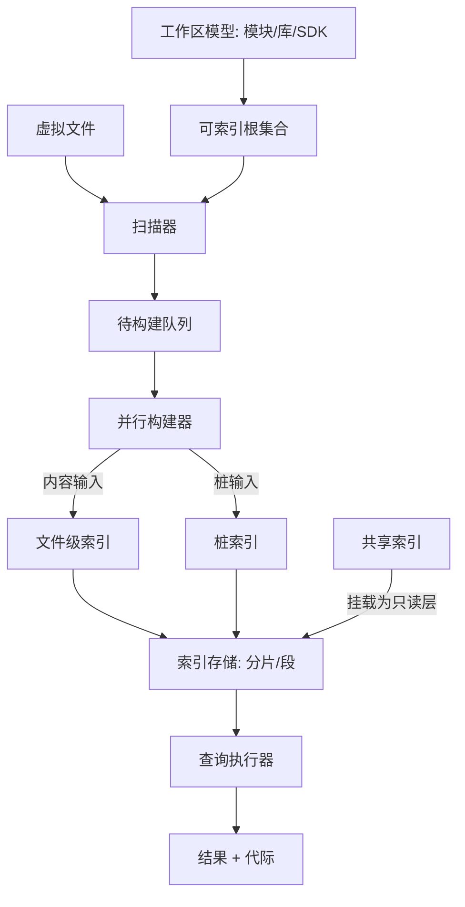

# 07 — 索引与检索

> 范围：索引的定义与种类、更新流水线、存储形态、共享索引、哑模式状态机、检索原语、结果一致性与查询优化。｜ 依赖：03（并发与写意图）、04（文件标识与内容）、06（语法树与桩）。｜ 排除：语法树与桩的构造（见 06）、文件内容读取与缓存（见 04）、检查与补全的判定策略（见 08、09）、远端传输协议（见 17）。

## 1. 目的与范围

### 1.1 本子系统解决什么问题

系统中的多数用户操作——找符号、找用法、补全、检查、重构、结构搜索——本质是同一个问题："**哪些文件（乃至哪些位置）含有 X**"。若每次遍历全部文件并解析，代价与"文件数 × 解析成本"成正比，在万级文件的项目上不可接受。

本子系统把问题改写为**索引查找**：文件在内容第一次被系统看到时被投影成若干张键值映射并持久化，此后查询只读映射、不触碰原文。它必须回答五个问题：

1. **定义**：什么事实可被索引、如何声明、如何版本化、如何与语言无关地表达。
2. **时点**：文件变更后何时重建、如何把大量变更合并成一次受控扫描。
3. **存储**：映射如何落盘、提交如何原子、崩溃后如何自愈。
4. **复用**：如何把与具体项目无关的部分（第三方库、SDK）跨机器分发以缩短首次打开。
5. **一致性**：读者如何知道结果属于哪一代；索引未就绪时哪些能力关闭、哪些可降级。

### 1.2 边界

本子系统**不负责**：词法/语法解析与桩的构造（见 06）；文件系统访问、归档展开与内容长度限制判定（见 04）；语言语义（何种标识符值得索引、何种引用算一次用法，由语言扩展声明）；用户可见的搜索界面（对话框、结果树、替换）；倒排索引细节（内容级匹配由三元组索引与词扫描缓存作为原语提供）。

### 1.3 与其他子系统的关系

| 关系 | 说明 |
|---|---|
| 04 文件系统 | 提供文件标识（生命周期内稳定、可整数化）、内容句柄、排除标记、符号链接策略 |
| 06 语法树与桩 | 提供"桩"作为可脱离全文重建的输入；桩索引的键值由桩直接导出 |
| 03 并发 | 构建在后台池执行；查询需在读锁或显式"忽略哑模式"的上下文中运行 |
| 08 守护分析 | 主要消费者；索引代际变化必须使分析结果失效 |
| 09 补全与导航 | 通过前缀检索、按键取文件集合、结构搜索等原语访问 |
| 11 工程模型 | 提供内容根/源根/库/SDK 划分，决定"什么算项目内文件" |
| 14 设置与持久化 | 提供缓存失效入口（用户可手动触发全量重建） |
| 15 扩展机制 | 索引种类、扫描器、权重、存储布局均以扩展点接入 |
| 17 远端部署 | 索引属于"必须位于工作区一侧"的能力，客户端只消费结果 |

## 2. 概念模型

### 2.1 术语

| 术语 | 定义 |
|---|---|
| 索引（Index） | 从内容或桩派生的持久键值映射；由标识、键类型、值类型、版本、输入过滤器共同定义 |
| 索引标识（Index ID） | 稳定字符串名；进程内映射为 1..32767 的整数序号，序号在同一安装内持久 |
| 输入（Input） | 被索引的文件或目录实例，携带整数文件标识；同一文件在不同时刻是不同输入版本 |
| 键（Key） | 查找维度：标识符、文件路径、类型名、字面量、模式串 |
| 值（Value） | 键所映射的数据：文件标识集合、整数序列、序列化对象、空值（仅表示"存在"） |
| 文件级索引 | 输入为**文件内容**，键值由扫描全文得到 |
| 桩索引（Stub Index） | 输入为**桩**，键值由符号声明导出，可在不重建全文语法树时更新 |
| 文件名字典 / 路径索引 | 以文件名为键、或以路径/包路径为键的索引 |
| 共享索引（Shared Index） | 与具体项目无关的索引片段，可生成、分发、下载、挂载，与本地索引合并 |
| 索引代际（Generation） | 一次全局索引状态的单调编号；每次提交推进，查询结果绑定到代际 |
| 扫描（Scanning） | 遍历可索引根并为每个输入调度构建的过程，分全量与部分；单输入相对索引的进度状态为"未索引/已过期/最新"，且必附原因 |
| 哑模式（Dumb Mode） | 索引未就绪时的受限运行状态，见 §4.6 |
| 权重（Weigher） | 查询结果的排序因子，由语言扩展声明 |

### 2.2 实体关系



### 2.3 派生层级

```
文件内容 → 语法树 → 桩 → 索引键值
```

- 索引是**第二手派生**：既可从内容重建（重新解析取桩），也可从桩重建（不读全文）。
- 因此"删除索引目录"必须是安全操作，唯一后果是重建成本。
- 分工判据：**桩中已有的事实必须用桩索引；只有全文可见的事实（字面量、注释标记）才用文件级索引。**

## 3. 数据模型

### 3.1 索引定义

```
IndexDefinition {
  id: IndexName                 // 稳定字符串，全局唯一，建议带命名空间前缀
  numericId: int                // 1..32767，由持久枚举分配，同一安装内稳定
  version: int                  // 语义变化必须递增；递增导致该索引全量重建
  kind: FILE_CONTENT | STUB | FILE_NAME | PATH | AUXILIARY
  keyType: TypeRef              // 键的取值域与比较语义
  valueType: TypeRef            // ID 集合 / 整数序列 / 序列化对象 / 空
  inputFilter: (Input) -> bool  // 哪些输入参与该索引；附"不受大小上限约束的文件类型"白名单
  dependsOnContent: bool        // true = 内容变更必须重建；false 时仅元数据变更即可判定
  indexesDirectories: bool      // 是否把目录作为输入（默认否）
  canBeShared: bool             // 是否可进入共享索引（默认允许）
  cacheSize: int                // 该索引驻留的映射条目上限（默认 1024）
}
```

- `numericId ↔ id` 的映射持久化于索引根的枚举文件；**必须**保证同一 `id` 跨启动获得同一序号，否则存量存储不可读。
- `version` 是**唯一**的失效手段：实现变化但语义不变时**必须不**递增版本。
- 索引总数受序号上限（32767）约束，这是"每个第三方插件可声明若干索引"的总预算。

### 3.2 索引条目与输入映射

```
IndexEntry { key: Key; values: Map<InputId, Value> }   // 同一键在不同输入上可有不同值

InputRecord {
  inputId: int                  // = 文件标识
  contentHash: Hash?            // 内容级校验，用于跳过未变更输入
  indexedAtGeneration: int
  status: NOT_INDEXED | OUT_DATED | UP_TO_DATE
  explanation: string?          // 状态原因的短文本，供诊断展示
}
```

- `explanation` **必须**存在：任何"未被索引"的判定都要能回答"为什么"（被排除、超大小上限、二进制、类型不参与、过滤器拒绝）。
- 状态枚举只有三值，但每次都伴随解释；解释是诊断入口的核心数据（见 §9）。

### 3.3 索引代际

```
IndexGeneration {
  global: long                    // 全局单调，任一次提交后推进
  perIndex: Map<IndexName, long>  // 单索引提交戳，供细粒度失效
}
```

查询结果**必须**携带其观察到的 `global` 代际；缓存（含负缓存）的键**必须**包含代际，代际变化即整体作废。

### 3.4 存储布局

```
IndexStore {
  rootPath: path                // 应用级索引根，与项目无关（共享索引亦落在此树下）
  indexDir: {
    persistent: path            // 该索引的数据文件
    version: file               // 版本号、过滤器版本、共享索引挂载代际
  }
  shards: Shard[]               // 分片数由核数决定：<=16 核 1 片，<=32 核 2 片，否则 3 片
}

Shard { id: int; forward: file; inputs: file; wal: file? }
```

- **前向映射与输入映射必须成对存在**：删除某输入的贡献时必须能"只删它写的项"，否则只能全量重建。
- 分片按"输入标识对分片数取模"划分，保证同一输入落在同一分片，重建局部且可并行。
- 布局本身可替换（见 §10）；布局 `version` 变化与索引 `version` 变化同样触发重建。

### 3.5 共享索引描述

```
SharedIndexDescriptor {
  contentHash: string                    // 生成时对被索引内容集合的摘要
  indexVersions: Map<IndexName, int>
  files: Chunk[]                         // 每块有偏移、长度、校验和
  origin: BUNDLED | DOWNLOADED | LOCAL_DISCOVERED
  attached: bool
}
```

## 4. 行为契约

### 4.1 索引种类与输入

| 种类 | 输入 | 值 | 重建条件 |
|---|---|---|---|
| 文件级索引 | 内容（按文件类型过滤） | 文件标识集合或整数序列 | 内容变更、索引版本变更、过滤器版本变更 |
| 桩索引 | 桩（不读全文） | 声明位置集合 | 桩版本变更、内容变更导致桩重建 |
| 文件名字典 | 文件/目录名 | 文件标识集合 | 增删、重命名 |
| 路径索引 | 路径片段、包路径 | 文件标识集合 | 增删、重命名、根变化 |
| 辅助索引 | 扩展计算（如框架配置键） | 扩展定义 | 扩展声明的版本 |
| 共享/库索引 | 第三方库与 SDK 的内容 | 同前两类 | 库内容摘要变化或共享索引版本不匹配 |

**必须**：一个事实只在一个索引中出现一次；同一事实由两个索引重复表达会迫使查询方做无谓交集，属设计缺陷。

### 4.2 更新流水线

```
阶段1 观察：文件系统事件（创建/修改/删除/移动）入队；事件必须合并
阶段2 归类：按"是否属于可索引根"与输入过滤器判定为 待构建 / 忽略(附原因)
阶段3 排队：按根分桶；项目内容根优先于库；已被共享索引覆盖的输入可跳过
阶段4 构建：并行，每输入独立，构建期持有该输入的内容快照
阶段5 提交：逐输入原子提交；提交后推进代际并向订阅方广播
```

- **阶段 1 必须合并**：同一输入在一个扫描周期内的多次事件只保留最后一次；目录级事件折叠为其子树的批量失效。
- **阶段 4 必须可取消**：取消只丢弃结果，不得留下半提交状态；**阶段 5 必须逐输入原子**——读者要么看到该输入的旧贡献，要么看到新贡献，不得看到"写了一半的键"。
- 构建期间文件被修改：快照与磁盘不一致时，该输入必须在提交前重新排队（**写后重验**）。

### 4.3 触发与合并

| 触发源 | 范围 | 说明 |
|---|---|---|
| 内容变更 | 单输入 | 只重建依赖内容的索引；仅元数据变更的索引可复用 |
| 增删/重命名 | 单输入 + 名字/路径索引 | 名字与路径索引必须同步更新 |
| 根集合变化（模块/库/SDK 加入或移除） | 差集 | 只扫描新增根，只清理被移除根 |
| 索引版本变化 | 该索引全量 | 由扩展声明 |
| 全局过滤器版本变化 | 受影响索引全量 | 见 §10 |
| 缓存失效（用户操作） | 全量 | 必须显式，必须提示代价 |
| 共享索引挂载/卸载 | 该共享索引覆盖的输入 | 见 §4.7 |

- 目录树的批量变化（例如分支切换）**应当**折叠为一次部分扫描，而不是 N 次单文件重建；同一输入在同一索引上至多一个构建任务，重复请求必须合并。

### 4.4 提交与可见性

```
commit(inputId, indexName, entries):
  1. 取得该分片写锁
  2. 用输入映射查出该输入上次贡献的键集合 K_old
  3. K_old 中不属于新集合的键：删除该输入的值
  4. 新集合中的每个键：写入该输入的值
  5. 更新 InputRecord(status=UP_TO_DATE, indexedAtGeneration)
  6. 刷新前向映射（可延迟，但刷新前内存视图必须一致）
  7. 释放写锁；推进 perIndex 代际；发布变更事件
```

- 步骤 2–4 必须在同一临界区完成，否则并发删除/重建会产生悬挂键；提交可延迟落盘（批量刷写以摊薄写入放大），但内存视图必须在提交返回时对读者可见。
- 崩溃时未刷写部分必须要么可重放（有预写日志），要么被识别为"该输入过期"并在下次启动重建；**不得**出现"键存在但指向不存在的输入"的悬挂状态。

### 4.5 构建失败与重试

| 失败类型 | 检测 | 处理 |
|---|---|---|
| 输入不可读（权限/消失） | 打开失败 | 标记未索引并记录原因；不重试 |
| 超过大小上限 | 长度判定 | 跳过；类型若声明"不受上限约束"，改用更高的内容加载上限 |
| 二进制内容 | 类型判定 + 内容嗅探 | 跳过；仅当索引声明接受二进制时处理 |
| 桩不一致 | 桩数据自校验失败 | 该输入强制全量重建；记录不一致事件 |
| 存储写入异常 | 写入抛错 | 关闭该分片并标记索引不可用；重新打开；连续失败请求重建 |
| 扩展实现抛错 | 构建期捕获 | 该输入对该索引记失败；不得影响其他索引、其他输入 |

- 重试上限：同一输入连续失败 N 次（量级 3）后进入"本会话不再重试"并在诊断中可见；因扩展缺陷导致的重复失败**必须**归因到具体扩展（见 §9），否则无法隔离第三方问题。

### 4.6 哑模式状态机

```
NOT_STARTED ──扫描开始──▶ INDEXING ──部分输入就绪──▶ PARTIAL
   │                        │                          │
   │                        └────全部就绪──────────────▶ READY
   └────重建请求（版本/缓存失效/共享索引变化）──▶ REBUILDING ──▶ READY
```

| 状态 | 定义 | 允许的查询 | 禁止的行为 |
|---|---|---|---|
| 未开始 | 尚无任何索引可用 | 仅"基于桩的一次性遍历"（显式降级路径） | 任何索引查找 |
| 构建中 | 正在扫描，尚无可用子集 | 同上 | 任何索引查找 |
| 部分可用 | 部分输入就绪，代际未稳定 | 可返回**带代际标记的不完整结果**，调用方必须能区分"无结果"与"尚未索引" | 不得把不完整结果当最终结果缓存 |
| 就绪 | 全部就绪，代际稳定 | 全部原语 | — |
| 重建 | 全量重建进行中 | 旧代际数据保持可读直至新代际提交 | 不得读取混合代际 |

- **查询默认行为**：在"未开始/构建中/重建"下，索引查询**必须**抛出可捕获的"索引不可用"信号，调用方据此切到无索引路径或推迟。**不得**静默返回空集合——空集合是合法结果，混同会让用户得出"符号不存在"的错误结论。调用方可显式声明"接受原始索引数据"，此时允许非就绪读取，但结果必须视为逐输入的、可能旧的，且不得缓存。
- **状态广播**：迁移必须发布事件，订阅方（补全、检查、导航）据此启用/禁用能力（对应 01 §7 的 D1 档）；"部分可用"超过阈值（量级 30 s）时界面必须显示"索引中"，且可展开查看进度与当前根。

### 4.7 共享索引生命周期

1. **生成**：只导出与项目无关的索引（第三方库、SDK、构建产物），记录各索引版本与内容摘要；与项目相关的索引**必须不**进入共享包。
2. **定位与下载**：启动时先查本地已有共享索引（内置包、下载缓存、项目声明位置）；缺失则按块并行下载（默认块 100 MB、4 个并发通道），可被"智能模式已稳定"事件自动取消。
3. **校验**：逐块校验和 + 整体内容摘要；不匹配的块必须重下，不得部分接受。
4. **挂载**：共享数据作为**只读层**接入索引存储，本地写入覆盖到可写层，形成"共享层 + 本地增量层"的合并视图。
5. **优先级与失效**：读取优先级为 **本地增量层 > 共享层**；同一输入两层都有贡献时以本地为准，共享层的旧贡献被遮蔽而非删除（便于卸载回退）。版本不匹配时该共享索引对该索引不可用；内容摘要与工作区不符时整份作废。
6. **用户同意**：网络下载**必须**默认关闭或需显式同意（按"项目"与"JDK"两类分别征求），必须可撤销，下载历史必须可查。

### 4.8 检索原语

| 原语 | 语义 | 实现约束 |
|---|---|---|
| 精确匹配 | 键等值 | 直接映射查找 |
| 前缀匹配 | 键以给定串开头 | 依赖有序键枚举，必须利用键顺序，禁止全键扫描 |
| 多键交集/并集 | 同时含全部/任一键的文件 | 交集以基数最小的键为驱动集，其余做验证 |
| 模糊匹配 | 编辑距离或子序列 | 候选先由前缀/子串收窄，再判距离；距离上限为常数 |
| 正则匹配 | 键或内容符合正则 | 先提取正则的固定前缀做索引查找，再对候选做完整匹配 |
| 结构搜索 | 语法树模式匹配 | 先用模式中的固定标识符预筛，再对候选文件解析匹配 |
| 按文件过滤 | 作用域（项目/模块/目录/库）、类型、名称模式 | 作用域必须下推为文件标识过滤器，**不得**在结果侧后过滤 |
| 按索引过滤 | 排除规则、全局过滤器 | 同上，必须在读取前生效 |
| 分页与上限 | 截断、游标、总数估算 | 每个查询必须声明上限；超限必须返回"已截断"标记 |

- **迭代式返回**：结果必须以流式产出，允许调用方中途取消，不得先物化全部结果。
- **上限**：单次查询返回条目数必须有上限（量级 10⁴ 文件、10⁵ 值）；超限按权重截断并标记。
- **排序**：由权重扩展提供；权重缺失时按作用域距离（当前文件 > 当前模块 > 项目 > 库）。学习型排序**必须**可关闭，关闭后退回确定性的静态排序。

### 4.9 结果一致性与缓存

- 结果**必须**绑定代际（跨代际的结果集合不得合并），且**必须**可追溯：给定一个条目，必须能回答"它来自哪个索引、哪个输入、哪一代"。
- 缓存分三层：映射条目缓存（容量由索引声明，默认 1024，按访问序淘汰）；查询结果缓存（查询签名 → 结果摘要 + 代际，随代际整体失效）；负缓存（键 → 不存在，随代际失效）。
- **负缓存风险**：错误命中的负缓存会造成"符号明明存在却找不到"，因此其有效期不得超过一个代际，且必须可从诊断清空；它只能表达"该键不在任何输入中"，**不得**表达"该键的值集合为空"。

### 4.10 查询优化与并发

```
执行计划（按代价升序选择）：
  1. 单键等值 → 直接映射
  2. 多键交集 → 按各键基数升序驱动
  3. 前缀 → 有序键范围扫描
  4. 无可用键 → 全键枚举 + 结果侧过滤（必须计入"昂贵查询"预算）
```

- **短路**：交集遇到空集立即返回；多键查询必须按驱动集大小排序，而非按调用方给出的键序。
- **上界探测**：查询前必须能估算匹配规模；估算超过阈值（量级 10⁵ 文件）时，调用方应先请求"是否值得搜索"的判定，再决定是否扩大为全文匹配。
- **并发与隔离**：查询可并发，读不阻塞读，写按分片串行，跨分片查询必须并行并合并；构建不得持有全局读锁（否则阻塞编辑），查询不得等待构建完成，除非显式请求"确保最新"。
- **背压**：待构建队列必须有界；超限时按"根优先级 + 等待时长"丢弃低优先级项并标记待重建，而不是无限堆积。

## 5. 不变量与约束

| 编号 | 不变量 |
|---|---|
| INV-1 | 索引 `id` 与其数值序号的映射在同一安装内必须稳定；失稳等同于全量重建。 |
| INV-2 | 索引条目只能引用已存在的输入，不存在指向已移除输入的键。 |
| INV-3 | 一个输入的提交是原子的，读者不得观察到部分写入。 |
| INV-4 | 同一输入在同一索引上至多一个构建任务。 |
| INV-5 | 查询结果必须携带代际；跨代际的结果不得混合。 |
| INV-6 | 非就绪状态下索引查询必须显式报"不可用"，不得返回空集合冒充结果。 |
| INV-7 | 删除索引存储只能导致重建，不得导致数据丢失或用户文件改动。 |
| INV-8 | 前向映射与输入映射的键集合必须互为投影，不一致必须被检测并触发该输入重建。 |
| INV-9 | 共享索引层只读；任何本地写入必须落在本地层并可遮蔽共享层。 |
| INV-10 | 版本未变化的索引不得因重启而重建。 |
| INV-11 | 超限、二进制、被排除的文件必须记录为"未索引 + 原因"，不得静默忽略。 |
| INV-12 | 负缓存项的有效期不得超过一个代际。 |
| INV-13 | 索引构建失败不得传播为进程级失败，必须隔离到输入或扩展。 |
| INV-14 | 单次查询必须有上限，截断必须可检测。 |

## 6. 对外能力契约

```
declareIndex(definition) -> IndexHandle          // 注册即声明，不实例化
requestRebuild(indexId, reason) -> void
invalidateAll(reason) -> void                     // 用户可见的"失效缓存"

getValues(indexId, key, scope, idFilter?) -> Value[]
getContainingFiles(indexId, key, scope) -> FileSet
processValues(indexId, key, file?, scope, visitor) -> bool     // 可取消
processAllKeys(indexId, scope, visitor) -> bool
getFileData(indexId, file, project) -> Map<Key, Value>         // 单输入反向读取
getIndexModificationStamp(indexId, project) -> long            // 代际的细粒度投影

processFilesContainingAllKeys(queries[], scope, visitor) -> bool
processFilesContainingAnyKey(queries[], scope, idFilter, visitor) -> bool

getIndexingState(file) -> { NOT_INDEXED | OUT_DATED | UP_TO_DATE, explanation }
ensureUpToDate(indexId, project, scope) -> void    // 可取消
awaitInitialized() -> void
gist(name, version, serializer, calculator) -> { get(file), invalidate(file?) }
```

- 读取 API 必须只读且幂等；"确保最新"是唯一改变状态者，且必须可取消；所有流式 API 必须支持提前终止并返回"是否走完"。
- 所有 API 必须可在无界面角色下调用，不得依赖渲染设施；状态查询必须能回答"为什么这个文件没被索引"，且该回答稳定、可本地化。

## 7. 故障模式与降级

| 故障 | 检测 | 用户可见 | 档位 | 恢复 |
|---|---|---|---|---|
| 索引未就绪 | 状态机 | 顶部"索引中"提示 | D1 | 等待完成；可跳过特定能力的等待 |
| 单索引损坏 | 打开/校验失败 | 后台通知 | D2 | 关闭该索引存储并重建，其他索引不受影响 |
| 索引根不可写（磁盘满/只读） | 写入失败 | 通知"索引不可持久化" | D2 | 切为内存索引，本会话可用，重启后重建 |
| 版本不匹配 | 版本文件比对 | 无（静默） | D0 | 全量重建 |
| 共享索引摘要不匹配 / 下载失败 | 校验 / 网络 | 通知，可重试 | D0 | 丢弃该共享索引并回退本地；不得阻塞智能模式 |
| 扩展反复抛错 | 失败计数 | 通知（可禁用该扩展） | D2 | 隔离该扩展的索引贡献 |
| 映射不一致 | 一致性巡检 | 诊断项 | D2 | 重建受影响输入 |
| 存储整体损坏且重建失败 | 打开失败 | 引导修复 | D5 | 删除索引根并重建；用户源码不受影响 |
| 查询超限 | 估算/上限判定 | 部分结果 + "已截断" | D1 | 收窄作用域重试 |

原则：**索引是派生数据，任何索引故障的正确恢复手段都是"删除并重建"，绝不允许以修复索引为由改动用户文件。**

## 8. 资源与性能预算

| 项 | 预算 / 实测 |
|---|---|
| 索引标识上限 | 32767（实测常量） |
| 单索引映射缓存 | 默认 1024 条 |
| 分片数 | ≤16 核 1 片；≤32 核 2 片；否则 3 片（实测规则） |
| 共享索引下载 | 块 100 MB，4 并发通道（实测默认） |
| 大文件阈值 | 超 2.5 MB 不再提供智能功能；超 20 MB 不加载内容（实测启动参数） |
| 构建并行度 | 与核数相关，必须为界面线程预留至少 1 核 |
| 流式内容缓冲 | 循环缓冲区 1024 KB（实测配置） |
| 默认堆上限 | 2 GB（实测）：索引内存占用必须靠"驻留上限 + 淘汰"约束，不得随项目规模线性增长 |
| 冷启动到智能模式 | 中等项目 < 30 s；大型项目必须能借共享索引把该时间压到与"差异输入数"相关 |

- 内存驻留：映射条目缓存 + 操作系统页缓存双重缓存，索引层自身**必须不**持有全文内容。体积上限必须可配置；超限时进入"仅保留项目内容根索引"的降级模式。

## 9. 可观测性

| 类别 | 内容 |
|---|---|
| 扫描事件 | 扫描类型（全量/部分、强制/打开触发/重启触发/刷新）、根数、文件数、耗时 |
| 构建与提交事件 | 单输入耗时分布、失败原因分类、跳过原因分类；每代际提交数、刷写次数、队列深度 |
| 查询事件 | 索引标识、键的形态（不记录键值）、候选规模、耗时、是否截断 |
| 状态事件 | 哑模式状态迁移及持续时间 |
| 共享索引事件 | 定位、下载、校验、挂载、命中率、失效原因 |
| 诊断视图 | 每索引的版本、存储大小、输入数、最后提交代际、失败计数；单文件 → 参与哪些索引、状态与原因、耗时 |

- 查询日志**必须不**记录用户代码内容（键值属于用户数据），只记录索引标识、键形态与规模。
- 卡顿归因必须能回答"索引是否占用界面线程"——答案必须是"否"，且须有证据支持。

## 10. 扩展点

| 接缝 | 扩展必须遵守 | 失败隔离 |
|---|---|---|
| 索引声明（文件级 / 桩 / 标识符） | 提供标识、版本、键/值类型、键序列化、缓存大小、输入过滤器；版本变更即全量重建 | 声明非法 → 跳过该索引并记录 |
| 索引模式构建 | 为文件提供"注释/字面量"范围与用于预筛的正则 | 失败 → 该文件退化为纯文本匹配 |
| 索引模式提供与检索 | 声明模式串与多行语义；检索必须遵守作用域与上限 | 单个实现抛错 → 空结果 + 记录 |
| 权重 | 对"元素 + 位置"给出可比较权重；纯函数、无副作用、不访问网络 | 抛错 → 该元素按默认权重排序 |
| 可索引根提供 | 返回额外根集合；不得返回空项或失效项 | 单个提供者失败 → 跳过其根 |
| 全局索引过滤与目录排除 | 声明"是否对该索引排除" + 版本；版本参与该索引失效判定 | 失败 → 视为不排除并记录 |
| 存储布局 | 提供布局实现、标识、版本、优先级 | 无适用布局 → 该索引初始化失败并报错 |
| 索引基础设施 | 可组合/包装索引实例（共享索引层即由此接入）、参与版本变更回调、提供持久状态根 | 初始化返回"需重建" → 该索引全量重建 |
| 工作区文件归属 | 声明工作区实体到"文件归属根"的映射 | 失败 → 该实体对应文件视为项目外 |
| 缓存失效与索引活动监听 | 失效只删派生数据；监听只读，不得改变索引行为 | 单个失败 → 记录并继续/移除该监听 |
| 共享索引（建议器/本地查找/下载授权/内置包/摘要提供与导出） | 建议器只产出候选；摘要提供者必须对同一内容返回稳定摘要 | 任一实现失败 → 丢弃该候选 |

硬性约束：扩展**不得**在构建期访问网络、访问界面、获取可能阻塞的全局锁；**不得**在查询期修改索引状态；任何扩展的失败必须被归因（标识 + 版本）并可从诊断中单独禁用。

## 11. 对照实现（证据锚点）

| 上文结论 | 证据 |
|---|---|
| 索引标识 = 字符串名 + 1..32767 整数序号，映射持久化于索引根 | `intellij.platform.core` → `com/intellij/util/indexing/ID.java`（`MAX_NUMBER_OF_INDICES`、`indices.enum`） |
| 索引声明含版本、输入过滤器、是否依赖内容、是否索引目录、缓存大小、可否共享、是否启用日志 | `FileBasedIndexExtension`（`getName`、`getInputFilter`、`dependsOnFileContent`、`indexDirectories`、`getCacheSize`、`canBeShared`、`enableWal`） |
| 文件级索引 111 条、桩索引 179 条（合计口径，含模块与插件描述符） | `_rev/ep_counts.json` → `total`：`com.intellij/fileBasedIndex`、`com.intellij/stubIndex` |
| 桩索引声明含键、版本、键序列化、缓存大小 | `com/intellij/psi/stubs/StubIndexExtension.java` |
| 单输入状态三值 + 解释 | `FileIndexingStateWithExplanation`（`UP_TO_DATE`/`OUT_DATED`/`NOT_INDEXED` + `explain()`） |
| 分片按核数 1/2/3，按输入标识取模 | `storage/sharding/ShardableIndexExtension.java`（`determineShardsCount`、`shardNo`） |
| 存储目录含持久数据、版本文件、前向与输入两套映射 | `IndexInfrastructure`（`.persistent`、`.versions`、`getStorageFile`、`getInputIndexStorageFile`、`<id>.ver`） |
| 布局可替换且带标识/版本/优先级；基础设施可包装索引实例（共享层入口） | `FileBasedIndexLayoutProviderBean`、`fileBasedIndexLayout`（9 条注册）、`FileBasedIndexInfrastructureExtension`（`combineIndex`、`onFileBasedIndexVersionChanged`） |
| 状态查询区分两种数据可靠性 | `DumbModeAccessType`（`RELIABLE_DATA_ONLY`、`RAW_INDEX_DATA_ACCEPTABLE`） |
| 扫描类型区分全量/部分与触发源，共 9 值 | `diagnostic/ScanningType`（`FULL_FORCED`、`PARTIAL_ON_PROJECT_OPEN`、`REFRESH` 等） |
| 全局过滤器与目录排除策略参与索引版本计算 | `GlobalIndexFilter`（`affectsIndex`、`getFiltersVersion`）、`directoryIndexExcludePolicy`（2 条注册） |
| 追加根由扩展提供且须过滤空/失效项 | `IndexableSetContributor`（`indexedRootsProvider`，10 条注册） |
| 注释/字面量范围由扩展提供 | `indexPatternBuilder`（18 条）、`indexPatternProvider`（3 条）、`indexPatternSearch`（5 条） |
| 权重由扩展提供 | `com/intellij/psi/Weigher`（`weigh`）、`weigher`（59 条注册） |
| 工作区实体到索引根映射；特定文件类型的标识符索引 | `workspaceModel.fileIndexContributor`（44 条）、`idIndexer`（30 条） |
| 缓存失效入口与索引活动历史观察 | `cachesInvalidator`（23 条，含 `id="invalidateDownloadedSharedIndexes"`）、`projectIndexingActivityHistoryListener`（4 条） |
| 共享索引：内置包、建议器、下载授权、摘要提供/导出、本地查找、生成命令 | `_rev/pluginxml/plugins_indexing-shared_lib_indexing-shared.jar__0_40.xml`：`sharedIndexBundled`、`sharedIndexSuggester`、`sharedIndexDownloadExtension`、`sharedIndexHashProvider`、`sharedIndexHashExporter`、`sharedIndexLocalFinder`、`sharedIndexDumpCommand` |
| 下载开关、自动取消、块 100 MB、4 线程、等待策略；挂载位于智能模式启动活动最早顺序；参与哑模式完成条件 | 同上 `registryKey`：`shared.indexes.download`、`.autoCancel`、`.chunk.size`、`.chunk.threads`、`.wait.default`；`requiredForSmartModeStartupActivity order="first, before projectIndexStart"`；`dumbModeInitializationCondition` |
| 超限文件判定；内存/空布局用于只读与测试 | `FileBasedIndexEx.isTooLarge`、`getFileTypesWithSizeLimitNotApplicable`；`memory/InMemoryIndexStorage`、`storage/fake/FakeIndexStorage` |
| 按文件驻留缓存（版本化、可失效） | `com/intellij/util/gist/GistManager`（`newVirtualFileGist`、`invalidateData`） |
| 文件名索引与全文三元组原语（后者可返回"无三元组"） | `FilenameIndex`（`ID<String, Void> NAME = "FilenameIndex"`）、`TextSearchService`（`TextSearchResult.NO_TRIGRAMS`） |
| 结果排序存在学习型实现且可关闭；索引标识参与遥测校验并归因到插件 | `FileRankerMlService`（`isEnabled`、`shouldUseOldImplementation`）、`diagnostic/IndexIdRuleValidator`（`index_id`） |

## 12. 未决问题

- "前向 + 输入"两套映射的一致性巡检频率与触发条件无直接证据；`[推断]` 为"打开时抽样 + 打开失败时全量"。
- 预写日志默认是否启用：声明默认返回否，共享索引层是否强制启用 `[推断]` 为否。
- 分片上限为 3 的依据（缓存局部性 vs 并行度）无直接证据，`[推断]` 为避免过多文件句柄与写放大。
- 负缓存的实际粒度证据不足；`[推断]` 为随代际整体失效，若为按索引失效则 INV-12 需放宽。
- "本地增量层遮蔽共享层"的合并结构未在描述符中直接体现，`[推断]` 为实例层包装。
- 结构搜索是否强制走索引预筛无直接证据，`[推断]` 为"有固定标识符则预筛，否则全作用域遍历并受上限约束"；索引体积是否内建硬阈值亦无证据，`[推断]` 为软阈值 + 提示。
