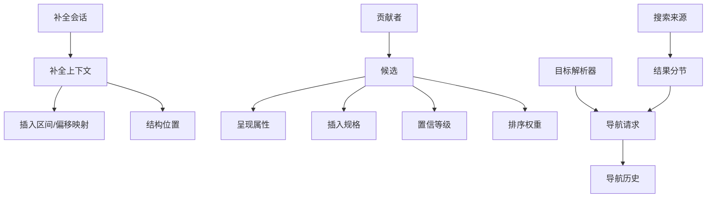
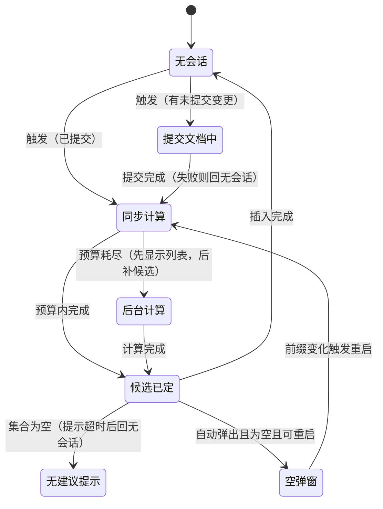

# 09 — 补全与导航

> 范围：补全流水线与变体、置信度与排序、参数信息与文档弹出；导航原语、用法查找、搜索聚合、结构视图与面包屑、行级标记。｜ 依赖：06（语法树）、07（索引）、08（守护分析）、13（动作与界面）。｜ 排除：重构与代码生成（见 10）、断点状态与调试会话（见 12）、渲染控件与布局（见 13）。

## 1. 目的与范围

### 1.1 本子系统解决什么问题

用户与代码之间只有两种方向的跨越，本子系统把它们做成可预测的机械过程。**向前跨越（补全）**：已键入一段不完整文本，系统给出"此处可合法出现什么"并按"最可能想要"排序，一键写入；难点不是列举候选，而是**在毫秒预算内、在用户继续敲键的同时，让数十个互不知情的贡献者协作出一个稳定序**。**向后跨越（导航）**：用户指着已存在的文本，系统回答"它指向哪里"；难点是同一处文本可能有零到多个目标，且目标可能位于被注入的片段、只读归档或另一项目的共享索引中。

两者共享同一底层机制：**候选生产 → 去重合并 → 加权排序 → 增量呈现 → 取消**。补全的候选是"可插入片段"，导航的候选是"可跳转位置"，搜索的候选是"可打开对象"，本规格统称**候选流（Candidate Stream）**。

### 1.2 边界

本子系统**不负责**：语言语义（"此处什么可见"由语言插件依据 06 给出）；索引建立与持久化（见 07，本子系统只消费）；问题检测与高亮（见 08）；按键绑定与菜单（见 13）；断点状态与求值（见 12，本子系统只渲染图标并保证可跳转）。

### 1.3 与其他子系统的关系

| 关系 | 说明 |
|---|---|
| 06 语法树 | 补全位置、期望类型、可见作用域、导航目标均以结构节点为单位；补全期写入**哑标识符**以强制结构重建 |
| 07 索引 | 符号/文件/用法/待办事项的批量来源；未就绪时按哑模式裁剪 |
| 08 守护分析 | 共享"文件版本"概念；版本不符的结果必须丢弃 |
| 13 界面 | 列表/弹窗/树/停靠区由界面层提供，本子系统只产出数据与呈现属性 |
| 17 远程部署 | 导航请求必须可序列化：在服务端产生、在客户端执行 |

## 2. 概念模型

### 2.1 术语

| 术语 | 英文 | 定义 |
|---|---|---|
| 补全会话 | Completion Session | 从触发到插入/取消的完整生命周期，持有相位、偏移映射与候选集合 |
| 插入区间 | Replacement Range | 插入时必须整体替换的文本区间，可宽于前缀（含未闭合括号） |
| 候选 / 置信等级 | Candidate / Confidence | 名称别名集合 + 呈现属性 + 插入动作 + 置信等级；等级是"被采纳可能性"的离散分级，独立于排序得分 |
| 贡献者 / 权重器 | Contributor / Weigher | 按位置模式注册的候选生产者；从候选与位置派生可比较值的纯函数，排序即权重器链的字典序 |
| 目标解析器 | Target Resolver | 把"光标处文本"映射为"目标位置集合"的组件 |
| 导航请求 | Navigation Request | 与界面无关、可跨进程传递的"打开某文件某区间"值对象 |
| 结果分节 | Result Section | 一个来源产出的条目集合，带独立配额与"还有更多"标志 |
| 行标记 / 面包屑 | Line Marker / Breadcrumbs | 附着于结构节点区间、渲染在行首槽位的图标与提示；从文件根到光标节点的路径压缩视图，与结构视图共享层次模型 |

### 2.2 三个共享原语

```
候选流（补全）  : 贡献者 × 位置 × 前缀 → 候选集合 → 排序 → 列表 → 插入
目标集合（导航）: 解析器 × 位置 × 标志 → 目标集合 → 消歧 → 导航请求 → 打开
分节结果（搜索）: 来源 × 模式 × 配额 → 分节 → 去重 → 分组排序 → 预览 → 打开
```

三者的呈现契约完全相同（§4.15）：**必须可增量、必须可分页、必须可即时取消**。新增来源不得违反。

### 2.3 实体关系



## 3. 数据模型

```
CompletionContext { documentVersion: long      // 结果与该版本绑定，变更即作废
  caretOffset: int; invocationCount: int       // 0=自动弹出；>=2 且基础类型 => 扩展搜索
  completionType: BASE | TYPE_AWARE
  offsetMap: {start, selectionEnd, identifierEnd}    // 原文↔占位副本三锚点
  sentinelIdentifier: string; hostRanges: Range[] }  // 哑标识符（须带尾随空格）；注入片段的宿主偏移
Candidate { names: string[]                    // 首个为显示名，其余为匹配别名
  object: Element | null                       // 来自结构树时可解出定义位置
  presentation; insertion: InsertionSpec | null   // null = 仅展示/仅命令
  confidence: HIGH | NORMAL | LOW | HIDDEN
  basePriority: int; proximity: int            // 显式优先级；距离覆盖值（0=不覆盖）
  weightTags: string[] }                       // 供模型特征提取
Presentation { text, typeText?, tailText?; tailGrayed, grayed, strikethrough: bool
  icon?, typeIcon?: IconRef; matchedRanges: Range[] }        // 命中字符区间
InsertionSpec { replacementRange: Range; text: string
  tailKind: NONE | SPACE | SEMICOLON | CUSTOM
  placeholders: Placeholder[]                  // 插入后按序选中的参数/括号占位
  requiresImport: SymbolRef[]; requiresReformat, committedDocumentsRequired: bool }
NavigationRequestData { kind: FILE_OFFSET | ELEMENT_RANGE | DIRECTORY
  fileId: FileId; offset: int; range: Range?; options: NavigationOptions }
NavigationOptions { requestFocus, preserveCaret, openInRightSplit, sourceOnly: bool }
ResultSection { sourceId; items: Item[]; limit: int; hasMore, finished: bool; elapsedMillis }
StructureNode { element: Element; text; typeText?; icon?
  children: StructureNode[]                    // 惰性：首次展开才构造
  sortKey: (int, string) }                     // (源序或字母序, 名称)
LineMarker { anchorElement: Element            // 必须是叶子节点
  range: Range; icon: IconRef; tooltip?; navigation: NavigationRequestData?
  alignment: LEFT | RIGHT; contributor: string }              // 用于隔离与去重
Bookmark { target: FileId+offset | CustomTarget; typeId?; groups: string[]; description? }
TodoEntry { fileId: FileId; pattern: string; caseSensitive: bool; range: Range }
```

**生命周期**：补全上下文与会话同生共死并绑定文档版本；候选是会话内瞬态对象，不得跨会话缓存（只允许缓存派生输入，例如可见符号名集合）；导航请求可被历史栈长期持有，因此**必须**是自包含值对象，不得引用结构节点；书签持久化在项目配置，行标记与待办事项持久化在派生索引。

## 4. 行为契约

### 4.1 补全流水线

| 阶段 | 输入 → 输出 | 关键约束 |
|---|---|---|
| S0 触发判定 | 键入/快捷键 → 是否开会话 | 抑制规则见 §4.3；判定在输入线程完成 |
| S1 冻结上下文 | 编辑器状态 → 上下文 | 必须记录文档版本，结果与之绑定 |
| S2 写入占位 | 上下文 → 占位副本 + 偏移映射 | 必须在**副本**上写哑标识符，不得改动用户文档 |
| S3 位置解析 | 占位副本 → 结构位置、期望类型、可见作用域 | 只读；索引未就绪时按哑模式裁剪贡献者 |
| S4 收集 | 位置 + 类型 → 候选 | 按注册序执行；可被任一贡献者提前终止 |
| S5 规范化 | 候选 → 规范候选 | 别名去空白、区间裁剪、非法候选剔除 |
| S6 合并去重 | 多来源 → 唯一集合 | 同一目标保留信息量最大的一条，并合并权重标签 |
| S7 排序 | 集合 → 稳定序 | 权重器链字典序；平局规则见 §4.6 |
| S8 过滤 | 集合 + 前缀 → 可见集合 | 三层匹配器见 §4.7 |
| S9 呈现与插入 | 可见集合 → 列表项/插入 | 呈现按需构造；插入必须原子可撤销 |

**提前终止语义**：任一贡献者声明"到此为止"后，后续贡献者**必须不**执行，已收集候选保留。这是语言插件压制"通用候选淹没语义候选"的机制，平台不得忽略。

### 4.2 会话状态机



同一编辑器在任一时刻**至多**一个会话处于"同步/后台/候选已定"之一；新会话开始前必须关闭旧会话（旧会话已插入的结果保留）。

### 4.3 触发与抑制

| 触发方式 | 条件 | 调用计数 |
|---|---|---|
| 显式基础补全 | 用户调用 | 1 |
| 显式重复调用 | 同一位置再次调用 | ≥2 → **扩展搜索**（放宽到非导入符号、更大作用域） |
| 显式类型感知补全 | 用户调用 | 1，类型 = 类型感知 |
| 自动弹出 | 键入触发字符且设置开启 | 0 |
| 自动弹出（成员） | 键入成员访问分隔符 | 0 |
| 补全后重启 | 列表已显示且前缀变化满足重启条件 | 保持原计数 |

**必须抑制**（任一成立即不弹出，且**必须不**消耗计算资源）：节能模式开启；自动弹出在应用级关闭且该编辑器未显式开启；当前相位不是"无会话/空弹窗/提交文档中"；任一置信度贡献者投出否定票；选区跨多个结构位置（多光标按每个光标独立判定，但只允许单光标会话）；文件超过大文件阈值（见 01 §8），仅保留显式调用。

**键入抑制与立即取消**：任何动作开始执行、任何文本键入、任何界面活动事件发生，都必须关闭待执行的自动弹出请求（提示窗或文档弹窗刚显示时除外，避免"弹出即取消"自激）。

### 4.4 上下文构建（哑标识符法）

补全位置的语法常不完整（成员访问符之后为空），直接解析无法承载候选，故采用占位写入：① 在 `identifierEnd` 处插入哑标识符（固定字母串 + 一个尾随空格）；② 记录三锚点（前缀起点、选区末端、可插入末尾）；③ 在副本上重建结构，得到"若用户输入了一个标识符"的合法结构；④ 插入时按锚点在**原文**上计算替换区间，不使用副本绝对偏移。

约束：尾随空格**必须**存在，否则哑标识符与前缀粘连成一个词元；锚点**必须**随副本编辑同步平移；若文件被语言注入拆为片段，锚点**必须**投影到宿主坐标后才交给编辑器——候选可来自片段，插入只能发生在宿主。

### 4.5 收集与置信度

**收集顺序**：先"调用计数匹配的贡献者"，再"通配贡献者"；同组内保持注册序；每个贡献者在独立可观测区间内执行以便归因耗时。**并行度**：同一阶段的贡献者可以并行填充同一结果集（结果集须线程安全且保持到达序），但会话只允许一个光标、一个版本。

**置信度投票**（三态）：`任一贡献者 => 跳过 : 跳过`；`全部 => 不确定 : 允许（默认乐观）`；`其它 : 允许`。投票**必须不**把异常抛到主流程，单个贡献者异常按"不确定"计；投票只影响自动弹出，不影响显式调用。置信等级是候选属性，与投票无关：`HIDDEN` 必须不进入列表（但可被命令式复活）；`LOW` 必须排在所有 `NORMAL` 之后，此优先级高于任何正向距离得分。

### 4.6 合并、去重与排序

**去重键**：候选的目标身份（结构节点标识，或"名称 + 类型串"的规范组合）。**排序**是权重器链的字典序比较，链序由平台固定，扩展只能插入到具名位置：

| 序 | 权重器 | 取值语义 |
|---|---|---|
| 1 | 显式优先级 | 贡献者声明的整型，降序 |
| 2 | 置信等级 | `HIGH` > `NORMAL` > `LOW` |
| 3 | 匹配质量 | 完整前缀 > 驼峰 > 片段匹配 |
| 4 | 距离 | 同目录 > 同源根 > 同模块 > 同作用域库 > 其它；已打开于编辑器者提升 |
| 5 | 使用频率 | 该位置类别下的历史采纳统计（按类别分桶，不按精确偏移） |
| 6 | 模型得分 | 见 §4.6.2 |
| 7 | 名称字典序 | 稳定化兜底 |

**平局规则**：链走完仍相等时按"注册序 + 名称字典序"确定，且**必须**稳定——同一输入两次运行必须得到同一序，否则用户的选择记忆失效。

#### 4.6.1 距离语义

距离**必须**是可组合向量而非单一标量：`sameDirectory: 0|1`、`sameSourceRoot: 0|1`、`sameModule: 2（同模块）|1（同项目异模块）|0（外部）`、`inResolveScope: 0|1`、`openedInEditor: 0|1`、`directoryKind: 源码|测试|生成|库`。距离计算**必须**惰性并按位置类别缓存，不得为每个候选重建项目模型查询；距离只参与排序，**必须不**参与可见性判定。

#### 4.6.2 模型的接入点与降级

以"排序权重器"接入，标识固定，挂在链第 6 位。特征分两类：**上下文特征**（位置、期望类型、前缀、前后文类别）与**候选特征**（名称形态、置信等级、距离向量、使用频率、类型串）。提供者经独立接缝注册，**至多**一个有效实现，多实现时取第一个并告警。降级：模型缺失、加载失败、推理超时、被禁用四种情况**必须**等价于"该权重器返回空"，排序退化为其余链；用户可见差异仅为顺序，不得出现空列表或异常。权重可导出为特征映射用于对照与复现，导出**必须不**改变排序。

### 4.7 过滤（前缀匹配）

| 层 | 语义 | 备注 |
|---|---|---|
| 前缀匹配 | 名称以下拉前缀开头（大小写策略可配） | 所有语言必须有的基础层 |
| 驼峰匹配 | 前缀字符序列匹配词首字母 | 混排名称按词边界退化为前缀匹配 |
| 模糊匹配 | 子序列匹配 + 空隙惩罚 | 仅用于文件/动作等大集合，符号补全默认不启用 |

**起始匹配**（前缀恰为名称开头）必须可区分于中间匹配：前者排序优先，且是"单候选自动插入"的前置条件。匹配器**必须**返回命中区间列表供高亮，不得只返回布尔值；替换匹配器后**必须**保持单调性——若 A 被接受而 B 被拒绝，更长的前缀下 B 不得被接受。

### 4.8 选择、预选与插入

**预选**：列表首次显示时预选首项，使"回车即接受"。预选受"预选行为提供者"约束，任一提供者反对即不预选；预选**不得**触发插入；用户移动选择后预选失效，前缀变化重启会话时重新评估。

**自动插入决策**（仅显式调用且集合非空时评估；自动弹出从不自动插入）：

```
若 候选数 == 1:
   策略 永不自动插入 => 显示列表；策略 总是自动插入 => 立即插入；非起始匹配 => 显示列表
若 该补全类型不允许自动插入 => 显示列表；若 光标在标识符内部（右侧有文本）=> 显示列表
若 候选数 == 1 且 策略 允许覆盖 => 立即插入
否则: 依次询问各贡献者的"自动完成可能性"，首个非空决策生效；仍为空 => 显示列表
```

**插入动作**（必须原子）：① 校验文档版本与会话版本一致，否则整体放弃；② 单个可撤销单元内完成"替换区间 → 写文本 → 应用尾随（空格/分号）→ 按序选中占位符"；③ 需补导入时在写意图下补导入并只格式化导入区；④ 需重排时只格式化受影响行范围，不得整文件重排；⑤ 关闭会话并把采纳事件写入使用统计（键 = 位置类别 + 候选身份）。

尾随字符只在"后一字符不是标识符字符或闭合符"时写入；多光标场景会话只针对一个光标，插入时若其它光标行与替换区间相交，**必须**跳过该光标而非产生重叠编辑。呈现侧（列表、类型串、图标、文档预览）只读取呈现属性，不得在渲染时解析结构。

### 4.9 补全变体

| 变体 | 候选来源 | 成本 | 取消/降级 |
|---|---|---|---|
| 基础 | 可见作用域符号（含未导入的低置信候选） | 中：遍历可见符号集合 | 分批追加，超预算转后台 |
| 类型感知 | 期望类型的成员/可赋值表达式 | 高：需类型推导 | 推导超时即降级为基础，不报错 |
| 语句级 | 结构模板（循环/分支/异常） | 低：模板集合有限 | 无特殊处理 |
| 路径/文件名 | 文件系统目录列举 | 低但受 I/O 影响 | 限深度与条目数；远程/网络文件系统降级为"仅显示已缓存项" |
| 模板 | 用户与内置模板（带前缀键） | 低 | 前缀键变化即重启会话 |
| 后缀补全 | 对光标前已有表达式做变换的模板 | 中：需构造变换结果 | 仅自动弹出或独立分组时启用；前缀变化按有效键集合重启 |
| 内联补全（单行/多行） | 模型生成 | 高且不可预测 | 必须可整体关闭；必须支持"提供者抑制器"；只允许一个提供者生效 |
| 命令补全 | 意图/动作（"此处可做的修复"） | 中：需问题集合 | 仅列表为空或用户显式切换时展示；问题集合未就绪则不展示 |

**内联补全的特殊约束**：提供者按声明序竞争，**至多一个**产出建议，被抑制者必须在调用前返回空而非产出后丢弃；建议在**接受前**不得修改文档；接受分整体与部分两种，部分接受必须按词/行边界切分且可撤回；建议与普通补全**必须**互斥（内联展示期间列表不得同时弹出）；超时返回的建议**必须**直接丢弃，不得以"迟到的建议"插入到已变化的位置。

**参数信息（参数提示）**：触发条件为键入参数分隔符、光标进入/离开参数列表、或显式调用；定位方式是"光标映射到第几个参数 → 定位被调用者签名"，重载多于一个时列表呈现并加粗当前参数。自动弹出延迟可配置且带数值范围约束；延迟期间光标移动、文档变更、相位失效**必须**取消请求；索引未就绪**必须**静默跳过。补全列表显示期间**不得**自动弹出参数信息，显式调用可顶替列表。

**文档弹出**：按需在后台计算目标节点的文档内容，超时或失败显示占位而非报错；文档弹窗显示期间不得取消已排队的位置更新；与参数信息、补全列表**必须**互斥（同一位置同一时刻只有一个弹出层）。

### 4.10 导航原语与目标解析

**原语清单**：**转到声明/定义**（先问声明处理器扩展，再回退引用解析；多目标弹窗、首项为默认）；**转到实现**（子类型/实现索引，哑模式不可用）；**转到超类型**（语言扩展，缺失时按引用解析）；**转到符号/文件/行**（名称模型，见 §4.12，由列表消歧）；**用法查找**（引用搜索双通道，见 §4.11，不消歧、全量列出）；**调用层级/类型层级**（以被调用者或类型为中心逐层展开，按需展开、可中止）；**相关符号**（测试/实现/声明处，分组呈现）；**最近文件**（项目级访问历史，列表消歧）；**历史前进/后退**（导航历史栈，栈语义、无可选）。

**目标解析顺序（必须）**：

```
1. 扩展提供了目标集合 → 使用之（返回空表示"不处理"，不等于"无目标"）
2. 否则在光标处解析引用：a. 被引用元素可接受  b. 否则元素名称（声明处）可接受
   c. 否则列表项（补全中）可接受
3. 集合为空 → 不导航，给出"无可导航目标"的明确反馈，不得静默失败
4. 集合大小 > 1 → 首项目标"显著优先"（同名同容器）则直跳，否则消歧
```

位置在注入片段中时必须把偏移投影到宿主文档，导航后回到宿主编辑器；目标为只读归档时导航仍必须发生，但"转到实现"类动作应优先指向源码（`sourceOnly`）。导航请求**必须**是值对象，使同一原语可在无界面角色产生、在有界面角色执行。

### 4.11 用法查找（双通道）

```
通道 A（直接查询）：引用搜索执行器遍历已知候选文件，产出引用
通道 B（索引请求）：执行器声明"需按某名称/词元查索引"，由收集器汇总去重后批量查询并回填
合并：A ∪ B → 按引用身份去重 → 按文件与偏移排序
```

两通道**必须**各自独立可用：无索引时 B 为空，A 仍给结果，列表标注"不完整"。请求**必须**携带：目标元素、搜索作用域、上下文掩码（代码/注释/字符串/外来语言/纯文本，可取并集"任意"）、是否忽略可见性、是否同时搜索文本出现。文本出现搜索是**独立可选通道**，默认关闭；开启后结果必须与"引用"分组区分——其语义是"字符串里也出现了这个名字"。结果**必须**可增量：边搜边显示，且允许在完成前打开某条结果并使搜索继续；结果上限可配置，触顶时显示"可能还有更多"而非静默截断。

### 4.12 搜索无处不在（多来源聚合）

来源集合至少包含：文件、符号、动作、设置项、文本/正则、最近文件。每个来源实现统一契约：

```
来源契约 { id, 分组名, 排序权重
  fetch(模式, 进度, 回调) -> 是否继续      // 推送式；回调返回 false 即停止
  search(模式, 进度, 配额) -> {条目[], hasMore}
  处理选中(条目, 修饰键, 模式) -> 是否已处理；渲染(条目) -> 呈现属性
  过滤控制符(模式) -> 模式               // 允许来源自定义前缀语法
  支持空模式, 支持多选, 哑模式可用: bool }
```

```
1. 每个参与来源分配独立配额（按分组权重与位置）；各来源在独立任务中并行执行，共享可取消进度
2. 结果进入所属分节；来源达配额后其后续结果被阻塞等待（背压），并标记"还有更多"
3. 每条新结果入节前与全部分节做等价性比较：丢弃，或替换既有条目
   （"最近使用优先"时保留最近者，且不得替换最近文件来源的条目）
4. 每次变更立即通知视图：新增 / 移除 / 分节完成（带"还有更多"标志）
5. 全部分节完成 → 通知整体完成 → 按分组权重合并呈现
```

**空模式与预选**：仅声明支持空模式的来源参与，避免"打开即全项目扫描"；列表首项预选使"回车即打开"成立，预选不得触发预览之外的动作。**拼写纠正**：仅在单一来源（动作）视图中启用，纠正结果作为**额外分节**与原模式并列，最多两个，失败静默回退原模式。**重排序服务**：可选接缝，按当前查询重排分节内条目；多实现取第一个并告警；禁用时保持原生序。**即时预览**：选中条目后在侧栏预读目标内容，必须异步、可取消、失败显示占位，且不得阻塞键盘导航。**分组与排序**：分节间按来源分组权重，分节内按条目权重降序，两者都必须稳定。

### 4.13 结构视图与面包屑

**层次构建**：按文件类型选择结构视图构建器（键 = 文件类型/语言）产出层次模型，必须满足：子节点**惰性**构造，只构造已展开层级，根层级在视图显示时构造、节点数超阈值时分批；节点**必须**持有可失效的元素引用而非文本片段，元素失效后显示为"过期"，不得崩溃；排序默认源序、可切换字母序且两者都必须稳定，扩展追加的"附加组"**必须**排在语言原生子节点之后并在组内保持自身顺序；按名称子串过滤时保留"含匹配后代的祖先"，过滤只作用于已构造节点，未展开子树在展开时按同一条件再过滤；与编辑器光标同步——光标移动选中对应最深节点并展开祖先，选择节点则编辑器滚动到该区间，双向同步**必须**带方向标记以避免回环。

**面包屑**：与结构视图**共享**层次模型，但只取"根到光标节点"的单一路径，因此是 O(深度) 而非全树。收集器可叠加（结构路径 + 文档符号路径），后者可替换前者末段；呈现提供者可覆盖单节点文字/图标/颜色，缺失时回退结构视图属性。路径过深时**必须**压缩中段（保留首、尾与当前节点），且压缩不得破坏键盘可达性；光标移动触发的重算**必须**去抖，且只允许最后一次请求生效。

### 4.14 行级标记：行标记、书签、待办事项

**行标记**：注册单位是**叶子结构节点**，对非叶子节点注册必须视为缺陷并报告；同一行多个标记**必须**合并为单槽位条目，点击展开菜单，合并顺序按贡献者注册序；区间必须落在宿主文件范围内，注入片段中的区间**必须**投影到宿主后再注册；行标记只描述"可跳转位置与图标"，**不得**承担问题状态（问题归检查）；刷新与守护分析的遍历周期绑定，单次遍历内不得重复计算同一节点。断点图标由本层渲染，但断点的启用/命中/挂起状态归调试器（见 12），本层只保证"同行合并、顺序稳定、点击可跳"。

**书签**：项目级服务持有；可指向文件位置，也可经提供者指向自定义目标（查询、端点等）。每个书签**可以**携带一个助记标记（字母/数字），同一时刻一个助记标记至多对应一个书签，重复分配时旧书签被清除。分组是一个默认分组加若干命名分组，书签**可以**属于多个分组（多对多），必须能按分组过滤与批量跳转。持久化随项目配置保存；文件位置书签以"文件标识 + 偏移 + 少量上下文指纹"保存，重开时指纹不匹配则标记"已移动/已失效"，不得静默丢弃。按助记标记跳转是单键操作，不得依赖列表参与。

**待办事项**：由**索引**派生而非实时扫描，键为"关键词 + 是否区分大小写"，值为出现次数，另有位置记录；只有属于项目内容根、或被额外位置检查器接受的文件进入索引，纯文本文件类型默认可排除；索引按文件类型提供，语言决定关键词集合与大小写语义；结果按"关键词/文件/包路径"分组并跳到具体行，修改文件后由索引增量更新，不要求全量重扫。

### 4.15 结果呈现契约

| 契约 | 要求 |
|---|---|
| 增量刷新 | 每产生一批结果立即追加可见；不得"收集完毕再一次性显示" |
| 分页 | 每个来源独立配额；触顶置"还有更多"标志并提供继续加载；配额不得全局共享 |
| 取消 | 取消必须在常数时间内生效：置标志 → 唤醒全部等待者 → 后续回调不得再到达视图；已得部分保留并标记"未完成" |
| 顺序稳定 | 同一输入的两次运行，同权重条目相对序必须一致 |
| 无阻塞 | 呈现回调中不得执行超过一个交互帧的工作；需计算的呈现属性必须惰性求值 |
| 内存有界 | 驻留量受配额约束；分批加载只保留"已显示 + 少量前瞻"，不得无限累积 |

## 5. 不变量与约束

| 编号 | 不变量 |
|---|---|
| INV-1 | 任一编辑器在同一时刻至多存在一个活跃补全会话。 |
| INV-2 | 补全结果必须与文档版本绑定；版本变化后到达的结果必须丢弃。 |
| INV-3 | 占位写入必须发生在副本上，会话期间用户文档不得被修改。 |
| INV-4 | 偏移映射必须覆盖全部锚点；替换区间必须由原文坐标计算。 |
| INV-5 | 单个贡献者失败不得导致会话失败，只影响该贡献者的候选。 |
| INV-6 | 会话被提前终止后，后续贡献者必须不执行。 |
| INV-7 | 排序必须稳定：同权重条目的相对序不得因运行而异。 |
| INV-8 | `HIDDEN` 置信等级的候选不得出现在列表中。 |
| INV-9 | 自动弹出永不自动插入。 |
| INV-10 | 插入（含自动导入与尾随字符）必须由一次撤销完整回退。 |
| INV-11 | 导航请求必须是自包含值对象（可跨进程传递、不持有结构节点），且目标解析必须遵循"扩展优先、引用回退"。 |
| INV-12 | 注入片段中的位置必须投影到宿主坐标后再导航或注册标记；行标记只能注册在叶子节点上。 |
| INV-13 | 每个结果来源必须有独立配额，且取消必须对所有等待者在常数时间内生效。 |
| INV-14 | 空模式下只有声明支持空模式的来源可以参与。 |
| INV-15 | 结构视图与面包屑必须共享同一层次模型，不得各自独立解析。 |
| INV-16 | 同一助记标记在同一时刻至多绑定一个书签。 |
| INV-17 | 权重器链顺序由平台固定，扩展只能插入具名位置；模型权重器缺失必须等价于空。 |

## 6. 对外能力契约（概念级）

```
beginCompletion(context) -> Session;  addCandidates(session, sourceId, candidates) -> void
stopContributors(session) -> void                     // 提前终止
declareRestartConditions(session, prefixSet) -> void
insertCandidate(session, candidate) -> Result;  cancelSession(session) -> void
resolveTargets(position, flags) -> TargetSet;  navigate(request) -> bool
navigateWithChooser(targets, title, dataContext) -> bool
recordHistory(request) -> void;  stepHistory(direction) -> bool
aggregate(pattern, sources[], limits, listener) -> ProgressHandle
loadMore(sourceIds[], alreadyFound) -> ProgressHandle
preview(item) -> PreviewContent?                      // 异步、可取消
structureModel(file) -> StructureNode?                // 惰性根
breadcrumbPath(offset) -> StructureNode[];  lineMarkers(file, range) -> MarkerGroup[]
bookmarks(scope) -> Bookmark[];  todoOccurrences(scope, pattern) -> TodoEntry[]
```

要求：全部能力必须可在无界面角色下调用（呈现部分返回数据而非控件）；必须接受显式取消句柄，不得提供不可取消的同步变体；导航与搜索只读，补全插入走写意图（见 03 §5）；扩展注册的候选与来源必须携带来源标识，用于隔离、统计与来源过滤。

## 7. 故障模式与降级

| 故障 | 检测 | 用户可见 | 档位 |
|---|---|---|---|
| 单贡献者抛错 | 逐贡献者捕获 | 该项候选缺失，无提示 | D2 |
| 贡献者超预算 | 会话预算检查 | 列表先显示已有候选 | D1 |
| 类型推导不可用 | 返回未知类型 | 退化为基础补全 | D1 |
| 索引未就绪 | 哑模式标志 | 列表标注"结果可能不完整" | D1 |
| 模型不可用 | 加载/推理失败 | 仅顺序变化 | D0 |
| 搜索来源抛错/超时 | 来源任务捕获 | 该分节缺失或标记"未完成" | D2 |
| 来源卡住不返回 | 慢来源检测 | 其余分节照常呈现，可直接回车打开 | D1 |
| 预览失败 / 结构模型构造失败 | 异步异常、构建器异常 | 侧栏占位；结构视图不可用且面包屑降级为文件名 | D1 / D2 |
| 行标记元素失效 / 书签指纹不匹配 | 引用失效检查、重开时校验 | 标记消失或标注"已移动" | D0 |
| 导航目标为空 | 目标集合大小 0 | 明确提示不可导航 | D0 |
| 目标位置不可达（远端断连/网络盘） | 打开失败 | 提示"无法打开"，保留历史项 | D3 |
| 待办索引损坏 | 索引版本校验 | 视图为空并提示重建 | D5 |

## 8. 资源与性能预算

| 项 | 预算/实测 |
|---|---|
| 补全同步预算 | 默认 2000 ms（可配置）；同步阶段 = max(300 ms, 2000 ms − 已耗时)，超预算转后台并先显示列表 |
| 候选追加取消粒度 | 每 1000 条检查一次取消 |
| 参数信息自动弹出延迟 | 可配置且带范围约束；延迟期间光标移动或文档变更必须取消 |
| 参数信息位置刷新去抖 | 200 ms，且只允许最后一次请求生效 |
| 搜索分节背压与拼写纠正上限 | 分节满配额后以 100 ms 为周期等待并重检取消；纠正候选至多 2 个 |
| 结构视图 / 行标记 | 子节点惰性构造，超大文件必须限制根条目或禁用视图；行标记单次遍历每节点一次计算且只允许叶子节点 |
| 模型排序 / 索引未就绪 | 模型必须在补全预算内完成、超时等价于缺失；索引未就绪时不得触发索引构建，只许用已有数据 |

## 9. 可观测性

必须能回答四类问题，每类都有稳定标识：**为什么没弹出**（记录触发判定与抑制原因：设置关闭/节能/相位/置信度否决/大文件，带位置标识）；**为什么这么排序**（记录候选的权重器取值向量，至少前 4 位，以及是否应用模型，可导出哑数据复现）；**慢在哪**（每个贡献者/来源独立计时区间，输出耗时与产出条数，超阈值标记"慢来源"）；**为什么跳到这里**（记录解析链"扩展 → 引用 → 名称"、选中目标序号、是否发生消歧）。

指标按来源与会话聚合：会话数、平均候选数、首屏延迟、插入率、重开率、取消率、分节完成率与触顶率。诊断入口必须能在无界面角色下导出上述计数；导出内容不得包含用户源码文本，只允许位置标识与计数。

## 10. 扩展点

| 接缝 | 扩展必须遵守 | 失败隔离 |
|---|---|---|
| 候选贡献者 | 只写结果集，不读写文档；可被提前终止；响应取消 | 逐个捕获并跳过 |
| 置信度投票者 | 只回答三态，快速返回，不得查索引 | 视为"不确定" |
| 权重器/排序插入 | 声明插入锚点；必须是纯函数 | 跳过该权重器 |
| 模型提供者 | 至多一个有效；声明"是否可用"；可整体禁用 | 等价于空权重器 |
| 插入处理器 | 在传入插入上下文中工作，不得直接关闭会话 | 光标置为插入后位置并记录 |
| 匹配器/重启条件 | 保持匹配单调性 | 回退默认匹配器 |
| 目标解析处理器 | 先于引用回退被询问；返回空表示不处理 | 视为返回空 |
| 搜索来源 | 实现配额与取消；声明空模式支持；不得阻塞回调线程 | 该分节缺失 |
| 用法处理器工厂 | 声明"能否处理该元素"与文本出现开关可用性 | 回退默认工厂 |
| 结构视图构建器 / 面包屑收集器与呈现提供者 | 惰性构造、稳定排序；收集器可叠加，呈现只影响单节点 | 视图不可用 / 回退默认呈现 |
| 行标记提供者 | 只注册叶子节点；单节点贡献少量标记 | 跳过该提供者 |
| 待办索引器 | 按文件类型提供，语言决定关键词与大小写 | 该类型无待办结果 |
| 书签提供者 | 自定义目标必须可序列化持久化 | 该书签不支持自定义目标 |

共同要求：上述接缝均为动态（可运行期装卸）；卸载后其候选、目标、标记必须立即失效；扩展不得缓存跨代结果（见 02 §4.4）。

## 11. 对照实现（证据锚点）

> 计数口径：**合计** = 模块描述符 + 插件描述符内的注册条目；仅描述符内的子集另行标注。

| 上文结论 | 证据 |
|---|---|
| 补全贡献者 290 条注册，按语言注册、带实现类型约束、动态 | `_rev/ep_counts.json`（`total`：`completion.contributor` = 290；`module` 193 + `plugin` 97）；`lib_intellij.idea.ultimate.customization.jar__0_0.xml` 中该点的 `<with attribute="implementationClass" implements=…>` 与 `dynamic="true"` |
| 置信度投票为三态，34 条注册 | `CompletionConfidence`（返回 跳过/允许/不确定）；`ep_counts.json`：`completion.confidence` = 34 |
| 会话相位：无会话/提交文档/同步/后台/候选已定/空弹窗/无建议 | `CompletionProgressIndicator`、`CompletionServiceImpl` 的相位断言与切换 |
| 同步预算 2000 ms、下限 300 ms、每 1000 条检查取消 | `CodeCompletionHandlerBase.getDefaultAutoInsertTimeout`（`ide.completion.auto.insert.item.timeout` = 2000）、`calcSyncTimeOut`（`max(300, …)`）、`CompletionResultSet.addAllElements` |
| 哑标识符与三锚点偏移映射 | `CompletionInitializationContext`（`START_OFFSET`/`SELECTION_END_OFFSET`/`IDENTIFIER_END_OFFSET`、`DUMMY_IDENTIFIER`） |
| 调用计数 0 = 自动弹出、≥2 = 扩展补全 | `CompletionParameters.isAutoPopup`、`isExtendedCompletion` |
| 排序为权重器链、可插入具名位置；距离权重器族 | `CompletionSorter.weighBefore/weighAfter/weigh`；`psi/util/proximity/*Weigher`、`ExplicitProximityWeigher` |
| 模型权重器标识固定、缺失即退化；自动插入决策 | `MLWeigherUtil`（`ml_weigh`、`key="completion"`，未找到返回 null）、`com.intellij/completion.ml.model`；`CodeCompletionHandlerBase.shouldAutoComplete`/`isInsideIdentifier` |
| 参数信息去抖 200 ms、可取消、需提交文档 | `ParameterInfoController`（`DebouncedUpdates … 200`、`runLatest`、`cancelOnDispose`）、`AutoPopupControllerImpl.autoPopupParameterInfo` |
| 目标解析先扩展后引用，含三类标志 | `GotoDeclarationAction.findTargetElements*`；`TargetElementUtil`（`REFERENCED_ELEMENT_ACCEPTED=1`、`ELEMENT_NAME_ACCEPTED=2`、`LOOKUP_ITEM_ACCEPTED=8`） |
| 导航请求为值对象并带选项集（焦点/保光标/右分栏/仅源码） | `platform/backend/navigation/NavigationRequest`、`ide/navigation/NavigationOptions` |
| 用法搜索双通道 + 引用身份去重；上下文掩码五类 + 任意 | `ReferencesSearch`（扩展查询 ∪ 请求收集器，`UniqueResultsQuery`）；`UsageSearchContext`（1/2/4/8/16，任意 = 255）；`referencesSearch` = 60、`methodReferencesSearch` = 25 |
| 搜索来源契约（配额、空模式、多选、哑模式、处理选中） | `SearchEverywhereContributor`（`fetchElements`、`search(…, elementsLimit)` 返回 `hasMore`、`isEmptyPatternSupported`、`getSortWeight`） |
| 搜索并行聚合、分节背压、增量通知、去重替换 | `MixedResultsSearcher`（每来源一线程 + 等待闩；分节满时 `condition.await(100ms)`；`elementsAdded/elementsRemoved/contributorFinished(hasMore)/searchFinished`） |
| 空模式过滤、拼写纠正仅单来源且上限 2 | `MixedResultsSearcher.search`、`applySpellCheckIfNeeded`（`MAX_SPELLING_CORRECTIONS = 2`） |
| 重排序服务单实现、缺失即原序；搜索来源 37 条注册 | `SearchEverywhereReorderingService.getInstance`（多实现告警、`isEnabled` 为假返回 null）；`ep_counts.json`：`searchEverywhereContributor` = 37 |
| 设置项作为搜索来源；符号/文件/类三条名称模型 | `search.topHitProvider` = 55；`ChooseByNameContributor`（`gotoClassContributor` 10 / `gotoSymbolContributor` 36 / `gotoFileContributor` 8） |
| 结构视图按文件类型构建、可叠加扩展；面包屑共享同一模型 | `structureViewBuilder`（键 = 文件类型）、`lang.psiStructureViewFactory` = 25、`lang.structureViewExtension`、`customStructureViewFactory`；`fileBreadcrumbsCollector`（`IDEA_PROJECT`）、`breadcrumbsInfoProvider` = 18、`BreadcrumbsInitializingActivity` |
| 行标记按语言注册、只允许叶子节点（125 条）；书签为项目服务且多分组（提供者 7） | `codeInsight.lineMarkerProvider`（`order`、`LanguageExtensionPoint`）、`LineMarkerInfo` 的叶子节点告警；`BookmarksManager`（`getGroups`、`toggle`、`getAssignedTypes`）、`bookmarkProvider` = 7 |
| 待办事项按索引派生、键含大小写、限定内容根与额外位置 | `TodoIndexEntry`（`pattern`/`caseSensitive`）、`TodoIndexers.needsTodoIndex`（内容根 + `todoExtraPlaces`；纯文本可排除）、`todoIndexer` = 32 |
| 后缀补全受设置、单光标、前缀重启条件约束；内联补全多提供者按序竞争、可抑制 | `PostfixTemplatesCompletionProvider`（`isCompletionEnabled`、`getCaretCount() == 1`、`restartCompletionOnPrefixChange`）；`inline.completion.provider`（`order="first, before …"`、= 4）、`ml.inline.completion.provider.suppressor` |
| 匹配器提供起始匹配与命中片段；候选呈现与候选契约 | `PrefixMatcher.isStartMatch`/`matchingDegree`/`getMatchingFragments`；`LookupElementPresentation`；`LookupElement`（`getAllLookupStrings`、`handleInsert`、`requiresCommittedDocuments`、`getAutoCompletionPolicy`、`getExpensiveRenderer`） |
| 自动弹出抑制：设置/节能/相位/动作与键入取消；命令补全 | `AutoPopupControllerImpl`（`AUTO_POPUP_COMPLETION_LOOKUP`、`PowerSaveMode`、相位判定、`beforeActionPerformed`/`beforeEditorTyping`、界面活动取消）；`CommandCompletionService`（项目级服务、按语言工厂、`filterLookupAfterChar`） |
| 本领域涉及模块 113 个；全平台唯一扩展点 3235、注册条目 29282 | `_rev/evidence/08-completion-navigation.md`（`Modules (113)`）、`_rev/ep_counts.json`（`total`） |

## 12. 未决问题

- "使用频率"的持久化边界无直接证据（是否跨项目共享、是否上报），仅见按位置类别取值；`[推断]` 为按项目 + 位置类别分桶且不上报原始标识符。
- 驼峰/模糊匹配器实现未在反编译产物中；`[推断]` 模糊匹配默认只用于文件与动作，因符号补全对精确度敏感。
- 结构视图的排序与过滤状态是否持久化到项目配置证据不足；`[推断]` 按工具窗口实例保存。
- 导航历史容量与淘汰策略无直接证据；`[推断]` 为定长环形缓冲（数十级），超出丢弃最早项。
- 内联补全"部分接受"的切分粒度由提供者还是平台决定证据不足（仅有"部分接受处理器"接缝）；`[推断]` 提供者可覆盖、平台给出行级默认。
- 慢来源检测的阈值常量未在可见证据中出现；`[推断]` 为数百毫秒级，超时仅通知、不取消来源。
- 书签"上下文指纹"的构成证据不足；`[推断]` 为结构节点标识优先、文本哈希兜底。
