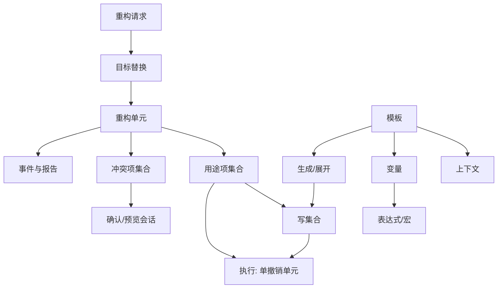

# 10 — 重构与代码生成

> 范围：重构流水线（校验→用途收集→冲突→预览→原子执行→撤销→报告）、重命名语义、结构化变换、代码生成、模板体系（实时/文件/后缀/包裹）及其扩展接缝。｜ 依赖：03、05、06、07、08、09、13、14。｜ 排除：检查与意图本体（见 08）、补全排序（见 09）、格式化规则细节（见 05、14）、版本控制变更列表（见 18）。

## 1. 目的与范围

### 1.1 本子系统解决什么问题

编辑器允许用户任意改文本，但"正确地改一处并连带改对全仓"不是文本编辑问题，而是**跨文件、跨语言、可回退的结构化变换**问题。本子系统把这类变换收敛为一条统一流水线，使三件事同时成立：

1. **语义正确**：改的是符号而不是"长得相同的字符串"；所有引用点按解析结果定位。
2. **文本一致**：非代码位置（字符串、注释、配置、资源、模板片段、构建脚本）一并跟随，否则问题要到下次运行才暴露。
3. **可回退**：一次变换是一个撤销单元，无论跨了多少文件、多少语言。

`[推断]` 代码生成是同一问题的反方向：从"已有结构"派生"新结构 + 新文本"，因此复用同一套冲突检测、引用调整、格式化与撤销机制，而不是另建写入通道。

### 1.2 边界

本子系统**不负责**：

- 问题检测与修复建议的产生（见 08）；只消费"用户已触发一次变换"这一事实。
- 补全候选的生成与排序（见 09）；后缀补全的触发点由补全机制提供（见 §4.9）。
- 格式化规则本身（见 05、14）；只规定何时调用格式化、以何顺序调用。
- 语法树与引用的构建（见 06）、用途检索的底层实现（见 07、09）。
- 变更列表、提交与合并（见 18）。

### 1.3 与其他子系统的关系

| 关系 | 内容 |
|---|---|
| 05 文档与编辑器 | 输入是文档的最新已提交状态；非代码用途按文档偏移批量写入；就地重命名是编辑器内的一种渲染模式 |
| 06 解析与语法树 | 用途定位、符号替换、生成结果的合法性判断都建立在结构之上；注入片段需坐标映射 |
| 07 索引 / 09 用途检索 | 用途收集依赖索引；索引未就绪时只提供语法级能力（见 §7） |
| 08 分析与检查 | 变换完成后由守护分析重新校验；本子系统不做编译验证 |
| 13 界面 / 14 设置 | 确认弹窗、预览视图、模板编辑界面；搜索策略与范围是持久化设置 |
| 15 插件模型 | 全部接缝（见 §10）按扩展点注册，失败必须局部隔离 |

## 2. 概念模型

### 2.1 术语

| 术语 | 英文 | 定义要点 |
|---|---|---|
| 重构请求 | Refactoring Request | 一次用户触发的变换意图：种类 + 目标符号 + 选项 |
| 用途项 | Usage Item | 一个将被改写的点：语义引用、非代码文本、冲突占位、伴随变更 |
| 写集合 | Write Set | 执行期实际被修改的（文件, 区间, 新文本）三元组集合 |
| 影响集 | Impact Set | 写集合 ∪ 被读取但不变更的文件，用于可写性检查与预览范围 |
| 冲突项与类别 | Conflict Item / Class | 无法自动决定或无法执行的用途，携带类别（同名遮蔽、外部引用、只读、目标已存在、未加载模块）与可选项 |
| 预览会话 | Preview Session | 只读的结果视图：不写入，仅呈现用法树与冲突 |
| 撤销单元 | Undo Unit | 承载整个变换的单一命令；跨文件跨语言仍为一个单元 |
| 目标替换 | Target Substitution | 把用户选区规范化到"真正可重命名的符号" |
| 伙伴重命名 | Companion Rename | 由规则派生、需一并改名的关联符号（派生名、覆写、测试、资源） |
| 插入锚点 | Insertion Anchor | 生成文本在目标容器内的落点策略 |
| 模板集 | Template Set | 同源（同插件/同语言包）的一组模板，可整体启用或隐藏 |
| 实时模板 | Live Template | 以缩写触发、含变量与编辑跳转的文本片段 |
| 模板上下文 | Template Context | 模板可用位置的判定谓词，构成单继承层次 |
| 宏 | Macro | 展开期把编辑现场求值成文本或数值的函数 |
| 文件模板 | File Template | 新建文件的骨架，含变量占位与可选跳转 |
| 后缀模板 | Postfix Template | 在表达式后以分隔符键入关键字触发的包裹式模板 |
| 包裹模板 | Wrap Template | 以现有选区为参数、把选区嵌入模板文本的变换 |

### 2.2 实体关系



### 2.3 两条生成路径

系统存在两种"产生新代码"的机制，其输入输出性质不同，必须分别约束：

| 路径 | 输入 | 输出 | 是否走重构流水线 |
|---|---|---|---|
| 结构化变换 | 已有结构 | 改写后的结构 + 其文本投影 | 是（§4.1） |
| 模板实例化 | 模板文本 + 上下文变量 | 新文本，随后解析为结构 | 复用冲突检测、引用调整、格式化、撤销（§4.8、§4.9） |

## 3. 数据模型

```
RefactoringRequest {
  kind: rename|extract|inline|move|changeSignature|safeDelete|encapsulate|replaceInheritance|copy
  target: SymbolRef                  // 经目标替换后的规范符号
  options: OptionSet                 // 见 §4.7 规则表
  scope: SearchScope; searchPolicy: { references, comments, text: bool }
  previewForced: bool
}
UsageItem {
  kind: reference | nonCode | companion | collision | related
  fileId: FileId; range: (offset, length)   // 文档坐标；注入片段须已映射宿主
  element: SymbolRef?; newText: string      // nonCode 时为字面量
  writable: bool
  origin: ProviderRef                // 来源，用于诊断与冲突归因
}
ConflictItem {
  class: shadowed | externalRef | readOnly | targetExists | unloadedModule
  at: UsageItem
  message: LocalizedText
  options: ConflictOption[]; resolvable: bool
}
WriteSet { entries: { fileId, range, newText }[]
           applyOrder: perDocumentDescendingOffset }   // 必须：降序避免位移

RefactoringOutcome { status: applied | previewed | cancelled | blocked | failed
  writtenUsages: int; skippedUsages: UsageItem[]
  conflicts: ConflictItem[]; undoUnit: UndoHandle? }
Template {
  id: string                          // 稳定身份，跨版本不变
  abbreviation: string                // 触发键（区分大小写）
  group: string
  contexts: ContextId[]               // 至少一个
  body: TemplateText                  // 原始文本，未解析
  variables: VariableDef[]
  shortcut: space | tab | enter | custom | none
  reformat: bool; shortenReferences: bool; useStaticImport: bool
  deactivated: bool                   // 用户停用 ≠ 删除
}

VariableDef { name: string
              expression: Expression?    // 常量 | 宏调用 | 另一变量 | 空
              defaultValue: string?
              stopAlways: bool }         // 是否无条件成为一次编辑跳转

TemplateContext { id: string
                  baseContext: ContextId        // 单继承；根为"到处"
                  expandableFromEditor: bool    // 是否允许键入缩写触发
                  predicate: (file, offset) -> bool }

FileTemplate {
  qualifiedName: string               // 名称 + 扩展名
  body: TemplateText
  variablesUnset: string[]            // 创建时必须询问的变量
  children: FileTemplate[]            // 一次创建的伴随文件集合
  reformatOnCreate: bool; liveTemplateEnabled: bool   // 创建后是否进入编辑跳转
  category: internal | user | project
}
```

取值域约束：

- `UsageItem.kind = collision` 的项**必须**在执行前从写集合剔除（仅用于呈现冲突）。
- `searchPolicy` 默认值按重构种类分别持久化：删除默认搜索注释与非代码文件；文件重命名默认搜索注释、文本与引用。
- 模板 `shortcut = none` 表示只能从列表或动作触发，不得被键入缩写触发。

## 4. 行为契约

### 4.1 重构流水线（状态机）

```
空闲
 ├─(触发)→ 目标替换：选区规范化为可重命名符号；无法规范化则拒绝
 ├→ 前置校验：非只读模式、非写锁内、索引就绪、目标有效
 ├→ 用途收集（只读事务，可取消，带进度）→ 冲突检测与前置确认
 ├→ 预览判定：满足任一强制条件则进入预览，否则直接执行
 │    · 用户强制预览 · 作用域内存在未加载模块 · 任一写目标不可写 · 存在只读用途
 ├→ 执行（单一撤销单元）：提交文档 → 开启事务 → 参与者前相（只读）→ 写相位一（主改写）
 │    → 参与者后相 → 事务提交 → 写相位二（收尾）→ 报告：写入计数、跳过项、冲突摘要
失败边：任一阶段取消或抛错 → 回到空闲，且不得留下部分写入
```

**必须**区分两个写相位：相位一执行结构改写与用途文本替换，结果语义完整；相位二执行"依赖改写结果"的收尾（引用缩短、导入整理、格式化、局部重建），在事务提交之后、同一撤销单元之内完成。**必须不**在写锁已持有期间启动重构（自死锁）：检测到处于写动作中时必须延后到无写锁时再启动。

### 4.2 用途收集

收集顺序固定，因为顺序决定呈现分组与去重语义：

1. **范围求交**：符号可用范围与用户选择范围求交；符号范围为局部（单文件）时忽略用户范围。
2. **语义引用**：由语言提供者返回引用集合，每项携带所在元素与精确区间。
3. **非代码用途（字符串与注释）**：以符号的"可搜索描述"（限定名或简单名）按词边界匹配；替换文本取"改名后的限定名"，不是简单替换。
4. **文本兜底**：以简单名做纯文本匹配，覆盖配置、资源、脚本、模板片段；提供者可追加第二组"搜索串 → 替换串"（属性键、路径形式等）。按名动态引用（反射、配置文件、脚本、序列化名）无法由语义解析发现，**必须**由本层覆盖，并在预览中标注为文本用途。
5. **伙伴派生与冲突注入**：按自动重命名规则把关联符号加入改名集合，再对每个伙伴重复 1–4；最后由语言侧碰撞检测补充不可解决的用途项。

去重规则：同一（文件, 起, 止）只保留一个用途项；两次替换文本不同时**必须**记录告警并以首项为准（注入片段可能同时产生宿主与片段两个坐标）。

语义用途经结构替换完成；非代码用途**必须**按文档分组、按起始偏移**降序**逐条替换文档文本，随后提交该文档，使其余偏移不失效。

| 跨语言位置 | 处理方式 |
|---|---|
| 注入片段（字符串内嵌语言、模板表达式） | 片段内偏移映射回宿主文档坐标；同一宿主区间只允许一次替换 |
| 模板语言（服务端模板、前端模板） | 由模板语言提供者声明符号作用域，使模板内引用进入同一用途集合 |
| 构建脚本与配置 | 文本兜底 + 专用提供者（依赖坐标、键名、路径） |
| 资源文件（属性/JSON/XML） | 文本兜底；键名变更与文件名变更分别由不同提供者声明 |

### 4.3 冲突检测与解决选项

| 类别 | 检测方式 | 可自动解决 | 用户选项 | 未解决时 |
|---|---|---|---|---|
| 同名遮蔽 | 目标作用域已存在同名符号，或改名后产生歧义 | 部分（限定化引用） | 继续/取消/查看冲突 | 阻断执行 |
| 外部或不可解析引用 | 引用类型不受提供者支持 | 否 | 取消 | 中止并说明不支持的元素类型 |
| 只读目标 | 逐个写目标做可写性检查；目录按递归展开 | 是（尝试解除只读；归档内不可） | 解除只读并继续/取消 | 转入预览并列出只读项（约 20 项后省略） |
| 目标已存在（移动/复制/新建） | 目标位置同名文件 | 否 | 覆盖/跳过/改名/取消 | 阻断该项 |
| 未加载模块 | 作用域内存在未加载模块 | 否 | 继续（不完整）/取消 | 强制预览，报告标注"结果不完整" |
| 删除后仍有引用 | 安全删除的引用搜索 | 否 | 查看引用/强制删除/取消 | 阻断执行 |

**不变量**：冲突判定必须在执行前一次完成；执行期**必须不**再产生新冲突（否则意味着用途收集不完整）。

### 4.4 预览会话与确认

- 预览**必须**只读（禁止写入、禁止推进撤销栈），且**必须**包含：按类型/文件分组的用法树、每项替换前后文本、冲突清单及可选项、涉及文件数。
- 预览中**必须**提供"直接执行"入口，复用同一用途集合与同一写集合，不得重新收集。
- 确认弹窗与预览是两种确认形态，由"是否强制预览"与用户偏好共同决定，两者**必须**呈现同一份冲突语义；仅当"无冲突、无只读、无未加载模块、用户未强制预览"时允许跳过预览直接执行。

### 4.5 原子执行与撤销单元

| 要求 | 内容 |
|---|---|
| 单命令 | 整次变换包在一条具名命令中；命令名同时是撤销栈条目名与本地历史标签，且执行期必须开启以它命名的本地历史动作 |
| 撤销粒度 | 跨文件跨语言仍为一个撤销单元；不允许"每文件一个撤销条目" |
| 全局标记 | 变换不由编辑器触发时（结构视图、搜索结果），必须把命令标记为全局，使其在任一编辑器可撤销 |
| 通知 | 变换开始事件（携前后相数据）→ 逐元素改名/移动通知 → 变换完成事件；无监听者时使用空实现，不得产生空指针 |
| 失败语义 | 主改写抛错 → 整个命令回滚；参与者前相抛错 → 主改写尚未开始，直接中止；后相抛错 → 记录并保留主改写结果 |

### 4.6 重命名的三种入口

1. **弹窗式**：呈现新名称、搜索范围、三个搜索开关（引用/注释/文本）、伙伴清单、预览按钮。适用于需要改变搜索策略或审查伙伴的场景。
2. **就地式**：在编辑器中直接改写标识符并实时重算用途；提交前可逐跳浏览同名用途；取消必须恢复原始文本与光标。就地模式依赖"解析快照"：提交时把编辑中的文本重新解析为符号，再按快照替换全部用途，避免边改边失效。
3. **批量式**：由伙伴规则驱动，一次改名一组关联符号。**必须**先呈现待改清单，除非用户已关闭该确认。

名称校验：先按语言无关硬约束（空、路径分隔符），再用语言校验器；校验失败**必须**在输入期提示而非提交期报错。

### 4.7 结构化变换规则表

| 变换 | 前置条件 | 写集合构成 | 主要冲突 |
|---|---|---|---|
| 提取变量/常量 | 选区是可求值表达式且不在声明位置 | 插入声明 + 替换选区 + 同构出现处（可选） | 遮蔽既有名；类型不明确 |
| 提取方法 | 选区为连续语句或表达式，控制流不被撕裂（无跨越的跳转/返回） | 新方法 + 调用点替换 + 参数/返回值推导 + 同构片段替换 | 多返回值；含未声明依赖；重复片段歧义 |
| 提取参数/参数对象 | 表达式在方法体内可提升为调用方实参 | 签名 + 全部调用点 + 调用方作用域 | 调用点无同名可用变量；重载歧义 |
| 内联 | 被内联体单返回点，且不含对自身递归调用 | 调用点替换 + 删除声明（可选）+ 局部变量重命名避让 | 多次求值副作用；引用私有成员 |
| 移动（成员/类/文件） | 目标容器可见性允许；不产生循环依赖 | 声明迁移 + 全部引用更新 + 包/命名空间声明 + 文件系统位移 | 目标已存在同名；依赖不可达；目录含类时的批量移动 |
| 签名变更 | 参数增删改序的默认值可推导 | 声明 + 全部调用点（含覆写链与函数式引用）+ 默认值补充 | 默认值不可推导；覆写链不一致；外部调用方不可解析 |
| 安全删除 | 目标无强引用，或仅剩可自动清理的引用（导入、未使用声明） | 删除声明 + 清理引用/导入 | 仍有有效引用；被反射/配置按名引用 |
| 封装字段 | 字段存在且可生成访问器 | 访问器插入 + 全部直接访问改为访问器调用 | 同名访问器已存在；字段被同名字段遮蔽 |
| 替换继承 | 继承关系可分解为委托 | 新成员/委托字段 + 引用改写 + 继承声明移除 | 多态调用点无法静态确定；受保护成员跨包 |

成员级变换（上移/下移/移动成员）**必须**先构建成员依赖图：节点为候选成员，边为"依赖/被依赖"；选中集合若含被依赖却未选中的成员，必须报告不兼容并给出"一并选中"建议。

### 4.8 代码生成序列

```
1. 目标解析：容器（类/文件/模块）与已有成员集合
2. 成员选择：从"未实现/未覆写/可访问"候选勾选，候选须标注来源与冲突
3. 选项解析：可见性、final 性、标注、是否复用既有字段、是否调用父构造器、
             委托目标、相等性比较的字段集合
4. 文本合成：按语言模板产出成员文本（访问器即读取器/写入器、构造器、委托、覆盖/实现、测试骨架、相等性与散列）
5. 引用调整（缩短/导入/静态导入）→ 6. 插入锚点（见下表）
7. 格式化：仅格式化插入区间，不得重排既有代码
8. 版权头：新建文件时插入/更新；既有文件不重复插入
9. 单撤销单元：以上全部合并为一条命令
```

| 插入锚点 | 适用 | 规则 |
|---|---|---|
| 相邻同类成员之后 | 访问器、委托 | 紧跟对应字段/被委托成员之后 |
| 构造器区之后 | 构造器 | 最后一个构造器之后；无构造器则首个成员之前 |
| 覆写成员区末尾 | 覆盖/实现 | 已有覆写成员之后，保持既有相对顺序 |
| 容器末尾 | 相等性、测试骨架 | 无更强锚点时使用 |

生成结果的必备性质：生成文本**必须**是可解析的完整成员，不依赖"用户随后补全"；标识符**必须**经过与重命名相同的合法性校验与冲突检测；生成**必须不**修改选区之外的既有文本；同一生成动作重复执行**必须**幂等（已存在等价成员时不再生成或提示已存在）。

### 4.9 模板展开状态机

```
无会话
 ├─ 触发识别：键入缩写 + 展开键 / 列表选择 / 包裹动作 / 后缀分隔符 + 关键字
 ├→ 上下文判定（可多层继承）→ 模板选择：上下文最具体 → 模板集优先级 → 注册序
 ├→ 建立会话：记录展开前文本与选区（用于取消回滚）
 ├→ 变量求值：按出现顺序，逐个用 预定义值 → 表达式/宏 → 用户输入
 ├→ 编辑跳转：stopAlways 的变量成为停靠点；结束标记是隐式最后一站
 ├→ 结束：会话关闭，光标落在结束标记；整个展开为一个撤销单元
 └→ 取消（转义/焦点丢失）：恢复展开前状态，不产生撤销条目
```

约束：

- 变量求值**必须**无副作用且对同一输入稳定（同一会话内重复求值结果一致）。
- 变量值**必须不**再次参与模板语法解析，否则产生二次展开；字面美元符号必须由转义表示（实时模板双写，文件模板用专用转义变量）。
- 变量求值失败**必须**降级为该变量留空或保留原文本，不得中断整个展开；模板不存在或上下文不匹配时**必须**走普通编辑路径（键入字符按原样插入），不得吞掉按键。
- 包裹模板以选区文本作为唯一预定义变量注入；包裹后**必须**保持选区语义不变（不重复缩进、不丢换行）。
- 后缀模板触发后**必须**先校验"光标左侧是合法表达式"，否则不提供候选；展开结果替换该表达式而不是追加。
- 文件模板一次创建可产出多个文件（伴随文件集合）；变量未赋值时必须先询问；创建后可选进入实时模板跳转。
- 持久化**必须**区分"用户停用"与"用户删除"：前者在模板集更新后仍保持停用。

### 4.10 幂等性与可逆性

| 性质 | 要求 |
|---|---|
| 重命名幂等 | 改名为当前名 → 空操作且不产生撤销条目；已改名符号再次改名只影响新状态 |
| 结构化变换与生成幂等 | 前置条件不满足时（提取目标已存在、内联体已消失）必须明确拒绝，不得产生第二个结果；重复生成不得产生重复成员（见 §4.8） |
| 可逆 | 撤销必须恢复文本、文件位置（移动/重命名造成的路径变化）与元素身份映射 |
| 可编译下限 | 执行后每个受影响文件必须仍能解析成语法树，且不引入无法解析的引用；导入/缩短/格式化在该保证之后进行 |
| 不可保证情形 | 若语言侧无法保证上述解析性（只能文本替换），必须强制预览并在确认文案中写明"仅文本替换" |

`[推断]` 系统不提供"变换后自动编译验证"步骤；正确性由后续守护分析与用户构建共同暴露。

## 5. 不变量与约束

| 编号 | 不变量 |
|---|---|
| INV-1 | 用途集合与写集合在进入执行前确定；执行期不得新增文件或新增用途。 |
| INV-2 | 语义用途必须来自引用解析；纯文本用途必须携带精确区间与替换字面量。 |
| INV-3 | 非代码用途按文档分组、按起始偏移降序应用。 |
| INV-4 | 注入片段内的用途必须映射到宿主文档坐标后写入，同一宿主区间至多一次替换。 |
| INV-5 | 任一写目标不可写时不得进入执行，必须转入预览或中止。 |
| INV-6 | 一次变换恰好对应一个撤销单元。 |
| INV-7 | 变换不得在已持有写锁的上下文中启动。 |
| INV-8 | 冲突项不得进入写集合。 |
| INV-9 | 作用域内存在未加载模块时必须强制预览，并标注结果不完整。 |
| INV-10 | 参与者前相在写相位一之前完成；后相异常不得回滚主改写。 |
| INV-11 | 模板展开结束时编辑器文本必须等于"变量全部代入后的模板文本"，不得残留标记或占位符。 |
| INV-12 | 同一上下文内同缩写的模板至多一个生效，选择规则必须确定且可复现；模板变量求值必须无副作用且在一次会话内稳定。 |
| INV-13 | 生成代码必须经引用调整与格式化后处理，后处理不得改变已生成的语义结构。 |
| INV-14 | 索引未就绪时不得把结构化变换静默降级为文本替换。 |
| INV-15 | 预览会话不得写入文件、不得推进撤销栈。 |

## 6. 对外能力契约（概念级）

```
beginRefactoring(request: RefactoringRequest) -> RefactoringSession
substituteTarget(selection: Selection) -> SymbolRef | Rejected
collectUsages(session) -> UsageItem[]
detectConflicts(session, usages) -> ConflictItem[]
preview(session) -> PreviewSession                 // 只读
apply(session, confirmations) -> RefactoringOutcome
undo(outcome.undoUnit) -> void

expandTemplate(editor, trigger: Trigger, context: Context) -> ExpansionResult
listTemplates(context) -> TemplateItem[]           // 已按上下文过滤与排序
instantiateFileTemplate(template, variables, targetDir) -> CreatedFile[]
generateMembers(container, selection: MemberSelection, options) -> GeneratedMember[]
validateName(symbol, name) -> NameVerdict
```

要求：所有入参必须显式携带作用范围与搜索策略，不得依赖全局可变默认值；`apply` 必须可重入安全（同一会话重复调用返回已应用结果而非重复写入）；查询类接口（收集、冲突、预览、列模板）必须可在无界面角色下调用；结果对象必须携带"被跳过项及原因"，使调用方能够呈现不完整结果。

## 7. 故障模式与降级

| 故障 | 检测方式 | 用户可见结果 | 降级 | 恢复 |
|---|---|---|---|---|
| 索引未就绪 | 智能模式判定 | 提示"索引就绪后可用" | D1 | 索引完成后重试 |
| 用途搜索被取消 | 进度取消 | 无可见结果 | D0 | 重新触发 |
| 引用类型不受支持 | 收集期异常分类 | 错误提示并说明元素类型 | D2 | 缩小范围或改用文本搜索 |
| 索引不一致导致意外取消 | 收集期异常分类 | 提示"索引可能损坏"并给重建入口 | D2 | 重建索引后重试 |
| 只读或归档内文件 | 可写性检查 | 列出只读项（约 20 项后省略） | D1 | 解除只读后重试或先预览 |
| 目标已存在 | 目标位置检查 | 冲突列表 + 覆盖/跳过/改名 | D1 | 用户选择后继续 |
| 存在未加载模块 | 作用域统计 | 强制预览 + 不完整标注 | D1 | 加载模块后重试 |
| 参与者异常 | 前相/后相分离捕获 | 通知"部分连带更新未完成" | D2 | 手工修正或撤销 |
| 模板上下文注册缺失或模板集语法错误 | 上下文解析 / 模板文件解析 | 模板在错误位置出现，或该模板集被整体跳过 | D2（回退"到处"上下文） | 修复注册或模板文件 |
| 模板变量宏抛错 | 求值异常捕获 | 该变量留空 | D2 | 手工填写 |
| 生成目标不支持该成员 / 撤销栈超出预算 | 生成前校验 / 容量检查 | 动作呈禁用态；早期撤销条目不可用 | D1 | — |

分级原则：**结构不可用不得退化为静默文本替换**；宁可阻断并说明（D1/D2），也不产生用户看不见的错误文本。

## 8. 资源与性能预算

| 项 | 预算 / 事实 |
|---|---|
| 用途收集 | 必须在可取消进度中执行；耗时与"是否被取消"必须可计量 |
| 典型用途规模与预览 | 单次重命名 10^0–10^2，跨项目文本搜索 10^4–10^5 量级；预览必须按需展开，不得一次性渲染全部用途文本 `[推断]` |
| 写相位 | 全量文档提交只允许在写相位一开始时做一次；相位内不得反复提交 |
| 撤销单元内存 | 保存受影响区间差异，不保存全文快照 `[推断]` |
| 大文件 | 超过全功能阈值（实测 2.5 MB）的文件不参与语义用途收集，仅参与文本用途且需提示 `[推断]` |
| 模板候选与解析 | 上下文过滤在键入期执行且候选数受上限约束；默认模板集首次使用时解析并缓存，单集解析失败不影响其他集 |
| 生成操作 | 生成 N 个成员只允许一次格式化与一次插入，避免 N 次全文件重排 `[推断]` |
| 并发 | 用途收集并发只读；写相位独占；同一项目同一时刻只允许一个写相位 |

## 9. 可观测性

- **变换与元素事件**：种类、目标符号、用途数、冲突数、写入数、阶段耗时、是否预览、是否被取消；每个元素的改名/移动通知（旧名与新名）用于关联下游（构建脚本、资源引用）。
- **撤销事件**：撤销/重做时携带同一变换标识，使"某次变换被回退"可归因。
- **模板与生成事件**：模板标识、上下文标识、触发渠道（缩写/列表/后缀/包裹/文件创建）、变量数、是否被采纳；生成种类、成员数、插入锚点、是否复用既有成员。

诊断所需的最小可复现状态：① 变换种类 + 目标符号限定名与语言；② 搜索策略与范围；③ 用途数与冲突清单（含类别）；④ 受影响文件集合与每文件用途数；⑤ 生成/展开时的模板标识与上下文标识。

## 10. 扩展点

### 10.1 接缝清单

| 接缝 | 职责 | 必须遵守 | 失败隔离 |
|---|---|---|---|
| 重命名提供者 | 声明可处理符号、收集引用、执行改名、冲突检测、伙伴派生、文本搜索串 | 收集期不得写入；必须返回精确区间 | 跳过该提供者，回退到默认"命名元素通用改名" |
| 重命名入口处理器（含解析快照提供者） | 目标替换、替代入口（文件/目录重命名）、就地提交时的符号重建 | 目标替换必须收敛；快照必须自包含 | 回退到通用入口 / 弹窗式重命名 |
| 伙伴重命名工厂 | 按上下文产出需一并改名的符号清单 | 必须可枚举、可预览、可取消 | 跳过该工厂 |
| 名称校验器 / 否决条件 | 输入期合法性判定与"不可改名"否决 | 必须为纯函数并给出原因文案 | 回退语言无关校验 / 忽略该否决 |
| 重构参与者与元素监听器提供者 | 主改写前后做连带更新（构建脚本、依赖声明）；把元素级通知桥接到子系统状态 | 前相只读、后相重入安全、监听幂等 | 前相失败中止；后相或监听失败记录并跳过 |
| 移动/复制/内联/成员级处理器 | 按语言扩展可移动性、冲突检测、成员选择与依赖图 | 必须声明可移动性判定与目标合法性 | 回退到通用文件移动 / 忽略语言增强 |
| 安全删除处理器与导入搜索器 | 区分强引用与可清理引用 | 必须能识别"仅剩导入" | 保守处理（阻止删除） |
| 签名变更用途处理器 | 逐用途改写调用点、补默认值 | 必须覆盖覆写链与函数式引用 | 跳过并报告未覆盖用途 |
| 提取包含处理器 | 把片段抽取为独立文件并替换为引用 | 必须保持引用可解析 | 回退到不抽取 |
| 模板宏 / 模板上下文 / 模板集 | 变量求值、可用位置判定、内置模板资源 | 宏无副作用；上下文须声明基上下文；模板标识跨版本稳定 | 变量留空 / 回退"到处"上下文 / 整组跳过 |
| 文件模板与文件模板组 | 新建文件骨架与分组 | 变量自描述；伴随文件成套 | 该模板不可见 |
| 包裹模板处理器 / 自定义模板 | 把选区嵌入模板；以程序生成整块代码 | 保持选区语义；走同一撤销单元与校验 | 视为普通编辑 / 入口不可用 |
| 预览与冲突呈现 | 用法树、冲突清单、状态栏结果的渲染 | 必须与执行共用同一份用途与冲突数据；无界面角色下返回空实现而非失败 | 回退到无呈现（仅返回结果对象） |
| 模板过滤器、替换器、可选处理器 | 过滤候选、展开前改写文本、标记可跳过变量 | 不得改变其他模板的语义 | 跳过该处理器 |

### 10.2 契约要求

- 提供者**必须**声明适用的符号种类与语言；**必须不**以"总是返回真"抢占其他提供者，且**必须不**持有项目级长生命周期引用（作用域内缓存必须可失效）。
- 用途项**必须**携带来源标识，使冲突与诊断可归因。
- 模板标识**必须**跨版本稳定，否则用户对模板的停用/编辑状态会丢失。

## 11. 对照实现（证据锚点）

计数口径：扩展注册数一律取"合计"，即模块描述符内注册 + 插件描述符内注册之和（`_rev/ep_counts.json` 的 `total`）；引用旧口径（仅插件描述符）的地方会被显式标注。

| 上文结论 | 证据 |
|---|---|
| 七阶段流水线与两个写相位、单撤销单元、全局撤销标记；禁止在写锁内启动 | `BaseRefactoringProcessor`：`doRun`（提交文档 → 进度内收集用途 → 前置处理 → 预览判定 → 执行）、`execute`（单命令 + `markCurrentCommandAsGlobal`）、`doRefactoring`（事务 → 前相 → 写相位一 → 参与者后相 → 提交 → 写相位二 `performPsiSpoilingRefactoring`）；已允许写访问时记录错误并延后到 `smartInvokeLater` |
| 用途收集异常分类（不支持引用/索引未就绪/取消/其他） | 同上：`UnknownReferenceTypeException`、`IndexNotReadyException`、进度未完成、`ProcessCanceledException` 分支 |
| 强制预览四条件（用户强制、未加载模块、不可写、只读用途） | 同上：`isPreviewUsages`、`computeUnloadedModulesFromUseScope`、`ensureElementsWritable`、`hasReadOnlyUsages` |
| 只读处理：递归展开、尝试解除只读、约 20 项后省略、区分归档内只读 | `util/CommonRefactoringUtil`：`checkReadOnlyStatus` + 只读状态处理器 + 消息拼装 |
| 非代码用途按文档分组、降序替换、注入坐标映射、重复替换告警 | `rename/RenameUtil.renameNonCodeUsages`（文档→偏移表、`injectedToHost`、排序后倒序替换、重复项告警） |
| 三段式用途收集与文本兜底、额外"搜索串→替换串" | 同上：`processUsages`（语义引用 → 字符串/注释 → 纯文本 → `getTextOccurrenceSearchStrings`） |
| 冲突项以用途项承载、执行前剔除 | 同上：`removeConflictUsages`、`addConflictDescriptions` |
| 名称校验链（语言校验器 → 标识符规则 → 路径分隔符） | 同上：`isValidName` |
| 重命名提供者契约（目标替换/引用收集/伙伴派生/冲突/后置回调/就地支持/搜索开关） | `rename/RenamePsiElementProcessorBase`（`substituteElementToRename`、`findReferences`、`prepareRenaming`、`findExistingNameConflicts`、`findCollisions`、`getPostRenameCallback`、`isInplaceRenameSupported`、`isToSearchIn*`） |
| 接缝规模：重命名提供者 69、入口处理器 65、伙伴工厂 42、校验器 29、否决条件 21 | `_rev/ep_counts.json`（`total`）：`renamePsiElementProcessor`=69、`renameHandler`=65、`automaticRenamerFactory`=42、`renameInputValidator`=29、`vetoRenameCondition`=21 |
| 元素级通知与事务；事件五元组（开始/完成/冲突/撤销/重做，项目级不转发） | `refactoring/listeners/RefactoringElementListener`、`listeners/impl/RefactoringTransaction`、`RefactoringEventListener.REFACTORING_EVENT_TOPIC`（`BroadcastDirection.NONE`）、`RefactoringEventData` |
| 参与者两相契约 | `refactoring/RefactoringHelper`（`prepareOperation`/`performOperation`）；`ep_counts.json`：`refactoring.helper`=5 |
| 用户偏好按重构种类持久化（删除默认搜注释与非代码、文件重命名默认搜注释/文本/引用、伙伴确认开关） | `refactoring/RefactoringSettings` 字段默认值 |
| 成员依赖图与类成员重构支持；提取方法的重复片段检测 | `refactoring/classMembers/MemberDependencyGraph`、`ClassMembersRefactoringSupport`、`extractMethod/ExtractMethodValidator`、`SimpleDuplicatesFinder` |
| 签名变更契约（收集/冲突/逐用途/主方法/默认值/预览/冲突解析器） | `refactoring/changeSignature/ChangeSignatureUsageProcessor` |
| 移动：通用文件移动 + 语言冲突检测钩子（只读进度内 `detectConflicts` 后 `showConflicts`） | `refactoring/move/moveFilesOrDirectories/MoveFilesOrDirectoriesProcessor`、`MoveFilesOrDirectoriesHandler.canMove/isValidTarget` |
| 其余接缝计数：`refactoring.moveHandler`=21、`elementListenerProvider`=16、`safeDeleteProcessor`=9、`copyHandler`=8、`inlineHandler`=6、`refactoring.helper`=5、`moveDirectoryWithClassesHelper`=5、`moveMemberHandler`/`moveClassHandler`/`moveInnerHandler`=4、`safeDelete.importSearcher`=4、`extractIncludeHandler`=4、`changeSignatureUsageProcessor`=3、`pullUpHelperFactory`=3、`moveFileInvalidationStrategy`=3、`introduceParameterObject`=2 | `_rev/ep_counts.json`（`total`） |
| 生成类与引用调整接缝 | `_rev/ep_counts.json`：`codeInsight.overrideMethod`=6、`testGenerator`=3、`generateAccessorProvider`=2、`constructorBodyGenerator`=2、`generation.topLevelFactory`=2、`overrideImplementsAnnotationsHandler`=2、`propertyAccessorDetector`=1、`codeStyle.ReferenceAdjuster`=2；代码风格侧 `langCodeStyleSettingsProvider`=33、`codeStyleSettingsProvider`=20、`predefinedCodeStyle`=13 |
| 模板数据模型与上下文继承（缩写、描述、键、上下文、变量、表达式、默认值、停靠、重排、缩短、静态导入、停用、本地化；单继承 + "到处"回退） | `codeInsight/template/impl/TemplateSettings`（持久化属性名、`serializeTemplate`）、`codeInsight/template/TemplateContextType`（`baseContextType`、`isInContext(TemplateActionContext)`、`isExpandableFromEditor`、基上下文解析失败回退） |
| 模板解析与构造（结束变量、预定义变量、标记），展开可独立或合并为撤销单元 | `codeInsight/template/LiveTemplateBuilder`（`buildTemplate`、`insertTemplate(offset, template, predefinedVarValues)`、`isEndVariable`、`Marker`）、`TemplateManagerImpl.startTemplate(..., inSeparateCommand, predeterminedValues, listener)` |
| 宏 160 个（模块描述符 63 / 插件描述符 97）；上下文 120 个（68 / 52） | `_rev/ep_counts.json`：`liveTemplateMacro`=160、`liveTemplateContext`=120 |
| 内置模板集以资源文件 + 隐藏标志注册 | `DefaultLiveTemplateEP`（`file` 必填、`hidden`）；`ep_counts.json`：`defaultLiveTemplates`=52 |
| 文件模板：类别、伴随文件（`.child.`）、变量未赋值检测、创建后跳转、创建时重排 | `ide/fileTemplates/impl/FileTemplateBase`（`getUnsetAttributes`、`getText(Properties)`、`children`、`liveTemplateEnabled`、`reformatCode`）、`FileTemplateManagerImpl.getDefaultProperties`（DATE/TIME/YEAR/MONTH/DAY/USER/PRODUCT_NAME/PROJECT_NAME/`DS`） |
| `DS` 作为产出字面美元符号的转义变量 | 同上：`props.setProperty("DS", "$")` |
| 文件模板 103、模板组 13、包裹模板处理器 7、自定义模板 6、可选处理器 6；替换器与预处理器已注册 | `ep_counts.json`：`internalFileTemplate`=103、`fileTemplateGroup`=13、`templateCompletionProcessor`=7、`customLiveTemplate`=6、`liveTemplateOptionalProcessor`=6、`liveTemplateSubstitutor`=3、`liveTemplatePreprocessor`=1 |
| 后缀模板契约（标识、键、示例、provider 展开前后钩子、外部模板读写） | `codeInsight/template/postfix/templates/PostfixTemplate`、`PostfixTemplateProvider`；`ep_counts.json`：`postfixTemplateProvider`=10 |
| 版权头接缝 | `ep_counts.json`：`com.intellij.copyright/updater`=19；证据包中 `intellij.copyright` 被 14 个模块依赖 |
| 模块规模：重构模块被 151 个模块依赖、语言实现重构 42、实时模板 3；本域不同扩展点标识 106 个，系统整体唯一扩展点声明 3235 个、注册条目 29282 条 | `_rev/evidence/09-refactoring-generation.md` 的 Modules 段；证据包 "Extension points declared (106)"；`_rev/ep_counts.json`（`total` 键数）与 `_rev/agg.json` |

## 12. 未决问题

- 伙伴重命名的批量默认确认策略：证据只显示存在"显示自动重命名对话框"开关，其在批量入口的默认值 `[推断]`。
- 未加载模块的用途是否在最终报告中单列（证据只显示它强制预览），以及就地重命名在远程/Web 拓扑下是否改为服务端执行、快照不跨进程，`[推断]`。
- 生成成员的锚点优先级与版权头的挂接阶段都由语言侧实现决定：平台层证据只显示存在"顶层工厂""成员选择"与"头注释更新器"接缝，具体排序与触发时机 `[推断]`。
- 模板变量求值失败时"留空"与"保留原文本"是否可按模板配置，证据未显示该开关，`[推断]` 为统一留空。
- 大文件阈值是否参与语义用途收集的裁剪：证据只显示存在该阈值配置，重构路径是否读取 `[推断]`。
