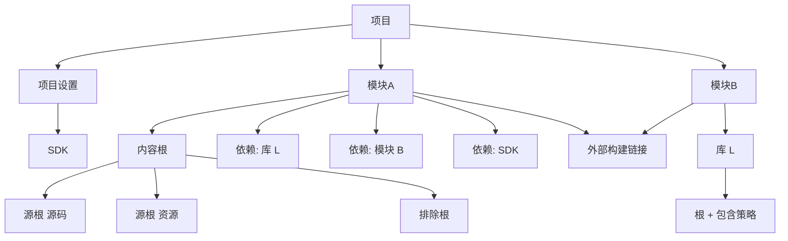
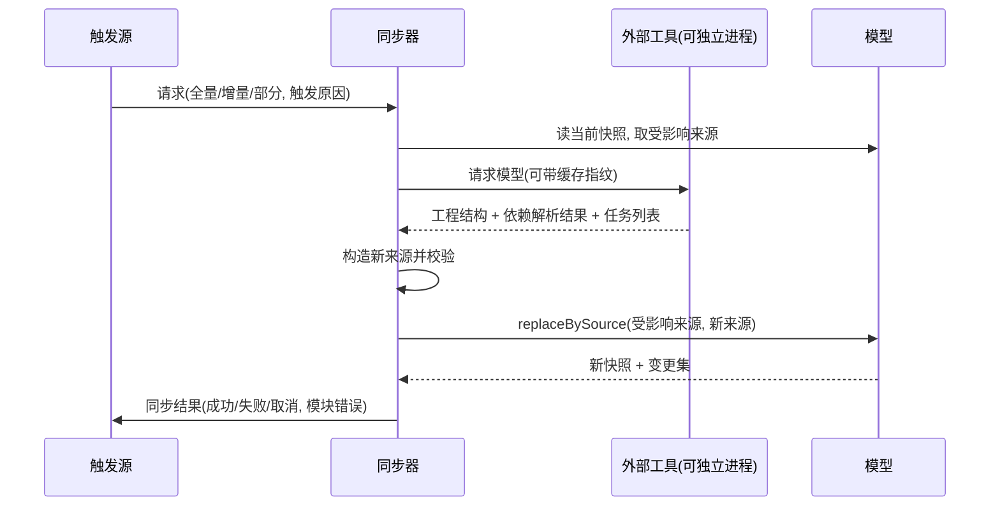

# 11 — 工程模型与构建集成

> 范围：工程结构的实体图（项目/模块/内容根/源根/库/SDK）、工作区模型（快照、增量变更、查询、序列化）、工程持久化与路径可移植性、外部构建系统作为模型来源的同步契约、依赖解析、增量编译与错误回传、多构建系统并存、构建视图与进度。｜ 依赖：01、02、03、04、15。｜ 排除：运行/调试会话与断点语义（见 12）、设置项的界面与存储细节（见 14）、索引的键值布局（见 07）。

## 1. 目的与范围

### 1.1 本子系统解决什么问题

代码要被"理解"和"构建"，前提是先回答五个问题：工程由哪些编译单元组成、每个单元含哪些文件、每个单元依赖什么、这些事实由谁维护、修改后谁需要知道。

本子系统把回答固定成**一份可查询的实体图**加**一条变更事件流**，并向三侧提供服务：

1. **向上（分析侧）**：索引、解析、检查、补全需要"哪些文件属于源、哪些属于库、哪个模块拥有哪个文件"；它们只读快照（见 07、08）。
2. **向下（执行侧）**：编译、打包、运行、调试需要"编译范围、输出位置、类路径"；它们按任务粒度读快照（见 12）。
3. **向外（工具侧）**：外部构建工具是**模型的事实来源之一**；它不直接改文件树，而是把"它认为正确的模型"提交给本子系统，由本子系统统一裁决与广播。

### 1.2 边界

不负责：构建脚本语言的语法语义（见 06）；构建工具自身的依赖语义（版本冲突算法由工具实现，本子系统只承载结果）；文件内容读写（见 04）；索引键值（见 07）；进程控制（见 12）；设置项呈现（见 14）。

### 1.3 与其他子系统的关系

| 关系 | 编号 | 交互点 |
|---|---|---|
| 虚拟文件 | 04 | 模型中一切位置以"路径引用"表达，可解析为虚拟文件 |
| 运行时与并发 | 03 | 模型提交必须持写锁；读取不加锁 |
| 索引 | 07 | 从模型派生"可索引根集合"；模型变更触发增量重索引 |
| 分析 | 08 | 库/源根变更使解析结果失效 |
| 执行调试 | 12 | 编译任务、运行配置的类路径来源 |
| 扩展机制 | 15 | 实体扩展、序列化器、构建系统接入均为扩展点 |
| 远端部署 | 17 | 模型读侧可分离：变更事件需跨进程投递 |

## 2. 概念模型

### 2.1 模型层次

```
项目 Project
└── 模块 Module                     1..n，名字项目内唯一
    ├── 内容根 ContentRoot          1..n，物理目录
    │   ├── 源根 SourceRoot        0..n，带"根类型"标识
    │   ├── 排除根 ExcludeRoot     0..n
    │   └── 排除模式 glob          0..n
    ├── 依赖列表 Dependency        0..n，有序
    ├── 模块扩展 ModuleExtension   0..n（语言/框架附加配置）
    └── 外部构建链接 ExternalLink  0..1（归属哪个构建工具）
库 Library                          0..n，分属三级库表（全局/项目/模块）
SDK                                 0..n，具名 + 具类型
```

1. **根类型是开放字符串，不是枚举**：源根种类（源码/测试源码/资源/测试资源/生成源码/自定义）由语言扩展声明标识，模型只存标识——新增语言无需改 schema。
2. **库是"根 + 包含策略"而非"一堆构件"**：一个解析结果集用一个库表达，根目录加递归归档策略即可覆盖成百个传递构件，避免实体数随依赖树爆炸。
3. **依赖是有序列表**：顺序参与类路径构造，模型必须保序，且同一声明顺序跨会话稳定。

### 2.2 实体关系



### 2.3 事实来源与权威

每个实体**必须**携带来源对象，来源回答三件事：这条事实写自哪个配置位置、由谁负责重写、删掉整个来源时该删哪些实体。

| 来源类别 | 权威方 | 典型内容 |
|---|---|---|
| 项目级配置文件 | 本系统 | 项目设置、项目库、SDK 表 |
| 模块级配置文件 | 本系统 | 模块内容根、依赖、模块库 |
| 全局配置文件 | 本系统 | 全局库、SDK 表 |
| 导入来源（外部分配） | 外部构建工具 | 由工具生成的全部模块结构 |
| 合成来源 | 本系统临时计算 | 临时模块、未落盘内容 |

导入来源另带两个标记：**归属的构建系统标识**与**是否由外部存储承载**。后者为真时，本系统**必须不**把该模块写回自有描述文件——描述文件的权威已让渡给构建工具。

### 2.4 运行期概念

| 概念 | 定义 |
|---|---|
| 快照 Snapshot | 某一版本下整张实体图的不可变视图，可安全跨线程持有 |
| 版本号 | 单调递增整数，每次成功提交 +1 |
| 构建器 Builder | 从快照派生的可变副本，承载一次事务的全部编辑 |
| 变更集 Change Set | 一次提交产生的按实体类型聚合的新增/修改/删除列表 |
| 同步 Sync | 把外部构建工具的模型读入并合并进快照的完整过程 |
| 部分同步 | 只替换"受影响来源集合"所辖实体的同步 |
| 构建任务 Build Task | 编译/打包的最小可调度单元，带范围与增量标志 |

## 3. 数据模型

`PathRef` 表示**可相对化的路径引用**：内存中为绝对位置，持久化时为相对位置或宏引用（见 §4.4）。

```
Project {
  name: string
  configLocation: ConfigLocation        // DirectoryBased(projectDir, configDir) | SingleFile(file)
  defaultSdk: SdkRef?
  defaultLanguageLevel: string?         // 开放标识；空表示按 SDK 推断
  moduleGroupTree: GroupPath[]          // 展示用分组，不参与编译
}
Module {
  id: ModuleId                          // name，项目内唯一
  type: string                          // 开放标识，非枚举
  groupPath: string[]
  contentRoots: ContentRoot[]           // 同一模块内不得互相包含
  dependencies: Dependency[]            // 有序；顺序影响类路径
  extensions: ModuleExtension[]         // 语言/框架附加配置
  externalSystem: ExternalLink?
  testTarget: ModuleRef?                // 测试模块 → 被测生产模块
  unloaded: bool                        // 是否仅存于"未加载"存储
}
ContentRoot { url: PathRef; excludedPatterns: string[]      // glob，作用于该根之下
              sourceRoots: SourceRoot[]; excludedRoots: PathRef[] }
SourceRoot  { url: PathRef; rootType: string                // 源码/测试源码/资源/生成源码/…
              generated: bool; packagePrefix: string? }     // 生成根写入保护不同；前缀映射与语言相关
Dependency =
    LibraryDep      { library: LibraryRef, exported: bool, scope: Scope }
  | ModuleDep       { module: ModuleRef, exported: bool, scope: Scope, productionOnTest: bool }
  | SdkDep          { sdk: SdkRef }
  | InheritedSdkDep                                     // 继承项目默认 SDK
  | OwnSources                                          // 模块自身源码（隐式首项）
Scope = COMPILE | RUNTIME | TEST | PROVIDED             // 编译 / 运行 / 测试 / 提供
Library { id: LibraryId; type: string; roots: LibraryRoot[]; excludedRoots: PathRef[] }
                                        // id=(name,table)；type 为开放标识
LibraryRoot { url: PathRef; kind: string; inclusion: InclusionMode }
                                        // kind: classes/sources/javadoc/自定义
InclusionMode = ROOT_ONLY | ARCHIVES_UNDER_ROOT | ARCHIVES_UNDER_ROOT_RECURSIVELY
LibraryTable = Global | Project | Module(ModuleRef)   // 三级；模块级表随模块存亡
Sdk { id: SdkId; version: string; home: PathRef; roots: { url: PathRef, kind: string }[]
      additionalData: opaque }          // id=(name,type)；additionalData 由类型自行解释
ExternalLink { systemId: string; linkedProjectPath: PathRef; linkedProjectId: string
               rootProjectPath: PathRef; moduleType?/moduleGroup?/moduleVersion?: string }
                                        // systemId 标识拥有该模块的构建系统；*ProjectPath 支持多工程构建
ModuleExtension { typeId: string; config: opaque }   // 语言/框架附加配置的通用载体
```

**持久化形态**：模型不落盘为单一整体，而是**按来源分片**——每个配置位置对应一个描述文件，文件中按实体类型分组；实体与"定义文件"的对应关系由来源复原。派生缓存另存（见 §4.4），可随时删除。

**生命周期**：实体随父实体存亡（模块删 → 内容根删 → 源根删）；库随库表存亡；SDK 为项目级或全局级，生命周期与项目或应用一致。字段的默认值只允许出现在"读入时补全"与"写出时省略"两处，模型内部**必须**始终是完整赋值。

## 4. 行为契约

### 4.1 读路径

- 读取只针对快照，不得读构建器；读取**必须不**获写锁，可与任意数量读者并发。
- 查询接口（概念级）：

| 查询 | 语义 | 复杂度要求 |
|---|---|---|
| 按类型枚举 | 返回该类型全部实体 | 与结果数成正比，不得全表扫描 |
| 按符号标识解析 | 名字 → 唯一实体 | 近似常数 |
| 按来源过滤 | 谓词作用于来源 | 与来源数成正比 |
| 反向引用 | 给定符号标识，返回引用它的实体 | 近似常数 + 结果数 |
| 路径索引 | 路径 → 实体集合 | 近似常数 |

- 查询结果可带**缓存单元格**：缓存附着于版本号，版本变化即失效；缓存不得延长实体生命周期。

### 4.2 写路径与事件

提交序列（**必须**按此顺序，任一步失败即整体回滚）：取得写锁（与 03 的写意图同一机制）→ 从当前快照派生构建器 → 施加编辑（新增、按类型修改指定实体、删除、按来源范围整体替换）→ **校验**（引用完整性、符号标识唯一性、必填字段非空）→ 原子切换快照并使版本号 +1 → 释放写锁 → 投递变更集。

```
ChangeSet {
  storageBefore: Snapshot
  storageAfter: Snapshot
  changes: Map<EntityType, { added[], modified[]{old,new}, removed[] }>
  referenceChanges: { id, before[], after[] }[]      // 符号引用的解析结果变化
}
```

- 监听器**必须**收到两个时刻：提交前（可读旧快照做差异准备）与提交后（新快照已生效）。
- 投递**必须**按版本号单调顺序；同一监听器不得看到版本 5 之后又看到版本 3。
- 投递**必须**在快照切换完成之后，因此监听器读"当前快照"与读 `storageAfter` 结果一致。
- 单个编辑批次**必须**只产生一个版本；任何跨多版本的"逻辑原子操作"都是缺陷。
- 变更流对订阅者可**合并**（背压时丢弃中间版本、只保最终版本），但**必须**保证最终态可见；需要逐版本序列的订阅者必须显式声明不允许合并。

### 4.3 来源范围替换（部分更新的核心原语）

```
replaceBySource(predicate: Source -> bool, source: Snapshot)
```

语义：① 删除当前快照中**来源匹配**的全部实体及其子实体；② 把 `source` 中**来源匹配**的实体（含子树）并入；③ 不匹配的实体逐字保留，含符号标识。

这是"部分同步"、"单模块重载"、"外部工具只改一个工程"三种场景的同一实现，同时是冲突裁决点：**谁提供来源，谁就拥有该来源下的全部事实**；未被覆盖的来源保持原样，因此并存不产生竞争。

### 4.4 序列化、版本与可移植性

- 每类实体有**序列化器**并声明**数据格式版本**。版本不匹配的读取**必须**丢弃缓存并回落到源描述文件重解析，不得逐字段迁移。[推断：迁移策略由序列化器自实现]
- 缓存序列化只对快照发生，产出可丢弃数据；缓存中**必须**记录来源描述文件的指纹，不符即失效。
- 路径**必须**相对化后落盘：项目内路径存相对形式；项目外但属于已知应用级位置的路径存**宏引用**（项目文件、模块文件、工作区文件、缓存文件四类宏）；两者皆不适用则存绝对路径并**应当**给出可移植性警告。内存中的 `PathRef` 一律绝对，相对化只在写出边界、绝对化只在读入边界发生。
- 源根、模块列表、库根**必须**以稳定顺序写出（按类型、名称、路径排序），降低版本控制噪声。

### 4.5 模型 ↔ 文件系统双向绑定

加载：定位配置位置（目录式或单文件式）→ 读模块清单得到"模块 → 描述文件"映射（清单缺失时以目录扫描兜底 `[推断]`）→ 逐模块解析，产出实体并以该文件为来源 → 解析失败不丢弃整个工程，失败模块进入**孤儿暂存区**并记录"模块加载错误"（模块名 + 错误数 + 首错元素名）→ 显式标记为"未加载"的模块进入**未加载存储**：实体存在、可查询，但不参与索引与编译范围。

保存：只写**权威为本地**的来源；导入来源且"外部存储"标记为真的实体**必须不**写回。写出以来源为单位、按实体类型分组，同一来源的写出是**原子**的（临时文件 + 重命名，见 04 §7）。删除模块时必须清理其描述文件与模块级库表；清理失败降级为"残留文件 + 报告"，不得阻塞关闭。

一致性校验（加载后、保存前各一次）：

| 校验 | 不通过时 |
|---|---|
| 模块名唯一 | 后者被重命名为唯一名并报告 |
| 内容根互不包含（同模块内） | 保留外层，内层降级为普通目录并报告 |
| 源根必须落在某内容根之内 | 提升为隐式内容根并报告 |
| 依赖目标存在 | 记为**未解析依赖**，不删除条目 |
| 库根存在 | 保留条目并标记缺失（离线可用性） |
| 循环模块依赖 | 允许存在，编译闭包必须去重；结构视图标红 |

### 4.6 外部构建工具的同步



触发条件（**至少**一条成立才允许发起）：**工程打开**（首次装配，必发）；**构建脚本或其引用文件变更**（文件监视 + 内容指纹比对，默认可按工程关闭）；**依赖坐标变更**（同前，指纹粒度到依赖段）；**用户显式请求**（必发）；**编译/运行前**（任务前置钩子，模型已陈旧则发）；**定时轮询**（默认关闭）。

- **指纹**：每个被监视构建文件维护内容指纹，指纹不变则**必须不**发起同步（避免工具自写文件引发同步风暴）。
- **合并**：同一时刻只允许一个同步；期间请求合并为一个"待执行"，只保留最强范围（全量 > 增量 > 部分）。
- **取消**：只中止读取与合并，不得留下半提交状态；已提交版本不回滚。
- **失败呈现**：按树呈现（工程 → 子工程 → 任务/失败点），配合输出流与问题列表；失败**必须**保留上次成功的模型并显式标记"模型可能陈旧"。
- **恢复贡献者**：失败后允许注册方提供修复动作（切换工具版本、重新链接工程），在失败通知中就地可点。
- **未链接工程**：检测到构建文件但未链接时以非侵入提示出现；链接动作本身也是一次同步触发。
- **离线模式**：同步退化为"仅用本地缓存与已解析结果重建模型"，不发起网络请求；缺失构件根保留为缺失标记，编译范围据实收缩（见 §7）。

### 4.7 依赖解析

```
解析(模块声明) -> 构件坐标集合 -> 解析器 -> { 构件位置[], 传递图, 冲突裁决 }
```

责任划分：**坐标声明**由构建脚本给出，模型不解释坐标语法；**坐标替换**允许本系统注册贡献者介入（测试/本地覆盖）；**传递闭包**与**冲突裁决**（最近优先或强制版本）由外部工具完成，模型不重算；**结果映射**由本系统把传递结果折叠为一个库（根 + 包含策略）；**本地缓存**只引用工具缓存目录路径；**完整性校验**（校验和/签名）由工具完成，本系统不二次校验但记录可信度 `[推断]`。

- **强制版本/替换**的结果**必须**以"最终构件路径"进入模型，而非候选集合——模型只承载确定结果，以保证索引与分析可复现。
- 仓库与镜像：模型只保存"仓库引用是否可用"的事实；地址与凭据属设置域（见 14）。仓库提供者允许第三方注册。
- 解析失败时：模块保留依赖条目，库实体缺失或部分缺失；受影响源根集合**必须**可被索引侧查询到"该类路径不完整"，从而抑制"未解析符号"类误报（见 08 §7）。

### 4.8 编译集成

```
BuildTask =
    AllModules { incremental: bool }
  | Modules    { ids: ModuleRef[], incremental: bool,
                 includeDependents: bool, includeRuntimeDependencies: bool }
  | ModuleFiles{ module: ModuleRef, files: PathRef[] }      // 单文件编译
  | ModuleResources { module: ModuleRef }                   // 仅资源更新
  | RunConfiguration { ref }                                // 由运行配置派生
```

- **范围语义**：`includeDependents` 决定是否把"依赖该模块的模块"纳入；`includeRuntimeDependencies` 只影响运行期类路径构造，不影响编译目标。编译器不得自行扩大范围。
- **增量判定**：由编译器实现依据"输出与输入的时间/指纹映射"决定；模型只提供"哪些根是源、哪些是输出、哪些是库"。本子系统**必须不**内嵌语言相关的过期判定。
- **输出目录**：模块级编译输出与测试输出，可"继承项目默认"或"显式指定"；可设置"排除输出目录"（不进索引的源根，但仍进类路径）。
- **注解处理**：属编译器配置的一部分，由语言编译器扩展承载；模型只保证"生成的源根"以 `generated=true` 的源根出现并被加入下一轮索引。
- **错误映射**：输出流经解析器转为统一构建事件 `{ 文件, 行, 列, 严重级, 消息, 是否来自生成文件 }`；多行续行必须合并，无法解析的行必须作为原始输出保留而不得丢弃。
- **时序**（**必须**遵守）：模型同步 → 编译 → 输出落盘 → 输出根增量重索引 → 分析以新结果运行。任何"先重索引再编译"的顺序都会产生"已修复但仍报错"的假象。
- **取消**：在任务边界与输出解析边界检查；取消后任务进入"已取消"终态，已产生的输出保留（可被下次增量利用），构建视图标注为取消。

### 4.9 多构建系统并存

- 每个模块**至多**一个外部构建链接；没有链接的模块由本地描述文件权威。
- 同一项目内允许多个构建系统共存（不同模块集、不同子目录），规则：
  1. **模块级权威优先**：模块的外部构建链接决定其来源归属。
  2. **来源不重叠**：两个系统不得对同一模块声明结构；发生后到者被拒并在同步结果中报告。
  3. **工程级链接**：链接工程（根工程）之外的文件变更不触发该系统同步。
  4. **无外部系统时**：内置模型即权威，构建由内置构建流程执行。
  5. **混合编译**：跨系统模块依赖允许存在；类路径按依赖顺序拼接，不做系统间语义转换。
- 构建系统以"运行环境 + 构件"的形式接入（存在独立的运行环境支撑模块），因此不是本地编译器的替代品，而是任务执行者。

### 4.10 构建视图与进度

```
BuildEvent { id: EventId; parentId: EventId?; time: timestamp;
             message: string; hint: string?; description: string? }
BuildNode  { id: int; parentId: int;              // 根固定标识
             title: string?; name: string?; duration: duration?
             targets: NavigatableRef[]             // 可跳转位置（源位置/输出位置）
             autoExpand: bool; hasProblems: bool
             visibility: always | onSuccess | onWarning }
```

- **树**：根 → 模块/任务 → 子步骤 → 消息；节点携带时长与可跳转目标；可见性支持"仅失败时显示"以压缩成功路径噪声。
- **输出流**：与控制台事件同源；stdout/stderr 分流但不改变顺序语义（按到达顺序）。
- **问题**：构建问题（配置错误、工具版本不匹配等非编译器诊断）与编译诊断同列于问题视图，均带快速修复入口。
- **多构建并行**：视图可同时持有多个构建，各自独立进度；节点更新**必须**按 `id/parentId` 归并，不得重复建树。
- **进度**：嵌套（父进度携带完成数/总数），报告必须幂等——重复报告同一节点只更新不追加。
- **取消**：视图暴露取消入口，语义同 §4.8；取消后仍可查看已完成部分的输出。
- **跨进程**：构建事件是可序列化的封闭类型集合（开始/进度/消息/文件消息/结束/移除/选中/状态变化），因此后端产生、前端渲染；视图自身不持有编译器对象。

## 5. 不变量与约束

- **INV-1** 快照一旦发布即不可变；任何修改都产生新版本。
- **INV-2** 版本号单调递增，变更集与版本一一对应。
- **INV-3** 提交是原子的：外部观测不到"半个提交"。
- **INV-4** 每个实体都有来源，且来源可判定其配置文件位置（合成来源除外）。
- **INV-5** 符号标识在命名空间内唯一：模块名唯一、`(库名, 库表)` 唯一、`(SDK 名, 类型)` 唯一。
- **INV-6** 无悬空引用：删父必级联删子；删被引用实体必留"未解析引用"记录。
- **INV-7** 部分替换只影响谓词匹配的来源，其余实体的标识与字段逐一不变。
- **INV-8** 未加载存储与主存储的实体集合不相交（同一符号标识不得同时存在）。
- **INV-9** 持久化往返等价：写出后读回，除时间戳与顺序外实体语义不变。
- **INV-10** 相对化是写出边界行为：内存中的路径引用一律可绝对解析。
- **INV-11** 由外部存储承载的模块，其结构不得写回本地描述文件。
- **INV-12** 构建任务必须终止于三类终态之一：成功、失败、取消；不允许静默消失。
- **INV-13** 依赖列表中"模块自身源码"恒为首项且不可删除。

## 6. 对外能力契约

```
// 读
snapshot() -> Snapshot
snapshot.elements(type) -> sequence
snapshot.resolve(symbolicId) -> Entity?
snapshot.referrers(symbolicId, type) -> sequence
snapshot.bySource(predicate) -> sequence
// 写
update(name, body: Builder -> void) -> Unit        // 异步、持写锁、单写者
updateSync(name, body) -> Unit                     // 仅限已持锁调用方
subscribe() -> flow<ChangeSet>                     // 可合并
subscribeStrict() -> flow<ChangeSet>               // 不合并
// 同步
sync(request: { scope, trigger }) -> SyncResult
link(projectPath) -> SyncResult
unlink(projectPath)
awaitSynchronizedWithModel() -> Unit
// 编译
runTask(task: BuildTask) -> Promise<TaskResult>
cancel(taskHandle)
createTask(scope...) -> BuildTask
taskResult { aborted, errors, warnings, perTaskState }
```

- `update` **必须**不可重入（body 内不得再调 `update`）；需要嵌套逻辑时由调用方合并为一次 body。
- `subscribe` 的回调**必须**容忍"变更集与当前快照不一致"的瞬时情形（并行同步可能已提交更新版本），处置原则是重读快照而非缓存旧值。
- `runTask` 的句柄**必须**可独立取消，取消幂等。

## 7. 故障模式与降级

| 故障 | 检测 | 用户可见 | 档位 | 恢复 |
|---|---|---|---|---|
| 单个模块描述文件损坏 | 解析异常/校验失败 | 该模块以错误标记出现，其余正常 | D1 | 修复文件或重新同步；孤儿暂存区内容不丢 |
| 同步失败（工具崩溃/脚本错误） | 非零退出/超时/协议错误 | 通知 + 同步视图失败树；模型标记陈旧 | D3（陈旧模型下编译/运行按提示禁用或强制使用旧模型） | 修复后重试；恢复贡献者提供动作 |
| 依赖解析失败 | 工具侧报告缺失构件 | 类路径不完整标记；未解析符号误报被抑制 | D1 | 联网重试或切换缓存 |
| 网络不可达（离线） | 连接失败/显式离线开关 | 同步与解析降级为本地 | D1 | 恢复网络后增量同步 |
| 模型缓存损坏 | 反序列化失败/版本不匹配 | 无感（重建），首次打开变慢 | D0 | 自动删除缓存重建 |
| 来源缺失（外部写入被删） | 加载时来源无法复原 | 提示"工程配置不完整"，保留已解析部分 | D1 | 从版本控制恢复 |
| 两构建系统声明同一模块 | 同步结果冲突 | 后到者被拒并报告 | D2 | 解除链接或移出模块集 |
| 编译任务被中断（进程退出） | 任务无终态 | 构建视图标注中断；输出保留 | D0 | 重跑增量编译 |
| 前端出现不应持有的实体 | 前端侧一致性监听 | 记录并丢弃，不影响后端 | D2 | 重新订阅变更流 |
| 工程配置文件全不可读 | 目录/单文件均无 | 以空模型 + 抢救提示打开 | D5 | 引导修复向导或从历史恢复 |

## 8. 资源与性能预算

| 项 | 预算/量级 | 说明 |
|---|---|---|
| 快照切换 | O(受影响实体) 而非 O(全图) | 结构共享；不得整图复制 |
| 单次提交实体数 | 同步可达上万；交互编辑应在百级 | 超过万级应拆批次以保事件延迟 |
| 事件投递延迟 | 百毫秒量级，允许合并 | 不得因慢监听器阻塞提交 |
| 快照驻留 | 至少"当前 + 上一次" | 供差异计算，更早版本按引用计数回收 |
| 路径索引内存 | 与源根数量线性，不与文件数线性 | 文件级映射由索引层承担（见 07） |
| 模型加载 | 与模块数线性，模块可并行解析 | 单模块失败不阻塞其余 |
| 同步频率下限 | 同一工程两次同步间隔 ≥ 数秒 | 由指纹与合并共同保证 |
| 构建事件速率 | 输出行可高频，树节点更新必须按节点聚合 | 未聚合会导致前端抖动 |
| 编译并行度 | 由编译器按模块依赖图分层 | 模型提供分层依据，不调度线程 |

## 9. 可观测性

- **模型摘要**：模块数、内容根数、源根数、库数、SDK 数、未解析依赖数、未加载模块数、孤儿实体数——用于"打开前后是否一致"的对比。
- **变更日志**：每次提交记录 `{ 名称, 起始版本, 结束版本, 新增/修改/删除计数, 受影响来源数, 耗时 }`；名称是诊断关键（谁改的）。
- **同步与编译报告**：同步记录 `{ 触发原因, 范围, 工具标识与版本, 阶段耗时(读取/合并/校验), 结果, 模块错误列表 }`；编译记录 `{ 任务范围, 增量标志, 命中/重编文件数, 耗时, 错误与警告数 }`。
- **诊断导出**：模型可导出为结构化转储（实体类型 + 标识 + 来源），用于复现问题的最小状态。
- **反模式检测**：短窗口内提交次数异常高、单次提交实体数异常大、同一来源被反复替换——均应可被记录并告警。

## 10. 扩展点

| 接缝 | 允许扩展什么 | 必须遵守 | 失败隔离 |
|---|---|---|---|
| 实体类型注册 | 新增实体类型与字段 | 提供来源；提供序列化器；声明父子关系 | 序列化失败仅影响该类型 |
| 模块扩展 | 语言/框架附加配置 | 配置可序列化；声明适用模块类型 | 配置损坏 → 该扩展缺失，模块保留 |
| 序列化器定制 | 特定实体在描述文件中的形态 | 声明格式版本；必须可往返 | 版本不符 → 回落默认或丢弃该节 |
| 根类型声明 | 新增源根种类 | 声明是否参与索引、是否只读 | 未知类型降级为普通源根 |
| 库类型/库表 | 新增库表与库类型 | 库标识必须在表内唯一 | 冲突时后到者被拒 |
| 外部系统接入 | 新增构建系统 | 实现"读模型 → 来源 → 范围替换"；提供指纹计算与变更监听 | 整体故障 → 该模块集降级为陈旧模型 |
| 同步前后处理 | 修正导入结果（重命名、路径调整） | 不得引入无来源实体 | 单个处理器异常 → 跳过并报告 |
| 编译前/后任务 | 挂接前置/后置动作 | 声明失败时是否阻断编译 | 阻断仅影响本次任务 |
| 构建问题贡献者 | 追加构建期问题 | 绑定可跳转位置或声明不可导航 | 异常 → 该问题被丢弃 |
| 构建目标范围提供者 | 决定"编译哪些" | 不得越权修改模型 | 异常 → 回落默认范围 |
| 文件索引贡献者 | 声明哪些实体参与索引 | 只声明，不直接写索引 | 异常 → 该实体不参与索引 |

## 11. 对照实现（证据锚点）

| 上文结论 | 可核对锚点 |
|---|---|
| 模型抽象与实现分离 | 模块 `intellij.platform.projectModel`（758 个依赖方）、`intellij.platform.projectModel.impl`（94） |
| 实体图存储层独立 | 模块 `intellij.platform.workspace.storage`（92）、`intellij.platform.backend.workspace`（77） |
| 内置描述文件模型 | 模块 `intellij.platform.workspace.jps`（75）、`intellij.platform.jps.model`（230）、`intellij.platform.jps.model.serialization`（47） |
| 快照/构建器/变更集 | `EntityStorage`、`ImmutableEntityStorage`、`MutableEntityStorage`、`VersionedEntityStorage`、`VersionedStorageChange`、`EntityChange` |
| 部分替换原语 | `MutableEntityStorage.replaceBySource`、`WorkspaceModelInternal.replaceWorkspaceModel` |
| 查询与变更流 | `WorkspaceModel.currentSnapshot`、`WorkspaceModel.eventLog`、`flowOfQuery`/`flowOfDiff` |
| 监听双时刻 | `WorkspaceModelChangeListener.beforeChanged/changed`、`WorkspaceModelTopics.CHANGED` |
| 未加载实体与孤儿暂存 | `WorkspaceModelInternal.getUnloadedEntitiesStorage`、`LoadedProjectEntities.orphanageBuilder`、`UnloadedModulesNameHolder` |
| 来源分类 | `JpsProjectFileEntitySource`、`JpsGlobalFileEntitySource`、`JpsImportedEntitySource`（含 `storedExternally`）、`OrphanageWorkerEntitySource` |
| 实体与字段（模块/根/库/SDK） | `ModuleEntity`、`ContentRootEntity`、`SourceRootEntity`、`ExcludeUrlEntity`、`LibraryEntity`、`LibraryRoot`、`SdkEntity`、`ProjectSettingsEntity` |
| 开放根类型标识 | `SourceRootTypeId`、`LibraryRootTypeId`、`SdkRootTypeId`、`ModuleTypeId`、`LibraryTypeId`（均为字符串标识） |
| 库包含策略 | `LibraryRoot.InclusionOptions`：`ROOT_ITSELF`、`ARCHIVES_UNDER_ROOT`、`ARCHIVES_UNDER_ROOT_RECURSIVELY` |
| 依赖范围与导出语义 | `DependencyScope`：`COMPILE`/`TEST`/`RUNTIME`/`PROVIDED`；`ModuleDependency.exported`/`productionOnTest`；`LibraryDependency.exported` |
| 依赖种类与模块级库表 | `LibraryDependency`、`ModuleDependency`、`SdkDependency`、`InheritedSdkDependency`、`ModuleSourceDependency`；`LibraryTableId.ModuleLibraryTableId`/`ProjectLibraryTableId` |
| 外部构建链接 | `ExternalSystemModuleOptionsEntity`（systemId、linkedProjectPath/Id、rootProjectPath、moduleType/Group/Version） |
| 测试模块、分组、语言附加 | `TestModulePropertiesEntity.productionModuleId`、`ModuleGroupPathEntity.path`、`JavaModuleSettingsEntity`（`inheritedCompilerOutput`/`excludeOutput`/`compilerOutput`/`languageLevelId`）、`JavaSourceRootPropertiesEntity`（`generated`/`packagePrefix`） |
| 路径可移植性 | `UrlRelativizer.toRelativeUrl/toAbsoluteUrl`、`StoragePathMacros`（`$PROJECT_FILE$`/`$MODULE_FILE$`/`$WORKSPACE_FILE$`/`$CACHE_FILE$`）、`ProjectSettingsSerializer`、`ModuleListSerializerImpl` |
| 外部存储开关 | `ExternalStorageConfigurationManagerImpl`（启用/停用并迁移实体来源） |
| 变更检测与触发 | `JpsConfigurationFilesChange`（added/removed/changed）、`externalSystemCrcCalculator`、`externalProjectWatcherContributor`、`autoReloadTypeProviderExtension`（各 1–2 个实现） |
| 同步与错误呈现 | `JpsProjectModelSynchronizer`、`ReloadingResult.affectedSources`、`ModuleErrorType`、`externalSystemRecoveryContributor`、`externalSystemUnlinkedProjectAware` |
| 外部系统接入面 | `ExternalSystemExtensionPoints` 声明 35 个扩展点（含 `externalSystemManager`、`externalSystemConfigLocator`、`externalSystemOutputParserProvider`、`externalSystemExecutionConsoleManager`） |
| Gradle 接入 | 插件标识 `org.jetbrains.plugins.gradle`；自声明 `projectResolve`、`syncContributor`、`importCustomizer`、`taskManager`、`settingsControlProvider`、`autoReloadSettingsCollector` |
| Maven 接入 | 插件标识 `org.jetbrains.idea.maven`；`org.jetbrains.idea.maven.importer`、`provider`、`repositoryProvider`、`artifactBuilder`、`compiler`、`workspaceConfigurator` |
| Eclipse 互操作 | 插件标识 `org.jetbrains.idea.eclipse`；注册 `workspaceModel.customModuleRootsSerializer`、`workspaceModel.customModuleComponentSerializer`、`projectImportBuilder`、`classpathStorageProvider` |
| 依赖解析 | 模块 `intellij.java.aetherDependencyResolver`、`intellij.platform.externalSystem.dependencyUpdater`（21）；扩展点 `dependencySubstitutionCoordinateContributor`、`externalSystemDependencyAnalyzer` |
| 编译任务模型 | `ProjectTaskManager`（`buildAllModules`/`rebuild`/`compile(files)`/`createModulesBuildTask(incremental, includeDependent, includeRuntime)`）、`ModuleFilesBuildTask`、`ProjectTaskResult` |
| 编译扩展点 | 独立描述符 `extensions/compiler.xml` 声明 58 个扩展点，含 `com.intellij.compiler`、`com.intellij.compilerFactory`、`com.intellij.compiler.task`、`com.intellij.compiler.buildTargetScopeProvider`、`com.intellij.compiler.isUpToDateCheckConsumer` |
| 编译错误映射 | `JavacOutputParser`/`KotlincOutputParser`（按 `文件:行:列` 前缀解析、合并续行、无法解析保留原文）、`BuildOutputCollector` |
| 构建视图与进度 | 模块 `intellij.platform.buildView`/`.backend`/`.frontend`；`BuildProgress`（`startChildProgress`/`message`/`fileMessage`/`buildIssue`/`cancel`）、`BuildViewEvent`（开始/结束/移除/选中/状态变化的封闭集合）、`BuildTreeNode`（`parentId`/`visibleAsSuccessful`/`hasProblems`）、`MultipleBuildsView`、`SyncViewManager` |
| 索引与结构编辑接缝 | `workspaceModel.fileIndexContributor`（44 条注册）、`projectStructure.sourceRootEditHandler`（16）、`moduleBuilder`（17）、`library.type`（16）、`com.intellij.projectModelModifier`（2） |
| 工程级服务规模 | `com.intellij/projectService` 合计注册 1,165 条（模块描述符 608 + 插件描述符 557）、`projectSettings` 430 条；应用级 `applicationService` 2,187 条 |
| 扩展统计口径 | 唯一扩展点声明 3,235（模块描述符 2,352 + 插件自命名空间 883）；扩展注册 29,282（模块 18,615 + 插件 10,667） |
| 多系统共存前提 | 模块 `intellij.platform.bazel.runfiles`；插件目录 `gradle-plugin`、`gradle-java-plugin`、`maven-plugin`、`android-gradle-dsl`、`java-aetherDependencyResolver-plugin` |

## 12. 未决问题

- **离线模式的精确边界**：证据只显示构建工具自身配置与仓库配置界面，未发现模型层统一的"离线"开关；本规格按"同步退化为本地重建"描述，具体哪些解析阶段仍触网 `[推断]`。
- **注解处理与生成源根的时序**：`generated` 证明"生成源根"是一等概念，但"编译期生成 → 重新索引"的确切触发点未在模型层显式建模，应属编译器实现 `[推断]`。
- **循环模块依赖的编译语义**：模型层允许循环（无环约束证据缺失），但编译闭包终止与排序规则未在模型层声明 `[推断]`。
- **多系统同模块冲突的裁决位置**：证据显示"来源 + 外部存储标记"表示归属，但"两个系统都声明同一模块"时的卫语句位置在模型层不可见 `[推断]`；本规格规定后到者被拒。
- **校验和/签名验证归属**：依赖完整性校验应属工具或解析器，模型只承载路径；若将校验结果入模需新增实体 `[推断]`。
- **工作区状态与项目配置的物理分离粒度**：证据显示存在四类宏与三类存储文件，但每一项设置落在哪个文件由设置框架声明（见 14），本规格只声明"必须分离"这一约束。
