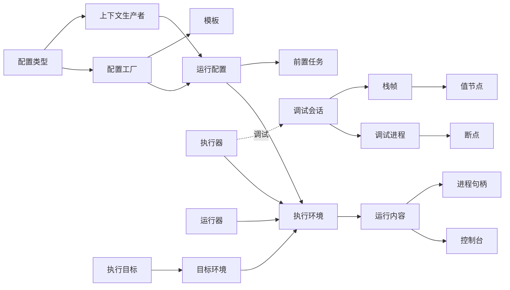
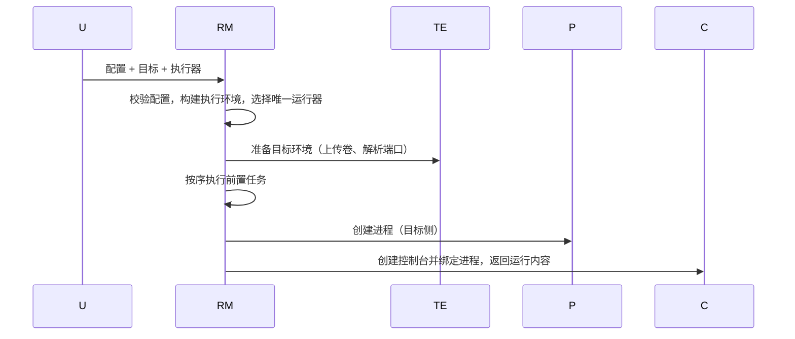
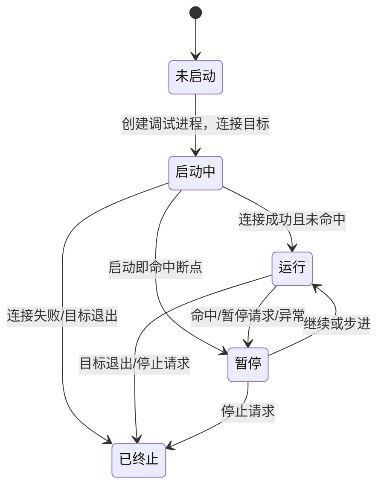

# 12 — 运行、调试与度量

> 范围：运行配置模型、启动链路、进程与控制台、调试器模型、协议适配、测试、覆盖率、性能分析。｜ 依赖：02、03、11、13、14。｜ 排除：构建语义（见 11）、编辑器渲染（见 05）、持久化引擎（见 14）、远端传输协议（见 17）。

## 1. 目的与范围

### 1.1 本子系统解决什么问题

"把代码跑起来"不是单一路径，而是四种执行意图（运行、调试、覆盖率、性能分析）× 四种执行位置（本地、远端主机、容器、WSL）× 任意语言与框架。按组合逐一实现会使复杂度成为乘积；本子系统拆成三条正交轴，各实现一次：

1. **要跑什么** —— 运行配置：可持久化、可编辑、可由上下文自动生成。
2. **以什么方式跑** —— 执行器（意图）与运行器（把配置翻译为进程启动）。
3. **在哪里跑** —— 执行目标与目标环境：把路径、端口、卷、PTY、权限从语言语义中剥离。

只有配置类型与调试后端是语言相关的；其余是平台机制。新增一种语言只需三件套：配置类型、上下文生产者、调试后端。

### 1.2 边界

**不负责**：编译与产物定位（见 11，本子系统只消费已构建产物）；语言特有的调试语义（虚拟机字节码、解释器栈约定，由调试后端承担）；界面布局与控件（见 13，本子系统只定义运行内容语义）；远程通道建立与加密（见 17）；测试框架的断言与生命周期语义（只定义发现、调度、结果、覆盖率的统一模型）。

### 1.3 与其他子系统的关系

| 关系 | 说明 |
|---|---|
| 11 工程模型 | 提供模块、依赖、SDK、产物路径；运行配置可选绑定模块 |
| 03 运行时 | 提供后台任务、取消、超时；进程事件投递不得阻塞输入线程 |
| 13 界面 | 提供动作、停靠区；运行内容挂在执行器声明的停靠区内 |
| 14 持久化 | 运行配置、断点、调试设置走统一状态存储，按项目/工作区两级归属 |
| 17 前后端切分 | 运行会话与调试会话必须能整体位于服务端，界面只持代理 |

## 2. 概念模型

| 术语 | 定义 |
|---|---|
| 运行配置 | 可持久化的启动描述，是"要跑什么"的唯一载体 |
| 配置类型 / 配置工厂 / 模板 | 一类配置的元描述 / 创建模板与新实例的策略 / 每工厂一份的不可执行默认值实例 |
| 执行器 / 运行器 | 执行意图（决定停靠区、图标、文案、目标可用性）/ 把配置与执行环境组合为实际启动 |
| 执行环境 / 运行内容 | 一次启动的上下文（项目、执行器、运行器、目标、复用内容、执行标识）/ 停靠区中的执行单元（控制台、进程、动作、名称、图标） |
| 执行目标 / 目标环境 | 用户可见的"跑在哪"（本地/远端/容器）/ 其运行期展开（命令、路径映射、卷、端口、PTY） |
| 调试会话 / 调试进程 | 调试的界面侧状态机 / 调试后端（栈、变量、求值、断点） |
| 断点 / 值节点 | 带条件的暂停或记录点，按类型分族 / 变量树节点，子节点按需计算 |
| 覆盖率报告 / 性能采样 | 行·分支·方法三层命中模型 / 调用栈样本序列，聚合为调用树与火焰图 |



**三条正交轴**：配置轴可扩展（类型与工厂由第三方声明）；执行器轴可扩展但须声明停靠区、图标、文案、是否可在非本地目标执行；位置轴可扩展（目标类型只回答"如何准备、如何创建进程、如何回收"）。**规则**：任一轴不得为另一轴枚举分支——运行器不判断"是否调试"，目标环境不判断配置类型，只接收中性的命令行描述。

## 3. 数据模型

```
ConfigurationType { id; displayName; configurationClass: TypeRef; managed: bool; tag? }
ConfigurationFactory { name; typeId; template: RunConfiguration
  singletonPolicy: SINGLE|MULTIPLE|SINGLE_ONLY|MULTIPLE_ONLY; optionsClass: TypeRef?
  editableInDumbMode: bool; beforeRunTaskDefaults: map<taskKind, TaskDefault> }
RunConfiguration { id; name; nameGenerated: bool; typeId; factoryName; moduleRef?
  temporary: bool; singleton: bool
  options { beforeRun: BeforeRunTask[]; fileOutput {enabled, path}
    logFiles {path, skip, charset}[]; predefinedLogFiles {kind, enabled}[]
    showConsoleOnStdOut, showConsoleOnStdErr, allowRunningInParallel: bool
    remoteTargetId?; projectPathOnTarget?; workingDirectory?; programArguments
    runtimeArguments; classPath: Entry[]
    env {inherit: bool, vars: map<string,string>} }   // 空值 = 删除该变量
Executor { id; toolWindowId; displayName; actionText; description
  icon; disabledIcon; rerunIcon; supportedOnTarget: bool }
ProgramRunner { id; policy: SYNC|ASYNC; matches(executorId, runConfiguration): bool
  contentToolWindowId? }                             // ASYNC 必须在后台推进
ExecutionEnvironment { projectId; executorId; runnerId; runProfileId; settingsId?
  targetId; targetRequest: TargetEnvironmentRequest; contentToReuse: RunContentId?
  executionId: int64; dataContext?; modulePath?; headless; autoTriggered; runningCurrentFile }
TargetEnvironmentRequest { typeId; configurationId; projectRootOnTarget
  runtimes: LanguageRuntimeRef[]; volumesToUpload {localRoot, targetRoot, mode: SYNC|COPY_ONCE}[]
  volumesToDownload[]; portBindings {local, target}[]; pathMappings {localPath, targetPath}[] }
TargetedCommandLine { exePath                          // 目标侧路径，非本地路径
  arguments[]; workingDirectory; env; envInherit: bool; pty {enabled, columns, rows}?
  redirectErrorStream: bool; inputEncoding; outputEncoding; privilegeElevation: bool }
RunContentDescriptor { id; displayName?; icon?; consoleRef?; processRef?; componentRef?
  restartActions[]; reuseProhibited: bool; reusePolicy: canBeReusedBy(new) -> bool
  runConfigurationName?; runConfigurationTypeId?; contentToolWindowId? }
Breakpoint { id; typeId; enabled; suspendPolicy: ALL|THREAD|NONE; condition?; logMessage?
  logStack: bool; logExpression?; sourcePosition {fileRef, line, column?}?; scopeId
  temporary: bool }                                  // logMessage 非空 = 记录点，不暂停
DebugSession { state: NOT_STARTED|STARTING|RUNNING|PAUSED|TERMINATING|TERMINATED
  processRef?; consoleRef?; breakpointsMuted: bool; currentStack?; currentFrame? }
ExecutionStack { id; displayName; icon?; isActive: bool; groupId? }
StackFrame { id; index; sourcePosition?; presentation }
ValueNode { id; name; typeName; valueText; childrenState: UNKNOWN|PARTIAL|COMPLETE
  presentationKind: NUMERIC|STRING|KEYWORD|REGULAR|ERROR }
TestItem { id; kind: SUITE|CLASS|METHOD|PARAMETERIZED_INSTANCE; parent?; displayName
  frameworkId; sourceLocation?; children[] }
TestResult { itemId; status: PASSED|FAILED|ERROR|SKIPPED|IGNORED; durationMs
  failureMessage?; stackTrace[]; outputRef? }
CoverageReport { engineId; mode: PROBE|SAMPLING; files {fileRef; lines {line, hits, status}[]
  branches {line, branchIndex, taken}[]; methods {signature, entryLine, hits}[]}[] }
ProfileSample { stack: FrameRef[]; weight; threadId: int64 }
```

## 4. 行为契约

### 4.1 启动链路



1. **校验先于准备**：校验失败必须在任何上传或进程创建之前返回，错误携带定位（哪一项、期望什么）。
2. **目标环境按执行阶段准备一次**，同一执行环境内多阶段复用；运行内容销毁时必须关闭。
3. **前置任务串行**：按声明顺序执行，任一失败即终止启动并进入"未启动"分支。
4. **控制台晚于进程、内容描述早于可见**：先创建进程再绑定控制台，未绑定期间输出无损缓冲（见 §4.5）；运行内容须完整构造（重启动作、图标、名称）后再插入停靠区，禁止先显示空标签。

### 4.2 运行器选择

```
selectRunner(executor, configuration):
  1. candidates := 全部 matches(executor.id, configuration) 为真的运行器
  2. 空 → 报告"该执行器不支持此配置"（携带执行器与配置类型）
  3. 多于一个 → 取注册序第一个并记录歧义（不得表现为随机行为）
  4. policy == ASYNC → 启动在后台推进，不占界面线程
  5. executor.supportedOnTarget == false 且 target != 本地 → 拒绝并建议切换目标
```

（执行器，配置）→ 运行器必须是函数关系。目标的解析：项目维护"活动目标"，配置未绑定时采用；切换目标触发变更事件供订阅方重算，但**不得**让已启动会话静默迁移；未就绪目标不得被选为启动目标，外部管理的目标不得被平台关闭。

### 4.3 进程启动

```
startProcess(environment, commandLine):
  1. 可执行文件按目标侧绝对路径解析；不做本地存在性检查（目标可能另一操作系统）
  2. 环境：inherit 为真则以宿主环境为基座并覆盖显式变量；显式空值 = 删除变量
  3. 工作目录缺省为项目根的目标侧映射路径，不得缺省为进程启动目录
  4. PTY：分配伪终端并设初始列/行；尺寸变更转发为终端事件
  5. 权限提升走独立提权通道，不得要求以管理员身份重启整个 IDE
  6. 创建进程，绑定三路标准流，记录目标环境到进程句柄的关联
  7. 创建失败 → 不建控制台，直接进入"未启动"分支
```

| 维度 | 差异 | 归一化 |
|---|---|---|
| 进程树终止 / 信号 | 类 Unix 以进程组/会话为单位且有终止/中断信号；Windows 需递归遍历且无等价信号 | 统一为"终止进程树"（Windows 用递归终止）与"温和终止 / 强制终止"两级 |
| 伪终端 / 路径 / 编码 | PTY vs ConPTY；大小写与分隔符；控制台代码页 | 由目标环境选实现；一律以目标侧路径表达并显式声明映射；命令行显式携带编解码 |

### 4.4 生命周期事件顺序

| 序 | 事件 | 触发点 |
|---|---|---|
| 1 | 启动已排期 | 用户确认启动（尚未选运行器） |
| 2 | 启动中 | 运行器确定、目标环境准备（可携带进程句柄） |
| 3 | 启动失败 | 校验/准备/创建失败，携带原因，后续无 4–7 |
| 4 | 已启动 | 进程创建成功，控制台须已可绑定 |
| 5 | 终止中 | 用户请求或进程自行退出（两者都必须发） |
| 6 | 已终止 | 进程回收完成，携带退出码（强制终止可空） |
| 7 | 内容销毁 | 运行内容移除，释放目标环境 |

同一执行标识的事件**不得乱序、不得重复**；界面侧必须容忍"已终止"先于某次"终止中"（并发终止）`[推断]`。

### 4.5 输出流分帧、着色与链接识别

```
onOutput(chunk, streamKind):
  1. 按输入编码解码；跨块多字节序列留在解码器，不得产生替换字符
  2. 按 CR / LF / CRLF 切分；未终结的半行留在待定缓冲
  3. 每个完整片段过过滤器链：返回（高亮区间 + 超链接 + 文本属性 + 是否继续）或空
  4. 合并重叠区间；两者都带链接时默认保留先到者（可配置）
  5. 错误流片段且"错误出现即激活控制台"为真 → 请求激活运行内容
  6. 写入缓冲；未绑定则入待定缓冲，绑定后一次性冲刷
```

过滤器**必须无副作用**（不得改文档、不得触发导航），跳转只在点击时发生。栈帧识别是过滤器的一种：把"文件:行:列"片段识别为可点击链接，解析失败必须降级为普通文本而非报错。

### 4.6 控制台状态机与输入

状态：`空闲 → 运行中 → 已终止`，已终止可重新运行回到运行中。

- **缓冲**：循环缓冲，容量以 KB 声明，`0` = 无上限（另受文件大小上限约束）；容量变更下次创建控制台生效。
- **折叠与搜索**：按规则折叠行（框架调用、重复日志），规则可由第三方声明，折叠只改呈现不改缓冲；搜索在已缓冲文本上进行并可视标记，不得为此重建文档。
- **交互输入**：转发到进程标准输入，单位为"一行 + 终止符"（终止符由目标平台决定）；命令历史有独立上限。
- **多控制台**：同一配置可有多个运行内容（并行运行或多执行器），每个独占控制台，缓冲不共享。
- **暂停输出**：只冻结渲染，不得停止读取输出，否则管道满会阻塞被调试进程。

### 4.7 调试会话状态机



- **非法迁移必须拒绝并记录**（如"已终止 → 暂停"），不得静默忽略。
- **暂停是原子的**：必须同时确定活动执行栈与活动栈帧，不得出现"栈已更新、帧未更新"的可见中间态。
- **挂起策略**：`ALL` 暂停全部执行栈；`THREAD` 只暂停命中线程；`NONE` 不暂停仅记录——`NONE` 的断点不得把会话置为暂停。

### 4.8 断点模型

| 类型 | 定位 | 特有能力 |
|---|---|---|
| 行断点 | 文件 + 行（可选列、行间位置） | 条件、日志、挂起策略 |
| 异常断点 | 异常类型 | 捕获/未捕获、条件 |
| 方法断点 | 方法符号 | 进入/退出 |
| 字段断点 | 字段符号 | 读/写/读写 |
| 日志断点 | 任意可定位位置 | 消息模板、附带栈、求值表达式；不暂停 |
| 临时断点 | 任意可定位位置 | 命中一次即删除（与命中同事务） |

生命周期：**创建**（写入断点管理器 → 持久化 → 通知所有会话）→ **注册**（翻译为后端表示；失败须保留并标记"未验证" + 原因）→ **验证**（确认可命中；超时按未验证处理，不得删除）→ **命中**（决定是否暂停；记录点写控制台后自动继续）→ **失效**（源文件删除/重命名时随引用迁移或标记，不得静默丢弃）。**全局静音**为会话级布尔量：静音期间断点仍注册但不触发暂停或记录，取消静音后恢复，不得重新注册。

### 4.9 步进语义

| 动作 | 语义 | 边界 |
|---|---|---|
| 步入 | 进入下一层调用；无源码帧默认跳过至下一有源码帧 | 跳过策略必须可预测 |
| 步过 | 执行到当前帧下一行，跨调用不停 | 递归沿用同一规则 |
| 步出 | 执行到当前帧返回后的下一行 | 顶层帧退化为继续 |
| 强制步入 | 忽略"跳过库/无源码"过滤器 | 用于排查框架内部 |
| 运行到光标 | 设一次性停靠点后继续 | 位置不可达必须明确报告 |
| 智能步入 | 一行多调用时先询问目标 | 无多候选时退化为普通步入 |

**步进是异步命令**：发出后进入"运行"，下一次"暂停"才代表完成，不得同步等待。步进必须携带"忽略断点"标志：步过/步出在被跨过区间内默认不因断点暂停，否则单步会被无关断点打断。

### 4.10 线程与栈帧

- 以"执行栈"为顶层单位（线程、协程、虚拟线程、混合模式下的原生线程各为一个）。
- 栈帧**分块取回**：先取顶部若干帧，滚动按偏移续取（块大小见 §8）；每帧暴露序号、源位置（可有）、呈现文本、该帧求值器。
- **分组与混合模式**：按来源分组（协程调度器、线程池），分组由后端提供，前端只决定呈现顺序；同进程可并存高层（托管）与低层（原生）帧，切换点由混合模式扩展声明，禁止前端拼接两类栈。
- **协程/虚拟线程**：协程作为独立执行栈并保留创建栈；虚拟线程若后端无法区分则退化为普通线程，且不得伪造层级 `[推断]`。

### 4.11 变量树：惰性求值与呈现

```
展开(节点):
  1. UNKNOWN → 请求子节点，状态置 PARTIAL
  2. 分批返回，每批到达即插入并合并排序，保持 PARTIAL
  3. 达批次上限仍未取完 → 呈现"还有 N 项"占位，用户显式请求下一批
  4. 取完 → COMPLETE；求值异常 → 该节点呈错误样式，父节点不得因此失败
```

呈现类型必须显式区分数值、字符串、关键字（null/undefined/void）、常规对象、错误，由其决定着色与编辑能力，不得由文本猜测。节点可声明"可修改"与"可导航"，未声明则不得呈现入口。树展开必须可取消：会话继续或终止时取消全部在途请求，迟到结果按版本丢弃。

### 4.12 表达式求值

| 维度 | 契约 |
|---|---|
| 上下文 | 绑定当前栈帧；无帧时只允许静态/全局表达式 |
| 输入形态 | 表达式（单值）与代码片段（多语句，需后端声明支持），由输入分析判定 |
| 副作用 | 默认禁止；显式开启后才允许（仅限交互式求值） |
| 超时 / 错误 | 必须有硬时限，超时即丢弃并报"求值超时"；语法错误本地先报，后端错误作为该表达式的值呈现、不中断会话 |
| 并发 | 同会话求值不并发；后发请求排队或取消先前请求 |

### 4.13 热替换

条件：会话处于暂停、后端声明支持、变更集非空。流程：收集变更文件 → 编译为可替换单元 → 发送目标虚拟机 → 逐单元返回成功/失败与原因 → 汇总呈现。**只能替换方法体**：新增/删除方法、签名变更必须拒绝，不得部分应用。失败不中断会话，失败单元保留原实现；替换后断点保持注册，若因替换失效则标记"未验证"。

### 4.14 断点持久化与共享

归属**项目级状态**，按调试器作用域分键，临时断点不持久化；存储内容为"源文件引用 + 行/偏移 + 列（可选）+ 类型属性"，不得只存绝对路径；文件重命名/移动时断点随引用迁移（由重构监听驱动）。**共享**：断点集合可导出为可比较文本形态（供团队共享或随缺陷报告提交），导入按"位置 + 类型"去重；分组规则可声明，仅影响呈现顺序。

### 4.15 协议适配（外部调试器接入层）

调试适配协议接入层使任意实现该协议的外部调试器可作为后端：**会话建立**（启动适配器进程或连接端口）→ **能力协商**（读取适配器声明的能力集）→ **请求翻译**（暂停/继续/步进/断点/栈/变量/求值）→ **事件翻译**（协议事件→会话状态机事件）→ **生命周期收尾**（初始化、启动/附加、断开、终止各有独立时限）。

| 缺失能力 | 降级 |
|---|---|
| 条件断点 | 断点保留，去除条件并提示 |
| 日志断点 | 退化为"暂停后自动继续"，提示语义差异 |
| 函数断点 / 变量修改 | 隐藏创建入口 / 值节点不呈现编辑入口 |
| 栈分页 | 一次性取全部帧，但设上限保护 |
| 热替换 | 禁用动作，不报告"失败" |

能力协商必须显式，不得"试了再说"。该通道为可开关的替代路径：默认关闭，开启后后端可由外部适配器提供，平台内建后端仍可用 `[推断]`。

### 4.16 测试：发现、执行、结果

- **发现**来源三类：符号注解、命名约定、框架配置；优先级由框架适配器决定，平台只要求同一测试项不得重复出现。
- **执行单位**：套件、类、方法、参数化实例四级；须支持"只跑失败项"与"重跑单个参数化实例"。
- **结果树与输出归属**：按测试项层级构造，状态为通过/失败/错误/跳过/忽略；失败节点可跳转断言位置并附可点击堆栈；每个测试项的输出必须可定位到该测试项而非整次运行。
- **并行**：由适配器声明，平台只保证每个结果事件可归属到唯一测试项；**重跑**复用原配置，只替换测试过滤器，不新建配置。

### 4.17 覆盖率：探针与采样

| 模式 | 机制 | 精度 | 代价 |
|---|---|---|---|
| 探针 | 在目标代码插入计数探针（运行期代理或编译期注入） | 行/分支/方法级精确计数 | 启动与运行开销明显 |
| 采样 | 周期性采集执行位置，按样本推断 | 行级近似，分支不可靠 | 开销低，长尾代码可能漏记 |

- 由覆盖率引擎声明模式与支持语言；同一报告不得混合两种模式的数据；报告固定三层：行（命中数/状态）、分支（是否走过）、方法（是否进入）。
- **与编辑器映射**：以文件引用 + 行号表达，渲染层转成行内标记；行号漂移时按报告生成时的内容版本对齐，无法对齐的区间标记"不适用"，不得错位着色。可作为独立执行器启动，也可附加到已有运行（附加需后端支持）。

### 4.18 性能分析

触发方式：独立分析执行器（随进程启动附加采集器）或附加到运行中进程。模型为采样：固定频率抓取调用栈，按栈聚合为调用树与火焰图；火焰图支持按线程过滤、按深度折叠、自身/累计耗时切换、显示源码位置。采样可导出为可离线解析的转储，转储解析器可插拔。与运行配置的集成点在执行器层：分析执行器复用同一配置与同一目标环境，只替换运行器附加的采集参数。

## 5. 不变量与约束

| 编号 | 不变量 |
|---|---|
| INV-1 | （执行器，配置）到运行器的映射为函数关系，歧义必须可诊断。 |
| INV-2 | 校验失败的启动不得创建进程、不得上传卷、不得产生运行内容。 |
| INV-3 | 同一执行标识的生命周期事件单调有序且不重复。 |
| INV-4 | 控制台必须先绑定进程再呈现；未绑定期间输出必须无损缓冲。 |
| INV-5 | 过滤器不得改文档或触发导航，跳转仅由用户交互触发。 |
| INV-6 | 暂停状态必须同时具备活动执行栈与活动栈帧。 |
| INV-7 | 挂起策略为"不暂停"的断点不得把会话置为暂停。 |
| INV-8 | 值节点子项按需获取；在途请求在会话状态变化后必须作废。 |
| INV-9 | 求值必须有超时，超时结果不得写入界面。 |
| INV-10 | 热替换只能替换方法体，结构变更必须拒绝。 |
| INV-11 | 断点存储为文件引用 + 位置，不得只存绝对路径。 |
| INV-12 | 未验证断点必须保留并携带原因，不得因验证失败删除。 |
| INV-13 | 终止必须传播到整个进程树，平台不得留下孤儿进程。 |
| INV-14 | 目标环境必须在运行内容销毁时关闭；跨内容复用必须显式声明。 |
| INV-15 | 覆盖率行号必须与生成时的内容版本对齐，否则标记不适用。 |

## 6. 对外能力契约（概念级）

```
listConfigurationTypes() -> ConfigurationType[] ; createConfiguration(typeId, name?, fromTemplate)
registerConfigurationProducer(typeId, fromContext) -> Handle
validateConfiguration(config, target) -> Problem[]
start(executorId, configId, targetId?, reuseContentId?) -> ExecutionId
stop(executionId, graceful) / restart(executionId) -> ExecutionId
executionState(executionId) -> {phase, exitCode?, processRef?}
addBreakpoint(descriptor) -> BreakpointId ; setBreakpointEnabled(id, bool)
setBreakpointsMuted(sessionId, bool)
startDebugSession(executionId, attachSpec | launchSpec) -> DebugSessionId
resume / pause / stop(sessionId)
stepOver(sessionId, ignoreBreakpoints) / stepInto / stepOut / runTo(position)
evaluate(sessionId, frameId, text, allowSideEffects) -> Result
hotSwap(sessionId, changedFiles) -> SwapReport
discoverTests(configOrScope) -> TestItem[] ; runTests(config, itemIds, options) -> ExecutionId
collectCoverage(config, mode) -> CoverageReport
startProfiling(config, attachToProcessId?) -> SessionId ; exportProfile(sessionId) -> DumpRef
```

要求：启动类能力必须返回执行标识，可用于停止、重启、查询与事件关联；异步查询必须可取消且取消后不投递结果；所有能力在无界面角色下可调用（无控制台时降级为"无视图"）。

## 7. 故障模式与降级

| 故障 | 检测 | 用户可见 | 档位 | 恢复 |
|---|---|---|---|---|
| 配置无效（缺主类/模块） | 启动前校验 | 列出问题项 | D0 | 修正配置 |
| 无可匹配运行器 | 运行器选择 | "执行器不支持该配置" | D0 | 换执行器 |
| 目标未就绪/不可达 | 目标环境准备 | 目标不可用及原因 | D2 | 重连/换目标 |
| 可执行文件不存在 | 进程创建失败 | "未启动" + 原因 | D2 | 修正路径或运行期 |
| 前置任务失败 | 任务返回失败 | 终止启动并展示任务输出 | D2 | 修复任务 |
| 未绑定即有输出 | 缓冲溢出保护 | 无（缓冲） | D0 | 自动冲刷 |
| 适配器连接超时 | 初始化/启动时限 | 会话终止并报告阶段 | D2 | 重试或换后端 |
| 断点验证超时 | 验证时限 | 断点标记未验证 | D0 | 后端恢复后自动重验 |
| 求值超时 / 热替换失败 | 时限 / 单元级结果 | 表达式显示"超时" / 汇总报告并保留原实现 | D1 | 重试或修正 |
| 覆盖率代理注入失败 / 目标环境残留 | 启动阶段 / 内容销毁钩子 | 运行继续但覆盖率不可用 / 无（记录诊断） | D2 | 改用采样模式 / 显式回收 |
| 调试后端崩溃 | 会话事件 | 会话终止 | D2 | 重开会话 |

调试后端失效时默认**终止**被调试进程（避免留下不可控的挂起进程），除非配置显式声明"分离后保留" `[推断]`。

## 8. 资源与性能预算

| 项 | 预算/实测 | 说明 |
|---|---|---|
| 控制台循环缓冲 | 默认 1024 KB（实测配置项），`0` = 无上限 | 另受文件大小上限约束 |
| 控制台命令历史 | 独立上限（可配置） | 与缓冲容量解耦 |
| 栈帧分块 | 默认 100 帧/请求，范围 10–500（实测） | 协议适配路径默认值 |
| 适配器超时 | 初始化 10 s、启动 10 s、附加 20 s、求值 30 s、断点验证 2 s、断开 2 s、终止 2 s（实测）；启动期错误时断开 0.2 s | 附加较长因需发现进程 |
| 值节点批量 | 量级 100 子项/批，超出呈现"还有 N 项" | 常量未见于证据 `[推断]` |
| 大文件（栈帧定位） | 全功能 2.5 MB、可打开 20 MB | 超限则不在编辑器中定位 |
| 常驻运行内容 / 并行运行 | 无硬上限，缓冲按控制台独立计费；并行由单例策略与"允许并行"共同决定 | 默认堆上限 2 GB；非并行时复用运行内容 |

## 9. 可观测性

1. **启动链**：每阶段开始/结束/耗时，失败点的阶段名与原因码。
2. **进程账本**：全部存活进程（本地与目标侧）、父进程、所属执行标识、目标环境标识；孤儿检测依赖此账本。
3. **控制台吞吐**：每秒输出行数、缓冲水位、过滤器耗时，用于归因"输出卡顿"。
4. **调试会话**：状态迁移日志（含被拒绝的迁移）、命令往返时延、断点注册与验证结果。
5. **协议适配与度量**：协议请求的类型、耗时、结果码（转储目录可配置，默认关闭）；覆盖率与分析的采集耗时、样本数、报告条目数、注入失败项。

**最小可复现状态**：执行标识 + 配置快照（脱敏）+ 目标环境描述 + 阶段耗时 + 事件序列。

## 10. 扩展点

| 接缝 | 允许扩展 | 必须遵守 | 失败隔离 |
|---|---|---|---|
| 配置类型 / 配置工厂 | 新增可执行描述 / 创建策略 | 声明标识、显示名、持久化标签、单例策略、选项类型；不得内嵌界面 | 该类型或工厂跳过 |
| 上下文生产者 | 从光标/选区推导配置 | 可幂等重算；哑模式下返回空而非抛错 | 该生产者跳过 |
| 运行器 / 执行器 | 配置→进程启动 / 新增意图 | 声明匹配条件与同步异步策略 / 声明停靠区、图标、文案、目标可用性 | 该运行器或执行器不可见 |
| 执行目标类型 | 新增执行位置 | 提供准备/创建进程/回收三件事；不泄漏语言语义 | 该目标不可选 |
| 前置任务提供者 | 启动前动作 | 声明可配置/单例；失败可传播为启动终止 | 该任务跳过并记录 |
| 控制台过滤器 / 折叠规则 | 着色、链接识别、折叠模板 | 无副作用、可空返回；折叠只影响呈现 | 该规则跳过 |
| 断点类型 | 新增断点族 | 声明默认挂起策略、挂起线程支持、可用面板 | 该类型不可创建 |
| 调试适配器 | 以协议接入外部调试器 | 参与能力协商，不得假设能力存在 | 会话失败，平台后端仍可用 |
| 覆盖率引擎 / 性能分析器 | 采集与报告 / 采样与转储解析 | 声明模式与语言；报告模型固定三层；输出统一样本模型 | 该引擎或分析器不可用 |
| 启动命令 | 进程级命令入口（非运行配置） | 无界面可运行；不抢占已声明标识 | 该命令被拒绝 |

**跨扩展约束**：同一扩展不得替换"配置类型 + 运行器 + 执行器"中的两个以上而不声明理由，否则产生"看似支持但无法启动"的组合。

## 11. 对照实现（证据锚点）

| 上文结论 | 证据锚点 |
|---|---|
| 本区域 162 个相关模块；核心执行模块被 276 个模块依赖 | `_rev/evidence/11-execution-debugging.md` 模块表 |
| 配置类型 51、上下文生产者 80、运行器 43、执行器 6 条注册 | `_rev/ep_counts.json` → `total`：`configurationType`、`runConfigurationProducer`、`programRunner`、`executor` |
| 内建运行/调试执行器 | `execution` → `executors/DefaultRunExecutor`；`debugger` → `executors/DefaultDebugExecutor` |
| 启动命令接缝 88 条 | `_rev/ep_counts.json` → `total`：`com.intellij/appStarter` |
| 执行目标类型 13 条；EEL 与 WSL 类型注册 | `executionTargetType` → `EelTargetType`、`WslTargetType os="windows"` |
| 目标环境模型（卷、端口绑定、路径映射、PTY、目标平台） | `execution/target/`：`TargetEnvironment`、`TargetEnvironmentRequest`、`ResolvedPortBinding`、`PathMapping`、`PtyOptions`、`LocalTargetPtyOptions`、`TargetedCommandLine` |
| 执行环境字段、运行器选择与异步策略、准备任务与重启 | `runners/ExecutionEnvironment`、`ProgramRunner`、`AsyncProgramRunner`、`ExecutionEnvironmentBuilder`、`ExecutionManager`（`executePreparationTasks`、`restartRunProfile`、`isStarting`） |
| 前置任务提供者 25 条 | `com.intellij/stepsBeforeRunProvider`（`RunConfigurationBeforeRunProvider`、`LaunchBrowserBeforeRunTaskProvider`、`ToolBeforeRunTaskProvider`） |
| 生命周期事件顺序 | `execution/ExecutionListener`：`processStartScheduled`→`processStarting`→`processStarted`→`processTerminating`→`processTerminated(exitCode)`，另有 `processNotStarted` |
| 配置持久化字段、单例策略四态、临时/稳定配置 | `RunConfigurationOptions`、`LocatableRunConfigurationOptions`、`RunConfigurationSingletonPolicy`、`RunManager`（`getTempConfigurationsList`、`makeStable`、`addConfiguration(storeInDotIdeaFolder)`） |
| 控制台缓冲与折叠 | `intellij.platform.lang.impl`：`execution/impl/ConsoleViewImpl`（`useCycleBuffer`、`setCyclicBufferSize`）、`console/ConsoleConfigurableUI`（KB 输入、0 无限制）；`console.folding` 8 条、`stacktrace.fold` 131 条 |
| 过滤器结果模型 | `execution/filters/Filter` 与 `Filter.Result`（高亮区间、超链接、文本属性、`NextAction`）；`consoleFilterProvider` 28 条 |
| 进程先于控制台创建 | `configurations/CommandLineState#execute`（`startProcess`→`createConsole`→`attachToProcess`） |
| 本地 PTY 与 Windows 递归终止 | `intellij.platform.ide.impl`：`execution/process/LocalProcessServiceImpl`、`ProcessHandlerFactoryImpl` |
| 远端/监听入口点与端口发布 | `execution/rmi/RemoteProcessSupport`（`acquire`、`release`、`publishPort`、`stopAll`） |
| 调试会话命令集与会话事件集 | `xdebugger/XDebugSession`、`xdebugger/XDebugSessionListener` |
| 断点字段、挂起策略三态、类型契约与注册 | `breakpoints/XBreakpoint`、`SuspendPolicy`、`XBreakpointType`（`xdebugger.breakpointType` 16 条）；`xdebugger.settings` 6 条 |
| 日志断点（行间放置、内联编辑器） | 模块族 `intellij.debugger.logpoints.*`；注册键 `xdebugger.logpoints.enabled` |
| 栈与值的惰性模型 | `XExecutionStack.computeStackFrames(startIndex)`、`XValueContainer.computeChildren`、`XCompositeNode.tooManyChildren`、`XValue.computePresentation` |
| 求值契约与模式 | `evaluation/XDebuggerEvaluator`、`EvaluationMode`（`EXPRESSION`/`CODE_FRAGMENT`） |
| 热替换与混合模式 | `xdebugger/hotswap/*`（`HotSwapProvider`、`HotSwapSession`、`SourceFileChangesCollector`）、`xdebugger/mixedMode/*`（`XMixedModeDebugProcessExtension`、`MixedModeStackBuilder`）、`xdebugger.hotSwapInDebugSessionEnabler` |
| 协程可见性 | 模块 `intellij.kotlin.jvm.debugger.coroutines`；`XSuspendContext.getCoroutineScope`、`XExecutionStackGroup` |
| 前后端拆分默认开启 | 注册键 `xdebugger.toolwindow.split=true`；模块 `debugger.impl.frontend/backend/rpc`；运行侧 `BackendRunSessionService` |
| 协议适配层与生命周期 | 模块 `intellij.platform.dap`：`programRunner`（`DapProgramRunner`）、`dap.debugAdapterSupportProvider`、`dap.launchArgumentsProvider` |
| 适配层超时与分块 | `dap.timeout.initialize=10000`、`launch=10000`、`attach=20000`、`disconnect.normal=2000`、`causedByStartupError=200`、`terminate=2000`、`evaluate=30000`、`breakpoint.verification=2000`、`dap.lazy.load.stack.trace.chunk.size=100`（10–500） |
| 协议模式默认关闭 | `xdebugger/DapMode` 读注册键 `xdebugger.dap`，默认 `false` |
| 测试框架/发现/结果 | 模块 `platform.testRunner`（39 依赖）、`platform.smRunner`（35）、`platform.testIntegration`；`testFramework` 12 条、`testDiscoveryProducer` 2 条；JUnit 插件描述符内 6 条 `runConfigurationProducer`、`junitListener` 与 Test Runner 标签页描述 |
| 覆盖率引擎/运行器/选项 | 模块 `platform.coverage`、`coverage.agent`、`java.coverage`；`coverageEngine` 8 条、`coverageRunner` 9 条、`coverageOptions` 1 条 |
| 性能分析执行器与转储 | 模块 `profiler.common`、`profiler.ultimate`；`profiler.executor`、`attachProfilerProvider`、`ProfilerDumpParserProvider`、`profilerConfigurationType`；插件 `profiler-lineProfiler` |
| 运行内容复用、停靠区与运行会话接缝 | `ui/RunContentDescriptor`（`reuseProhibited`、`restartActions`）、`RunContentDescriptorReusePolicy`、`RunContentManagerExtension.getReuseCondition`、`execution.impl.runSessionService`、`execution.consolePauseStateProvider`、`execution.displayDescriptorChooser` |
| 扩展点作用域与动态性 | `configurationType dynamic="true"`、`programRunner dynamic="true"`、`stepsBeforeRunProvider area=IDEA_PROJECT dynamic="true"`、`beforeRunStartupTasks dynamic="false"`、`splitDebuggerModeEnabler dynamic="false"` |

## 12. 未决问题

- 值节点"每批子项数"常量未见证据，正文以量级 100 描述（`[推断]`）。
- 覆盖率"采样"是否为独立引擎，或仅作探针之外的备选实现，证据只有引擎与代理模块。
- 测试并行调度粒度（按方法/按套件）由适配器决定，平台是否提供全局并发上限证据不足；调试后端失效时默认终止被调试进程的策略亦未见显式枚举（`[推断]`）。
- 断点跨项目共享是否支持作用域限定（证据只见持久化于项目状态）；虚拟线程是否与协程同样作为独立执行栈呈现（证据只有协程模块与协程作用域字段）。
