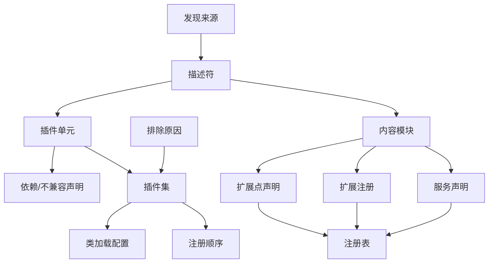

# 15 — 插件与扩展模型

> 范围：插件单元的描述与身份、发现与校验、依赖求解与冲突消解、类加载隔离与回收、扩展点与服务契约、动态装卸、市场分发、安全治理与开发者体验。｜ 依赖：02（构件与容器）、03（并发与生命周期）、14（状态持久化）、16（分发与许可）、17（前后端角色）。｜ 排除：扩展解析算法（02 §4.3）、服务解析算法（02 §4.2）、各功能域自身的扩展点清单（04–20）。

## 1. 目的与范围

### 1.1 本子系统解决什么问题

本发行版把全部能力拆成 **163 个随产品捆绑的插件**、**73 个公开模块标识**与不定数量的第三方插件，注册面覆盖 2090 个内部模块。若这些能力静态链接进单一二进制，任何一处缺陷或局部升级都会牵动整体。因此"能力"必须是**可独立描述、校验、隔离、装卸、分发**的单元，须解决五个问题：

1. **单元定义**：自述身份、版本、兼容区间、依赖、冲突与所含模块。
2. **组装顺序**：装载顺序必须由声明推导，不得由文件枚举或打包顺序决定。
3. **隔离**：两个单元可含同名类型；一个单元的缺陷不得让另一个加载失败。
4. **运行期变更**：启用/禁用/安装/卸载必须在不可重启约束下尽可能完成，失败必须可回退。
5. **来源可信**：网络与磁盘来源走同一校验，且必须能回答"这段代码属于谁"。

### 1.2 边界

不负责：具体扩展点的语义（04–20）；网络传输与许可判定（16）；插件浏览与安装向导界面（13）；用户代码的执行环境（12、17）；单元自带第三方库的内部实现（只负责纳入类路径）。

### 1.3 关系

| 关系 | 内容 |
|---|---|
| 02 | 本子系统产出"启用模块集合 + 注册顺序 + 类加载父图"，容器据此建注册表 |
| 03 | 装载与卸载都在写意图之外；卸载前必须排空正在执行本单元代码的线程（03 §7） |
| 14 | 禁用/过期清单、按项目启用状态、第三方同意状态的持久化形态 |
| 16 | 签名信任链、许可与功能开关、更新通道；本子系统只消费判定结果 |
| 17 | 单元可声明"仅客户端/仅服务端/双侧"生效，装载集合按角色不同 |
| 21、22 | 装载确定性、排除原因可复现性；术语见 22 §2 |

## 2. 概念模型

### 2.1 三个层次

| 层次 | 定义 | 实测规模 |
|---|---|---|
| 插件单元（Plugin） | 可分发的整体：描述符 + 资源根 + 0..n 个模块 | 163 个捆绑 + 若干第三方 |
| 模块单元（Content Module） | 编译与类加载的最小单元：类路径、依赖、可见性、装载规则 | 插件描述符内 520 个，分布于 123 个内容块 |
| 装载单元组（Runtime Module Group） | 求解与类加载配置的闭包：插件 + 必需模块 + 被其触发的子描述符 | 与启用插件数同阶 |

**插件是分发单位，模块是隔离单位**。二者非一对一：一个插件可声明多个模块，一个模块可被多个插件共享（受可见性约束）。这是"同一功能在本地与远端角色下需要不同类路径"的结构基础（17 §3）。

### 2.2 术语

| 术语 | 定义要点 |
|---|---|
| 插件标识 / 模块标识 | 全局唯一跨版本稳定 / 命名空间+名称、不含版本 |
| 描述符 | 单元自述声明，位于归档内固定位置 |
| 装载规则 / 可见性 | 必需·内嵌·可选·按需 / 公开·内部·私有 |
| 遮蔽（Shadowing） | 同标识的低优先级来源被高优先级来源取代 |
| 排除（Exclusion） | 求解结果中"存在但不得启用"，必须携带原因 |
| 插件集（Plugin Set） | 一次装载运算的结果：启用集合 + 排除集合 + 注册顺序 |
| 类加载作用域（Resolve Scope） | 加载器"拥有"的包前缀范围，范围外一律委派 |
| 归属（Attribution） | 由类型、资源或条目反查所属单元 |

### 2.3 实体关系



### 2.4 标识与平面

| 标识 | 形态 | 稳定性 | 冲突处理 |
|---|---|---|---|
| 插件标识 | 字符串 | 跨版本不可变 | 同标识多来源 → 消歧（§4.5） |
| 模块标识 | 命名空间 + 名称 | 跨版本不可变 | 重复即排除其中之一 |
| 扩展点全名 | 命名空间 + 名称 | 不可变，改名视为新点 | 同全名重复声明为错误 |
| 服务契约 | 类型引用 | 由类型系统保证唯一 | 多实现按覆盖语义消解（02 §4.2） |

- 条目归属**必须**由"写在哪个描述符里"决定，条目不得自报归属，否则卸载无法定位。
- 插件标识**必须不**承载版本信息；禁止用标识区分新旧版本。

系统把插件信息分成两个必须一致的平面：**结构平面**（依赖边、可见性、装载规则 → 决定启用集合、类加载父图、注册顺序）与**注册平面**（扩展点声明、注册、服务声明 → 决定运行期可见功能）。一致性要求：注册平面条目的所属模块必须在结构平面中被启用；被排除的模块必须使其全部条目消失（INV-5）。唯一连接点是模块标识。

## 3. 数据模型

扩展点与服务的注册条目形态见 02 §3；本节只定义**插件侧**模型。

### 3.1 描述符

```
PluginDescriptor {
  id: string                      // 必填，全局唯一
  name: string                    // 必填，面向用户
  version: string                 // 必填，不得为空串
  vendor: { name, url?, email? }  // 名必填
  category: string?               // 浏览分组
  description: string?            // 富文本，可含外链
  changeNotes: string?            // 升级说明
  icon: ResourceRef?              // 列表/商标图标
  hostRange: { sinceBuild, untilBuild?, strictUntilBuild? }
  dependencies: Dependency[]
  incompatibleWith: PluginId[]    // 对称排斥
  modules: ModuleRef[]            // 只声明"使用"而不内嵌
  content: ContentBlock[]         // 命名空间 + 内容模块列表
  resourceRoot: Path              // 资源与类的根，默认即单元归档/目录
  namespace: string?
  flags: {
    implementationDetail: bool    // 内部实现单元：不可被显式启用/禁用
    allowBundledUpdate: bool      // 允许新版本替换捆绑版本
    requireRestart: bool          // 任何变更都要求重启
    separateJar: bool             // 描述符与实现分属不同归档（按侧拆分）
  }
}
```

- `hostRange` **必须**同时参与"能否装载"与"能否升级"两种判定。`strictUntilBuild` 为真时上界是硬约束，否则允许用户确认后尝试上界之后的构建（插件描述符内实测：163 个单元中 94 个精确区间、69 个开放上界）。
- `icon` 在描述符词汇中**未**作为独立元素出现，实测由资源根约定与分发元数据提供，`[推断]`。
- `implementationDetail=true` 的单元不出现在启用/禁用列表且不允许禁用（实测 7 例）；`separateJar=true`（34 例）表示描述符可独立读取而无需加载实现归档，这是按角色拆分部署的前提。

### 3.2 依赖与内容模块

```
Dependency {
  kind: plugin | module
  target: PluginId | ModuleId
  optional: bool            // 真：缺失时跳过相关扩展，不排除本单元
  configFile: Path?         // 可选依赖：仅在对方存在时并入的附加描述符
  namespace: string?
}

ContentModule {
  id: ModuleId
  loadingRule: required | embedded | optional | onDemand
  requiredIfAvailable: bool        // 可选规则下的"若存在则必须成功"
  visibility: public | internal | private
  descriptor: Descriptor | null     // embedded 时内嵌完整子描述符
  resourceRoots: Path[]
}
```

| `loadingRule` | 语义 | 插件描述符内实测 |
|---|---|---|
| `required` | 必须存在且必须成功；失败则整个插件被排除 | 155 |
| `embedded` | 描述符内嵌于父描述符，随父一起启用 | 331 |
| `optional` | 可以缺失，缺失不构成错误 | 34 |
| `onDemand` | 首次被引用时才纳入类加载配置 | 0（本构建未使用） |

`visibility`：`public` 可被任何依赖方引用；`internal` 仅依赖闭包内；`private` 仅本插件。实测 344 / 435 / 26 —— 内部与私有合计多于公开，说明**默认关闭**是本发行版的实际取向。

### 3.3 装载结果与排除原因

```
PluginSet {
  enabled: ModuleRef[]              // 拓扑序
  excluded: ExclusionReason[]       // 每个被排除单元恰好一条
  registrationOrder: ModuleRef[]    // 拓扑序 × 描述符内声明序
  classLoaderOrder: ModuleRef[]     // 父先于子
  shadowed: PluginId[]              // 被高优先级来源取代的捆绑标识
}

ExclusionReason {
  plugin: PluginId
  kind: environmentConfigured | productRule | incompatibleHostPlatform | incompatibleHostCpu
      | incompatibleWithPlugin | malformedRange | sinceBuildViolation | untilBuildViolation
      | versionSuperseded | markedBroken | markedDisabled | nonBundledExplicitlyDisabled
      | privacyNoticeNotAccepted | declaresConflictingId | dependencyNotInstalled
      | dependencyDisabled | dependencyExcluded | dependencyNotVisible
      | requiredContentModuleExcluded | packagePrefixConflict | cycle | chained
  shortMessage: string     // 列表一行
  detailedMessage: string  // 详情面板
  logMessage: string       // 日志，可含技术细节
  shouldNotifyUser: bool   // 是否升级为用户可见通知
}
```

`ExclusionReason` 是本子系统的**核心诊断产物**：任何"插件为什么没生效"必须能由它单独回答，不需要读代码或翻日志。

### 3.4 持久化状态与市场条目

```
PersistedPluginState {
  disabled: PluginId[];  expired: PluginId[]      // 用户禁用 / 许可失效
  perProjectEnabled: Map<ProjectRef, PluginId[]>
  thirdPartyConsentAccepted: bool
  customRepositories: { url, authRef? }[]
  autoUpdateEnabled: bool
  ignoredUpdates: Map<PluginId, string>
}

MarketplaceEntry {
  id: PluginId;  version: string;  vendor: string
  compatibleBuildRange: { since, until? }
  pricing: free | paid | freemium
  stats: { downloads, rating, ratingCount }
  signatureState: invalid | missing | wrong | valid
  source: marketplace | customRepository | localArchive
}
```

**不变量**：`disabled` 与 `expired` 不得包含"必需插件"及其依赖闭包；必需集合在装载期计算，写入前必须排除。持久化格式与迁移由 14 负责。

## 4. 行为契约

### 4.1 装载入口与相位

1. **描述符解析必须发生在任何服务实例化之前**（相位见 02 §4.1）。装载期不得加载实现类型、不得构造实例、不得读取用户源码。
2. 装载期允许的 I/O **仅限**读目录项、读描述符、读归档目录表；"为了校验而实例化"一律禁止。
3. 装载结果是**不可变快照**；运行期不得原地修改启用集合，变更只能由动态装卸产生新快照（§4.10）。
4. 单个单元失败**必须不**中断启动：跳过并记录，其余按求解结果继续（INV-11）。
5. **必需插件**缺失是唯一允许中断启动的情形，必须以明确诊断终止，而非带着残缺注册表运行。

### 4.2 发现

发现按固定优先级合并五个来源，同一标识只保留最高优先级：

| 优先级 | 来源 | 说明 |
|---|---|---|
| 1 | 产品自身描述符 | 平台核心注册，标识固定 |
| 2 | 自定义（用户目录） | 用户安装的第三方单元，含经市场通道安装者 |
| 3 | 捆绑 | 随产品分发的 163 个单元 |
| 4 | 系统属性注入 | 显式指定目录，用于测试与隔离部署 |
| 5 | 类路径注入 | 从运行类路径直接发现，用于开发态 |

- **发现单位是"一层的目录项或一个归档"**，不递归；嵌套目录不视为独立单元，避免打包错误导致重复装载。
- 描述符**必须**位于归档/目录内的固定位置；找不到即视为损坏，记 `markedBroken`，不得静默忽略。
- 高优先级来源与捆绑来源同标识时：版本更高且允许替换则**遮蔽**捆绑版本并记入 `shadowed`；否则保留捆绑版本，给对方记 `versionSuperseded`。
- 来源优先级**只**决定"哪个版本参与求解"，不改变求解规则。

### 4.3 描述符校验

六个检查族按序执行，**第一处失败即排除该单元**（不做部分接受）：

| 族 | 内容 | 失败后果 |
|---|---|---|
| 结构 | 根元素与嵌套合法、未知元素按策略报错或警告 | 排除 |
| 必填 | 标识、名称、版本、厂商、宿主区间 | 排除 |
| 类型 | 布尔与枚举取值（装载规则、可见性、角色侧、操作系统、预加载） | 排除 |
| 引用 | 依赖目标存在或为可选；不兼容目标存在；内嵌子描述符父引用闭合 | 排除（可选依赖除外） |
| 可见性 | `internal`/`private` 模块不得被闭包外引用；实现细节单元不得被显式引用 | 排除引用方 |
| 包含 | 外部包含指令必须显式指定目标与选择器；允许条件包含与后备分支 | 排除 |

- 包含**必须**声明选择器；省略选择器等于"包含根下全部元素"，必须告警。
- 包含**必须**支持条件与后备：条件不成立时回退后备片段，不得产生空描述符。
- 包含**不得**跨单元边界，否则归属不可判定（INV-2）。

### 4.4 约束求解

求解是一台**单调排除机**：候选集只减不增，每次排除携带原因并向监听者传播。阶段顺序固定：

```
solve(candidates) -> PluginSet
  1. 应用环境配置排除      // 角色/产品模式导致的模块不可用
  2. 应用产品规则排除      // 产品层强制裁剪
  3. 建立完整性约束        // 父排除⇒子排除；必需内容模块排除⇒插件排除
  4. 建立依赖满足约束      // 缺失/被禁/不可解/不可见 ⇒ 依赖方排除
  5. 收集不兼容边          // 双向；一方被排除后另一方的约束自动解除
  6. 登记包前缀            // 冲突 ⇒ 后来者排除
  7. 构建装载单元组有向无环图；有环 ⇒ 排除环上候选后重试，循环直到无环
  8. 输出：启用序列（拓扑序）+ 排除表
```

- **排除必须单调**：已排除候选不得在同一轮重新成为候选——这是终止性保证（候选有限 + 单调）。
- **级联必须可追溯**：因父被排除而排除的子单元，原因为 `chained` 并指向父原因，不得笼统写"不可用"。
- **不兼容对称**：一方声明等价于双方声明，求解器不得要求双方都写。
- **环必须被"排除"而非"忽略"**：忽略会产生不确定顺序（违反 INV-8）。
- **拓扑序必须唯一**：同一候选集与规则集必须产出逐位相同的序列，不得依赖哈希遍历顺序。

### 4.5 冲突与消歧

发现先产出**歧义集**（标识 → 多个候选），再由消歧产出**无歧义集**：① 来源优先级高者胜；② 同来源内版本高者胜，版本不可比较即冲突；③ 仍无法判定则全部记 `declaresConflictingId` 并排除，**不得**任选其一。

| 冲突 | 检测点 | 处理 |
|---|---|---|
| 同插件标识多版本 | 发现 + 消歧 | 高版本胜，低版本记 `versionSuperseded` |
| 模块标识重复 | 消歧 | 保留优先级高者；其父插件若必需被遮蔽模块则父被排除 |
| 内容模块重复声明 | 完整性约束 | 两者都排除（归属不可判定） |
| 包前缀冲突 | 求解阶段 6 | 先登记者保留，后来者排除并记 `packagePrefixConflict` |
| 不兼容声明 | 求解阶段 5 | 优先级低者排除；同优先级则都排除 |
| 平台/架构不符 | 求解阶段 1 | 记 `incompatibleHostPlatform` / `incompatibleHostCpu` |

**包前缀冲突**单列说明：单元可声明"拥有某个包前缀"，声明后该前缀内类型只能由它提供。两个单元声明同一前缀会使"同名类型来自谁"不可判定，继而让卸载无法安全进行，因此必须在装载期解决，不可能推迟到运行期。

### 4.6 类加载

每个**模块**获得一个类加载器（不是每个插件一个）：

```
Loader {
  ownClassPath: Archive[]        // 本模块的资源根
  ownedPackagePrefix: string?    // 本模块"拥有"的包范围
  parents: Loader[]              // 依赖的模块，按拓扑序
  coreParent: Loader             // 平台核心加载器
  nativeLibDirs: Path[]          // 按平台子目录组织的原生库位置
}
```

委派规则（**必须**按此顺序）：

1. 类型名在 `ownedPackagePrefix` 之外 ⇒ 判为"外来类型"，**直接委派**给 `coreParent` 与 `parents`，不在本地查找。这是隔离的主要机制，也是跨插件共享的唯一通道：共享**必须**经父链上的**导出 API 包**发生，不得靠全进程扫描。
2. 类型名在前缀之内 ⇒ 先本地查找，未命中再按 `parents` 顺序委派。
3. 多个父声明同一类 ⇒ 按 `parents` 的**拓扑序**取第一个命中者；顺序必须确定（INV-8），否则同一安装在不同机器上行为不同。
4. 任何情况下**不得**回落到全进程扫描式查找：那会破坏确定性与可回收性。

资源与原生库：

- 资源名**必须**是相对名；以分隔符开头的名字必须被规范化并告警（最常见的跨平台错误）。
- 资源查找**必须**区分"仅本地"与"穿透父链"：前者用于单元私有模板/图标，后者用于合并式资源；同名资源不做自动合并。
- 原生库按"平台子目录 + 名称"定位；找不到时**必须**报出"模块 + 平台 + 名称"三元组。

**版本兼容层**三条并存：*核心加载器托管*——少数需与平台共享全部类型的单元声明放弃隔离换取二进制兼容，此类单元天然不可动态卸载；*实现细节标记*——被标记单元不参与依赖解析，只作为传递闭包随宿主装载，避免第三方耦合内部结构；*实验性接口面*——带实验性后缀的接口面不承诺跨版本兼容，升级策略将其视为"可能破裂"。

### 4.7 类加载器回收

回收是四个条件的合取，任一不满足即拒绝卸载：

1. 该模块不在当前启用集合中。
2. 加载器进入**卸载中**状态：此后任何加载请求必须失败或委派，**不得**定义新类型（防止卸载中途"复活"）。
3. 该加载器加载过的类型实例必须已被释放。这是唯一不可自动判定的条件，因此系统必须提供"该加载器是否加载过类型"的查询作为否决依据。
4. 父列表缓存必须被清空，避免父加载器持有子加载器成环。

条件 3 不满足时**必须**拒绝卸载并给出可读原因，而不是"标记泄漏后继续"：后者会让同标识重装与残留类型冲突，进程进入不可预测状态。

### 4.8 扩展点声明契约

```
ExtensionPointDecl {
  namespace: string        // 声明者命名空间
  name: string             // 局部名；与 qualifiedName 互斥
  qualifiedName: string?   // 显式全名，用于在他人命名空间下声明
  contractKind: interface | bean
  contract: TypeRef        // interface：注册者须实现；bean：注册数据被填充为该类型
  area: application | project | module
  dynamic: bool
  hasAttributes: bool      // bean 型是否允许以属性而非子元素传值
  bundleOnly: bool         // 仅允许随产品捆绑的模块注册
  attributeConstraints: { name: string, type: TypeRef }[]
}
```

- `dynamic` **默认真**（插件描述符内实测 2,492 条声明中 2,443 真、49 假）。默认真不是宽松，而是要求声明者主动承认"运行期集合可变"；声明为假即"集合不可变"，任何动态注册必须被拒绝。
- `area` 默认应用级；项目级/模块级（实测 146 条）意味着每项目各有一份实例集合，生命周期受项目作用域约束。
- `bundleOnly` 表示该点只接受捆绑单元注册。本构建描述符词汇中**未**出现同名布尔属性，该语义由"声明所在模块的可见性 + 平台校验"实现，效果等价（`[推断]` 为历史属性被可见性机制取代）。
- `contractKind=bean` 且 `hasAttributes=true` 时，注册可完全不含代码只有属性，由平台完成构造——这是"零代码扩展"的唯一合法形态。

注册形态三者互斥：**代码实现**（实现类型引用，需要行为）、**声明式数据**（属性/子元素，bean 型专用）、**子描述符**（由可选依赖触发的附加描述符，用于条件性集成）。注册可附加排序指令（`first`/`last`/`before X`/`after Y`，可逗号并列，插件描述符内 800+ 条）、操作系统条件（36 条）、条目标识（供他人作排序锚点）。

解析（条件过滤、顺序图、惰性、缓存、代际、副本返回、失败隔离）见 02 §4.3。插件维度的附加约束：

- **注册序基准**是 `registrationOrder`（拓扑序 × 描述符内声明序），不是发现顺序。
- `order` 只能调整相对**同一扩展点**其他条目的位置；跨扩展点无意义。
- 注册指向的扩展点必须已声明且可见；否则丢弃该条目并记录，不得使整个描述符失败。
- **卸载**必须原子完成四件事：释放该单元贡献的实例（按作用域逆序）、移除其声明式监听器、移除其动作条目、使其注册缓存整体作废。

### 4.9 服务声明契约

服务经三个固定扩展点登记（应用级/项目级/模块级）：

| 字段 | 取值 | 语义 |
|---|---|---|
| 接口 / 实现 | 类型引用 | 查找键 / 默认实现 |
| 测试实现 / 无界面实现 | 类型引用? | 测试模式 / 无界面角色下替换 |
| 覆盖 | 布尔 | 替换同接口既有注册；必须显式，且不可与可动态卸载共存 |
| 开放 | 布尔 | 是否允许第三方为该接口提供实现；关闭时第三方注册被拒绝 |
| 预加载 | 真 / 假 / 等待 / 非无界面 / 非轻量编辑 | 启动期构造策略 |
| 角色侧 | 本地 / 客户端 / 控制器 / 访客 / 属主 / 服务端 / 全部 | 在哪一侧生效（17 §3） |
| 操作系统 | 平台枚举? | 仅该平台生效 |
| 配置 schema | 字符串? | 持久化状态的 schema 标识 |

`preload` 五档：**真**=启动期同步构造（仅"其他一切都依赖它"的服务）；**假**=默认，首次解析才构造；**等待**=启动期构造但可与其它工作重叠；**非无界面**=仅界面角色；**非轻量编辑**=除轻量编辑模式外。

- **覆盖与动态装卸互斥**：声明覆盖的提供者不可动态卸载，可动态卸载的单元不得声明覆盖——否则被覆盖的注册在卸载后无法还原。
- 预加载**不得**形成隐式循环：A 构造中解析 B、B 又解析 A，必须在解析期判为循环并报错（02 §4.2），不得死锁。
- 条目实测：应用级 2,187（模块描述符内 1,120 + 插件描述符内 1,067）、项目级 1,165（608 + 557）、模块级 5。条目数**不**等于生效实例数——覆盖、测试/无界面实现、同实现重复声明会在注册时合并（`[推断]`）。

### 4.10 动态装卸

```
        install          enable            disable
  ABSENT ──────► INSTALLED ──────► ACTIVE ──────► DISABLED
                    │                 │               │
                    │ update          │ unload        │ uninstall
                    ▼                 ▼               ▼
                INSTALLED'        INSTALLED         ABSENT
```

"无需重启"必须逐项通过下列检查；任一项失败即整单降级为"需重启"，不允许部分生效：

| 检查 | 不通过的含义 |
|---|---|
| 描述符未声明"需要重启"（实测仅 2 例） | 作者明确要求重启 |
| 无旧式组件声明 | 旧式组件无卸载契约 |
| 无服务覆盖声明 | 覆盖无法还原 |
| 使用插件类加载器（非核心加载器托管） | 共享加载器无法回收 |
| 注册的所有扩展点均为 `dynamic=true` | 静态点无法增减 |
| 其动作条目可被卸载 | 动作系统持有不可撤销绑定 |
| 无否决者否决加载/卸载 | 第三方或产品层明确拒绝 |
| 产品规则允许该方向变更 | 产品层禁止装载或禁止卸载 |
| 非"从源码运行"或已显式允许 | 开发态默认保守 |
| 无已加载类型残留（卸载方向） | 见 §4.7 条件 3 |
| 线程已排空（卸载方向） | 见 03 §7 |

- **启用自底向上**：先启用依赖闭包再启用目标；任一依赖无法启用则目标不启用，不做部分启用。
- **禁用自顶向下**：先禁用依赖目标者；若某依赖者是必需或不可禁用，则目标不得被禁用，整单失败并给出链式原因。
- **可选依赖**卸载时不级联（对方可能仍被他人需要）；但若对方仅因本单元而启用，应在同一次操作中回收。
- **不可动态的扩展点**是其注册者不可动态卸载的硬约束：`dynamic=false` 的点一旦在启动期确定，运行期只能重启。

角色限定：仅界面侧的单元在服务端角色下不装载，其动态装卸只在客户端侧有意义（判定依据为声明角色侧与所提供扩展点的区域；实测存在"仅界面插件/仅界面扩展"区分但无独立描述符属性，`[推断]`）。

### 4.11 市场与分发

**打包**：一个单元 = 一个归档（目录或压缩归档），内含固定位置的描述符 + 资源根，描述符可独立读取（`separateJar`）。不允许多归档拼成一个单元，也不允许一个单元声明多个描述符根。

**签名**：四种结果必须区分——无效、缺失、与内容不符、成功。校验对象是**整个归档**而非描述符；证书撤销必须检查（撤销列表有有效期，结果可缓存）；"缺失签名"与"成功"都可安装，但前者必须弹显式确认；校验失败**不得**降级为警告。

**会话式安装/更新/卸载**：

```
session := open(source)
  list(query, offset) / reviews(id, limit) / compatibleUpdates(ids)
  install(entry, replace?) / continueAfterRestart(id)
  setEnabled(ids, bool)        // 依赖传播在此发生
  markDisabled(ids) / close()
```

- **兼容过滤以宿主构建区间为准**，不以版本串比较；区间外条目可展示但必须标记"不可安装"并给出区间。
- 更新必须支持"跳过此版本"，跳过记录参与后续更新计算。
- 捆绑单元的更新需该单元显式允许（实测 104 例）；未允许时通道必须拒绝替换，而不是"覆盖后由签名兜底"。
- 安装/更新必须在**装订边界之外**完成：先写暂存、再原子切换、最后进入发现流程；禁止边下载边被装载。
- 卸载前必须完成"准备"：无正在执行的代码、依赖者已禁用、文件不被占用；准备失败即中止，不进入删除。
- **离线安装**与在线安装走同一校验与同一发现路径，区别仅在来源字段。
- **评分只影响展示顺序**，不得影响兼容性与安全判定。

### 4.12 安全治理与开发者体验

| 面 | 本构建的实际设计 | 后果 |
|---|---|---|
| 内部 API 禁令 | 三者并存：模块可见性（`internal`/`private`）、实现细节标记、实验性接口面不承诺兼容 | 第三方"能用"内部结构，装载期不强制拒绝 |
| 权限 | 描述符词汇中**不存在**权限声明元素；单元权限等于宿主进程权限 | 可读任意文件、发任意网络请求、起任意子进程 |
| 进程外执行 | **不存在**插件沙箱或独立插件宿主进程；按角色拆分是"部署到不同进程"，不是隔离 | 单元缺陷可直接使宿主崩溃 |
| 崩溃归因 | 异常必须携带归属单元标识；加载失败按"日志级别 + 是否告知用户"两级策略呈现 | 可回答"谁崩的"，不能"只崩它" |

结论：本子系统的安全模型是**信任驱动**而非**能力驱动**——可信度由签名 + 来源 + 用户同意建立，由描述符校验与动态否决兜底。若要能力驱动，必须新增权限元素、按权限约束的宿主接口面与进程外宿主，三者在本构建中均不存在。

开发者体验三件事必须内建：

- **开发模式**：允许从类路径/系统属性目录直接发现单元（§4.2 的第 4、5 来源），"构建产物即插件"无需安装；开发态对卸载默认保守，除非显式允许。
- **热重载**：动态装卸 + 插件目录监视构成闭环——目录内容变化产生"可重载"提示，重载走 §4.10 的完整判定，失败即回落为"需重启"。
- **诊断**：必须能回答三个问题——"这个单元在做什么"（其全部注册条目）、"它为什么被禁用/排除"（`ExclusionReason` 四元组）、"它影响谁"（依赖者闭包）。三者都不得要求读源码。

## 5. 不变量与约束

| 编号 | 不变量 |
|---|---|
| INV-1 | 装载单元组的依赖图必须无环；有环必须通过排除候选消除，不得忽略。 |
| INV-2 | 描述符的包含/内嵌关系必须闭合在单一单元内；跨单元包含为非法。 |
| INV-3 | 一个模块的类只能由一个类加载器定义；同名类不得在两个加载器中被定义后混用。 |
| INV-4 | 包前缀在启用集合内唯一。 |
| INV-5 | 被排除单元的任何扩展、服务、监听器条目不得出现在注册表中。 |
| INV-6 | 必需依赖被排除 ⇒ 依赖方必须被排除，且原因可链式追溯到根因。 |
| INV-7 | 排除是单调的：同一轮求解内不得重新纳入候选。 |
| INV-8 | 启用序列与注册序列对同一候选集与规则集必须逐位一致。 |
| INV-9 | 宿主版本区间外的单元不得启用；`strictUntilBuild` 为真时上界不得放宽。 |
| INV-10 | 扩展点全名全局唯一；重复声明为错误，不得"后者覆盖"。 |
| INV-11 | 单个单元的描述符失败不得影响其他单元的装载结果。 |
| INV-12 | 必需插件缺失是唯一允许中断启动的装载失败。 |
| INV-13 | 可动态卸载的单元不得声明服务覆盖、不得使用核心加载器托管、不得注册静态扩展点。 |
| INV-14 | 卸载被拒绝时启用集合必须保持不变（不得出现"半卸载"）。 |
| INV-15 | 卸载后该单元的类加载器必须不可达（含父列表缓存清空、已加载类型计数归零）。 |
| INV-16 | 签名校验失败必须拒绝安装，不得降级为警告。 |
| INV-17 | 服务覆盖的优先级固定为"显式覆盖 > 产品 > 平台 > 第三方"；同层多实现必须可查询。 |
| INV-18 | 扩展解析对同一（扩展点、区域、代际、注册集合）必须返回逐位一致的序列。 |
| INV-19 | 注册表向调用方返回的集合必须是副本，调用方修改不得影响后续解析。 |

## 6. 对外能力契约

```
// 查询
installed(id) -> Descriptor?
enabled(id) -> bool
exclusionOf(id) -> ExclusionReason?
enabledSet() -> { enabled, excluded, registrationOrder, shadowed }
ownerOfClass(typeName) -> PluginId?        // 崩溃归因与诊断
ownerOfResource(resourceName) -> PluginId?

// 声明与注册
declareExtensionPoint(decl, moduleId) -> Handle
registerExtension(point, implOrData, order?, anchor?, conditions?) -> Handle
declareService(scope, decl, moduleId) -> Handle

// 生命周期
install(archive, source) -> Result          // 暂存 → 校验 → 切换 → 重新发现
uninstall(id, prepareOnly) -> Result
enable(ids) -> Result                       // 内部先做依赖闭包
disable(ids) -> Result                      // 内部先做反向闭包
canReconfigureWithoutRestart(ids, direction) -> Verdict

// 诊断
explain(id) -> { reason, short, detailed, log }[]
diagnostics() -> { loadErrors, shadowed, incomplete, vetoes }
```

- 所有查询**必须**可在无界面角色下调用（不得依赖界面初始化）。
- 所有变更入口**必须**先做"无需重启判定"再执行；不允许"先执行，失败再回滚"。
- 归属查询**必须**对"平台核心 / 产品层 / 第三方"给出不同答案，不得把平台自身报成某插件。
- 句柄**必须**支持显式注销；注销后查询不得再返回该条目。

## 7. 故障模式与降级

| 故障 | 检测 | 用户可见 | 档位 | 恢复 |
|---|---|---|---|---|
| 描述符缺失/损坏 | 发现期 | "单元无法加载" | D2 | 重装该单元 |
| 依赖缺失 | 求解期 | 详情列出缺失标识 | D2 | 安装依赖或禁用该单元 |
| 依赖被禁用 | 求解期 | 链式原因"依赖 X 被禁用" | D2 | 启用 X 或禁用本单元 |
| 宿主版本不符 | 求解期 | "需要构建 A–B" | D2 | 升级宿主或换版本 |
| 平台/架构不符 | 求解期 | "仅支持平台 P / 架构 A" | D2 | 无 |
| 同标识冲突 | 消歧期 | "存在多个同标识单元" | D2 | 移除其一 |
| 包前缀冲突 | 求解期 | "与单元 Y 的包范围冲突" | D2 | 移除其一 |
| 依赖成环 | 求解期 | "依赖成环" | D2 | 升级其一 |
| 必需插件缺失 | 求解期 | 明确终止对话框 | D5 | 修复安装 |
| 类加载失败 | 首次使用 | "功能不可用"并附归属 | D2 | 禁用该单元 |
| 卸载被否决 | 执行前 | "无法卸载：原因" | D2 | 重启 |
| 卸载后残留类型 | 执行前探测 | "存在已加载类型" | D2 | 重启 |
| 签名校验失败 | 安装期 | "签名无效" | D0（不改变现状） | 换来源 |
| 市场不可达 | 网络调用 | "离线；可安装本地归档" | D0 | 恢复网络 |
| 第三方同意未接受 | 装载期 | 提示接受声明 | D2 | 接受或移除 |

**降级原则**：本子系统的失败**必须**收敛为"某单元不生效"（D2），**不得**升级为"某功能静默错误"。静默错误（功能存在但行为残缺）比缺失更难诊断，因此宁可排除。

## 8. 资源与性能预算

| 项 | 实测 / 预算 |
|---|---|
| 唯一扩展点声明 | 3,235（模块描述符 2,352 + 插件自命名空间 883） |
| 有注册的扩展点 / 注册条目 | 2,242 / 29,282（模块描述符内 18,615、插件描述符内 10,667） |
| 插件描述符文件 / 内嵌描述符 | 168 / 1,676（含内容模块内嵌的子描述符） |
| 内容块 / 内容模块（插件描述符内） | 123 / 520 |
| 服务条目 | 应用级 2,187（1,120 + 1,067）；项目级 1,165（608 + 557）；模块级 5 |
| 监听器 / 不兼容 / 必需依赖 / 可选依赖（插件描述符内） | 452 / 24 / 45 / 16 |
| 描述符解析 | 必须在上层界面可见之前完成；单个描述符必须是常数级 I/O（一次读入 + 一次结构遍历） |
| 类加载器数量 | 与启用模块数同阶（数百），每个持有独立类路径索引 |
| 装载峰值内存 | 描述符结构体常驻、类路径索引按需构建；`[推断]` 量级数十 MB |
| 扩展解析缓存 | 按（点、区域、代际）缓存；条目列表缓存而非每次重算 |
| 装载阶段 | 必须有耗时计数；任何单元的描述符解析不得引入网络或磁盘递归扫描 |

- **描述符结构体常驻**（查询高频），**实现类型元数据不常驻**（由类加载器按需加载）。
- 卸载后必须回收：类路径索引、包的哈希缓存、父列表缓存。
- 大插件（携带大量资源）不得在装载期读取资源内容，只允许读取目录表。

## 9. 可观测性

必须提供五个诊断视图，且**无需界面角色也可导出**：

1. **启用/排除视图**：每个单元的 `ExclusionReason` 四元组——这是回答"为什么它没生效"的唯一入口。
2. **注册快照**：每个扩展点的贡献者与最终顺序，含被丢弃条目及原因。
3. **类加载视图**：模块 → 加载器 → 父列表 → 拥有前缀 → 已加载类型数。
4. **归属视图**：类型/资源 → 单元；单元 → 其全部注册条目。
5. **装载剖析**：发现、校验、求解、类加载配置四阶段的耗时与计数。

| 日志事件 | 必需字段 |
|---|---|
| 单元装载失败 | 标识、原因、来源、宿主构建号 |
| 单元被遮蔽 | 被遮蔽标识、胜出标识、来源 |
| 动态装卸判定 | 目标集合、方向、判定结果、失败检查项 |
| 否决生效 | 目标、否决者归属、原因文本 |
| 签名判定 | 四态之一、证书主体、是否撤销 |
| 归属缺失 | 类型名、候选单元 |

**最小可复现状态**（诊断包必须包含）：宿主构建号 + 启用标识集合 + 排除原因全集 + 被遮蔽集合 + 第三方同意状态 + 已安装来源列表。缺任一项，"插件问题"不可复现。

## 10. 扩展点

本子系统自身对外开放的接缝（概念名，标识见 §11）：

| 接缝 | 用途 | 契约 | 失败隔离 |
|---|---|---|---|
| 初始化错误处理器 | 接管"单元装载失败"的呈现 | 输入失败集合，输出是否已处理 | 失败 ⇒ 回落默认通知 |
| 仓库鉴权提供者 | 为私有市场源提供凭据 | 输入源标识，输出凭据或空 | 失败 ⇒ 该源不可用，其余正常 |
| 单元建议提供者 | "缺失能力"时推荐单元 | 输入上下文，输出候选标识 | 失败 ⇒ 不展示建议 |
| 装卸否决者 | 否决加载与否决卸载（两向） | 输入描述符，输出否决原因或空 | 自身失败 ⇒ **视为否决**（保守） |
| 动态动作定制 | 为动态加载的单元调整动作可见性 | 输入动作集合与单元 | 失败 ⇒ 保持原样 |
| 动态上下文提供者 | 动态变更后提供新数据上下文 | 输入上下文标识 | 失败 ⇒ 该上下文不可用 |
| 动态启动后监听 | 单元加载/卸载后执行补充动作 | 前后各一个回调 | 失败 ⇒ 记录，不影响装卸结果 |

强制契约：

- 否决点**必须**返回原因文本，为空表示同意；空串等同于同意，不得用空串表示否决。
- 否决者**必须**可在无界面角色下工作，不得依赖界面已初始化。
- 本子系统扩展点内的实现**必须不**持有被装载单元的强引用，否则阻止回收（INV-15）。
- 本子系统的扩展点**必须**自身声明为动态，否则动态装卸无法工作（自指陷阱）。

## 11. 对照实现（证据锚点）

| 结论 | 证据 |
|---|---|
| 描述符位于单元归档固定位置，标识/名称/版本/厂商/区间必填 | `intellij.platform.core.impl` → `platform/pluginSystem/parser/impl/PluginXmlConst.java`；`PluginManagerCore`（`META-INF/plugin.xml`） |
| 依赖分插件/模块，含可选与条件附加描述符 | 同文件：`DEPENDENCIES_ELEM`、`DEPENDS_OPTIONAL_ATTR`、`DEPENDS_CONFIG_FILE_ATTR`；`elements/DependsElement`、`elements/DependenciesElement` |
| 内容模块四档装载规则、三档可见性、内嵌描述符 | `elements/ModuleLoadingRuleValue`（`REQUIRED/EMBEDDED/OPTIONAL/ON_DEMAND`）、`ModuleVisibilityValue`（`PUBLIC/INTERNAL/PRIVATE`）、`ContentModuleElement` |
| 宿主区间含 since/until 与严格上界 | `IDEA_VERSION_SINCE_ATTR`、`IDEA_VERSION_UNTIL_ATTR`、`IDEA_VERSION_STRICT_UNTIL_ATTR` |
| 不兼容、实现细节、允许捆绑更新、需要重启、分离归档 | `INCOMPATIBLE_WITH_ELEM`、`PLUGIN_IMPLEMENTATION_DETAIL_ATTR`、`PLUGIN_ALLOW_BUNDLED_UPDATE_ATTR`、`PLUGIN_REQUIRE_RESTART_ATTR`、`PLUGIN_IS_SEPARATE_JAR_ATTR` |
| 五个发现来源 | `intellij.platform.core.impl` → `com/intellij/ide/plugins/PluginsSourceContext`：`Product`/`Bundled`/`Custom`/`SystemPropertyProvided`/`ClassPathProvided` |
| 歧义集 → 无歧义集两阶段消歧 | `AmbiguousPluginSetImpl`、`UnambiguousPluginSetImpl`（`Map<PluginId, List<…>>` vs `Map<PluginId, …>`） |
| 单调排除机与七阶段固定顺序 | `PluginSetConstraintsResolver#resolveConstraints()`、`CandidateState.Candidate/Excluded`、`exclude()`；`tryBuildRuntimeModuleGroupDAGOrExcludeCycles()` |
| 排除原因分类与三条消息 + 是否通知 | `PluginNonLoadReason`；实现类 `PluginIsMarkedDisabled`、`PluginIsIncompatibleWithHostPlatform`、`PluginIsIncompatibleWithHostCpu`、`PluginDependencyIsNotInstalled`、`PluginDependencyIsDisabled`、`PluginPackagePrefixConflict`、`PluginDeclaresConflictingId`、`PluginVersionIsSuperseded`、`PluginSinceBuildConstraintViolation`、`PluginUntilBuildConstraintViolation`、`ThirdPartyPrivacyNoticeIsNotAccepted` |
| 级联排除可追溯（父→子、必需模块→插件） | `DependsParentIsExcluded`、`ContentModuleParentIsExcluded`、`RequiredContentModuleIsExcluded`、`DependencyIsExcluded`；`ExcludeContentModuleOnPluginExclusion`、`ExcludePluginOnRequiredContentModuleExclusion` |
| 拓扑序用于类加载配置与注册序 | `PluginSet`：`topologicalComparator`、`sortedModulesWithDependencies`、`getModulesOrderedForClassLoaderConfiguration()`、`sequenceResolvedSortedDescriptorsForRegistration()` |
| 每模块一个加载器，多重父 + 核心父 + 包前缀 + 原生库目录 | `cl/PluginClassLoader`（`parents`、`coreLoader`、`packagePrefix`、`libDirectories`、`findLibrary()`）；`ClassLoaderConfigurator` |
| 包前缀是隔离与归属判定依据 | `cl/PluginClassLoader#getPackagePrefix`、`tryLoadingClass`；`cl/ResolveScopeManager#isDefinitelyAlienClass` |
| 卸载中状态、已加载类型查询、父缓存清理 | `cl/PluginClassLoader`：`setState(int)`、`toString()` 中 `active`/`unload in progress`、`hasLoadedClass()`、`clearParentListCache()` |
| 资源名规范化与父链查找模式 | `cl/PluginClassLoader`：`getResourceAsBytes(name, checkParents)`、`getResourceAsStream`、前导分隔符告警 |
| 扩展点声明字段（区域/动态/两种契约形态/属性约束/仅捆绑） | `elements/ExtensionPointElement`（`name`、`qualifiedName`、`interface`、`beanClass`、`hasAttributes`、`isDynamic`）；`EXTENSION_POINT_AREA_IDEA_PROJECT_VALUE`、`…IDEA_MODULE_VALUE` |
| 注册条目排序与操作系统条件 | `elements/ExtensionElement`（`implementation`、`os`、`orderId`、`order`）；实测 `order="first"` 397、`order="last"` 387 |
| 服务声明八字段与预加载/角色侧/OS 枚举 | `elements/ServiceElement`；`PreloadModeValue`（`TRUE/FALSE/AWAIT/NOT_HEADLESS/NOT_LIGHT_EDIT`）；`ClientKindValue`（`LOCAL/FRONTEND/CONTROLLER/GUEST/OWNER/REMOTE/ALL`）；`OSValue` |
| 服务经固定扩展点登记 | `_rev/epdecl.json`：`applicationService`、`projectService`、`moduleService` 声明于 `intellij.platform.core.jar` |
| 无需重启的逐项检查清单 | `DynamicPluginsValidators`：`validateDescriptorDoesNotRequireRestart`、`validateDescriptorHasNoComponents`、`validateDescriptorHasNoServiceOverrides`、`validateDescriptorUsesPluginClassloader`、`validateModuleGroupHasAllExtensionsFromDynamicEPs`、`validateActionsCanBeUnloaded`、`validatePluginLoadingIsNotVetoed`、`validatePluginUnloadingIsNotVetoed`、`validateProductRulesPermitLoading/Unloading`、`allowUnloadingWhenRunFromSources`、`allowServiceOverridesUnloading` |
| 装卸状态机与依赖闭包 | `DynamicPlugins`（`reconfigure`、`loadPlugins`、`unloadPlugins`、`computeNewPluginsState`、`UnloadPluginOptions`）；`DynamicPluginEnabler` |
| 否决契约（卸载返回原因文本，加载返回布尔） | `DynamicPluginVetoer`（`vetoPluginUnload` → 可空文本、`vetoPluginLoad` → 布尔）；`CannotUnloadPluginException` 已弃用 |
| 监听器生命周期（装载前/后、卸载前/后、卸载检查） | `DynamicPluginListener` |
| 禁用/过期状态持久化与必需插件保护 | `DisabledPluginsState`（`disabled_plugins.txt`、`getRequiredPlugins()`）；`ExpiredPluginsState`（`expired_plugins.txt`） |
| 第三方隐私同意开关 | `ThirdPartyPluginsPrivacyConsentState`、`ThirdPartyPluginsWithoutConsentFile` |
| 被遮蔽标识、加载错误、不完整插件分别记录 | `PluginManagerState`（`shadowedBundledPlugins`、`loadingErrors`、`incompletePluginsForLogging`） |
| 签名四态与撤销缓存 | `intellij.platform.ide.impl` → `marketplace/PluginSignatureChecker`、`marketplace/statistics/enums/SignatureVerificationResult`（`INVALID_SIGNATURE`/`MISSING_SIGNATURE`/`WRONG_SIGNATURE`/`SUCCESSFUL`） |
| 市场会话式安装/更新/卸载接口 | `intellij.platform.pluginManager.shared` → `rpc/PluginInstallerApi`（`installOrUpdatePlugin`、`continueInstallation`、`prepareToUninstall`、`performUninstall`、`unloadDynamicPlugin`、`isRestartRequired`）、`rpc/PluginManagerApi`（`initSession`/`closeSession`、`executeMarketplaceQuery`、`loadPluginReviews`、`getLastCompatiblePluginUpdate`、`setPluginsAutoUpdateEnabled`、`updateCustomRepositories`）、`rpc/PluginUpdaterApi` |
| 归属查询（类型/资源 → 单元） | `PluginUtils`（`getPluginDescriptorIfIdeaClassLoaderIsUsed`、`getPluginDescriptorOrPlatformByClassName`）；`diagnostic/PluginProblemReporter`、`PluginException` |
| "日志级别 + 是否告知用户"策略 | `PluginLoadingErrorReportingPolicy`（`logLevel`、`reportToUser`） |
| 本子系统自身扩展点（合计 = 模块 + 插件描述符内） | `_rev/ep_counts.json` → `total`：`com.intellij/pluginSuggestionProvider`(16)、`com.intellij/ide.dynamicPluginVetoer`(6)、`com.intellij/dynamicContextProvider`(5)、`com.intellij/pluginInitializationErrorHandler`(4)、`com.intellij/dynamicApplicationInitializedListener`(4)、`com.intellij/pluginRepositoryAuthProvider`(3)、`com.intellij/dynamicActionConfigurationCustomizer`(2) |
| 统计口径：3,235 声明 / 2,242 有注册 / 29,282 条注册 | `_rev/ep_counts.json`（`total`/`module`/`plugin` 三层；18,615 + 10,667）。`_rev/agg.json`（2,352 / 7,212）为**旧插件内子集口径**，不得当总数 |
| 插件描述符内分布（2,553 声明元素、1,676 内嵌描述符、520 内容模块、452 监听器、24 不兼容、16 可选依赖、2,443/49 动态性） | `_rev/pluginxml/*.xml`（168 个插件描述符）聚合统计 |

## 12. 未决问题

- **图标来源**：描述符词汇无独立图标元素，实测由资源根约定 + 分发元数据提供；两者优先级与失败回退 `[推断]`。
- **"仅捆绑"属性的消失**：02 §3 将其建模为扩展点字段，但本构建描述符属性清单中无同名属性，实际由可见性与平台校验实现；"属性被移除后语义并入可见性"`[推断]`。
- **服务条目与生效数差额**：3,357 条声明（2,187 + 1,165 + 5）与生效实例数的差额归因于覆盖、测试/无界面实现与重复声明 `[推断]`，需以注册表落盘快照逐条比对。
- **扩展点缓存的代际粒度**：02 §4.3 规定"注册集合变化或区域替换时整体作废"，是否存在按扩展点粒度的细化作废 `[推断]`。
- **进程外单元宿主**：证据中不存在"单元在独立进程执行"的模块；按角色拆分是部署切分而非沙箱。若目标平台要求沙箱，需新增进程协议与状态同步，属新增设计。
- **权限模型**：描述符无权限元素，单元能力等于宿主进程能力。这是本构建的设计事实；若下游要求最小权限，必须新增能力声明与宿主接口面的权限约束。
- **"安全模式"命名**：D5 抢救模式在装载层的实现（"禁用全部非必需单元"还是"跳过第三方单元"）在反编译范围内未见独立开关，`[推断]` 为前者，由必需插件集合 + 禁用清单共同实现。
