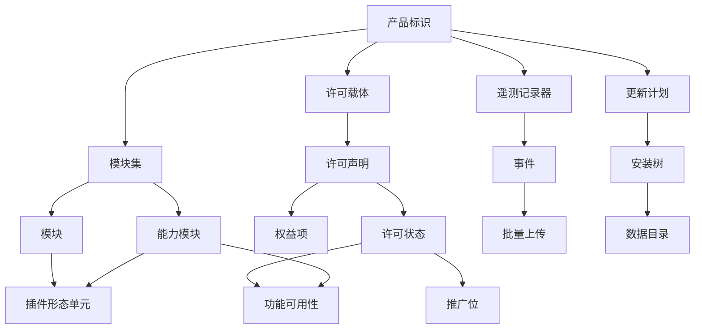

# 16 — 发行、授权与运营面

> 范围：产品标识与发行通道、功能分层的存在性实现、许可模型与校验、遥测、崩溃与反馈、更新、安装与系统集成。｜ 依赖：01（部署形态与降级梯度）、02（分层与产品定制）、14（插件装载与隔离）。｜ 排除：插件市场与生态治理（15、20）、远程开发链路（17）、设置持久化机制（13）。

## 1. 目的与范围

### 1.1 本子系统解决什么问题

同一份代码库要交付成不同能力档位、在不同渠道分发、按不同商业条款授权，并在无网络、企业内网、被篡改的条件下仍然可启动。本子系统收敛为六个机制：

1. **身份** —— 进程必须能回答"我是哪个产品、版本、构建、通道"，该答案被下游全部缓存与判定复用。
2. **分层** —— 能力边界在**装载期**由"某物是否存在"决定，而非运行期条件分支；被裁掉的能力不留半死路径。
3. **授权** —— 许可证据可离线携带、可签名校验、可缓存，过期后退化为"受限"而非"不可用"。
4. **度量** —— 数据在同意前提下采集、本地过滤、按阈值批量上报，关闭后行为完全确定。
5. **更新与落地** —— 替换原子、可回滚、可被企业整体禁用；安装、卸载、文件关联、多版本共存、数据目录布局有唯一权威定义。

### 1.2 边界

不负责：商务条款的定价与结算（只负责条款**如何被表达与校验**）；账户与单点登录协议（只把账户当作载体之一）；插件市场治理（15、20）；遥测数据的存储与看板（只负责产生与投递）；界面视觉规范（只规定推广位与反馈入口的存在性、位置约束与频次）。

### 1.3 与其他子系统的关系

- 位于分层最上层的**产品层**，只可向下覆盖服务与扩展，不得被下层编译期依赖（02 §2.2、02 §4.5）。
- 能力缺失表现为模块/插件不装载；装载失败必须局部隔离（02 §4.4、14 §7）。
- 许可首轮与更新检查必须落在"启动后"相位，不得进入"初始化活动"（02 §4.1）。
- 本子系统所有故障必须映射到 D0–D5，且不得引入新的"不可启动"结果（01 §7）。
- 远程形态下许可校验与遥测归属服务端，呈现归属客户端（01 §4、17）。

## 2. 概念模型

| 术语 | 英文 | 定义要点 |
|---|---|---|
| 产品代码 | Product Code | 两字母稳定标识（本产品 `IU`），是文件关联、权限键、许可权益的匹配键 |
| 构建号 | Build Number | `<分支>.<构建>.<修订>` 三段数字；派生数据、缓存、不兼容库、许可缓存的**唯一版本键** |
| 模块集 | Module Set | 命名的模块集合，可嵌套；"某能力是否被交付"的最小判定单位 |
| 能力模块 | Capability Module | 以模块/插件标识形式存在的空能力声明；付费功能以它为硬依赖 |
| 许可载体 | License Carrier | 承载许可证据的容器：账户、许可服务器、签名文件 |
| 许可声明 | License Claims | 载体内部的结构化条款数据 |
| 权益项 | Entitlement | "某产品代码在某时间区间内有效"的最小单元 |
| 付费至 / 永久回退日期 | Paid-Up-To / Fallback Date | 前者为权益时间上界；后者为订阅终止后仍可永久使用的**版本**上界（以日期表达） |
| 浮动许可 / 并发校验 | Floating / Concurrent-Use | 服务端按并发席位放行；单席位不可同时被多实例使用 |
| 宽限期 | Grace Period | 权益到期后仍维持全功能的时间窗 |
| 试用 / 推广位 | Trial / Promotion Slot | 前者是有时限、有状态机的体验授权；后者是产品层注入界面固定锚点的可点击单元 |
| 记录器 / 允许清单 | Recorder / Allowed List | 前者是遥测的独立通道与独立同意单元；后者是服务端下发的事件/字段白名单，本地据此丢弃非法事件 |



**功能可用性有两条独立输入**：许可状态（授权）与能力模块存在性（交付）。二者是"与"关系，且在装载期或首轮求值期完成，运行期不二次判定。

## 3. 数据模型

### 3.1 产品标识

```
ProductIdentity {
  productCode, version: string
  buildNumber { branch, build, revision: int }   // 只可相等或区间判定
  vendor, dataDirName, envPrefix: string         // 数据目录名含版本次版本号
  releaseDate: date, minRuntimeVersion: int
}
```

- **构建号必须可与版本号独立变化**（同一版本可有多个补丁构建），故所有缓存键用构建号。
- 产品代码必须在许可声明、安装器、文件关联三处一致；不一致即判定"跨产品安装"，装载期拒绝。

### 3.2 模块集与能力模块

```
ModuleSet { setId: string, parent: ModuleSet?, members: ModuleMember[], nestedRegionPath: string[] }
ModuleMember { moduleRef: string, loading: embedded | standalone }
CapabilityModule { capabilityId: string, provided: bool, owner: ModuleSet }
```

实测规模：9 个命名模块集；最大集（终端能力集）373 个模块、其中 233 个为 `embedded`、含 **26 层嵌套区域**；试用集 3 个模块；商业能力集 2 个；Web 形态集 2 个。

- **裁剪粒度是模块集**，不是模块；不存在"集合内部分模块单独关闭"的第四种状态。
- `embedded` 并入引导类路径（不可装卸、不可被插件覆盖）；`standalone` 是独立装载单元（可装卸，见 14 §7）。
- `nestedRegionPath` 只用于组织与诊断，不产生语义；求值时按展开后的扁平成员集处理。

### 3.3 许可载体与声明

```
LicenseCarrier = AccountRef { accountId, credentialHandle }
               | ServerRef  { serverUrl, seatId, leaseToken }
               | KeyFile    { envelopeTag, checkPrefix, claimsSegment, signatureSegment, encoding }

LicenseClaims { licenseId: string;  licenseeType: enum(PERSONAL, ORGANIZATION, ACADEMIC, …)
  restriction: string              // 限制条款标识；空表示无额外限制
  products: Entitlement[];  gracePeriodDays: int      // 默认 7
  checkConcurrentUse, trial, autoRenewed: bool;  hash, metadata: string }
Entitlement { productCode: string, paidUpTo: date, fallbackDate: date, extended: bool }
```

签名文件形态：文本信封，首行固定信封标签；次行为**校验前缀**（定长，等于许可标识，兼作快速比对）；声明段与签名段为定长编码文本，按固定分隔符拼接；整体 UTF-16 存储（跨平台无字节序歧义）；尾部为服务端签名，覆盖"前缀 + 声明段"。**声明段解析失败不得视为"无许可"，必须视为"载体损坏"**——两者降级路径不同（§7）。

### 3.4 许可状态

```
LicenseState { kind: enum(UNLICENSED, TRIAL, TRIAL_EXPIRING, SUBSCRIBED, GRACE,
             FALLBACK, PERPETUAL, RESTRICTED, DEGRADED)
  entitlements: EntitlementView[];  validUntil: timestamp?      // paidUpTo + gracePeriodDays
  fallbackCeiling: BuildNumber?     // 由 fallbackDate 推出的最高可用构建
  lastVerifiedAt: timestamp, lastVerifiedSource: enum(LOCAL_SIGNATURE, SERVER, CACHE)
  clockWatermark: timestamp }       // 观测到的最大可信时间
EntitlementView { productCode: string, usable: bool,
  reason: enum(OK, EXPIRED_GRACE, EXPIRED_FALLBACK, PRODUCT_MISMATCH, RESTRICTED_EDITION) }
```

状态不持久化（每次启动重算），但 `lastVerifiedAt`、`clockWatermark` 与"最近一次成功载体"必须持久化，否则离线容忍无法成立。

### 3.5 遥测配置与事件

```
RecorderConfig { recorderId: string     // 实测两个独立通道：使用统计、模型训练
  consent: enum(GRANTED, DENIED, UNKNOWN);  buildScope: BuildNumber
  dataThreshold, groupAlertThreshold, groupDataThreshold: int }  // 实测 15000 / 6000 / 10000
EventRecord { recorderId, groupId, eventId: string;  schemaVersion: int   // 不匹配即丢弃
  fields: map<string, FieldValue>
  systemHeader { build, productCode, runtimeVersion, osFamily, uiLanguage } }
FieldValue = enum | int | bool | classifiedString  // 自由文本必须分类化或摘要后才可出现
AllowedList { recorderId, buildScope, events[], validationRules: RuleRef[] }
```

允许清单**必须按构建号绑定**：旧构建的清单不得用于新构建。`classifiedString` 是唯一允许携带"看起来像用户数据"的字段类型。

### 3.6 更新与反馈状态

```
UpdateState { lastBuildChecked: BuildNumber?, lastTimeChecked: timestamp?, channel: string
  autoUpdatePlugins, thirdPartyPluginsAllowed, obsoleteRepositoryCleanup: bool
  whatsNewShownFor: string?        // 已展示新版说明的版本
  customRepositories: RepoRef[];  disabledByPolicy: bool }      // 运行期不可覆盖
FeedbackState { surveyShowCounts / surveyResponded / surveyDismissed: map<surveyId,int>;  suppressedVersions: string[] }   // "不再显示" 作用域是产品版本，不是会话
```

### 3.7 数据目录布局

四类根必须分离，**只有第一类是只读的**：

| 根 | 语义 | 内容 | 生命周期 |
|---|---|---|---|
| 安装根 | 产品本体，只读，可整体替换 | 运行时、引导类路径、模块集声明、捆绑插件、许可正文、卸载器 | 随更新替换 |
| 配置根 | 用户设置与身份 | 全局设置、键映射、许可载体、凭证库、禁用清单、迁移记录 | 跨升级保留 |
| 缓存根 | 可再生派生数据 | 索引、编译输出、插件缓存、日志、本地历史 | 可随时删除 |
| 用户插件根 | 用户安装的扩展单元 | 第三方插件及版本目录 | 独立于产品升级 |

配置根与缓存根必须默认为两个不同的父目录（漫游型与本地型），且均可被属性覆盖；查找顺序为"安装根内的默认属性 → 用户覆盖属性"。

## 4. 行为契约

### 4.1 启动期的分层求值

在"描述符装载 → 服务注册"之间完成，且只做一次：

```
evaluateTiers(installTree):
  1. 读产品标识；校验产品代码一致性（安装树 / 卸载器 / 关联注册）
  2. 展开模块集 → 扁平成员集；能力模块存在即 provided=true
  3. 插件依赖求解：依赖全 provided → 装载；缺失且硬依赖 → 不装载并记录原因；
                   缺失且可选依赖 → 装载，但该插件内能力分支不可达
  4. 生成能力视图（能力 → 可用/不可用 + 理由），交许可层做权益判定
```

- 缺失原因必须分类可查："本产品不含此能力""依赖的产品未安装""依赖的插件被禁用"；不得统一提示"功能不可用"。
- 缺席插件**必须不留下**动作、扩展点条目、服务注册，故不得出现"点了报错"的入口；结果按代际缓存，装卸后失效（02 §4.4）。

### 4.2 许可校验流水线

```
verifyLicense(identity, carrier):
  1. 定位载体：账户会话 > 服务端租约 > 签名文件 > 持久化的最近成功载体
  2. 结构校验（信封标签、校验前缀、分段数量与编码、长度上限）→ 失败即"载体损坏"，止于此
  3. 签名校验（内置于安装树的公钥）→ 失败即"篡改"，该载体标记不可再用
  4. 声明校验（产品代码匹配、日期合法、权益项非空、摘要一致）
  5. 时间判定：以时钟水位（§4.4）为当前时间，计算各权益项窗口
  6. 在线补充（可选）：续期/席位查询；浮动许可必须在此登记并发占用
        成功 → 更新载体与缓存；失败 → 沿用第 5 步结论，不降级
  7. 写 lastVerifiedAt / lastVerifiedSource / clockWatermark；产出 LicenseState
```

- 第 6 步不得阻塞启动（落"启动后"相位后台执行），界面先按第 5 步结论呈现；网络失败、5xx、超时**一律不改变授权结论**，只影响新鲜度字段。
- 验签公钥必须内置于安装树，不得从网络获取；轮换只能通过新安装树完成。

### 4.3 授权状态机

```
未授权 ──启动试用──▶ 试用 ──剩余天数≤阈值──▶ 试用将尽 ──到期──▶ 宽限
未授权 ──校验成功──▶ 已订阅          已订阅 ──paidUpTo 已过──▶ 宽限
宽限 ──用尽──▶ 回退态；回退态 ──当前构建 > 回退上界──▶ 受限
宽限/已订阅 ──载体恢复──▶ 已订阅      回退态 ──续期成功──▶ 已订阅
已订阅 ──无到期日权益项──▶ 永久
已订阅/宽限 ──载体损坏/校验子系统失效──▶ 降级态 ──载体恢复──▶ 已订阅
试用将尽 ──到期且无宽限──▶ 受限
```

| 状态 | 商业能力 | 平台与免费能力 | 用户可见 |
|---|---|---|---|
| 未授权 | 否 | 是 | 推广位显示"解锁" |
| 试用 / 试用将尽 | 是 | 是 | 剩余天数；临近到期转"即将到期" |
| 已订阅 / 永久 | 是（按权益项） | 是 | 无推广位 |
| 宽限 | 是 | 是 | "宽限中"与到期日 |
| 回退态 | 部分（受构建上界限制） | 是 | 提示"当前版本超出许可范围" `[推断]` |
| 受限 / 降级态 | 否 | 是 | 受限原因与解锁入口；降级态另有重试与手动载入 |

**任何状态都必须允许完整使用平台能力**（打开、编辑、构建、运行、版本控制、调试）。授权只影响商业能力集合，不影响进程可用性。

### 4.4 时钟水位与回拨防护

```
advanceClock(observedNow, watermark):
  observedNow >= watermark              → watermark := observedNow（单调推进）
  watermark - observedNow > 容差        → 判为回拨；有效时间 := watermark，不改授权结论
  否则（校时/夏令时）                    → 有效时间 := observedNow
```

- 水位必须持久化且**与许可状态分开存储**（否则删除许可即重置水位）。
- 回拨不得立即降级：只把有效时间钉在水位并计入可观测计数；降级只由时间窗自然耗尽触发。
- 水位推进频率有下限（每次启动与每次成功校验各一次），避免高频写盘。试用期与宽限期共用同一水位。

### 4.5 试用与推广位

- 四个用户动作：开始试用、解锁订阅、取消试用、状态查看。必须作为独立动作存在，可被快捷键、搜索与推广位分别触发。
- 推广位状态与 §4.3 一一对应，实测五个展示态：可试用、试用中、剩余天数、即将到期、宽限中；新增展示态必须先扩状态机。
- 位置由**动作组锚点**决定（实测注入主工具栏右侧末尾），不硬编码坐标，用户对工具栏的自定义覆盖默认锚点；试用内容可插拔——页签内容、视觉资源、编辑器内嵌解锁提示各由一个接缝提供，产品层只决定"在哪放"。

受限功能的完整行为链：`可用 = capabilityProvided(能力) && entitlementUsable(产品代码)`。任一为假 → 该能力的动作/扩展点条目**不存在**（装载期），或**被替换为解锁入口**（运行期、仅限已装载能力）。禁止形态：保留入口但点击报错；保留入口但静默无响应；部分子功能可用而界面无任何标识。

### 4.6 遥测：采集、校验、批量、关闭

**采集**：收集器在动作边界与扩展点边界计数，不在任意代码点埋点；分应用级（跨项目）、项目级（随项目生命周期）与计数器型（高频短事件）。单个收集器失败必须隔离——其事件丢失，其余继续（14 §7）。实测注册：计数器型 606（模块描述符 281 + 插件描述符 325）、应用级 138、项目级 114。

**校验**：事件写盘前必须过允许清单（组、事件、模式版本三者都在清单内），再逐字段校验值域、整数范围、字符串长度与基数上限；自定义校验规则可注册（实测 160 条），必须是纯函数、无 IO、不得放宽内置规则。校验失败**整条丢弃**并计数，不得"修正后上报"。

**批量**：事件先写本地日志（按会话与构建号分文件），再按阈值触发——事件总数达数据阈值（15000）、单组达组数据阈值（10000）；单组增长达组告警阈值（6000）只标记该组，不改变上报行为。失败必须保留数据，成功后按"已确认送达水位"清理（而非按时间）。上报必须后台低优先级，与索引、构建、调试竞争时让路。

| 关闭动作 | 行为 |
|---|---|
| 关闭某记录器或全局关闭 | 该记录器（或两个记录器）不再采集、不写盘、不出网；已写盘数据按保留期静默清理，不再有任何出网请求 |
| 离线 | 正常采集写盘，上报进入等待；不得因无法上报而告警或阻塞 |
| 首次运行未表态 | 视为拒绝，直到用户显式同意 `[推断]` |

### 4.7 崩溃与反馈

```
onCrash(throwable, context):
  1. 指纹 = 摘要(顶层栈帧签名, 异常消息模板, 构建号)
  2. 本会话已上报该指纹 → 只累加计数，结束
  3. 组装：指纹、构建号、模块与插件快照、最近动作序列（动作标识，不含文本）
  4. 附件策略：小型上下文默认附带；转储与日志默认不上传，需显式同意；上传异步，失败落盘并在下次启动重试一次，返回报告标识供反馈入口引用
```

捕获范围：未捕获异常、内存不足（必须生成转储）、运行时致命信号、界面线程长时间冻结。隐私边界：路径脱敏到"目录层级深度 + 扩展名"；凭证类环境变量必须剔除；项目源码内容绝对不进报告。

反馈入口必须同时存在四种：动作入口（菜单/搜索，任一工作状态可达）、编辑器内嵌提示条（每版本最多展示固定次数）、空闲调查（连续空闲超阈值，问题文本由产品层提供）、评分调查（特定事件后，可附加上下文但同样受脱敏管线约束）。"不再显示"的作用域是**产品版本**而非会话；出现次数、响应次数、忽略次数分别持久化，作为频次控制输入。

### 4.8 更新流程

```
updateCheck(identity, policy):
  1. 外部禁用文件存在 → 立即返回 NONE，不发任何网络请求；未到检查间隔 → 同样返回 NONE（以时间为准，不以启动次数为准）
  2. 拉通道描述：候选构建 + 补丁可用性 + 摘要 + 签名
  3. 过滤：低于当前构建、超出许可回退上界、被不兼容库标记不可用
  4. 产出计划 {候选构建, 方式: 补丁|全量, 体积, 是否需重启}
  5. 下载 → 校验摘要 → 校验签名 → 失败退化为全量重试一次
  6. 解包到旁路目录 → 结构校验（产品代码、构建号、模块集声明完整）
  7. 原子替换：旧树标记 → 切换指针/重命名 → 启动新进程 → 旧进程退出后清理
  8. 任一步失败 → 保持旧树，删旁路目录，记录原因，不修改任何用户数据
```

- **更新不修改数据目录**；数据形态变更只能由迁移器在启动期完成，且必须可回退。替换由独立的重启器进程执行（父进程退出后操作文件），运行中的本体无法替换自身。
- 补丁只是全量的优化路径：失败必须无缝退化为全量，用户不做任何选择。
- 插件更新走独立通道与开关（实测产品级自动更新插件默认开启，另有"允许第三方插件来源"开关）。
- **企业禁用更新是文件级开关，优先级最高**：禁用后不检查、不提示、不自动更新插件，但仍允许手动安装插件（若另一开关允许）。不兼容插件库与更新同源下发，按**构建号**索引"插件标识 + 版本区间"，命中即拒绝装载；库缺失时保守放宽为允许装载。

### 4.9 启动参数合并

```
参数文件优先级（前者覆盖后者）：环境变量指定 → 安装根旁覆盖文件（安装器托管）
                              → 配置根内同名覆盖文件 → 安装根内默认参数文件
JDK 探测顺序：环境变量指定 → 安装根旁记录的路径 → 捆绑运行时 → 系统 JDK 环境变量
```

覆盖文件**整份替换**对应类别，不做逐行合并；但对内存与垃圾回收类参数存在互斥过滤（不得同时出现两套互斥策略）。属性文件（阈值、路径覆盖）走独立开关，不共用查找链。最终生效的参数文件路径必须记入日志，否则"为什么这台机器堆是 4 GB"无法复现。

## 5. 不变量与约束

| 编号 | 不变量 |
|---|---|
| INV-1 | 许可校验失败必须不阻止进程启动；结果只能是功能集合收缩。 |
| INV-2 | 缓存、派生数据、不兼容判定、更新比较的版本键必须是构建号，不得是版本号。 |
| INV-3 | 能力可用性必须由"交付（装载期存在性）"与"授权（权益项）"共同决定，缺一即不可用。 |
| INV-4 | 被裁掉的能力不得在装载图中留下任何动作、扩展点条目或服务注册。 |
| INV-5 | 模块集的成员集合在安装树生命周期内不可变；变更只能通过新安装树。 |
| INV-6 | 验签公钥必须来自安装树，不得来自网络或用户可写目录。 |
| INV-7 | 时间判定的唯一依据是持久化水位与系统时间的较大者，且水位单调不减。 |
| INV-8 | 遥测事件必须同时通过"同意"与"允许清单"才可写盘；任一道为否即丢弃。 |
| INV-9 | 遥测出网必须后台低优先级，离线时不得产生用户可见告警；关闭某记录器后该记录器不得再产生任何出网请求。 |
| INV-10 | 更新替换必须原子：磁盘上的安装树要么是旧完整树，要么是新完整树。 |
| INV-11 | 外部禁用更新开关优先级高于一切策略；禁用后不得发起任何更新请求。 |
| INV-12 | 崩溃报告与遥测载荷不得含项目源码内容或未脱敏绝对路径。 |
| INV-13 | 卸载必须不默认删除配置根与缓存根；删除由用户显式选择；不同版次的数据目录名必须不同，跨版次不得共享配置根。 |

## 6. 对外能力契约

```
identity() -> ProductIdentity            buildNumber() -> BuildNumber
capabilityAvailable(id) -> { available: bool, reason: enum }
moduleSetActive(setId) -> bool
entitlement(productCode) -> EntitlementView
licenseState() / reloadLicense(carrier) -> LicenseState
observeLicenseState(listener) -> Unsubscriber
telemetryConsent(recorderId) -> enum;  setTelemetryConsent(recorderId, value) -> void
recordCounter / recordValue / recordError (groupId, eventId, …) -> void
reportCrash(payload, attachmentsPolicy) -> ReportId;  openFeedbackEntry(kind) -> void
updatePlan(policy) -> UpdatePlan | NONE;  applyUpdate(plan, onProgress) -> Result
updateDisabledByPolicy() -> bool
dataRoot(kind: config | cache | log | plugins | index) -> Path
```

- 所有查询接口必须可在无界面角色下调用（服务端也要能回答"当前授权是什么"）；`dataRoot` 是数据目录布局的唯一权威来源，任何子系统不得自行拼接路径。
- `observeLicenseState` 保证顺序与去重：重复状态可合并，但状态不得抖动（不出现"已订阅 → 未授权"，除非载体确实失效）。

## 7. 故障模式与降级

| 故障 | 检测 | 用户可见 | 档位 | 恢复 |
|---|---|---|---|---|
| 许可文件缺失 | 载体定位全失败 | 推广位显示解锁 | D0（未授权即正常态） | 购买/登录/载入 |
| 载体结构损坏 | 信封/前缀/分段校验 | "许可文件已损坏"，不当作无许可 | D5（仅该子系统） | 删除后重新载入 |
| 签名校验失败 | 内置公钥验签 | "许可无效" | D1 | 重新下载/载入 |
| 产品代码不匹配 | 声明 vs 安装树 | 明确提示不适用 | D1 | 使用对应产品 |
| 许可服务器不可达 / 5xx | 超时、响应码 | 无提示（诊断页可见） | D0 | 退避重试 |
| 浮动席位耗尽 | 服务端拒绝 | "席位已满"+重试入口 | D1 | 等待释放/加席位 |
| 时钟回拨 | 水位比较 | 无提示（计数可见） | D0 | 水位自然追上 |
| 凭证库不可读 | 解密失败 | 提示重新登录 | D1（仅账户载体） | 重登 |
| 不兼容库不可用 / 遥测写盘失败 | 文件缺失、磁盘、网络 | 无提示 | D0（保守放宽） | 下次更新或启动重试 |
| 更新下载截断 | 摘要不符 | 更新失败，建议重试 | D0 | 重试/改全量 |
| 替换中断（断电） | 启动时树结构校验 | "更新未完成" | D2 | 清理旁路目录，旧树启动 |
| 安装树被外部修改 | 结构校验/签名清单 | "安装已损坏" | D5 | 重装 |
| 外部禁用更新 | 禁用文件存在 | 设置页显示"由管理员禁用" | D0 | 移除文件（需权限） |
| 配置根跨版次混用 | 迁移器版本校验 | 提示需迁移，可跳过 | D1（最小配置启动） | 迁移或新建 |

## 8. 资源与性能预算

| 项 | 预算 / 实测 |
|---|---|
| 本地签名校验 | 必须在启动后可输入前完成，目标 < 100 ms `[推断]` |
| 许可在线查询 | 超时量级 10 s；必须后台，不阻塞界面 `[推断]` |
| 许可缓存有效期 | 量级 1 天；到期只降新鲜度，不降能力 `[推断]` |
| 宽限期 | 7 天（实测声明默认值） |
| 遥测数据阈值 / 单组上报 / 单组告警 | 15000 / 10000 / 6000（实测） |
| 遥测本地保留 | 按已送达水位清理，保留期量级 7 天 `[推断]` |
| 更新检查间隔 | 量级 1 天 + 抖动；首次检查有专用"首轮延后"接缝 |
| 堆预算与崩溃转储 | 堆默认上限 2048 MB、初始 128 MB（实测启动参数）；内存不足时生成转储，体积与堆同量级，默认不自动上传 |
| 文件关联声明 | 250 个扩展名（实测） |
| 模块集规模 | 最大集 373 模块 / 233 embedded / 26 层嵌套（实测） |

背压：遥测写盘在磁盘压力下必须丢弃新事件而非阻塞采集线程；许可校验在启动期不设背压（必须完成）；更新下载必须提供可取消的进度。

## 9. 可观测性

| 诊断面 | 必须包含 | 用途 |
|---|---|---|
| 产品身份与分层视图 | 产品代码、版本、构建号、通道、安装根、运行根；已激活模块集、能力及其 `provided` 与理由、被跳过插件及原因 | 复现"只在这台机器上"的问题；回答"为什么没有这个功能" |
| 许可与时间视图 | 载体来源、校验各阶段结论、权益窗口、有效时间（水位）、累计回拨判定次数 | 回答"为什么功能受限"、排除环境问题 |
| 遥测视图 | 各记录器同意状态、清单构建号、本地条数、已送达水位、最近结果 | 回答"数据发没发出去" |
| 更新视图 | 上次检查时间与构建、通道、候选计划、失败阶段、禁用原因 | 回答"为什么不更新" |
| 启动参数视图 | 生效参数文件路径、覆盖来源、JDK 来源 | 排除环境差异 |
| 卸载清单 | 将删除与将保留的路径 | 回答"卸载会不会丢数据" |

日志事件分类（必须结构化）：身份确定、分层求值完成、许可状态迁移、载体校验失败、时钟异常、遥测批次投递、更新阶段进展、崩溃指纹生成、策略禁用生效。最小可复现状态 = 产品身份 + 分层视图 + 许可视图 + 启动参数视图，四者必须能一次导出。

## 10. 扩展点

| 接缝 | 允许第三方做什么 | 必须遵守 | 失败隔离 |
|---|---|---|---|
| 使用统计收集器（计数器/应用级/项目级） | 上报自有能力的使用 | 事件与字段在允许清单内；不得上报用户内容 | 该收集器事件丢弃，其余继续 |
| 收集器扩展 | 为既有收集器补充维度 | 不得改变既有字段语义 | 跳过扩展 |
| 校验规则 / 规则工厂 | 定义自有字段值域 | 纯函数、无 IO、不得放宽内置规则 | 按"校验不通过"丢弃该字段 |
| 提示/通知/动作标识持有者 + 动作自定义位允许清单 | 声明稳定标识参与遥测与去重；声明哪些动作可进自定义工具栏 | 标识稳定不复用；仅影响可见性 | 该条目不参与遥测 / 忽略该条目 |
| 试用页内容工厂 / 视觉资源提供者 | 提供试用期展示内容 | 只读、无网络、不阻塞界面 | 回退产品层默认内容 |
| 带免费档的编辑器内嵌提示 / 商业横幅图像提供者 | 在免费档提示可解锁能力；提供推广位图像 | 频次受产品层控制；尺寸与格式受限 | 不展示 / 用默认图 |
| 反馈问题描述提供者 + 评分调查额外数据提供者 | 提供调查问题文本；附加上下文 | 不得含用户数据；必须过脱敏管线 | 不展示该调查 / 丢弃附加保留评分 |
| 更新设置/界面/信息提供者 | 定制更新策略与呈现 | 必须先尊重外部禁用 | 回退默认策略 |
| 更新请求参数贡献者 | 追加渠道、地域等参数 | 不得含身份信息 | 忽略该贡献 |
| 首轮检查延后器 / 新增文件处理器 / 最终用户协议更新器 | 决定首次检查延后；更新后处理新增文件；提供协议变更钩子 | 不得无限延后；不得删除用户文件；变更须可查阅 | 采用默认延后 / 跳过 |

总规则：所有接缝失败只能影响本接缝产生的条目，不得影响启动、其他收集器或更新流程（14 §7）。

## 11. 对照实现（证据锚点）

| 上文结论 | 证据锚点 |
|---|---|
| 产品代码 `IU`、版本 2026.2.0.1、构建号 262.8665.337、数据目录名含版本次版本 | 安装根 `product-info.json`：`productCode`、`version`、`buildNumber`、`dataDirectoryName`、`envVarBaseName` |
| 构建号是独立版本键 | 安装根 `build.txt` = `IU-262.8665.337`；`bin/brokenPlugins.db` 首字段即该构建号 |
| 9 个命名模块集；最大集 373 模块 / 233 embedded / 26 层嵌套 | `lib/intellij.platform.cs.jar` → `META-INF/intellij.moduleSets.{commercial,coverage,duplicates.ultimate,error.automatic.reporting,graph,ide.trial,ide.ultimate,identifiers.ultimate,webide}.xml` |
| 模块集以嵌套区域 + `loading="embedded"` 表达 | `intellij.moduleSets.ide.ultimate.xml` 的 `<!-- region nested: … -->` 与 `loading="embedded"` |
| 能力以模块/插件标识存在性实现，付费插件以其为硬依赖 | `_rev/pluginxml/plugins_spring-boot-plugin_lib_spring-boot-plugin.jar__0_133.xml`：`<plugin id="com.intellij.modules.ultimate"/>`、`<plugin id="com.intellij.modules.idea.ultimate"/>` |
| 能力模块清单随产品插件声明 | `lib_intellij.idea.ultimate.customization.jar__0_0.xml` 头部 `<id>com.intellij</id>` + `<module value="com.intellij.modules.idea.ultimate"/>` |
| 许可载体：信封 + 校验前缀 + 声明段 + 签名段，UTF-16 | 配置根 `idea.key`：首行 `<certificate-key>`，次行 `<licenseId>-<base64 声明>-<base64 签名>` |
| 声明字段集；宽限期默认 7 天；浮动许可存在 | 同上声明段：`licenseId`、`licenseeType`、`licenseRestriction`、`products[].code/paidUpTo/fallbackDate/extended`、`gracePeriodDays=7`、`checkConcurrentUse`、`trial`、`autoProlongated`、`hash`；模块 `intellij.platform.commercial.license` |
| 每个商业插件各带一份校验器，按插件命名空间隔离 | `_rev/extract/md/intellij.platform.commercial.verifier_<pluginId>_$implicit.xml`（20 个，`visibility="private"`，资源位于对应 `plugins/<Plugin>/lib/`） |
| 许可子系统依赖本地凭证库、实验开关、统计、签名解码与许可服务端客户端 | `intellij.platform.commercial.license.xml` 依赖：`intellij.platform.credentialStore`、`intellij.platform.experiment`、`intellij.platform.statistics`、`LicenseDecoder`、`LicenseServerAPI`、`jna` |
| 试用状态机五态 | `lib_intellij.idea.ultimate.customization.jar__0_0.xml`：`statistics.gotItTooltipAllowlist prefix="trial.state.widget.{trial.available,trial.started,remained.days,expiring,grace}.got.it.id"` |
| 试用动作与推广位锚点 | 同上：`<action id="TrialStateWidget">` + `<add-to-group group-id="MainToolbarRight" anchor="last"/>`；`StartTrial`、`UnlockSubscription`、`CancelProTrial` |
| 免费档在编辑器内嵌解锁提示 | 同上：`editorNotificationProvider implementation="…UnlockUltimateEditorNotificationProvider"` |
| 试用内容可插拔 | 模块 `intellij.platform.trialPromotion.idesWithFreeTier`：EP `com.intellij.trialTabContentFactory`、`com.intellij.trialTabVisionResourceProvider` |
| 试用集有免费档/付费档两套变体 | `intellij.moduleSets.ide.trial.xml` 含 `trialPromotion.idesWithoutFreeTier` + `trialPromotion.common` + `trace.consent`；另有 `idesWithFreeTier`、`idesWithFreeTier.jcef` |
| 试用状态已落地到工具栏自定义 | 配置根 `options/customization.xml`：`<group value="TrialStateWidget" is_action="true" position="8">` 位于主工具栏右侧 |
| 统计扩展点由平台描述符声明，带类型约束且动态 | `_rev/epdecl.json`：这些 EP 由 `intellij.platform.ide.impl.jar` 的 `META-INF/PlatformExtensionPoints.xml` 声明；`<extensionPoint name="statistics.counterUsagesCollector" beanClass="…CounterUsageCollectorEP" dynamic="true"><with attribute="implementationClass" implements="…FeatureUsagesCollector"/></extensionPoint>` |
| 统计实现规模（合计口径） | `_rev/ep_counts.json`：`statistics.counterUsagesCollector` 606（模块 281 / 插件 325）、`applicationUsagesCollector` 138（62/76）、`projectUsagesCollector` 114（59/55）、`validation.customValidationRule` 160（70/90）、`collectorExtension` 22、`gotItTooltipAllowlist` 23、`notificationIdsHolder` 17 |
| 两个独立记录器与两套阈值；记录器标识 | 配置根 `options/EventLogAllowedList.xml`：`<build recorder-id="ML" build-number="IU-253.29346.240"/>`；`<options recorder-id="FUS">` 与 `recorder-id="ML"` 各有 `dataThreshold=15000`、`groupAlertThreshold=6000`、`groupDataThreshold=10000`；`options/usage.statistics.xml` 记录 `<system-event-id recorder="FUS"/>` 与 `recorder="ML"` |
| 使用统计按小时分桶；功能计数含展示次数 | 配置根 `options/dailyLocalStatistics.xml`（`<entry key="2026-4-24-20">` + `count`/`distribution`）、`options/features.usage.statistics.xml`（`count`/`last-shown`/`last-used`/`shown-count`） |
| 更新状态字段 | 配置根 `options/updates.xml`：`LAST_BUILD_CHECKED`、`LAST_TIME_CHECKED`、`PLUGINS_AUTO_UPDATE`、`THIRD_PARTY_PLUGINS_ALLOWED`、`WHATS_NEW_SHOWN_FOR`、`OBSOLETE_CUSTOM_REPOSITORIES_CLEAN_NEEDED` |
| 按插件覆盖更新来源；企业禁用更新的文件级开关 | 配置根 `options/pluginUpdateSources.xml`：`<entry pluginId="…"><updateSource host="…"/></entry>`；`disabled_update.txt`（存在即生效，实测为空文件） |
| 不兼容库按构建号索引 | `bin/brokenPlugins.db`（格式版本 2、构建号 `IU-262.8665.337`）与配置根 `updatedBrokenPlugins.db` |
| 反馈频次计数与"不再显示"按版本；反馈扩展点 | 配置根 `options/CommonFeedbackSurveyService.xml`（出现/响应/忽略三组计数）、`options/DontShowAgainFeedbackService.xml`（`dontShowAgainIdeVersions`）；`_rev/epdecl.json`：`com.intellij.feedback.idleFeedbackSurvey`、`com.intellij.platform.feedback.csat.feedbackExtraDataProvider`（声明于 `intellij.platform.feedback.jar`） |
| 崩溃诊断自动上报模块集 | `intellij.moduleSets.error.automatic.reporting.xml`：`diagnostic.errorAutoReport.{backend,frontend,shared}` |
| 启动参数与 JDK 探测优先级 | `bin/idea.bat`：`IDEA_JDK → idea64.exe.jdk → ..\jbr → JDK_HOME → JAVA_HOME`；`IDEA_PROPERTIES`；参数链 `IDEA_VM_OPTIONS → <IDE_HOME>.vmoptions (Toolbox) → <配置根>\idea64.exe.vmoptions`；存在 GC/内存百分比互斥过滤 |
| 默认堆、初始堆、转储与信号捕获 | `bin/idea64.exe.vmoptions`：`-Xms128m`、`-Xmx2048m`、`-XX:+HeapDumpOnOutOfMemoryError`、`-Djbr.catch.SIGABRT=true` |
| 属性覆盖与致命错误通知关闭 | `bin/idea.properties`：`idea.max.intellisense.filesize=2500`、`idea.max.content.load.filesize=20000`、`idea.cycle.buffer.size=1024`、`idea.fatal.error.notification=disabled` |
| 数据目录可重定位与容量建议 | `Install-Windows-zip.txt`：配置根在漫游目录、缓存根在本地目录，可用 `idea.system.path` / `idea.config.path` 重定位，建议缓存盘 ≥ 1 GB |
| 安装根内容（卸载器、重启器、启动器、终端集成、远程服务端、运行时） | `bin/`：`Uninstall.exe`、`restarter.exe`、`launcher.exe`、`elevator.exe`、`fsnotifier.exe`、`WinShellIntegrationBridge.dll`、`jetbrains_client64.exe`、`remote-dev-server.exe`、`wslproxy`、`idea.exe`/`idea64.exe` |
| 文件关联声明数量 | `product-info.json`：`fileExtensions` 250 项 |
| 捆绑插件与公开模块标识 | `product-info.json`：`bundledPlugins` 163、`modules` 73；磁盘 `plugins/` 164 个目录；配置根 `bundled_plugins.txt` 为 `名称\|分类` |
| 定制品与终极套件为独立插件，且通过依赖基础插件 + 自检产品身份启用 | `plugins/java-ide-customization/lib/java-ide-customization.jar`、`plugins/ultimate-plugin/lib/ultimate-plugin.jar`；`plugins/java-ide-customization/lib/modules/*.jar` 内嵌描述符依赖 `<plugin id="training"/>`，实现含产品身份判定 |
| 用户插件与捆绑插件分目录；缓存根记录绑定的安装根 | 配置根 `plugins/`（实测 20+ 第三方插件）vs 安装根 `plugins/`；缓存根 `.home` 内容为安装根绝对路径 |
| 数据目录实际布局 | 配置根：`options/`、`plugins/`、`workspace/`、`app-internal-state.db`、`c.kdbx`/`c.pwd`（凭证库）、`disabled_plugins.txt`、`disabled_update.txt`、`bundled_plugins.txt`、`migration/`、`ssl/`；缓存根：`index/`、`caches/`、`compiler/`、`log/`、`LocalHistory/`、`fileHistory/`、`plugins/`、`tmp/` |
| 许可追踪独立存储；每插件可有独立许可文件 | 配置根 `options/trace_license_storage.xml`（`lastUsedLicenseData`）、`plugin_<CODE>.license` |
| 统计/商业平面的模块图规模 | `_rev/evidence/15-licensing-distribution.md`：`intellij.platform.statistics` 被 267 个模块依赖；`commercial.verifier` 25、`commercial` 18、`feedback` 19、`ide.updateChecker` 12 |

## 12. 未决问题

- 账户载体与签名文件载体的**优先级**，以及浮动许可的**席位释放**时机（进程退出 / 心跳超时 / 显式登出）均无法从依赖关系确定，`[推断]` 分别为"账户优先"与"心跳超时释放"。
- `extended` 权益标志的能力档含义、试用时长与"即将到期"阈值的来源（载体声明或服务端下发）均无直接证据，`[推断]` 分别为"含更高档能力集"与"服务端下发"。
- 遥测本地日志的保留期与磁盘上限未在证据中出现，`[推断]` 按已送达水位 + 时间双条件清理。
- 增量更新的补丁粒度（按构建对还是按文件）证据不足，`[推断]` 按构建对的差分包。
- 卸载器对配置根的默认行为仅从安装文档可见"可自定义路径"，`[推断]` 保留并提示位置。
- 崩溃去重窗口是否跨会话（持久化指纹库）证据不足，`[推断]` 仅会话内去重。
- Web 形态是否有独立许可校验路径：`webide` 模块集仅 2 个模块，`[推断]` 复用服务端实现。
