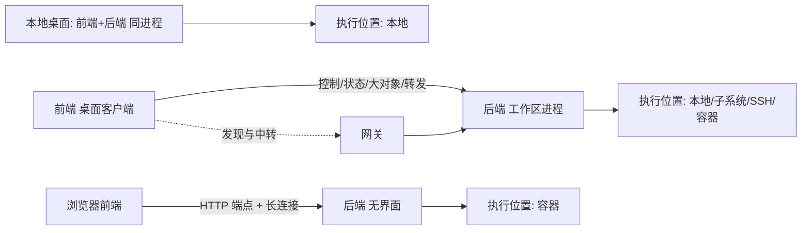
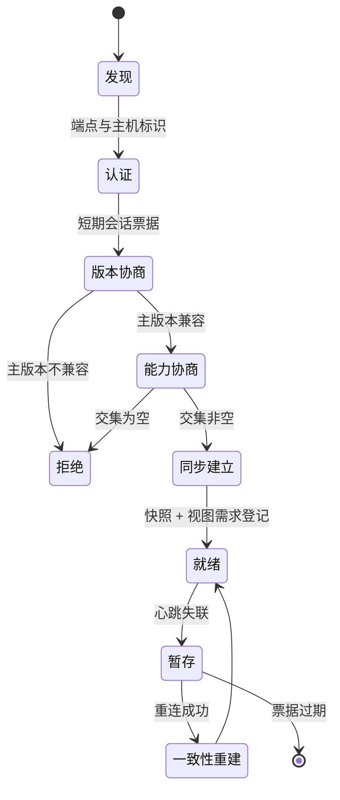

# 17 — 远程开发与前后端拆分

> 范围：部署拓扑与角色、前后端职责归属规则、会话建立与恢复、协议分层与通道语义、工作区模型同步、执行环境抽象、远端安全边界、Web 形态差异、失败与一致性重建。｜ 依赖：01、02、03、05、06、07、15。｜ 排除：传输库实现、界面视觉（见 13）、构建与调试内部（见 11、12）、许可与分发（见 16）。

## 1. 目的与范围

### 1.1 本子系统解决什么问题

同一套产品必须能以三种形态运行：单进程桌面、客户端/服务端分离、浏览器访问。若把"远程"实现为一层运行期分支，系统会退化为大量"是否远程"的判断，且每条新功能要写两遍。本子系统的三个结论：

- **角色拆分是结构约束，不是运行期探测**。模块在描述符中声明属于前端、后端还是共享，装配期按角色裁剪模块集。实测存在两代命名：三态拆分族（共享协议与模型 16 个、前向 46 个、后向 21 个）与非对称的前后向模块对（前向 49 个、后向 79 个）；方向一致，阶段不同。
- **跨进程状态必须带版本语义**。前端持有的是后端工作区的**投影**，投影的每次变化必须能追溯到后端的一个确定版本，否则断线重连后无法判断"前端看到的世界"是否仍然成立。
- **断线是常态**。客户端必须在无连接状态下保持可交互（继续渲染缓存、接受输入并暂存），重连后重建一致视图。

三者分别对应 §4.1、§4.3、§7.3。

### 1.2 边界

不负责：具体语言/构建/调试的语义（只规定它们位于哪一侧、以什么粒度跨越连接）；界面视觉与交互规范（见 13）；索引、语法树、文档的内部实现（见 05、06、07，本篇只规定位置与跨侧可见形态）；云厂商业务逻辑（容器、集群仅作为"执行位置"的取值）；拓扑选择策略（由产品装配与启动参数决定，协议层不自动选择）。

### 1.3 与其他子系统的关系

| 关联 | 内容 |
|---|---|
| 02 §2.3、§3 | 服务描述符含"有效侧"字段；角色拆分复用同一容器与扩展点机制 |
| 03 | 会话内事件走同一消息总线；请求取消与并发作用域复用同一套语义 |
| 05 | 文档版本号是模型同步的版本来源；共享撤销栈的权威侧在后端 |
| 06、07 | 语法树与索引**只存在于后端**；前端只能请求结果，不能请求树 |
| 11、12 | 构建与调试在后端发起，进程运行于"执行位置" |
| 15、16 | 会话可用功能由装载插件与其侧归属共同决定；分发包校验属分发通道，本篇只要求"校验通过才允许启动" |

## 2. 概念模型

### 2.1 五个角色

| 角色 | 定义 | 关键约束 |
|---|---|---|
| 前端 Frontend | 呈现与输入：渲染、输入法、快捷键、剪贴板、本地窗口与对话框 | 不得直接访问工作区物理资源 |
| 后端 Backend | 工作区与计算：文件、索引、语法树、构建、调试、版本控制 | 不得调用渲染接口；必须能无界面运行 |
| 网关 Gateway | 连接中介：发现、地址解析、建连、日志收集 | 不参与业务语义，只做连接与代理 |
| 执行位置 Execution Location | 进程、文件、终端实际所在的环境：本地、子系统、SSH 主机、容器 | 由后端引用，前端不直接持有 |
| 会话 Session | 一对前端↔后端的唯一有状态连接 | 能力集合与纪元在会话内不可变 |

**后端可无界面运行**是硬性要求：无界面模式下不得装载渲染路径、不得创建窗口系统对象、不得解析字体与主题，只保留协议服务、工作区服务与执行能力。证据侧表现为后端发行形态被描述为"无人值守模式，仅提供对远端的连接访问"。

### 2.2 拓扑



三种拓扑的差异**只在传输与前端宿主**，不在职责划分。本地形态下跨侧调用退化为直接调用，但调用点、数据形状与版本语义必须一致——这是"可同构"的落地方式：本地实现不得拥有远程形态没有的能力。

### 2.3 职责划分规则

| 档 | 能力 | 判定理由 |
|---|---|---|
| **必须后端** | 文件读写与监视、路径解析、索引与桩、语法树与引用解析、构建与依赖同步、运行与调试、终端、版本控制与差异计算、全局检查 | 需工作区物理资源、索引存储或目标环境进程 |
| **必须前端** | 渲染与布局、滚动与光标绘制、输入法组字、快捷键解析与键位映射、系统剪贴板、本地窗口与文件选择、显示器与缩放 | 依赖本地输入设备、显示与窗口系统；往返会直接破坏输入延迟 |
| **两侧共有** | 设置界面（后端裁定值，前端呈现）、进度（后端出阶段，前端呈现）、通知（后端出事件，前端定形态）、动作清单（后端裁定可用性，前端呈现并触发）、搜索结果（后端排序，前端虚拟化） | 数据权威在一侧，呈现必然在另一侧 |

- **R1 静态声明**：每个能力声明有效侧（前端/后端/两侧/任一侧），装配期按角色裁剪；运行期禁止"如果远程则……"分支。
- **R2 单向资源访问**：前端不得打开工作区文件句柄、不得枚举目录、不得监听文件系统。
- **R3 单向呈现**：后端不得调用前端渲染接口，只能发布状态。
- **R4 权威侧**：两侧共有能力必须指定唯一权威侧，另一侧副本只读，冲突以权威侧为准。
- **R5 句柄化引用**：跨侧只传标识（实体、文档、票据），禁止传对象引用或内存地址。
- **R6 可校验**：侧归属由"模块声明 + 依赖方向"静态校验，违反者装配期报错。

### 2.4 核心实体关系

```
会话 ──绑定──> 能力摘要（不可变） + 纪元
后端工作区 ──产生──> 实体集合（权威）──发布补丁──> 前端投影
前端投影 ──变更请求（幂等键）──> 后端工作区
后端工作区 ──引用──> 执行位置[] ──提供──> 进程/文件/终端/套接字
```

## 3. 数据模型

```
SessionSpec {
  role: frontend | backend
  transport: tls | quic | webSocket | stdio        // 由连接策略选择
  endpoint: Endpoint
  auth: AuthMethod
  productCode: string                              // 主机产品标识，用于兼容性归类
  protocolVersion: {major: int, minor: int}
  requestedCapabilities: Capability[]
  resumeToken: string?                             // 仅恢复时存在
}
Endpoint { kind: direct | gateway | relay | unixSocket, host, port?, hostKeyFingerprint? }
AuthMethod = oneTimeToken{value} | sshKey{credRef} | password{secretRef}
           | singleSignOn{assertion} | preIssuedCertificate{chainRef}
Capability { id: string, version: int, params: map<string,string> }
CapabilitySet { entries: Capability[], digest: string }   // 会话内不可变

Session {
  id: SessionId
  epoch: int                     // 每次重建递增；补丁必须同纪元
  backendProductCode: string
  protocolVersion: {major, minor}
  capabilities: CapabilitySet
  state: discovered|authenticating|negotiating|syncing|ready|stalled|closed
  startedAt: Instant
  lastSeen: Instant              // 最后心跳或业务帧
}

ModelEntity {
  kind: EntityKind               // 模块/库/内容根/源根/SDK/配置项/问题列表……
  id: GlobalId                   // 全局唯一，跨会话稳定
  version: Version               // 单调递增，不可回退
  fields: map<string, Value>
  state: alive | retracted
}
Patch { epoch: int, entityKind: EntityKind, baseVersion: Version,
        targetVersion: Version, ops: (insert|update|retract|move)[] }

BulkObject { id: TicketId, kind: file|log|binary|capture|upload,
             size: int64, digest: string, chunkSize: int, expiresAt: Instant }
PortForwardRule { direction: localToRemote|remoteToLocal, localBinding: {host,port},
                  remoteTarget: {host,port}, allowlistHit: string?, ttl: Duration }

ExecutionLocation {
  kind: local | subsystem | ssh | container
  platform: posix | windows       // 决定可用信号、路径与终端语义
  transport: shellBootstrap | tcpMutualTls | virtualSocket | unixSocket | hostVirtualSocket
  pathMappings: PathMapping[]
  envPolicy: inherit | override(map) | minimal
  tunnels: PortForwardRule[]
}
PathMapping { localPrefix, remotePrefix,
              caseSensitivity: sensitive|insensitive|preserveCaseInsensitive,
              separator: '/'|'\\' }
CredentialRef { id, kind: sshKey|password|token|passphrase, scope: application|project,
                store: systemVault|sessionMemory, expiresAt: Instant? }   // 系统凭据库优先
```

生命周期与持久化：`Session` 不持久化，但其**元数据**（主机、产品标识、能力摘要、窗口布局）可持久化用于恢复与诊断；`ModelEntity` 持久化于后端工作区存储，前端投影不持久化、重连即丢弃重建；`CredentialRef` 只持久化引用，密钥材料存系统凭据库，`sessionMemory` 作用域随进程结束消失；`BulkObject` 票据与 `Patch` 均只存内存，进程重启即失效（回溯用后端变更日志）。

## 4. 行为契约

### 4.1 会话建立



**1 发现。** 三种来源：直连地址、网关托管的后端清单、本地最近会话记录。发现阶段**必须不**传输项目内容、文档、索引或凭据，只返回主机标识、产品标识、协议版本提示与可用性；网关在此阶段只做地址解析与可达性探测。

**2 认证。** 五类方式（一次性令牌 / SSH 密钥 / 口令 / 单点登录断言 / 预签发证书）。认证必须先于任何业务数据，未认证连接只允许存活到认证超时；成功后必须换取短期会话票据，后续帧携带票据而非凭据；凭据交换必须在受保护传输上进行，明文上的口令类认证必须被拒绝。SSH 路径下**必须**校验主机密钥：首次连接展示指纹、要求确认并固化，指针不符即中止（见 INV 与 §4.6）。

**3 版本协商。** 双方申报产品标识、构建标识、协议主次版本、能力清单版本。主版本不同必须拒绝并给出双方版本与升级方向；主版本相同则次版本取较低者，次版本差异必须由能力协商吸收而非直接失败。协商必须发生在认证之后、业务数据之前。

**4 能力协商。** 前端提交请求集、后端提交提供集，结果为交集，并计算**摘要**绑定会话；摘要进入会话元数据与日志。会话内能力集合**不可变**——新增能力只能重建会话，目的是让"通道是否存在"成为静态事实。至少三类必须可协商：虚拟套接字（在既有连接上复用新流）、大对象直传、内嵌浏览器渲染。交集为空即拒绝，错误必须指出缺失的关键能力。

**5 同步建立。** 后端按实体种类分批发布工作区快照，前端登记视图需求（打开哪些文档、可见哪些区域）。快照必须携带纪元号；快照期间的后端变更以补丁追加在快照之后，不得丢弃。

**6 就绪。** "智能模式是否就绪"是**后端**状态（见 07），前端只呈现、不得推断；协议必须提供就绪度查询，供前端决定是否禁用依赖索引的动作。

**7 恢复。** 重连携带 `resumeToken` 与"最后已应用版本"。后端二选一：增量续传（补丁仍在保留窗口内）或全量重建（新纪元 + 新快照）。恢复必须幂等——同一令牌重复提交不得产生两个会话。

### 4.2 协议分层

| 通道 | 语义 | 保序范围 | 失败后果 |
|---|---|---|---|
| 控制 | 请求/响应；可取消；带幂等键 | 每请求独立 | 结构化错误，会话存活 |
| 状态 | 发布/订阅；增量补丁；版本绑定 | 按实体保序，跨实体可乱序 | 该实体重建或整会话重建 |
| 大对象 | 分块流；票据 + 摘要 | 块内严格保序 | 取消整个对象，票据作废 |
| 端口转发 | 多路复用字节流，每流独立标识 | 每流严格保序 | 仅关闭该流 |
| 终端 | 双向字节流 + 尺寸/信号事件 | 严格保序 | 该终端失败，其余不受影响 |

- **分层的必要性**：控制通道追求低延迟小帧，大对象通道追求吞吐；混在一帧里会让一次文件读取阻塞一次光标移动。因此通道共享同一连接但各有独立配额与优先级（§4.4）。
- **心跳与超时**：双向心跳，任一侧连续 N 次无响应即判失联。心跳帧必须不携带业务数据、必须不改变业务状态；空闲期必须降频，避免长连接在无操作时持续占用移动网络。
- **背压**：每通道独立信用窗口。状态通道积压时可以丢弃中间版本但必须保留最新；大对象通道必须不丢块，只能整对象取消。
- **多路复用**：转发、终端、大对象优先走既有连接上的虚拟流；仅当协商结果不支持或需绕过网络设备限制时才新建物理连接（TCP + 双向 TLS）。
- **网关不透明性**：网关只解析建连所需握手字段，不终止、不改写业务通道。

### 4.3 模型同步

**映射规则。** 后端实体（种类 + 全局标识）→ 前端视图对象。前端必须不推断字段语义，只做镜像：字段取值的含义属后端，呈现解释属前端。种类↔视图的对应关系必须可声明（§10），未声明的种类前端不得请求。

**增量更新。** 补丁携带 `baseVersion → targetVersion` 与操作序列，应用规则：纪元不一致 → 丢弃并请求重建；`baseVersion` 不等于当前版本 → 请求补齐区间，区间不可得则全量重建；`targetVersion` 不大于当前版本 → 幂等丢弃（重复投递必须无害）；应用必须原子，否则回退并请求重建。

**前端缓存与失效。** 以（种类，标识，版本）为键驻留投影。实体 `retract` 后必须立即从所有视图不可见并在同一帧内释放驻留内存，延迟释放会造成"幽灵条目"。不可见区域（折叠、未打开文档、非当前模块）的投影可被淘汰，重建由补丁重放或按需订阅完成；淘汰不得影响输入呈现，已渲染内容可保留为不可编辑快照。

**断线暂存与重放。** 变更请求进入待发队列（FIFO，带序号与幂等键）。断线期间队列必须继续接受新请求（用户必须能继续输入与触发动作），必须有上限，超限必须拒绝并明确提示"离线，操作未提交"，不得静默丢弃。重连后按序重放，后端以幂等键去重，重放产生的重复请求必须返回首次结果而非二次执行。依赖后端结果才能继续的操作（如重命名后刷新引用）离线期间必须置为"待定"而非"成功"。

**冲突与回滚。** 后端版本优先。乐观更新在后端拒绝、版本冲突或超时时必须回滚到后端版本，且回滚必须对用户可见。

**撤销。** 撤销栈权威侧是后端（共享撤销），前端只发"撤销/重做请求"，不得维护独立撤销栈，否则多前端场景下与后端历史分叉。

### 4.4 延迟与带宽

**可取消。** 每个控制请求携带取消令牌，取消必须传播到后端计算过程（解析、检查、构建查询），而非仅丢弃响应；已取消请求的响应即便晚到也必须被前端丢弃。

**优先级。** 至少四档，发送侧与后端调度侧语义一致：①输入反馈（回显、光标、选中、滚动）不得因任何后台工作延迟；②交互结果（补全、导航、悬停）；③可见区高亮与检查；④索引、后台分析与构建同步进度。前端必须不为不可见区域请求③④。

**批量合并。** 同一渲染帧内的多个增量必须合并为一个补丁，同一实体的多次更新必须折叠为最终值，合并窗口以渲染帧为界（量级 16 ms）。控制请求可以合并，但不得改变语义顺序。

**乐观更新与回滚。** 仅适用于"结果可预测且代价低"的交互（折叠、面板可见性、勾选、纯视图开关），不适用于语义变更（重命名、重构、提交）。判定规则：若回滚会让用户看到"内容变了又变回来"，则不得乐观更新。乐观更新必须携带可回滚前值，收到后端确认后丢弃。

**带宽裁剪。** 文本只传变更区间，整文档仅用于首次打开与重建；语义结果（高亮、检查、折叠区）随文档版本下发，版本不符即丢弃（见 05）；日志与终端按行批合并并受信用窗口约束，前端消费慢时后端必须暂停产出而非无限缓冲；大对象一律走大对象通道，禁止把文件内容塞进状态通道字段。

### 4.5 执行环境抽象

执行环境抽象（EEL）把"代码在哪里跑"收敛为统一概念**执行位置**，使上层无需为本地/子系统/SSH/容器写四套代码。

**统一能力面**：文件系统（含属性与监视）、进程启动与等待（退出码、信号、标准流）、环境变量查询与覆盖、终端（伪终端、尺寸事件、信号）、套接字与端口转发、平台标识（POSIX/Windows）及其扩展面。

**接入方式**三种，由连接策略选择：

1. **shell 引导**——在目标环境已有 shell 上投放并启动代理，之后复用该 shell 的双向流。适用于任意 POSIX 主机与容器。失败必须分类为"目标不兼容"（平台、架构、缺运行时）或"通信错误"（流中断、握手失败），二者处置建议不同。
2. **TCP + 双向 TLS**——目标监听固定或随机端口，双方证书互认；证书集合含颁发机构、服务端证书与私钥、客户端证书与私钥。仅在传输可被第三方触达时启用，且必须配合主机校验。
3. **虚拟套接字**——在既有会话连接上开新流（可用性由能力协商决定）。这是优选路径：不需要额外端口，也不需要额外证书分发。

**路径映射**：以前缀对（本地 ↔ 远端）表达，必须不做全局字符串替换；必须声明大小写敏感性（不敏感目标上，同名不同大小写的两个路径必须判为同一文件，与 04 的文件标识规则一致）；映射失败必须显式报错（"路径不在任何映射内"），绝不回退到本地文件系统——回退会导致"在错误机器上创建文件"这类不可恢复事故。

**进程启动**：必须在目标环境的工作目录、环境变量、用户身份下启动；标准流流式回传并按行批合并；退出码与信号必须区分（`退出 127` 与"命令不存在"不是同一件事）。终止必须先请求优雅终止、超时后强制，且必须对进程组生效，避免遗留子进程。

**终端**：必须上报尺寸变化、编码与 TERM 语义；平台差异（控制字符、信号名、回显模式）由执行位置适配；缓冲必须有上限并环形覆盖（见 §8）。

**降级**：无代理可用（只剩 shell）时只能提供命令执行与文件搬运，无结构化文件系统、监视、套接字、转发。依赖这些能力的动作必须被明确禁用（映射到 D1/D2），不得以"看起来能用但极慢"的形态存在。

### 4.6 安全

| 面 | 要求 |
|---|---|
| 主机身份 | 首次连接展示指纹并要求确认；固化后不一致即中止。必须不提供"忽略一次"的静默选项 |
| 凭据存储 | 系统凭据库优先、会话内存次之；凭据库两侧分离（前端存本地，后端存工作区侧）。密钥材料必须不写入设置文件 |
| 凭据生命周期 | 引用带过期时间；过期必须重新获取，不得静默复用 |
| 最小权限 | 后端以启动它的用户身份运行，不得自我提权；执行位置不得被授予多于启动用户的权限 |
| 端口转发 | 目标主机/端口必须命中白名单，默认拒绝；放行与拒绝均记录审计项；白名单按会话生效，不跨会话继承 |
| 剪贴板 | 两方向独立开关。禁止方向必须静默丢弃并计数，必须不把被丢弃内容写入日志 |
| 大对象 | 票据一次性、绑定会话、摘要校验；过期或摘要不符即拒绝 |
| 后端产物 | 客户端下载分发包后必须校验签名，失败必须拒绝启动 |
| 日志与遥测 | 令牌、口令、密钥、文件内容必须打码；崩溃报告走同一脱敏管线 |

补充：单点登录断言必须校验受众与有效期，只能换取会话票据、不得作为长期凭据保存；会话票据必须绑定会话标识与能力摘要，被复用到另一会话时必须拒绝；端口转发本地绑定应当默认只绑回环地址，绑外部接口必须显式配置。

### 4.7 Web 形态差异

Web 形态复用同一职责划分与同一状态语义，差异集中在**前端宿主**与**认证入口**：

- **渲染在浏览器**：前端不再拥有窗口系统，输入来自浏览器事件，快捷键解析改为"浏览器事件 → 动作标识"的映射层；输入法组字由浏览器负责，前端只接收已组字结果。因此在 Web 形态下"输入法"不是必须前端的能力，而是宿主提供的前提。
- **插件前端产物**：前端侧能力以"前端产物"形式随模块装配下发到浏览器。不支持前端产物的插件必须退化为"仅后端能力 + 通用呈现"，不得让整个界面不可用。
- **内嵌浏览器**：需要内嵌渲染的面板（文档预览、图表、富媒体）在无法内嵌时必须能以外部浏览器承载同一前端产物。
- **文件上传下载**：经 HTTP 端点 + 一次性票据，必须不经状态通道传大文件；上传必须边接收边校验摘要与大小上限。
- **会话超时**：标签关闭或长时间空闲时会话进入"可恢复"而非立即销毁，超过恢复窗口才回收后端资源（阈值见 §8）。
- **认证入口**：依赖既有身份提供方的重定向认证，一次性令牌由服务端签发，必须短有效期、单次使用并绑定客户端指纹（`[推断]` 指纹为浏览器会话标识）。

## 5. 不变量与约束

| 编号 | 不变量 |
|---|---|
| INV-1 | 每个能力必须声明有效侧；未声明的跨侧调用必须在装配期被拒绝。 |
| INV-2 | 前端不得持有工作区物理文件的直接句柄或目录枚举能力。 |
| INV-3 | 后端不得依赖前端已渲染；无界面后端必须能完成全部后端能力。 |
| INV-4 | 会话内能力集合不可变，摘要与实际行为必须一致。 |
| INV-5 | 补丁只能被其声明的 `baseVersion` 唯一确定地应用。 |
| INV-6 | 实体版本单调递增；重试与重放不得复用或回退版本号。 |
| INV-7 | 每个变更请求必须携带客户端生成的幂等键，重放不得二次执行。 |
| INV-8 | 断线期间前端必须保持可交互：已渲染内容可显示，输入可暂存。 |
| INV-9 | 重连后前端视图必须与后端某一确定版本一致，不得混合两个纪元的实体。 |
| INV-10 | 任何端口转发目标必须命中白名单，白名单按会话生效。 |
| INV-11 | 凭据材料不得出现在日志、遥测、崩溃报告或设置文件中。 |
| INV-12 | 大对象票据一次性、绑定会话、带摘要校验。 |
| INV-13 | 执行位置内的路径解析失败必须报错，不得回退到本地文件系统。 |
| INV-14 | 心跳与保活帧不得改变任何业务状态。 |
| INV-15 | 无界面模式下不得加载渲染路径，不得初始化窗口系统。 |
| INV-16 | 会话终止必须释放该会话在后端持有的全部前端相关资源（订阅、票据、临时流）。 |

## 6. 对外能力契约

```
openSession(spec) -> Session | SessionError        // 幂等：同一 resumeToken 并发提交返回同一会话
negotiate(session, requested) -> CapabilitySet     // 摘要绑定会话；已协商后再调必须返回同一结果
subscribe(session, entityKind, scope) -> Subscription
  // scope = workspace | project | module | document；断线后自动续订，从最后已应用版本开始
requestChange(session, idempotencyKey, change) -> Result
  // 幂等；离线期排队；结果 = accepted | rejected(reason) | pending
openChannel(session, kind, priority) -> Channel    // kind = control|state|bulk|portForward|terminal
forwardPort(session, rule) -> Handle               // 未命中白名单必须拒绝并返回判定依据
resolveExecutionLocation(kind, descriptor) -> ExecutionLocation  // 按描述符缓存
queryReadiness(session) -> Readiness               // 后端权威；前端不得自行推断
```

要求：全部能力必须可在无界面角色下调用（不得依赖界面已初始化，见 02 §6）；变更类接口必须幂等或明确拒绝重复，必须不"最后一次生效"；长操作必须接受取消令牌且取消传播到后端；错误必须有稳定分类（认证、版本、能力、网络、路径映射、权限、超时、对端内部错误），前端据分类决定是否可重试。

## 7. 故障模式与降级

### 7.1 失败分类与处置

| 故障 | 检测 | 用户可见 | 档 | 恢复 |
|---|---|---|---|---|
| 版本主号不兼容 | 版本协商 | "目标环境版本不受支持"，无重试按钮 | D2 | 升级一侧后重连 |
| 能力交集为空 | 能力协商 | 指出缺失的关键能力 | D2 | 调整部署或网络 |
| 认证失败 | 认证错误 | 区分"凭据错误"与"被拒绝"，不泄露细节 | D2 | 重新输入；不自动重试 |
| 主机指纹不匹配 | 建连握手 | 中止并展示两侧指纹 | D2 | 人工确认；不得自动信任新指纹 |
| 引导失败（目标不兼容） | 代理引导 | 列出探测到的平台/架构 | D2 | 更换目标环境 |
| 引导失败（通信错误） | 代理引导 | "连接不稳定"，可重试 | D1 | 指数退避重试，达上限转人工 |
| 网络抖动 | 心跳超时 | "已断开，正在重连"；编辑继续 | D1 | 重连 + §7.3 |
| 后端崩溃 | 连接关闭且重连失败 | 会话转"可恢复"，展示崩溃摘要 | D2 | 后端重启后按令牌恢复 |
| 后端持久化损坏 | 启动自检 | 引导修复；前端只读 | D5 | 导出诊断包后修复 |
| 补丁版本断裂 / 积压超窗口 | 前向校验 / 后端判定 | 无感知（自动重建） | D1 | 全量重建并新纪元 |
| 大对象传输中断 | 块超时/摘要不符 | 该对象失败，其余不受影响 | D1 | 重新申请票据 |
| 端口转发被拒 | 白名单判定 | "目标不在允许范围" | D2 | 修改白名单（需管理员） |
| 前端渲染进程崩溃 | 宿主持有 | 面板重建或整前端重载 | D2 | 重新订阅并从最后版本续传 |
| 凭据库不可用 | 访问失败 | 提示"无法保存凭据"，允许仅本次会话 | D1 | 退化为会话内存凭据 |
| 执行位置不可达 | 解析/心跳 | 依赖该位置的动作禁用，编辑与导航保留 | D3 | 位置恢复后自动解除 |

### 7.2 降级梯度映射

D0 正常；D1 功能受限（心跳抖动、补丁积压、单通道失败、凭据库不可用）——会话存活，可继续编辑；D2 子系统失效（认证、版本、能力、转发被拒、渲染崩溃、后端崩溃）——该能力不可用，其余保留；D3 只读/受限执行（执行位置不可达、构建模型不同步）——编辑与导航保留，执行类动作禁用；D4 无界面服务（后端角色本身，非故障）；D5 抢救模式（后端持久化损坏）。

### 7.3 重连后的一致性重建

必须按序执行，任何一步失败都回到"全量重建"，不得部分成功：

1. **握手重放**：用 `resumeToken` 建连；票据过期则要求重新认证。
2. **纪元校验**：后端返回当前纪元与最后有效版本；纪元不同即跳至第 5 步。
3. **增量补齐**：前端上报最后已应用版本，后端在保留窗口内补齐，逐补丁校验 `baseVersion`。
4. **待发重放**：按序号重放离线变更；后端以幂等键去重并返回首次结果。
5. **全量重建**：请求新快照，丢弃旧纪元全部投影与缓存，按订阅重建视图需求；重建期间界面必须可用（旧快照标记为"陈旧"继续显示）。
6. **能力复核**：若后端版本或能力摘要变化（例如被升级），必须重新协商能力并重新评估被禁用的动作。

## 8. 资源与性能预算

| 项 | 预算 | 依据 |
|---|---|---|
| 通道单帧上限 | 768 KiB（786432 字节） | 实测常量；大对象必须按此分块 |
| 心跳间隔 / 失联判定 | 量级 15 s / 45 s（3 次无响应） | `[推断]` |
| 空闲心跳降频 | 就绪且无业务帧时降为 2–4 倍间隔 | `[推断]` |
| 补丁保留窗口 | 量级 分钟（决定增量续传可用性） | `[推断]` |
| 幂等键保留窗口 | 不小于补丁保留窗口 | `[推断]` |
| 待发队列上限 | 量级 10³ 条请求或按字节上限 | `[推断]`；必须有上限并显式拒绝 |
| 前端投影驻留 | 按可见性淘汰，不可见区域仅留排版快照 | `[推断]` |
| 大对象并发流 | 每会话量级 4，超出排队 | `[推断]` |
| 终端环形缓冲 | 1024 KiB | 实测配置（与 12 一致） |
| 后端堆上限 | 2 GB | 实测启动参数（与 01 §8 一致） |
| 大文件阈值 | 全功能 2.5 MB / 可打开 20 MB | 实测配置；见 04 §6 |
| 空闲会话回收（Web） | 量级 30 min 转可恢复，再数小时回收 | `[推断]` |

背压：状态通道以信用窗口限流，窗口耗尽时后端必须停止推送而非缓冲；大对象通道以块级确认限流；终端以行批 + 上限缓冲限流。任何通道缓冲必须有硬上限，超限即关闭通道，不得扩大内存。

## 9. 可观测性

必须记录的会话级事件（结构化，带会话标识、纪元、能力摘要）：`discovered`（来源、端点种类）；`authenticated`（方式、耗时，不含凭据内容）；`negotiated`（双方版本、能力摘要、交集大小、被拒能力）；`established`（快照实体数、首次就绪耗时）；`disconnected`（原因分类、最后心跳时刻）；`resumed`（增量或全量、补齐补丁数、重放请求数、耗时）；`rebuilt`（触发原因、新纪元）；`channel.closed`（种类、发起侧、原因）；`bulk.failed`（票据、摘要结果）；`forward.opened` / `forward.rejected`（目标、白名单判定）。

必须暴露的指标：往返时延、每通道字节与帧数、补丁平均大小与合并率、请求取消率与取消延迟、乐观更新回滚率、重建次数与耗时、重连成功率、转发流并发数、前端投影对象数与淘汰率。

诊断入口（无界面角色也必须可导出）：已注册远程接口清单与服务可用性（判断"某能力是否被装载"）；两侧线程转储的协同抓取（一方触发，另一方产出并回传）；连接日志收集（网关侧与后端侧均可收集，用于事后归因）；按通道的流量统计导出（区分延迟问题与带宽问题）。

**最小可复现状态**：会话标识 + 双方产品与协议版本 + 能力摘要 + 最后已应用实体版本 + 失败阶段与错误分类 + 连接统计窗口。缺任一项都会使问题无法归因到具体一侧。

## 10. 扩展点

| 接缝 | 契约要求 | 失败隔离 |
|---|---|---|
| 连接器 / 连接提供者 | 提供"如何到达某后端"；不得解析业务帧 | 只影响该来源的发现结果 |
| 地址处理器 | 把外部地址（链接、协议 URI）解析为会话描述；不得在解析期建业务连接 | 提示"无法识别的地址" |
| 远端日志收集器 / 远端最近项目 | 经既有通道收集日志；提供目标环境最近项目清单 | 失败不影响会话，清单退化为空 |
| 后端产物下载器 | 下载并校验分发包；必须在启动前完成签名校验 | 校验失败即拒绝启动 |
| 前端组件提供者 | 为某实体种类提供前端视图组件 | 缺失时退化为通用呈现 |
| 前端应用定制 / 重连监听 / 连接信息提供者 | 定制前端外壳、观察重连、提供连接元数据 | 抛错必须被捕获，不得阻断重连 |
| 语言替换定制 | 声明远程形态下替代某语言的呈现实现 | 只影响该语言 |
| 后端动作数据提供者 / 动作执行委派 | 后端裁定动作可用性并执行，前端只呈现与触发 | 按 02 §4.3 跳过该条目 |
| 补丁访问令牌提供者（两侧） | 为大对象访问签发/校验票据 | 拒绝即该对象不可用 |
| 种类↔视图映射、前端文档标识登记、后端文档绑定、前端编辑器绑定、文档版本访问器、自定义序列化器、文档同步 | 模型同步的可扩展面；必须声明支持的版本区间与幂等性 | 未声明即该种类不可订阅 |
| 撤销集成 | 前端撤销请求到后端撤销栈的桥接 | 失败时禁用撤销而非本地分叉 |
| 环境解析 / 环境初始化 / 替代根 / 路径解析扩展 | 扩展执行位置的发现与路径归一化 | 解析失败按 INV-13 报错 |
| 凭据类型 / 凭据语言贡献 | 新增凭据种类与其编辑形态 | 未知类型必须拒绝而非猜测 |

通用约束：扩展必须声明有效侧，声明"两侧"者必须两侧都能装载且不得假设对侧存在；必须不在握手路径上做阻塞工作，握手期只允许声明与解析；失败必须表现为"能力缺失"而非"会话失败"；必须不打开未经协商的通道，必须不绕过票据直接访问大对象；参与模型同步者必须接受"补丁可重放、可重复投递"。

## 11. 对照实现（证据锚点）

| 上文结论 | 证据锚点 |
|---|---|
| 远程相关模块 314 个；远程相关扩展点声明 169 个、注册条目 730 条 | `_rev/evidence/16-remote-development.md`：`Modules (314)`；`_rev/epdecl.json` + `_rev/pluginxml/*.xml` 关键词过滤：声明 163（模块描述符）+ 6（仅插件自命名空间新增）= 169；`_rev/ep_counts.json`：注册 629（模块描述符内）+ 101（插件描述符内）= 730 |
| 三态角色拆分 | `_rev/modules.json`：`*.split` 16、`*.frontend.split` 46、`*.backend.split` 21；旧一代 `*.frontend` 49、`*.backend` 79 |
| 前端形态是模块装配而非另一套代码 | 插件 `com.intellij.idea.frontend.split.customization` 仅声明模块清单 |
| 后端可无人值守运行 | 插件 `com.jetbrains.remoteDevServer` 描述："Launches IDE in Unattended Mode and provides connection access to a remote client" |
| 三态由同一插件族承载 | 插件 `com.jetbrains.remoteDevelopment` 同时含 `kernel.frontend.split`、`kernel.backend.split`、`rpc.split`、`split.protocol` |
| 状态通道基于实体的不可变数据库 | `intellij.platform.kernel` 依赖 `fleet.rhizomedb`、`intellij.platform.pasta`、`intellij.platform.rpc` |
| 远程接口注册表与可用性诊断 | `intellij.platform.rpc` → `RemoteApiProviderService`：`resolve` / `listRegisteredApis` / `isServiceOperational` |
| 主题化发布订阅（应用级/项目级） | 模块 `intellij.platform.rpc.topics{,.frontend,.backend}`；EP `…rpc.applicationRemoteTopicListener`、`…rpc.projectRemoteTopicListener` |
| 传输族含 TLS、QUIC、ICE 穿透 | `intellij.platform.split.connection` 是 `intellij.libraries.tls.channel`、`quiche-jna-stubs`、`ice4j` 的唯一依赖者 |
| 报文上限 768 KiB | `RECOMMENDED_MAX_PACKET_SIZE = 786432`（`intellij.platform.ijent`） |
| 引导错误分类 | `IjentStartupError` → `BootstrapOverShell` → `IncompatibleTarget`、`CommunicationError` |
| 双向 TLS 证书集合与 SOCKS5 代理 | `MutualTlsCertificates`（CA/服务端证书+私钥/客户端证书+私钥）、`IjentTcpProxyInformation.SOCKS5` |
| 连接策略两态 | `IjentConnectionStrategy.Default`（虚拟套接字不可用）与 `.Tcp`（端口 + TLS + 代理） |
| 执行位置的通道种类 | `IjentPosixApi`：UNIX 套接字、结构化套接字、宿主虚拟化传输、`tunnels`、`addSpecialChannel` |
| 会话可在线调整日志级别 | `IjentSession.updateLogLevel(INFO/DEBUG/TRACE)`；`IjentSession.Posix` 平台变体 |
| 执行位置统一能力面 | `IjentApi`：`exec`、`fs`、`ijentProcessInfo`、`waitUntilExit`、`isRunning` |
| 端口转发为一等能力 | `IjentTunnelsApi`、`IjentTunnelsPosixApi`、`IjentTunnelsWindowsApi` |
| 凭据库两侧分离 | 模块 `intellij.platform.credentialStore{,.common,.impl,.ui,.frontend.split,.backend.split}` |
| Web 形态经内置 HTTP 服务暴露 | `intellij.platform.builtInServer`：`overridePort`、`addAuthToken`、`waitForStart`；`WebServerRootsProvider` 以（项目，路径）为根；`webide.impl` 依赖 `builtInServer.impl` |
| 端口可外部可达并可重绑 | `CustomPortServerManager`：`isAvailableExternally`、`isBound`、`cannotBind`、`rebind` |
| 后端产物需签名校验 | `intellij.remoteDev.util` 依赖 `intellij.libraries.download.pgp.verifier`、`bouncy.castle.pgp` |
| 网关=发现+连接器+代理+日志收集 | 插件 `com.jetbrains.gateway` 的 EP：`gatewayConnector`、`gatewayConnectionProvider`、`gatewayUrlHandler`、`gatewayRemoteLogCollector`、`gatewayRemoteRecentProjectsHelper`；实现含 `LinkedClientProxyingConnector`、`WslConnector` |
| 网关提供 HTTP 入口 | 同上插件注册 `httpRequestHandler`（`thinClientLink` 客户端请求处理器） |
| 会话控制存在于两侧 | 模块 `intellij.platform.remoteController` 与 `intellij.platform.remoteController.backend` |
| 模型同步扩展面 | EP：`frontendDocumentIdRegistry`、`backendDocumentBinder`、`frontendEditorBinder`、`rpc.documentVersionAccessor`、`customTypeRpcSerializer`；EP `…rpc.backend.documentSync` |
| 撤销栈跨侧同步 | 模块 `intellij.platform.undo.split`；编辑器双向模块 `intellij.platform.editor.frontend` / `.backend` |
| 前端组件与重连接缝 | EP：`com.intellij.frontend.splitComponentProvider`、`…frontend.applicationCustomizer`、`…frontend.reconnectListener`、`…frontend.connectionInfoProvider` |
| 后端动作委派面 | EP：`…rdserver.backendActionDataProvider`、`…rdserver.backendActionExecutorDelegateHandler`、`…rdserver.backendPatchAccessTokenProvider` |
| 前端呈现抑制与高亮定制 | EP：`com.intellij.rdclient.actionCustomization`、`…rdclient.highlighterSuppressionHandler`、`…rdclient.daemon.frontendMarkupSuppressorFactory` |
| 执行位置可扩展解析 | EP：`com.intellij.eelMachineResolver`、`…eelEnvironmentInitializer`、`…eelAlternativeRootProvider`、`…eelTcpPathParser` |
| 主机产品标识用于兼容性归类 | `intellij.platform.ide.impl` → `com.intellij.util.rdct` 的 `HostProductCode = {IU,RM,WS,PS,PY,DS,OC,CL,DB,RD,GO}` |
| 远程子系统的注册分布（合计口径） | `_rev/ep_counts.json` 的 `total`：`rdclient.*` 24 个扩展点 / 253 条注册，`rdserver.*` 27 / 171，`rdct.*` 1 / 14；角色相关：`frontend*` 18 / 89，`backend*` 29 / 166，`split*` 5 / 7，`eel*` 7 / 18，`ijent*` 2 / 5 |
| 连接与统计分层 | 模块 `intellij.platform.split.connection`、`.split.connection.base`、`.split.statistics` |
| 远端服务器定义与代理运行时 | 模块 `intellij.platform.remoteServers{,.impl,.agent.rt}` |
| SSH 传输与挂接 | 模块 `intellij.platform.ssh{,.core,.ui,.attach}` |
| 执行位置实现族 | 模块 `intellij.platform.eel{,.provider,.impl}`、`intellij.platform.ijent.ssh`、`.ijent.wsl`、`.ijent.bundledBinaries` |

## 12. 未决问题

1. **网关与直连是否共用同一协议栈**：网关有独立连接器、地址处理器与 HTTP 入口，但业务通道对其不透明；`[推断]` 为共用协议、网关只做中转与发现。若存在网关专用降级协议，§4.2 需增列一档。
2. **`resumeToken` 有效期与补丁保留窗口的取值关系**：两者必须匹配，否则增量续传永不可用；证据只显示机制存在，具体取值 `[推断]`。
3. **能力协商是否支持依赖表达式**：若"内嵌渲染"依赖"大对象直传"，交集计算就不能是简单求交；证据只显示结果有摘要绑定，未显示依赖声明，`[推断]` 为无依赖。
4. **Web 形态是否复用桌面前端的传输与产物格式**：`webide` 与 `remoteDevServer` 模块分立，`[推断]` 共用状态语义与前端产物、传输层不同。
5. **剪贴板方向的默认值**：只有开关需求与能力存在，无默认策略证据，`[推断]` 为按部署策略配置而非固定默认。
6. **一个后端是否同时服务多个前端**：客户端与服务端模块族对称，`[推断]` 协议支持多前端共享同一后端；协作场景下的撤销栈与光标归属冲突处理未验证。
7. **补丁的跨版本兼容策略**：实体种类与字段随插件变化，未知字段是"忽略"还是"拒绝整补丁"无证据，`[推断]` 为忽略并保留原值以便回传。
8. **大对象分块大小是否等于报文上限**：`[推断]` 不得大于上限，实际可能更小以降低尾部延迟，证据不足。
9. **执行位置不可达时 D3 与 D2 的边界**：若内容根完全位于远端，索引语料也随之中断，实际退化为 D1；`[推断]` 应按内容根粒度而非会话粒度判定。
