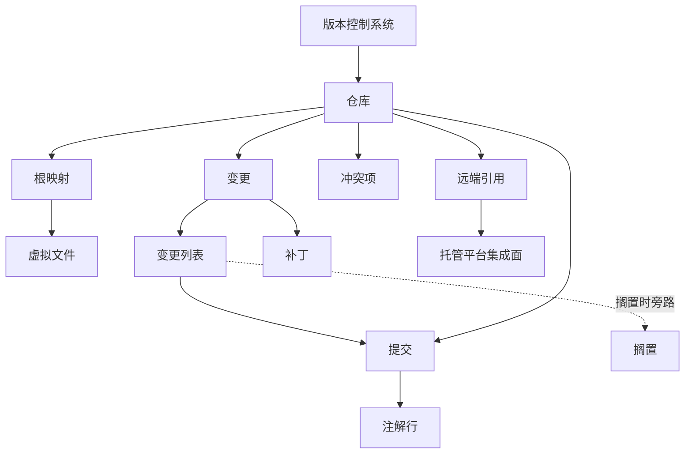

# 18 — 版本控制集成

> 范围：版本控制抽象层、状态跟踪、变更列表、差异与合并引擎、注解、提交与历史、远端同步、补丁与搁置、托管平台集成面。｜ 依赖：02、03、04、05、13、15、17。｜ 排除：具体版本控制系统的磁盘格式与网络协议、具体托管平台的 API 语义、代码评审业务规则。

## 1. 目的与范围

### 1.1 本子系统解决什么问题

本子系统把"仓库里发生了什么"翻译成编辑器可直接消费的信息，并把用户的改动组织成可提交、可交换、可搬运的单元：

| 关注点 | 产物 | 主要消费方 |
|---|---|---|
| 文件此刻的状态 | 文件状态（File Status） | 编辑器装饰、变更视图、提交对话框 |
| 两个版本差在哪里 | 差异片段（行/词/字符三级） | 差异视图、代码透镜、检查 |
| 每行是谁、何时、为何写入 | 逐行归属（Annotation） | 注解视图、文件历史 |
| 组织待提交内容并产生原子写入 | 变更列表（Changelist）→ 提交（Commit）与提交后刷新 | 提交流程、变更视图、历史、注解 |
| 与远端交换历史 | 拉取/推送/合并/变基结果 | 分支状态、冲突流程 |
| 搬运不完整改动 | 补丁（Patch）与搁置（Shelf） | 跨工作树移植、临时收纳 |

核心约束：**上层（编辑器、导航、检查、重构）只依赖本子系统定义的抽象，不依赖任何具体版本控制系统的行为差异**。差异只允许出现在实现内部，以及少量显式能力查询（是否支持搁置、amend、部分暂存、签名）。

### 1.2 边界

**不负责**：网络传输与认证协议细节（只规定凭据与代理的注入点）；代码评审业务规则（只规定外部评审状态如何进入并被展示）；编辑器渲染与交互控件（见 05、13）；文件系统监视机制本身（见 04 §7，本子系统是事件消费者）；构建/测试结果（见 12，只读取其状态）。

### 1.3 与其他子系统的关系

- **04 虚拟文件 / 05 文档**：被跟踪对象以虚拟文件标识寻址，**必须不**以物理路径作为身份；未保存内容可作为独立版本源参与差异与提交。
- **03 运行时**：刷新在后台线程；界面更新**必须**回到界面线程；差异计算**必须**可取消。
- **13 / 14 / 15 / 17**：变更视图、日志视图、注解栏、差异视图是 13 的挂载点而模型由本子系统提供；设置与凭据归 14；全部接缝为声明式扩展点（§10）；远程开发下版本控制**必须**在服务端独立完成，前端只保留渲染与命令触发。

## 2. 概念模型

### 2.1 三层抽象

```
版本控制系统 (VCS)  —— 一类能力的命名空间：状态语义、差异能力、提交语义
  └── 仓库 (Repository)      —— 可独立执行操作的历史存储单元，带独立根目录
        └── 根映射 (Root Mapping) —— 工作树路径 ↔ 仓库 ↔ 仓库内路径 的换算
```

- **版本控制系统**是**能力声明**而非实例：声明是否支持部分暂存、amend、搁置、签名、重命名追踪、文件锁定，以及提交标识是数值还是不透明串。上层据此启用能力，不探查实现。
- **仓库**是可寻址的**操作对象**：提交、拉取、注解、历史均以仓库为作用域，一个项目可含任意数量仓库；**根映射**是唯一允许把"项目内文件"翻译成"仓库内路径"的机制，一个工作树前缀可对应同一仓库的多个子目录，跨层调用**必须**经过它、禁止拼接路径字符串。
- **变更**是一对版本（前/后）与由此推导的状态，短寿命、随刷新重建；**变更列表**是其逻辑分组，项目级持久化、跨会话保留；**提交**不可变、按标识寻址；**注解行**是提交的派生投影，可失效重建；**补丁**是可序列化差异，**搁置**是被收纳的本地变更集（本地持久化、可离线恢复）。

### 2.2 实体关系



- 变更**必须**属于且仅属于一个列表；默认列表始终存在且不可删除。搁置与列表**并列**：搁置项**必须不**出现在待提交集合，但可回填为列表。
- 一个变更**可以**同时出现在多个版本控制层中（§4.1.3），此时是同一文件的**平行视图**而非重复变更。

### 2.3 术语

- **工作树 / 仓库内路径**：工作树（Working Tree）是仓库根下用户可见的文件集合；仓库内路径（Repository Path）是以仓库根为基准、`/` 分隔、大小写遵循仓库配置的路径。
- **基线 / 局部内容 / 层**：基线（Base）是与工作树比较的参照版本，通常为当前分支最近提交；局部内容（Local Content）是内存中未保存的编辑器内容，可作独立版本参与差异与提交；层（Layer）是同一文件在多个并存版本控制系统中的某一归属。

## 3. 数据模型

```idl
FileStatus = NOT_CHANGED | MODIFIED | ADDED | DELETED | DELETED_FROM_FS
           | UNVERSIONED | IGNORED | MERGED | CONFLICT | SUPPRESSED | UNKNOWN
Vcs {
  id: string
  capabilities: { supportsPartialStaging, supportsAmend, supportsShelve, supportsSigning,
                  supportsRenameTracking, supportsFileLocking: bool,
                  revisionNumberKind: numeric | opaque }
  priority: int                   // 多 VCS 并用时的归属优先级（§4.1.3）
}
Repository {
  id: RepoId, vcsId: string       // 工作树生命周期内稳定
  workTreePath: string            // 规范化绝对路径，无尾分隔符
  metadataPath: string?           // 元数据位置，可在工作树之外
  currentRef: string?             // 当前分支/引用；游离时为空
  valid: bool, readOnly: bool     // 权限/锁/损坏导致只读降级
  busy: OperationKind?            // 正在进行的独占操作
}
RootMapping {
  repositoryId: RepoId
  workTreePrefix: string          // 绝对路径前缀，最长匹配优先
  repoPathPrefix: string          // 仓库内的相对前缀，可为空
  caseSensitivity: sensitive | insensitive
  symlinkPolicy: resolve | preserve
}

Change {
  before: ContentRevision?        // 空 = 新增
  after:  ContentRevision?        // 空 = 删除
  status: FileStatus              // 由 before/after 推导，仓库可覆盖
  kind: NEW | DELETED | MODIFIED | MOVED | RENAMED
  movedTo: RepoPath?
  layers: Map<string, Change>     // 其他层中的同名变更（§4.1.3）
}
ContentRevision { file: FilePath, revision: RevisionNumber, content: lazy string, binary: bool }
RevisionNumber  = { raw: int64 | string, display: string }     // NULL 哨兵 = 无版本

ChangeList { id, name, comment, isDefault: bool, changes: ChangeRef[], metadata: Map<string,string> }
Commit {
  repositoryId: RepoId, revision: RevisionNumber, parents: RevisionNumber[]
  author: Identity, committer: Identity, authoredAt: timestamp, message: string
  signatureState: none | valid | invalid | untrusted,  refs: RefName[]
}
AnnotationLine {
  lineNumber: int
  revision: RevisionNumber?       // 空 = 未提交行
  author: Identity?, authoredAt: timestamp?
  sourceLineNumber: int?          // 在被归属版本中的行号，用于移动追踪
}

FilePatch {
  beforeName: RepoPath?, afterName: RepoPath?
  beforeVersion: string?, afterVersion: string?
  newFileMode: int?               // 可执行位等属性变更
  body: TextHunks | BinaryPair
}
TextHunks { charset: string?, lineSeparator: string?, hunks: PatchHunk[] }
PatchHunk { beforeRange: {start,end}, afterRange: {start,end}     // -1 = 该侧不存在
            lines: PatchLine[], noNewlineAtEnd: bool }
PatchLine { kind: CONTEXT | ADDED | REMOVED, text: string, sourceLineNumber: int? }
```

**持久化形态**：列表、忽略规则、根映射的**期望值**（非解析结果）、差异显示偏好属项目级配置（见 14）；注解、差异片段、状态缓存属**派生数据**，**必须不**作为正确性依赖，重启后重建；补丁可序列化为文本（含字符集与行尾）或二进制载体；搁置**必须**本地持久化且可离线恢复。

## 4. 行为契约

### 4.1 归属判定

**4.1.1 文件到仓库**

```
resolveRepository(path):
  1. 命中有效缓存（键含仓库代际）→ 返回
  2. candidates := 全部根映射中 workTreePrefix 为 path 前缀者
  3. 无候选 → 逐级向上查询至项目根；仍无 → 未受控
  4. 取 workTreePrefix 最长者为胜（嵌套仓库由此天然正确）
  5. 同长多者 → 按 (priority, 注册序) 稳定消解并记录"归属歧义"
  6. 大小写按映射声明归一化后比较；不得使用宿主默认大小写
```

**4.1.2 路径换算**

```
toRepoPath(mapping, absolutePath):
  rel := strip(absolutePath, mapping.workTreePrefix)   // 必须按分隔符边界切分
  return join(mapping.repoPathPrefix, rel)             // 统一 '/'，折叠重复分隔符
```

符号链接经解析后指向同一物理位置者视为同一文件，缓存按解析结果建立，避免同文件被两仓库同时认领。**必须不**做猜测性纠正（如把 `README.md` 匹配到 `readme.md`）；大小写不符**必须**显式失败并交上层提示。

**4.1.3 多 VCS 并存**

- **平行层与主层**：每层产生独立变更；其一是"主层"，其余记入 `layers`。主层由 `priority` 决定，同优先级取根映射最长前缀；主层状态用于装饰，多层时装饰**必须**能表达"存在多层"；提交**必须**指定层，未指定取主层且**必须**回显所选层。
- **冲突**：各层独立解决；解决一层**必须不**隐式标记另一层已解决。

### 4.2 文件状态推导

```
deriveStatus(change):
  before == null && after != null → ADDED
  before != null && after == null → DELETED
  before ≡ after (版本标识 + 内容指纹) → NOT_CHANGED
  路径被仓库声明忽略 → IGNORED ；  版本信息不可读 → UNKNOWN
  before.file != after.file 且支持迁移追踪 → MOVED / RENAMED
  否则 → MODIFIED
```

仓库**可以**覆盖推导结果（合并后为 `MERGED`，冲突为 `CONFLICT`）。状态**必须**是带代际的缓存值：刷新递增代际，旧代际查询**必须**返回"未知"而非旧值。文件状态到**元素状态**（单个语法元素是否变更）属可选派生，由"基线与当前内容差异 + 元素区间映射"计算，**必须不**作为文件状态的替代。

### 4.3 变更监听

**内部操作**指本子系统自身发起的写（保存、添加、删除、切分支），**必须**标记为"预期变更"，刷新时**不**提示外部修改；**外部变更**指磁盘或其他进程导致的变化，触发刷新，涉及已打开文档时**必须**提示冲突风险。

```
onFileSystemEvent(batch):
  1. 按仓库聚合（同仓库事件合并为一次刷新请求）
  2. 过滤：命中忽略规则 → 丢弃；命中内部标记 → 记为预期
  3. 去抖：同仓库窗口 W 内重复请求合并（量级 100–300 ms）
  4. 提交后台刷新任务（可取消）；期间新事件标记"需再次刷新"；完成后原子替换该仓库状态快照，递增代际，通知订阅方
```

**必须不**在文件事件回调线程上执行版本控制命令（命令可能阻塞数百毫秒）。刷新**必须**是"整仓库快照替换"而非增量修补——并发外部修改下增量不可靠。独占操作（更新/合并/变基）期间**必须**暂停常规刷新，结束后做一次完整刷新。

### 4.4 变更列表

- **列表**：默认列表始终存在、不可重命名、不可删除；变更可移出但不能删除列表。命名列表按名称唯一；删除列表时其变更**必须**回落默认列表，**必须不**丢失。
- **归属与提交映射**：变更**必须**属于唯一列表，跨列表移动原子完成（移除与加入同一事务）；一次提交**必须**只来自一个列表（或其子集），提交后**必须**只移除确实被提交的变更。
- **部分提交**：仓库支持部分暂存时可按块/行选择提交，未选中部分**必须**在提交后仍为 `MODIFIED`；不支持时由本子系统构造中间内容实现，失败**必须**回滚（§7）。两种方式下提交成功后**必须**重新计算差异，不得假定"已全部提交"。

### 4.5 提交

```
commitState: IDLE → VALIDATING → EXECUTING → (SUCCEEDED | FAILED) → REFRESH
```

| 阶段 | 契约 |
|---|---|
| 暂存与校验 | 待提交集合**必须**在执行前冻结为不可变快照，执行期间的编辑**不得**改变本次内容；先跑本地检查（空信息、格式规则、提交信息检查器），再跑可修改信息的前置处理器，失败则停留 `VALIDATING` 并回显原因 |
| 钩子 | 仓库原生钩子输出**必须**被捕获并按失败/警告分类；非零退出且声明阻断 → 中止且不改动仓库状态 |
| Amend / 签名 | Amend 仅在声明支持时可用且**必须**展示"将改写哪个提交"；签名失败**必须**默认阻断（可配置为警告），签名状态**必须**在历史中可见 |
| 提交后刷新 | 成功返回后**必须**完整刷新：状态快照、变更列表、历史、受影响文件的注解 |
| 失败回滚 | 未成功 → 工作树**必须**恢复到提交前，列表**必须**保持提交前内容；**必须不**出现"内容已改而列表已清空"的中间态 |

提交是**仓库级串行操作**，同仓库同一时刻至多一个；多仓库**可以**并行，但**必须**各自独立成败并逐仓库报告。

### 4.6 差异引擎

**4.6.1 三级差异**

```
compare(A, B, level, policy):
  LINE → 行片段 {beforeRange, afterRange}
  WORD → 在行片段内部再求词级片段
  CHAR → 在词片段内部再求字符级片段
```

三级**必须**共享同一空白与大小写策略，不得只在某一级生效；词/字符级**必须**仅在行级已判为"变更"的区间内计算，**必须不**跨行拼接；结果**必须**区分"该侧无对应行的显式缺席标记"（用于导航）与"占位行"（仅用于渲染对齐）。

**4.6.2 三方合并**

```
merge(base, left, right, policy) -> CANCEL | LEFT | RIGHT | RESOLVED  + 冲突区间列表
```

冲突分类**必须**至少区分：通用内容冲突、双方新增同一路径、一方删除另一方修改（两个方向）。自动合并**可以**被语义化扩展：语言相关消解器在**语义等价**时直接给出结果，其输出**必须**标记"由扩展建议"且用户**可以**拒绝。结果**必须**保留行尾与字符集语义，**必须不**因合并统一换行。

**4.6.3 二进制差异**：**不得**做内容级比较，**必须**降级为元信息差异（大小、摘要、可预览性、变更方向）。两侧均为已知可渲染类型时**可以**由扩展提供专用视图；否则**必须**展示明确占位，**必须不**显示乱码。

**4.6.4 空白与换行策略**

- **行尾**：仅行尾不同**不**构成内容差异，但**必须**以独立标记提示"仅行尾变化"；一侧行尾混用时比较前归一化为该文件主流行尾，并在结果中标注该事实。
- **空白 / 大小写 / 编码**：前导与尾随空白可由策略忽略，忽略时"接受整块"**必须**写回原始文本而非归一化文本，内部空白在词级折叠、字符级**不**折叠；大小写忽略仅影响"是否显示为变更"，**不**影响能否提交；两侧解码后文本相等时视为相同并提示"仅编码变化"。

**4.6.5 大文件与超限降级**：行数或总长超阈值 → 放弃细粒度差异，显示"文件过大，未计算"并提供"强制计算"入口；词/字符级超预算 → 静默降级为行级并标注；二进制或不可解码 → 走 4.6.3；计算超时 → 取消并保留已算出的行级结果，标注"部分结果"。

**4.6.6 差异视图交互**

- 最小操作单位为"块（change block）"；接受/拒绝以块为单位，单行部分接受**可以**作为块内操作；每块**必须**有稳定标识，两侧内容未变时**必须**保持不变（用于跨刷新选择保持与导航）。
- 三向视图（本地/基线/他人）**必须**支持"接受左""接受右""接受两者"，写回**必须**原子以避免半更新；文件被外部修改后**必须**重算差异，并**必须**尝试按块标识恢复滚动与选择位置。

### 4.7 注解（Blame）

```
computeAnnotation(file, revision, opts):
  1. 取得该版本内容与逐行归属原始结果（仓库产出或扩展提供）
  2. opts.ignoreWhitespace → 仅空白差异的行并入上一归属
  3. opts.detectMoves → 标注"该行来自同文件其他位置"
  4. 产出 AnnotationLine[]，与当前文档行号一一对应
```

- **增量刷新**：编辑后**必须**只重算受影响区间，未受影响行的归属**必须**保持不变（稳定性优先于绝对精确）；注解是**派生数据**，内容变更 → 局部失效，分支切换 → 整体失效，且**必须**可取消、可分页。
- **未提交行与跳转**：本地新增/修改行归属为空并标注"未提交"，**必须不**伪造归属；每个注解行**必须**可跳转到提交详情，该提交不在本地历史时**必须**提示"需获取更多历史"而非失败。
- **性能保护**：超大文件**必须**只算可视区域并标注"部分归属"。

### 4.8 历史

- **提交图与引用**：提交与其父提交构成有向图（允许多父），**必须**支持拓扑序渲染与按需分页，**必须不**要求一次加载完整历史；分支与标签均为"提交上的命名引用"，解析**必须**区分本地引用与远端跟踪引用并在界面显式区分。
- **日志过滤**：至少支持路径、作者、时间区间、提交信息文本、引用可达性；过滤**应当**下推到仓库查询，超限时降级为客户端过滤并标注。
- **搜索 / 文件历史**：文本搜索与提交标识搜索分开，标识搜索**不得**依赖文本索引；文件历史**必须**沿重命名/移动链回溯，追踪失败（不支持或历史被截断）时**必须**退化为"仅当前路径历史"并提示。

### 4.9 远端操作

```
remoteOp: FETCH | PULL | PUSH | MERGE | REBASE | CHERRY_PICK
状态: QUEUED → AUTH → TRANSFER → APPLY → (DONE | CONFLICT | FAILED | CANCELLED)
```

| 阶段 | 契约 |
|---|---|
| AUTH | 凭据**必须**由统一凭据提供者链解析（主机 + 协议 + 用户）；**必须不**写入日志或诊断包 |
| TRANSFER / APPLY | 进度**必须**可上报（对象数/字节）且可取消，取消**必须**不留半应用状态；本地应用**必须**在独占锁下进行，期间禁止其他仓库级写操作 |
| CONFLICT | 进入 §4.9.1；**必须**保留操作上下文（变基目标、剩余步数） |
| CANCELLED | **必须**回到操作前状态；变基中断**必须**支持"中止并复位"与"继续"两种出口 |

代理**必须**可按仓库/主机覆盖全局，代理凭据同受凭据链管理。

**4.9.1 冲突解决流程**：(1) 列出冲突项并标注类别与"是否可自动解决"；(2) 逐项选择——使用本地 / 使用远端 / 手工合并 / 标记解决；(3) 手工合并在三方视图中完成，接受单位为块；(4) 全部解决后**必须**再校验，残留冲突标记时**必须**阻断提交或继续；(5) 完成后刷新状态（冲突项转为 `MERGED`），允许提交或继续操作。

### 4.10 补丁与搁置

| 能力 | 契约 |
|---|---|
| 生成/应用 | 从列表或其子集生成，**必须**携带仓库内路径、版本标识、字符集、行尾、属性变更；应用时按行区间与上下文匹配定位，失败**必须**逐块报告并支持偏移容忍与手工定位，冲突**必须**产生可解决的冲突项而非静默跳过 |
| 搁置 | 收纳变更 → 工作树回基线 → 变更从列表移除（可恢复）；恢复与打补丁同路径处理冲突 |
| 与列表关系 | 搁置与列表并列；"取消搁置"**必须**回填到指定列表，默认列表为默认目标 |
| 位置无关性 | 补丁与搁置**必须**以仓库内路径为键，**必须不**依赖工作树绝对路径 |

### 4.11 忽略规则与文件类型

- **忽略规则**优先级由高到低：仓库内声明 → 目录级声明 → 全局用户声明 → 内置默认；冲突时高优先级胜出，但"取消忽略"**必须**能覆盖全部来源。忽略判定**必须**在状态推导阶段完成（早于差异与注解），被忽略文件**必须不**进入待提交集合。
- **二进制判定**：内容嗅探 + 文件类型声明双路；任一为二进制即按二进制处理，**必须不**尝试文本差异。
- **大文件**：超阈值文件**必须**在状态视图标注体积，差异/注解入口**必须**提示降级；是否纳入版本控制由仓库能力与用户确认共同决定，纳入前**必须**给出体积与影响提示。
- **行尾与编码归一化**：提交前**可以**按仓库配置归一化（如统一 LF），归一化**必须**可逆（检出时恢复本地策略）且**必须**在设置中可见。

### 4.12 托管平台集成（可选层）

托管平台集成是**叠加层**，不改变本地语义，且**必须**可完全关闭。远端地址映射到"平台 + 归属 + 仓库名"；无法识别时集成层**必须**整体禁用而不报错。评审请求（PR/MR）只读呈现标题、状态、评审结论与检查状态，**必须不**在本地生成历史；代码评审的评论与讨论为平台侧数据，本地只提供锚点（文件 + 行 + 版本）负责跳转；CI 状态作为"提交状态"附着于提交，**必须**可超时降级（状态未知 ≠ 失败）；认证复用凭据链但令牌作用域**必须**按平台区分、**必须不**跨主机共享；平台不可达时本地能力**必须**不受影响。

## 5. 不变量与约束

| 编号 | 不变量 |
|---|---|
| INV-1 | 每个被跟踪文件**必须**解析出至多一个仓库（多 VCS 时至多一个主层）。 |
| INV-2 | 根映射胜者**必须**由最长前缀唯一确定；同长时由稳定序确定。 |
| INV-3 | 任何变更**必须**属于且仅属于一个变更列表。 |
| INV-4 | 默认变更列表**必须**始终存在。 |
| INV-5 | 状态快照**必须**带代际号；跨代际查询**必须不**返回旧值。 |
| INV-6 | 提交内容在 `EXECUTING` 阶段**必须**不可变。 |
| INV-7 | 提交失败后，工作树内容与变更列表**必须**与提交前一致。 |
| INV-8 | 同一仓库同一时刻**必须**至多一个独占操作。 |
| INV-9 | 差异结果在给定（内容、策略、级别）下**必须**确定。 |
| INV-10 | 被忽略文件**必须不**出现在待提交集合中。 |
| INV-11 | 补丁与搁置中的路径**必须**为仓库内路径。 |
| INV-12 | 注解中未提交行**必须**显式标注，**必须不**被赋予提交标识。 |
| INV-13 | 凭据**必须不**出现在日志、诊断包、异常信息中。 |
| INV-14 | 版本控制不可用时，编辑、保存、导航**必须**继续可用。 |
| INV-15 | 托管平台集成关闭或失败时，本地能力**必须**不受影响。 |

## 6. 对外能力契约

```
findRepository(path) -> Repository?        toRepoPath(path) -> {repository, repoPath}?
fromRepoPath(repo, repoPath) -> FilePath?  listRepositories(project) -> Repository[]
getStatus(vf) -> FileStatus                getSnapshot(repository) -> StatusSnapshot
refresh(repository, scope) -> void         // 异步、可取消
getChanges(list) -> Change[]               assign(change, list) -> void
move(change, from, to) -> void             createList(name) -> ChangeList
deleteList(list) -> void                   // 其变更回落默认列表
compare(left, right, opts) -> DiffResult   // opts 含级别与策略
merge(base, left, right, opts) -> MergeOutcome   applyBlock(viewHandle, blockId, side) -> void
annotate(file, revision, opts) -> AnnotationLine[]
history(repository, query) -> PagedResult<Commit>
fileHistory(path, followRenames) -> PagedResult<Commit>
commit(request) -> CommitOutcome           // 列表、子集、信息、amend、签名
applyPatch(patch, target, opts) -> ApplyOutcome
shelve(changes, name) -> ShelfId           unshelve(shelfId, list) -> void
runRemote(repository, op, args) -> ProgressHandle
```

所有查询**必须**在无界面角色下可用；所有长操作**必须**返回可取消句柄，取消后仓库**必须**处于一致状态；所有结果对象**必须**可跨远程协议序列化（见 17），**必须不**暴露仅本进程有效的句柄。

## 7. 故障模式与降级

| 故障 | 检测 | 用户可见 | 档位 | 恢复 |
|---|---|---|---|---|
| 仓库元数据损坏 | 打开时校验 | 仓库标红，操作禁用 | D2 | 修复后重建映射并刷新 |
| 版本控制实现异常 / 刷新持续失败 | 扩展调用隔离 / 连续失败计数 | 通知不可用或状态显示"未知" | D2 | 重试、手动刷新或禁用该插件 |
| 计算超限/超时（差异、注解） | 阈值与取消令牌 | 提示"未计算/部分结果/部分归属" | D1 | 强制计算或滚动补齐 |
| 文件被外部修改且已打开 | 监视事件 + 脏标记 | 提示冲突风险并提供比较 | D0 | 保留或重载 |
| 提交被钩子拒绝 / 中途失败 | 钩子退出码 / 操作异常 | 中止或回滚并展示原因 | D0–D2 | 修正后重试 |
| 合并/变基冲突 | 应用阶段 | 进入冲突流程 | D0 | 逐项解决或中止 |
| 凭据缺失/失效 | 认证阶段 | 提示输入，可取消 | D1 | 重新输入 |
| 代理或远端不可达 | 连接阶段 | 仅远端操作不可用 | D1 | 重试或离线继续 |
| 托管平台限流/失效 | 平台响应 | 集成区显示"不可用" | D1 | 退避后重试 |
| 设置文件损坏 | 读取校验 | 使用默认策略 | D1 | 重置设置 |
| 补丁定位失败 | 上下文匹配 | 逐块报告并可手工定位 | D0 | 手工应用 |

**原则**：一切失败**必须**降级为"该能力不可用"，**必须不**升级为"项目不可编辑"。

## 8. 资源与性能预算

| 项 | 预算/量级 | 说明 |
|---|---|---|
| 状态刷新（中等仓库） | 10^2–10^4 文件，秒级；去抖窗口 100–300 ms | 后台、可取消、按仓库聚合 |
| 差异计算上限与驻留 | 单侧 10^5–10^6 行即降级；结果仅在差异视图存活期保留 | 三级各有独立预算；不得在项目级缓存差异片段 |
| 注解驻留 | 键为文件 + 版本；容量按项目配置 | 超出淘汰最久未使用 |
| 历史加载 | **必须**分页，首页亚秒级 | 单页节点 10^2–10^3，图渲染按需展开 |
| 补丁体积 | 随内容线性；超阈值提示 | 二进制补丁**必须**提示体积 |
| 并发 | 单仓库写串行；跨仓库并行上限 4–8 | 防多仓库同时 IO 饱和 |
| 凭据驻留 | 内存 + 系统凭据库；**必须不**落明文 | 见 INV-13 |

除注明外为量级估计 `[推断]`。

## 9. 可观测性

**必须**记录的事件（每条含仓库标识、操作类型、耗时、结果、是否取消）：根映射解析结果与命中歧义（含候选集合）；状态刷新的触发来源、事件数、合并后刷新次数；提交各阶段耗时与被触发钩子及其结果；远端操作的阶段迁移、字节数、重试次数；差异降级原因；注解耗时与命中缓存区间比例。

| 指标 | 用途 |
|---|---|
| 每仓库刷新耗时分布 / 状态查询命中率 | 定位大仓库卡顿，判断代际是否过于频繁失效 |
| 提交失败原因分类计数 | 区分钩子/权限/网络 |
| 差异降级率 / 注解取消率 | 判断阈值与预算是否失当 |

**最小可复现状态**：仓库数及根映射、当前分支引用、列表快照（名称 + 文件数）、最近一次刷新耗时与触发来源、正在进行的独占操作。**必须不**含凭据与文件内容。

## 10. 扩展点

| 接缝类别 | 允许的扩展 | 契约约束 | 隔离 |
|---|---|---|---|
| 版本控制系统注册 | 新增一类系统 | **必须**声明能力集与优先级，提供仓库发现与状态推导 | 失败 → 该类不注册 |
| 根检查/初始化 | 判定目录归属、仓库创建后钩子 | **必须**幂等，不得阻塞刷新主路径 | 失败 → 视为"不属于" |
| 文件状态提供者 | 为特定文件覆盖状态 | 只读，**必须**给出原因 | 失败 → 回退推导状态 |
| 列表分类与装饰 | 自动归类、列表渲染 | **必须不**修改归属，只建议 | 失败 → 忽略建议 |
| 提交前置/后置 | 信息策略、检查器、成功通知、提交执行器 | 前置可阻断；后置**必须**不可阻断 | 逐项隔离 |
| 差异工具 | 新增呈现器、替换默认工具、忽略区间提供者 | **必须**声明适用判定并支持取消 | 失败 → 尝试下一个工具 |
| 合并工具与消解器 | 合并视图、语义自动消解、外部合并工具 | 自动结果**必须**标记来源且可被拒绝 | 失败 → 回退内置合并 |
| 注解提供者 | 原始归属来源、注解栏动作与列 | **必须**支持分页与取消 | 失败 → 回退默认来源 |
| 历史视图 | 自定义列、提交状态、书签、文件历史处理 | 只读；**必须**遵守分页语义 | 失败 → 该项缺省 |
| 补丁与搁置 | 补丁格式扩展、收纳提示 | **必须**用仓库内路径且可往返 | 失败 → 拒绝该格式 |
| 忽略判定 | 额外规则来源 | **必须**参与优先级链且可被显式覆盖 | 失败 → 忽略该来源 |
| 托管平台 | 新平台适配（认证、评审、CI 状态） | 只读呈现；**必须**声明能力子集 | 失败 → 集成层禁用 |

**通用要求**：所有接缝**必须**在"无网络、无界面"下可实例化（可返回"不支持"）；扩展抛错**必须**被捕获并降级，**必须不**中断刷新与提交主流程；扩展**必须不**被允许绕过根映射直接使用物理路径。

## 11. 对照实现（证据锚点）

| 上文结论 | 证据锚点 |
|---|---|
| 版本控制与差异为独立可复用模块，差异可脱离版本控制单独使用 | 模块 `intellij.platform.diff`（63 依赖）、`platform.util.diff`（35）、`platform.diff.impl`（35）、`platform.vcs`（69）、`platform.vcs.impl`（50）、`platform.vcs.core`（18） |
| 分布式与本地版本控制在模块层分离 | 模块族 `platform.vcs.dvcs`、`vcs.dvcs.impl`（20）、`vcs.dvcs.impl.shared`（12）、`platform.lvcs`（34）、`lvcs.impl`（8） |
| 历史与提交图是独立子系统 | 模块 `platform.vcs.log`（19）、`vcs.log.impl`（17）、`vcs.log.graph`（4）、`vcs.log.graph.impl`（3） |
| 已具备前端/后端与协议拆分 | 模块 `platform.vcs.common.split`、`vcs.backend.split`、`vcs.impl.frontend`、`vcs.protocol.split.generated`；插件 `intellij.vcs.split.plugin` |
| 变更由一对版本 + 推导状态构成，支持多层并存 | `vcs.core` 变更模型字段：前/后版本、文件状态、迁移相对路径、重命名/移动标志、`otherLayers` 映射（§3、§4.1.3） |
| 版本标识支持数值与不透明形态、有"无版本"哨兵；文件状态取值共 11 个 | `VcsRevisionNumber` 及其 `Int`/`Long`/`NULL` 形态；状态常量 `NOT_CHANGED`、`ADDED`、`DELETED`、`DELETED_FROM_FS`、`MODIFIED`、`UNVERSIONED`、`IGNORED`、`SUPPRESSED`、`UNKNOWN`、`MERGED`、`CONFLICT`（§3） |
| 差异引擎提供行/词/字符三级比较与三方合并、可压缩、可超限 | 比较服务契约：行/词/字符比较、三方比较、三方合并、区间合并、压缩、块处理、相等判定、`DiffTooBig`（§4.6） |
| 合并结果为四态；冲突分类含"双方新增""删除对修改"两方向；可路由到内置/扩展/用户配置外部工具三态 | `CANCEL/LEFT/RIGHT/RESOLVED`；`DEFAULT/ADDED_ADDED/DELETED_MODIFIED/MODIFIED_DELETED`；合并处理器三态：内置、基于扩展、用户配置外部工具（§4.6.2） |
| 差异有"默认/统一"两种呈现类型、工具与合并工具均可替换、设置存于版本控制配置文件 | 差异工具类型 `Default`、`Unified`；扩展点 `com.intellij.diff.DiffTool`、`com.intellij.diff.MergeTool`、`diff.impl.DiffToolSubstitutor`；应用级差异设置含"显示词级差异"字段且默认真（§4.6.6、§8、§10） |
| 行号有"缺席"与"占位"两个特殊值 | 行号常量 `-1`（缺席）、`-2`（占位）（§4.6.1） |
| 相对路径换算有步数上限，超出退化为绝对路径；大小写跟随文件系统 | 相对路径计算器常量：向上 3 步、向下 4 步；按文件系统大小写敏感性比较（§4.1.2） |
| 补丁模型区分文本与二进制；文本补丁携带字符集、行尾、块区间与"末行无换行" | 文件补丁（前后名/版本/文件模式）、文本补丁（字符集、分隔符、块列表）、二进制补丁（前后字节）、块（前后区间、行、末行标记）；补丁行记录类型与来源行号（§3、§4.10） |
| 版本控制异常区分错误与警告；文件状态可由扩展覆盖 | 版本控制异常带"是否为警告"标志；扩展点 `com.intellij.vcs.fileStatusProvider`（项目级）（§7、§10） |
| 变更视图、日志、注解、补丁、忽略、提交、根检查等接缝齐备 | 与版本控制/差异直接相关的扩展点唯一名 **107** 个（全库唯一名 2,242 个），对应声明实例 **321** 条（全库 29,282 条；其中模块描述符 18,615、插件描述符 10,667）。代表项：`vcs`、`vcsRootChecker`、`vcsRepositoryCreator`、`vcsRepositoryInitializer`、`vcs.checkoutProcessor`、`vcs.changeListChangeAssigner`、`vcs.changeListClassifierProvider`、`vcs.changeListDecorator`、`editChangelistSupport`、`vcsChangesViewRefresher`、`vcsCheckinHandlerFactory`、`commitModeProvider`、`vcs.commitMessageProvider`、`vcs.commitMessageInspection`、`vcs.defaultCommitMessagePolicy`、`vcs.changes.localCommitExecutor`、`diff.lang.DiffIgnoredRangeProvider`、`diff.lang.DiffLangSpecificAdjuster`、`diff.merge.conflict.semantic.resolver`、`diff.merge.external.AutomaticExternalMergeTool`、`vcsAnnotationGutterActionProvider`、`vcsAnnotationGutterColumnProvider`、`vcsLogFileHistoryHandler`、`vcsLogCommitStatusProvider`、`vcsLogCustomColumn`、`vcs.log.bookmarkSupport`、`patch.extension`、`vcs.ignoredFilesHolder`、`vcs.unversionedFilesHolder`、`vcs.pathsToRefreshProvider`（§10） |
| 默认实现注册版本控制系统、根检查、检出处理器各一；提交前处理器按场景多个 | 默认实现插件内注册：`vcs`×1、`vcsRootChecker`×1、`vcs.checkoutProcessor`×1、`vcsCheckinHandlerFactory`×7、`changesViewContent`×4、`vcsChangesViewRefresher`×2（§4.5、§10） |
| 默认实现定义认证、托管服务、受保护分支、取回/更新钩子、注解性能与原始归属、推送通知等专有接缝 | `Git4Idea.GitHttpAuthDataProvider`、`Git4Idea.gitRepositoryHostingService`、`Git4Idea.gitProtectedBranchProvider`、`Git4Idea.gitFetchHandler`、`Git4Idea.gitPostUpdateHandler`、`Git4Idea.gitCurrentBranchPresenter`、`Git4Idea.gitAnnotationPerformanceListener`、`Git4Idea.gitRawAnnotationProvider`、`Git4Idea.gitPushNotificationCustomizer`、`Git4Idea.instantGitTokenProvider`、`Git4Idea.GitCheckinExplicitMovementProvider`（§4.5、§4.7、§4.9） |
| 提交模式（模态/非模态）是可替换策略 | 插件 `intellij.git.commit.modal` 注册 `commitModeProvider` 与 `vcsStartupActivity`，由高级设置项 `git.non.modal.commit` 控制；暂存区、仓库映射、提交模式变更均以项目级事件通知（§4.3、§4.4、§4.5） |
| 托管平台集成是独立插件层，提供标题/描述生成、AI 评审与摘要、分享项目兼容性、代码片段收集，并复用统一认证链与克隆扩展点 | 扩展点 `intellij.vcs.github.titleAndDescriptionGenerator`、`intellij.vcs.github.aiReviewExtension`、`intellij.vcs.github.aiSummaryExtension`、`com.intellij.github.ghShareProjectCompatibilityExtension`、`com.intellij.vcs.github.gistContentsCollector`、`intellij.vcs.gitlab.titleGenerator`；注册 `GitHttpAuthDataProvider`×2、`VcsCloneDialogExtension`×2、`vcsAnnotationGutterActionProvider`×1（§4.12） |
| 版本控制模块在依赖深度上位于核心之上、界面之下 | `_rev/modules.json`：`platform.vcs.impl` 依赖 `platform.core` 系与 `platform.diff`，被界面与产品模块依赖（§1.3） |

## 12. 未决问题

- 文件状态完整取值域只能由使用点反推（观察到 11 个）；是否存在"仅属性变更""仅编码变更"等独立状态**不能确证**，`[推断]` 由差异标注表达而非单独设状态。
- 刷新去抖窗口、并发上限、差异计算阈值（行数/字节）均未出现在可见证据中，属量级 `[推断]`；规格只约束"必须有阈值且必须可强制计算"。
- 仓库不支持部分暂存时的实现路径（构造中间内容 vs 反向应用其余块）有两条可行方案，证据不足以判定，`[推断]` 为构造中间内容。
- 注解"忽略移动"的检测粒度（同文件内 vs 跨文件）不明 `[推断]`。
- 托管平台与前端/后端部署的职责划分：协议模块表明存在生成式协议层，但哪些能力在服务端、哪些在客户端 `[推断]` 为"命令与数据在服务端、渲染在前端"。
- 历史过滤是否全部下推到仓库查询无法确证（`[推断]` 部分下推、超限回退客户端）；变更列表在同一仓库被多项目打开时的一致性语义 `[推断]` 为各自独立。
